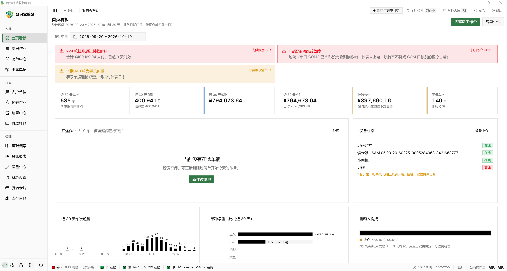
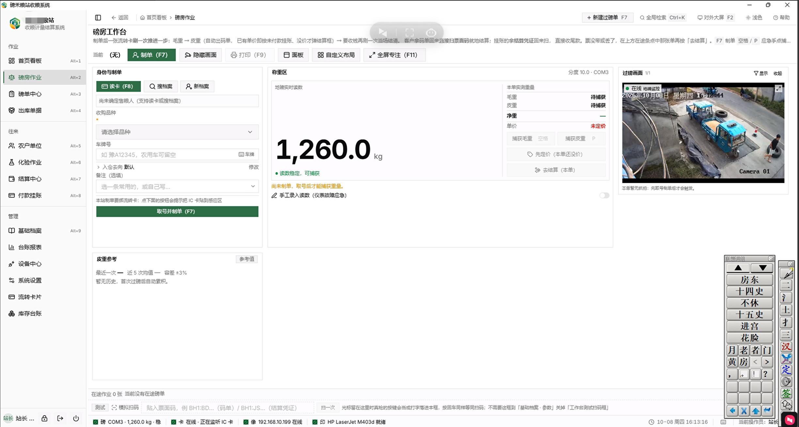
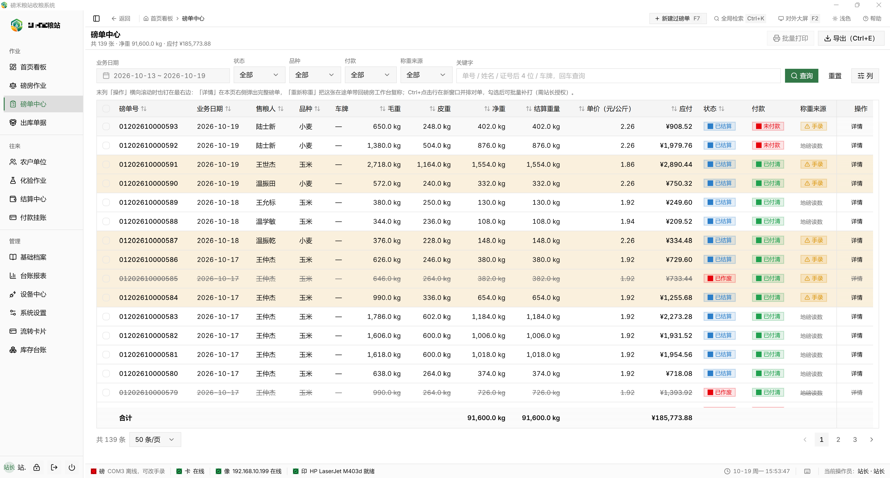
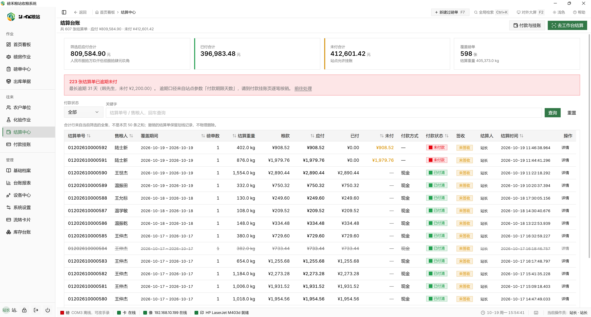
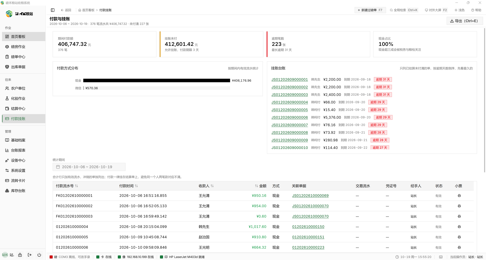
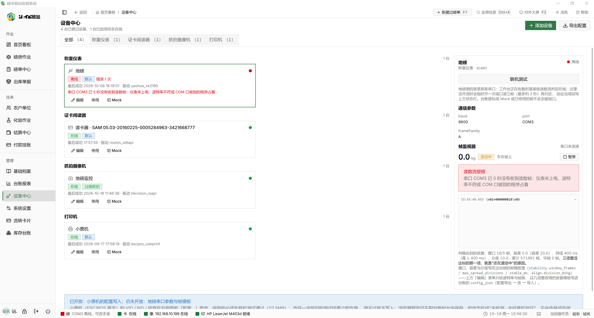
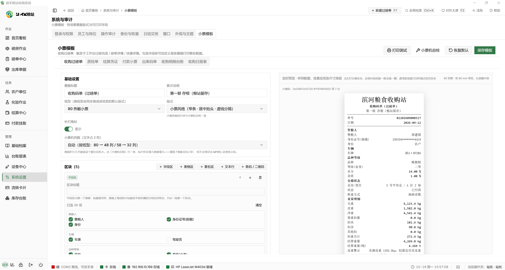

  
  <h1>磅禾粮站收粮系统</h1>
  
会电脑就能5分钟完成部署上线。

  
单机离线的粮站收粮过磅管理系统：制单、称重、化验、计价结算、付款、台账报表与小票打印，一台 Windows 电脑全程离线可用。

## 界面预览

<table>
  <tr>
    <td width="50%"> <b>首页看板</b>：近 30 天车次、净重、粮款趋势与待办预警。</td>
    <td width="50%"> <b>磅房作业</b>：现场制单、读取地磅称重数据、抓拍车辆照片、打印收购小票。</td>
  </tr>
  <tr>
    <td> <b>磅单中心</b>：过磅记录管理，含毛重、皮重、净重、单价与结算状态。</td>
    <td> <b>结算台账</b>：结算单应付、已付、未付金额汇总与逾期提醒。</td>
  </tr>
  <tr>
    <td> <b>付款与挂账</b>：期间付款额、挂账未付台账与逾期统计。</td>
    <td> <b>设备中心</b>：地磅仪表、读卡器、摄像机、打印机等连接状态与参数配置。</td>
  </tr>
  <tr>
    <td> <b>小票模板</b>：自定义收购小票打印模板，右侧实时预览样张。</td>
    <td></td>
  </tr>
</table>

## 已支持设备

按设备类型分类。所有设备均可在「设备中心」登记、启用 / 停用，并随时在真实设备与 Mock 模拟之间切换——**没有硬件也能跑通全流程**。

| 设备类型 | 已支持型号 / 协议 | 接入方式 | 说明 |
| --- | --- | --- | --- |
| 称重仪表（地磅） | 耀华 XK3190 系列（内置帧模板，现场实机验证）；托利多等其它仪表（走通用可配置帧模板） | RS-232 串口（本机 COM 自动扫描），波特率 9600 / 4800 / 2400 / 19200 / 38400，帧族 A / B | 连续帧解析 + 异或校验 + 判稳；实时读数流与原始帧监视器，现场排障不用接串口工具 |
| 证卡阅读器 | 精伦 Routon（Sdtapi 直调，64 位进程内） | 免驱 USB-HID | 一台机、双介质：身份证芯片（可同时取照片，界面脱敏显示）+ IC / Mifare 卡（只读卡号，不写块） |
| 抓拍摄像机 | 海康威视 ISAPI 网络摄像机；大华 CGI 网络摄像机；本机 USB / 内置摄像头（UVC） | 内网 HTTP 抓图 + RTSP 实时预览；本机走 Media Foundation 枚举 | 海康支持「自动检测参数」回填端口 / 路径 / 认证；一次过磅最多 3 台相机各拍一张 |
| 打印机（小票 / 单据） | ESC/POS 热敏小票机（80 / 58mm）；241 针式连续纸（ESC/P）；A4 激光 | USB 直连（usbprint.sys，按 VID/PID 寻址）+ Windows 打印队列 | 现场实机验证斯普瑞特 SPRT 80mm（ESC/POS Font A 一行 48 列不折行）；支持窗口预览 / 静默直打 / RAW 直连三种通道 |

> 暂未开放驱动的设备类型：串口扫码枪（已整条退役）、户外显示屏、钱箱、电子签名板——台账枚举值仍保留，但当前不提供登记与联机探测。

## 源码

Github ：<https://github.com/datawalkcloud/BangHe> 
Gitee ：<https://gitee.com/datawalkcloud/BangHe>

## 下载

Windows 64 位安装包，公网可直接下载：

- **国内高速（推荐）**：<https://gitee.com/datawalkcloud/banghe-release/raw/master/banghe-latest-windows-x64-setup.exe>
- **GitHub 备用**：<https://github.com/datawalkcloud/BangHe/releases/latest>

> `banghe-latest-windows-x64-setup.exe` 是稳定文件名，始终指向最新版（由 CI 每次发版同步到公开 Gitee 仓 `banghe-release`）。安装包与在线更新清单直接挂在本仓的 GitHub Release。

## 开源协议
**使用本软件或源码，表示同意以下协议。** 

本项目采用 [GNU Affero General Public License v3.0](https://www.gnu.org/licenses/agpl-3.0.html)（AGPL-3.0）开源，许可证正文见仓库根目录 [LICENSE](LICENSE)。

- 免费下载、安装、永久使用、可商用：不收任何费用。
- 可阅读、修改源码，并继续分发原版或修改后的版本（含企业内部自用的改造）。
- **Copyleft 义务**：一旦对外分发本项目或其修改版——包括以网络服务（SaaS）形式对外提供——整个衍生作品必须以 AGPL-3.0 同等条款开源并随附源码（获取作者书面授权的，则按照授权协议约定为准。）。
- 「磅禾 / BANGHE」的商标与产品名称不在授权范围内，不得为衍生版本背书。

# 交流咨询

交流 QQ 群：**1121300135**
