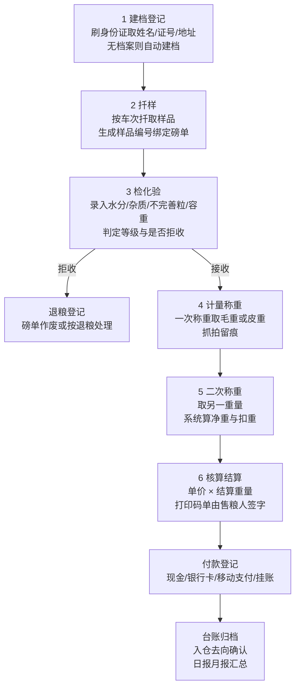

# 01 业务调研与流程分析

本文是粮站收粮管理系统的需求基线。所有功能模块划分（见 [02-功能模块规划](./02-功能模块规划.md)）与数据模型（见 [03-技术架构与数据模型](./03-技术架构与数据模型.md)）均以本文的业务事实为出发点。

---

## 1 调研来源

| 编号 | 来源 | 用途 |
| --- | --- | --- |
| R1 | LS/T 1804-2016《粮食出入库业务信息系统技术规范》 | 行业标准模块划分：出入库登记、扦样管理、检化验管理、计量管理、值仓管理、结算管理、统计分析；定义了"地磅称重控制器"等概念 |
| R2 | 国家发展和改革委员会、国家粮食和物资储备局、财政部、国家市场监督管理总局《关于执行粮食质量国家标准有关问题的规定》 | 稻谷 GB 1350、小麦 GB 1351、玉米 GB 1353、大豆 GB 1352 的增扣量计算口径（本次暂不实现规则引擎，但需预留） |
| R3 | 《粮食质量国家标准》中等级指标 | 定等指标（容重/出米率等）与增扣量指标（水分/杂质/不完善粒）的区分 |
| R4 | 地方粮食购销监管信息化案例（江苏扬州仪征、浙江海盐、河南南阳） | 监管硬性要求：全程留痕、可追溯可倒查、自动读取地磅毛皮重、打印一式五份收购码单由售粮农民签字确认、粮款 72 小时内支付预警 |
| R5 | 在售收粮系统公开功能描述（粮账通、丰收云、金丰粮 E 购、邮政智能收粮） | 个体收粮点/乡镇粮站的实际功能边界与高频痛点 |
| R6 | 粮食收购标准流程文档（IC 卡 + 内部流转单模式） | 六环节流转与卡单传递方式，作为流程建模参考 |

结论：本系统的功能骨架与 R1 的行业标准模块划分保持一致，以满足未来申报监管对接时的概念对齐；同时按 R4/R5 补足单机粮站在实务上必须留痕的环节。

---

## 2 业务对象与角色岗位

### 2.1 组织与站点

一个**粮站**（收购站点）在本系统中对应一套独立部署与一个本地数据库。站点下辖若干**磅点**（地磅）、**化验室**、**仓房/货位**、**结算窗口**。首版按单站点、单磅点设计，但数据模型保留 `station_code` 与 `device` 归属字段，以便后续扩展多磅点而不改表。

### 2.2 岗位与职责

| 岗位 | 核心职责 | 关键操作权限 | 首版必需 |
| --- | --- | --- | --- |
| 站长（管理员） | 站点参数、价格牌、人员、补打授权、报表审阅 | 全部；独占补打授权、参数配置（作废自 2026-10-09 起不再走站长授权，磅员填明事由即可，见 02 §F2.3） | 是 |
| 登记员 | 售粮人建档、发卡/取号、录入车辆与品种 | 建档、制单 | 可由磅员兼任 |
| 磅员（检斤员） | 一次/二次称重、留痕抓拍、打印磅单与内部流转单 | 称重采集、打印、复称 | 是 |
| 化验员 | 扦样、水分杂质等指标检测与录入、等级与是否拒收判定 | 化验录入、质检单打印 | 是 |
| 保管员（值仓） | 确认入仓去向、仓房与货位指定；**出库单经办**（制单、完成出库、作废/红冲） | 指定仓房货位、出库过账 | 去向首版选填、多数站点不登记，需要时由磅员制单顺手带过；出库现场也常由磅员/登记员代做，故过账岗取并集、更正类（作废/红冲）收到站长与值仓 |
| 结算员／出纳 | 单价确认、合并结算、付款登记、凭证打印 | 结算、付款登记 | 是 |
| 查询／审计 | 外部检查人员或老板，只读与导出 | 查询、导出 | 是（只读角色） |

### 2.3 售粮人（往来单位）分类

| 类型 | 特征 | 档案要求 | 结算差异 |
| --- | --- | --- | --- |
| 农户 | 零星、季节集中、多为现金或银行卡 | 实名 + 身份证号必录（监管要求） | 单车次结算、当场付款 |
| 种植大户／家庭农场 | 单次多车次、总量大 | 实名 + 可挂多辆车 | 常按日/按周合并结算 |
| 粮食经纪人（粮贩） | 高频、多车次、多农户拼车 | 需记录代售农户清单（迎检重点） | 常挂账、集中对公付款 |
| 合作社／企业 | 对公结算、需发票与合同 | 需统一社会信用代码 | 转账、账期 |

首版把以上四类统一抽象为 `party`（往来单位/售粮人），以 `party_type` 区分，不为某类单独建表。

---

## 3 标准收粮流程（六环节）

### 3.1 主流程

### 3.2 各环节的作业细节与规则

#### 环节 1 建档登记

- 输入：售粮人身份证（阅读器）、或手工录入姓名 + 身份证号 + 电话 + 地址；车辆号牌；品种；预估车数
- 规则：
  - 身份证号做**唯一性归并**——同一证号多次售粮必须复用同一档案，不产生重复档案；这是监管核查"是否重复报账"的关键
  - 身份证号做格式与校验位验证（18 位，末位校验码按 GB 11643 算法）
  - 读卡可得照片，作为附件留存（PII，需加密与访问审计）
- 输出：磅单号（取号即定，号不可回收）、售粮人档案引用

#### 环节 2 扦样

- 输入：样品编号（可与磅单号同源）、扦样位置/深度（首版不强制）
- 规则：一车次一样品；样品与磅单一对一；复检生成新化验单并标记 `is_recheck`，原化验单不覆盖
- 输出：待化验任务

#### 环节 3 检化验

- 输入指标（首版全部支持人工录入，可按品种配置启用项）：

| 指标 | 单位 | 常见标准值（三等/入库基准） | 说明 |
| --- | --- | --- | --- |
| 水分 | % | 小麦 ≤12.5；稻谷 ≤13.5（籼）/14.5（粳）；玉米 ≤14.0 | 最高频争议项 |
| 杂质 | % | ≤1.0 | 含矿物质时需单独扣 |
| 不完善粒 | % | 小麦 ≤8.0；玉米 ≤5.0 起 | 扣量项 |
| 容重 | g/L | 小麦 ≥750（三等）；玉米 ≥685（二等）/660（三等） | 定等指标 |
| 出米率／整精米率 | % | 稻谷定等指标 | 稻谷品种专用 |
| 霉变粒 | % | ≤2.0，≥4.0 常作拒收红线 | 食品安全项 |
| 黄粒米 | % | 玉米 ≤2.0 限量 | 食品安全项 |
| 气味／口味 | 判定 | 正常／异味（异常即不得收购） | 强制项 |
| 面筋/降落数值/品尝评分 | 选录 | 小麦品质指标 | 部分站点需要 |

- 规则：
  - **本次明确不实现自动增扣量与自动定等**（见 R2 公式）。首版做法：化验员录入指标值后，人工判定等级、人工填写"扣水公斤数""扣杂公斤数"或直接填写"结算重量"
  - 但数据模型必须把每一项指标值与判定结果分开存储（`qc_report` + `qc_indicator`），并且磅单上的扣重项必须可追溯到某一张化验单，否则未来上规则引擎时无法回填验证
  - 拒收：磅单转退粮流程，仍需称重（空车返回也要过磅）
- 输出：质检单（可打印，化验员签字）

#### 环节 4 / 5 计量称重

- 汽车衡常见规格 60 t / 80 t，**分度值 e 通常为 10 kg 或 20 kg**，即读数本身就是粗颗粒的
- 输入：仪表实时读数（或手录兜底）、车辆上磅抓拍图
- 规则：
  - 一次称重与二次称重顺序不固定，**必须支持先毛后皮与先皮后毛两种流向**（实践中返空车过磅、连续装车两种习惯都存在）
  - 净重 = |毛重 − 皮重|
  - 同一磅单同一方向允许多次复称，全部重量轨迹保留在 `weigh_record`，取用哪一次由磅员指定并记原因，**不覆盖原值**
  - 皮重异常校验：与该售粮人/该车辆的历史皮重比较，偏差超阈值（默认 ±3%）时**不阻断**——数据照常有效、捕获完成，只在磅单上醒目警示（屏显醒目条、时间轴、票面「皮重警示」栏、审计）并留痕，供事后核对与红冲更正
  - 重量读数取整：按仪表分度值对齐取整，取整规则（截断/四舍五入/就近）随**这台磅的帧模板 `align` 段**走（04 §2.3）——分度值是设备属性，1 号磅 10 kg、2 号磅 20 kg 是合法现场，一枚全局参数表达不了。取整结果与原值一起留在 `weigh_record`，单头与结算金额照旧按原始捕获值算
  - 包装物（袋、筐）扣重单独录入，不与水分杂质扣量混项
- 输出：毛重、皮重、净重、包装扣重、扣量总重、结算重量

#### 环节 6 核算结算

- 输入：结算单价（首版人工录入或从手工价目表带出）、包装物扣款、其他扣款（如烘干费、过筛整理费）、代垫费用
- 规则：
  - 结算金额 = 结算重量 × 单价，四舍五入到分；**中间过程不使用浮点**（详见 03 文档精度约定）
  - 同一售粮人多车次可**合并生成一张结算单**，结算单与磅单为多对多
  - 打印一式多份收购码单，售粮人签字确认后归档（R4 监管硬性要求）
  - 签字留痕用"纸质签字 + 拍照附件"；手写签名板已在 2026-09-13 确认站点不装（见 04 §5.4）
  - 粮款支付时效预警：结算完成后 N 小时未登记付款即提醒（R4 要求 72 小时，做成参数）
- 输出：结算单、付款流水、凭证

### 3.3 异常与例外分支

必须支持的异常场景，缺一不可，否则现场无法使用：

| 编号 | 场景 | 处理要求 |
| --- | --- | --- |
| E1 | 车辆上磅未按规范停车/有人下车未上磅 | 复称，保留两次轨迹与抓拍 |
| E2 | 皮重与历史偏差过大 | 照常捕获（数据有效），自动在磅单记警示并留审计，供事后核对/红冲；不阻断、不要求授权 |
| E3 | 化验后决定退粮 | 磅单走退粮：按空车返回称重，只出不进，金额为零并记录原因 |
| E4 | 磅单要作废（任何状态，含已结算与已付清） | 填原因（≥6 字）即可，不需授权；状态置 `voided`、永不物理删除、记录已打印联数。**作废一张已结算的单同事务撤销它的结算单**，付款流水原样保留（02 §F2.3、03 §4.3 不变式 8） |
| E5 | 已结算后发现重量/单价错误 | 红冲：生成一张与原单数量相反的负向新单并关联原单，重新开正确单（**本版未实现**，现场走 E4 作废 + 另开一张重结，见 02 §F2.4） |
| E6 | 断网 | 无影响（单机本地库） |
| E7 | 突然断电 | 重启后未完成的磅单在"进行中作业"列表中恢复，重量与化验数据不丢 |
| E8 | 仪表通讯中断/读数持续抖动 | 明确提示故障，允许切换到"手工录入"模式并标记该单为手录（监管倒查时可见） |
| E9 | 同一辆车同一日内多次售粮 | 允许多磅单；合并结算时按证号与日期归组 |
| E10 | 打印机卡纸/缺纸 | 打印失败必须回写 `print_log` 为失败，允许补打并标记"补打"字样 |
| E11 | 身份证阅读器无设备/司机不带证 | 允许手工录入证号并校验格式，档案标记"未读卡核验" |
| E12 | 代售（经纪人替多个农户交粮） | 磅单记经纪人，另存代售农户明细清单（P1，监管核查重点） |

---

## 4 行业痛点与系统的对应解法

| 痛点（源自 R4/R5） | 系统解法 | 对应模块 |
| --- | --- | --- |
| 手工记账易错、克斤扣两纠纷多发 | 仪表读数由程序采集，不让键盘参与；净重与金额由系统算 | M1/M9 |
| 高峰排队、单车作业耗时长 | 磅房工作台单屏一次完成、键盘优先、读卡自动带档、重量自动捕获 | M1/M3 |
| 农户与磅房对扣量结果各执一词 | 指标值、等级、扣重、单价、签字在同一张码单上并列呈现，且抓拍图与单据绑定 | M4/M8 |
| 粮款兑付滞后、现金压力大 | 结算单与付款流水分离，未付形成挂账清单并时效预警 | M5 |
| 监管抽查时台账临时拼表 | 台账按监管字段固定模板，一键导出 xlsx + 纸质打印，数据可留存 3 年以上 | M7 |
| 老板不在现场不了解收购进度 | 日报/月报/品种汇总，异地可查（P2 云同步，首版不做） | M7 |
| 员工误操作或舞弊难追溯 | 全量操作审计 + 作废/补打/授权留痕 + 重量轨迹不覆盖 | M10（P1） |

---

## 5 合规要求清单（首版必须满足）

1. **可追溯可倒查**：任一张磅单能从登记 → 化验 → 两次称重 → 结算 → 付款 → 打印全链路回溯到具体操作员与时间
2. **不删改留痕**：单据不做物理删除；作废与复称均记录原因与经办人（不走授权，作废自 2026-10-09 起任何状态可执行），红冲、补打记录原因与授权人，皮重偏差超容差自动记警示（无需授权）
3. **实名与身份核验**：售粮人身份证号必存；读卡核验与手工录入需区分标记
4. **影像留存**：过磅抓拍与单据绑定，保存期不低于台账保存期
5. **签字确认**：码单可由售粮人签字（首版纸质签字 + 拍照归档）
6. **台账可导出**：按时间段/农户/品种筛选导出，字段覆盖监管台账总览要求
7. **数据留存 ≥ 3 年**：本地库 + 附件目录 + 自动备份与手动导出
8. **个人信息保护**：身份证号、照片属敏感个人信息，本地加密存储，访问写审计，不向外部服务上传（本系统全程离线，无云端上传）

---

## 6 首版范围边界（明确不做什么）

| 不做项 | 原因 | 预留方式 |
| --- | --- | --- |
| 水分杂质自动增扣量、自动定等、等级加减价 | 本次决策明确暂缓；各企业口径差异大（R2 国标口径 vs 企业口径如"1:1.2 扣量、杂质超 7% 拒收"） | `PricingEngine` trait + `ManualPricing` 实现；`qc_indicator` 逐项存值；`weigh_order` 预留 `price_plan_id`、`deduction_detail_json` 字段不启用 |
| 库存与仓储管理里的**转仓、粮情（温湿度/虫情）、损耗核算、检斤与仓储对账** | 首版范围为收粮闭环。**出仓与结存不属于本表**：已于 M11 首批落地（02 §12.1），不再是不做项 | 出库单 `outbound_order`（03 §9.28）＋ `stock_movement` 两条腿真写入（0020/0021），结存按 仓房 × 品种；转仓/损耗仍只留 `kind` 值域、不给录入口 |
| 财务核算深化（成本、毛利、往来对账、发票） | 需要财务口径确认 | 付款流水已落库，可支撑后续核算 |
| 多站点/集团汇总与云端同步 | 已选单机桌面版 | 所有表带 `station_code`；单据编号含站点码 |
| 省级监管平台上报接口 | 需平台文档与账号 | 台账导出模板按监管字段设计，先满足人工报送 |
| 农户端小程序、预约售粮、排队叫号、IC 卡 | 首版收敛 | 磅单预留 `queue_no`、`card_no` 字段 |
| 明渠/地中衡、汽车衡以外的体积计量（入仓体积称重） | 场景不通用 | 不做 |

---

## 7 需求度量（用于容量与性能设计）

按典型乡镇粮站保守估计，若现场数据与下列偏离需调整索引与归档策略：

| 指标 | 估计值 | 影响 |
| --- | --- | --- |
| 收购旺季日车次 | 80–200 车 | 单车次作业目标 ≤ 3 分钟 |
| 年磅单增量 | 3–5 万单 | 5 年 25 万单，查询必须走索引 + 分页 |
| 每磅单附件（抓拍） | 2–4 张，单张 200–500 KB | 年附件约 20–40 GB，需目录分片与清理策略 |
| 重量刷新频率 | 仪表 5–10 帧/秒 | 前端事件节流，只推稳定值与状态变化 |
| 在岗终端 | 1 台（磅房） | 无并发写冲突，事务可串行化 |

---

## 8 待现场确认清单

以下问题无法通过公开资料自决，需粮站现场或设备采购方回答。文档其余部分已按"可先设计、后按答案微调"的原则处理，不会因这些问题未答而阻塞开发，但答错了会导致返工。

| 编号 | 问题 | 未答时的默认假设 |
| --- | --- | --- |
| Q1 | 收购品种范围（玉米/小麦/稻谷/大豆，是否含油料杂粮） | 四类主粮 + 可自定义新增品种 |
| Q2 | 日均与峰值车次、年磅单增量 | 按第 7 节估计值 |
| Q3 | 磅单联数（一式三份/五份）与纸型（A4 激光 / 241-3 针式连续纸 / 58 mm 热敏） | 同时提供 A4 与针式两套模板，默认 A4 |
| Q4 | 地磅称重仪表品牌型号与接口（RS232 串口 / TCP 网口 / 协议模式） | 先实现耀华 XK3190 连续发送 + 托利多帧，配 Mock |
| Q5 | 是否有独立第二台磅（小磅/皮重磅） | 按单磅设计，字段支持多设备 |
| Q6 | 证卡阅读器品牌型号（华视/新中新/神盾申/中科/国腾/精伦） | **已答复**：现场为精伦 Routon iDR，带 x64 `Sdtapi.dll`，进程内直调 + 免驱 HID（04 §3.2）；仅当后续换到只有 32 位 SDK 的机型时，才回退 04 §3.6 存档的桥接方案 |
| Q7 | 摄像头品牌、是否已有局域网 IP、是否走 NVR | 按海康/大华 HTTP 抓图设计 |
| Q8 | 是否需要农户手写签名板留痕 | **已答复**：2026-09-13 现场确认站点不装签名板，留痕只做纸质签字 + 拍照附件（04 §5.4） |
| Q9 | 支付渠道构成、是否涉及银行代发或聚合支付 | 只登记付款事实与流水号，不接支付通道 |
| Q10 | 是否需向省级监管平台/中储粮系统上报，是否关联农户补贴 | 只导出标准台账 |
| Q11 | 期初建账与历史单据是否迁移 | 提供农户档案 Excel 导入，不迁移历史单据 |
| Q12 | 化验是否使用近红外快速检测仪需串口取数 | 人工录入指标 |
| Q13 | 是否需预约售粮/排队叫号/IC 卡流转单模式 | 不做，字段预留 |
| Q14 | 站点名称、税号、结算章样式、码单抬头文案 | 全部做成可配参数 |

回答方式建议：直接在 `docs/design/` 下新建 `06-需求确认答复.md` 逐条回答，本文的默认假设随之作废。
