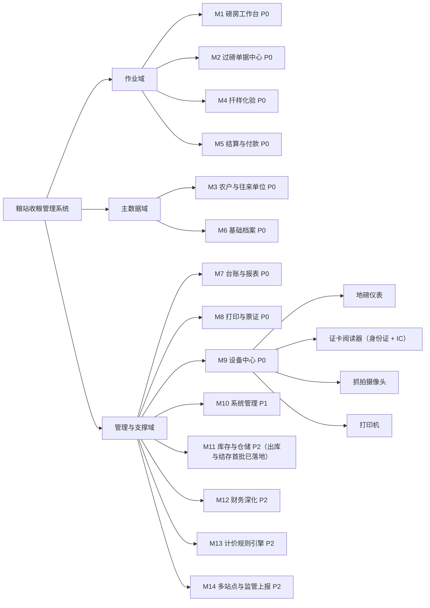
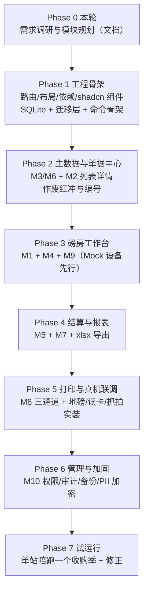

# 02 功能模块规划

依据 [01-业务调研与流程分析](./01-业务调研与流程分析.md) 的六环节流程与合规清单，本文给出模块树、逐项功能规格、分期路线图与非功能需求。

优先级定义：

- **P0** 首版必做，缺一项则粮站无法完成收粮或无法通过监管抽查
- **P1** 首版收尾或小步迭代（1–2 周内可追加），显著影响安全与体验
- **P2** 后续独立期，架构上预留但不实现

每项功能规格统一按 **输入 / 处理规则 / 输出 / 验收口径** 四要素描述，可直接转为开发任务与测试用例。

---

## 1 模块树

依赖关系：M1 是 M2/M4/M5 的作业入口，M9 为 M1 提供设备能力抽象，M6 为全部业务模块提供主数据。M13（计价引擎）以 `PricingEngine` trait 的形式被 M5 调用，首版注入 `ManualPricing` 实现。

---

## 2 M1 磅房工作台（P0）

一屏完成一个车次的全部作业，是系统的使用主界面。设计目标是**单车次作业时间 ≤ 3 分钟**，键盘可完成全流程。

### F1.1 制单与售粮人识别

- **输入**：IC 流转卡卡号（06 §4.0）；身份证阅读器取卡数据（**由系统自动监听取回，不要人点按键**）；车辆号牌；仓房货位（选填，多数站点不登记）。**收购品种是必填项**（2026-09-14 起，`orders.rs::create_order` 硬拦）：它是这一单往后一切的锚——结算的单价要对回价目表、化验的指标集与扣量基准全来自品种档案，空着取号等于把两件事都往后拖到卸完货才发现。下拉默认沿用上一张单的品种（磅房最省手），改判入口结算框与化验区各有一个（`order_set_variety`，两处仍是**硬闸门**：没定品种不许录化验、不许结算）
- **处理规则**：
  - **两刷一条流**：IC 卡就位（后台常听刷到空闲在册卡，或磅员点「取卡并制单」后贴卡）而售粮人还没定 → 「身份与制单」格子里**行内**起一轮 15 秒身份证监听（不弹框：一行脉冲动画 + 倒计时 + 「取消」，口径见 05 §4.0），读到证卡即自动取号制单；品种已按上一张单带出时**全程零按键**，当天第一单（还没有"上一张"）则要先在下拉里点一下品种再按主按钮——品种是出号的硬条件，本节输入那一段有理由。按「取消」或 15 秒听不到 → 回到 IC 卡常听，等下一张卡
  - 读卡成功 → 按身份证号查 `party`：**命中即复用档案**（档案停用另判，只挡新单；这张档案若还缺人像，顺手当场补一张，补不上也不挡取号制单，见 F3.1）并连同卡号自动制单
  - **未命中即静默自动建档**：农户一手拿证一手拿卡站在窗口前，再让磅员补一个电话号码等于把这台机器退回手工。姓名 / 证号 / 住址 / 人像全部由读卡带入（`party_photo_set`，见 F3.1），身份类型按自然人默认农户，证号标「已核验」，**电话留空**——它不挡制单，磅员回头问一句就能在身份卡那一格当场补上（`party_phone_set`，见 F3.1），不必再跑去「农户与单位」翻这张档案。建档走的还是同一条 `party_save`，一人一档的服务端闸门照旧生效
  - **同名且证号为空才问人**：读进来的证号没建档，但档案里躺着同名、`id_card_no` 为空、状态启用的旧档（早年手工录入没证号的那些）→ 弹「是否是同一人」：是本人就给那份旧档**补录身份证**（它的历史磅单、挂账余额、参考皮重全部沿用），都不是就新建一张。除这一种情形外不再有第二次询问——认错人等于把两个农户的挂账合成一个余额，这一问省不掉
  - 只有**自动建档失败**（该岗位无建档权限、库锁）才回落到「无档案 · 快捷登记」框手工补录，保存后同样直接选为本单售粮人；读卡读不出、或外设总开关关掉时，制单框内的「新档案」按钮打开同一张表单（证号手录 → 未核验），全程不离开制单
  - 手工录入 → 校验 18 位证号与 GB 11643 校验位，档案标记"未读卡核验"
  - **核验标记（`party.id_card_verified`）跟着证号来源走**：读卡带入即已核验，手工录入为未核验，口径见 F3.1
  - 取号：调 `seq_counter` 生成磅单号，状态 `registered`；被服务端拦下（卡已被占、闸门不过）时**这张卡就地作废**，回到刷下一张卡，不让人原地重试同一张
  - **读卡器坏了、卡池见底时不让队伍停在这里**（06 §4.0）：主按钮左边那颗**「无卡制单」**是单笔退路——不弹绑卡框直接出号，`card_no` 留空，`order.create` 那行审计末尾写明「无卡制单，待补绑流转卡」（光看 `card_no IS NULL` 分不出"当时就没绑"与"绑过又退卡"）。它**只**放开"必须刷到卡"这一道闸：品种必填、售粮人必须先定（这一路没有卡，那条挂在"卡已就位"上的 15 秒自动认人不生效），卡真带过来了在册/未注销/没挂着未完成单三道照旧拦在取号之前，不吃流水号、不留半张单。卡事后补：磅单详情那颗**「补绑流转卡」**（`card_issue` 显式带单号，与现场发卡同一套闸），或什么都不点、把空闲卡放上感应区由后台监听按"没有卡的在途单"认走。这颗按钮只在本站强制绑卡而此刻手上没卡时出现；独立权限闸门本轮不做（06 §9），只吃 `order.create` 那道岗位闸
  - 同一证号存在未完成任务时提示"该农户有 N 张在途单"，可一键切换
  - 仓房/货位（去向）留空不挡取号；粮真进了仓由值仓在**磅单详情**补录或改派，署名写 `keeper_id`、变更写 `order.destination` 审计（作废/拒收单不再接受登记）
- **输出**：一张状态为 `registered` 的磅单，进入作业区
- **验收口径**：IC 卡就位后放下身份证 → **0 次按键**出单号（品种沿用上一张单时；当天第一单品种还空着，要先点一下品种，见上一条）；无档案时不出现任何手工输入（只在"同名且证号为空"那一格问一次人）；断网（本无网络）与设备离线不阻断制单

### F1.2 实时重量采集与称重

- **输入**：地磅仪表读数流（经 M9）；抓拍触发；手录兜底
- **处理规则**：
  - 大屏显示当前毛重读数（整数公斤，字号 ≥ 96 px），并显示"读数稳定/不稳定"状态
  - 判稳（连续 N 帧波动 < 阈值且 > 起称值）后按 `空格` 或点击"捕获" → 按分度值取整 → 写入 `weigh_record`，类型为 `gross` 或 `tare`
  - 一次/二次称重顺序自由：先捕哪个都可，两个都到齐才计算净重
  - 复称：同一类型可再次捕获，须选为"采用值"并填原因，原值保留
  - 皮重异常：与该车辆/该农户历史皮重均值比较，超 ±3% **不阻断**——照常捕获（数据有效），服务端复算后自动在磅单记一条警示并写审计（屏显醒目条、时间轴、票面「皮重警示」栏），供事后核对与红冲；不再要求站长授权
  - 设备故障时切手录：`weigh_record.source = manual` 持久标记，列表与打印均可见"手录"。**手录与刷卡同权，且手录的入口就是称重区「毛重 / 皮重」那一格本身**（2026-09-14 明文化、2026-10-09 改形：撤掉那块「手工录入读数」开关与它下面两个框）：没捕过的格子直接是录入框，已捕到地磅读数的退回只读、点数值右边「修改」才进编辑态；主按钮与空格 / P 跟着这一格走——格子里有数就提交那个数，格子空着且仪表离线也走手录（空值提示并把光标送进那一格，成功即退回只读、换单即清空整组），落库后与刷卡走**同一个出口**（出码单 → 自动挂账 / 弹结算框），不是"降级成只能记个数"
- **输出**：毛重、皮重、净重、结算重量预览
- **验收口径**：上磅到读数定格 ≤ 1 s；捕获后重量在 UI 与库中一致；手录单可被检索出来供复查；皮重偏差超容差时照常入账并在磅单留下醒目警示与审计

### F1.3 化验指标录入

- **输入**：按品种启用的指标项数值；等级判定；扣重项（扣水公斤数、扣杂公斤数、其他扣重）；拒收标记
- **处理规则**：指标值逐项存 `qc_indicator`（不合并成文本）；扣重之和不得超过净重；拒收时引导走退粮流程
- **输出**：一张质检单，磅单状态推进到 `qc_done`
- **验收口径**：修改任一指标后磅单上的扣重与结算重量即时重算；复检生成新单且与首检并列可查

### F1.4 结算与打印（两个独立环节）

现场常态是**先过磅、先打码单把票给客户，钱当时不算**：农户一天跑两三趟、或把几趟的票攒到周末一起算。
所以这两件事是两个独立环节，不是一个动作的两步——磅房只管定价与出票，钱在结算窗口算。

**但"价"不是结算的产物，是成交的前提**（2026-09-14 修订）：农户到站先问价、谈成才卸货，
事后票上若一处价都没有，扯起皮来只能各说各话。所以价必须在**票打出来之前**就落到单上：
制单那一刻按价目表带一次挂牌价，之后化验定级、现场议价各是一次显式改价（见下）。

**定价 / 改价（`order_set_price`）**

- **输入**：磅单号、单价（分/吨）、改价事由
- **权限**：`price.override` = 验磅员 + 站长（与"改单价"同一个动作词；磅员有定价权是因为"谈价"发生在卸货之前，而挂账/收钱那两把钥匙仍不在他手里）
- **处理规则**：
  - **制单即带挂牌价**：`create_order` 按"品种 + 当日"查价目表现行价，写进 `price_fen_per_ton` / `price_list_id`，审计留一句「挂牌价」或「品种无现行价目，待定价」
  - 偏离现行价目（或该品种根本没有现行价目）＝一次真实议价 → **可写改价事由留痕（选填，2026-09-14 起改口径）**：写了才落 `price_override_reason`，不写也照常落价、那一列留 NULL；照价目执行的记回 `price_list_id`、清空事由
  - 闸门沿 `PRE_SETTLE`（未结算的那 7 个在途态）：已结算 / 已付款 / 已归档 / 已红冲的单不能再改价，要更正经站长走红冲（§F6.3）——票面已经把这个价印给客户了（`weigh_order.price_fen_per_ton` 只有 `settle` 与 `set_price` 两处会写）。**这道闸只管改价，不管作废**：作废任何状态都放行（§F2.3）
  - **捕毛重之前本单必须有价**（2026-09-14 起）：毛重是"这车粮上磅"的那一刻，谈成才卸货，所以这一捕之前单上必须已经有单价。没价就拦下这一捕，让磅员先在称重区把价填好（`PriceDialog`）再重新刷卡 / 录入——**拦下的是这一捕，不是这一单**：票、状态、轨迹一概不写。制单已带挂牌价之后，这道闸只对"该品种无现行价目且现场还没定过价"的单生效；**皮重那一捕不设这道闸**（空车多重与这车粮的价格无关），一次/二次称重顺序自由，先捕皮重后捕毛重的车毛重那一捕照样被拦下。硬闸在服务端 `orders.rs::capture`，前端 `src/lib/weigh-gate.ts`（手点 / 手录 / 刷卡三条入口共用）与 mock `api.capture` 同一条判定、**同一句文案**
  - 审计动作 `price.override`，与 M6 价目表维护的 `price.edit` 分开：一个改的是这一单的价，一个改的是表上的价
- **入口**：磅房称重区（本单单价那一行的正下方，排在「去结算」之前）、磅单详情基本信息卡「定价 / 改价」，共用同一个 `PriceDialog`
- **输出**：磅单单价更新 + 审计留痕（前后值 + 事由）
- **验收口径**：票面单价与 `weigh_order.price_fen_per_ton` 逐字一致；**毛重之前本单必有价**（服务端拒得掉一次没价的毛重捕获）；偏离价目表的每一单都能在审计里查到"凭什么"

**打印（工作台 F9 / 顶部按钮 / 第三刷结算弹窗「凭票打印」）**

- **输入**：已完成称重的磅单（净重确定）
- **处理规则**：打印收购码单，票面带**凭票二维码**，码下方默认留一行可读内容（＝码的载荷原文）兜底；打印与否不改变单据状态
- 票面印**单价 + 预估金额**（`settlePreview`：单价取本单现值，各项扣重取**磅单**现值、化验建议兜底），**每一处预估都带「（预估）」字样**；未结算的单票面金额一律是预估，以结算框确认的为准
- 「打过几张」只以 `print_log` 里成功的记录为准，不用前端临时状态：看了一眼预览又取消不算打过

**结算（磅房工作台结算框，一码一单）**

- **输入**：扫票面二维码取单（票没带或丢了：工作台顶部在途条点中那张单，或在磅单详情按「带到工作台」；只认扫码与点选，不靠键盘手输单号）→ 结算单价；各项扣重与费用扣款；支付方式；是否当场付款；**当场实付金额**（默认＝应付全额，允许挂账的站点可改小＝部分付款）。扫进来的是**结算凭证**（挂账客户回头拿这张纸来付尾款）时开的不是结算框而是补付框，见下面「两种票两个框」
- **处理规则**：
  - 调 `PricingEngine`（首版 `ManualPricing`：单价与扣重全人工）算金额。**结算这一刻能不能改价：能改，事由选填**——结算价与价目表现行价不一致（或该品种无现行价目＝手工定价）就是一次真实议价，可以写明"按什么谈的"留痕，不写也放行（2026-09-14 起改口径，`orders.rs::settle` 不再是硬闸）。制单挂的牌价在窗口被改掉，票上那个数与账上这个数的差异，写了事由就靠它解释，没写就留给事后解释
  - 生成结算单 → 付款状态三档：**付清**（实付 ≥ 应付）同步写付款流水；**部分付款**只登记实付那一段，差额留在结算单上（`payment_status = partial`）；**挂账**（一分未付）不产生流水（`unpaid`）。后两档都进 `/payments` 挂账台账等核销（客户拿这张凭证回到磅房窗口扫一下即弹补付框当场收钱，台账那条路照旧在）；随后打印结算凭证（财务入账联）
  - 实付金额的两条硬边界（前端、mock、Rust 三层同口径短句）：必须 `> 0`（不收钱就改走挂账）、不得 `> 应付`（超付当场拦，与 F5.3 的"付款累计不得超过应付"同一条）；磅单 `paid_at` 只在**付清**时落，部分付款留空直到补录付清
  - **磅房那条路不必扫票**：净重刚定的那一捕之后，工作台自动接着把"结算"这一步走掉——磅单上**已有单价**（制单时的挂牌价，或磅员在现场改过的价）就直接按**未付款**落一张结算单（只落挂账：不挑付款方式、不碰现金、也不替人定价），没有单价（该品种无现行价目且没人定过）才弹结算框（默认未付款）等人落价。判定与那一组默认值只写一份（`src/lib/settle-defaults.ts`），手点捕获与刷卡捕获共用同一个出口；**单价缺失 / 岗位无权 / 站点关挂账**三种情况一律退回结算框由人确认。**出票与落账的先后**：自动结算成功后再出码单（票面印确定的金额）；自动结算没能落成，票也要照出——那时票面金额一律标「（预估）」
  - **称重区那个「去结算（本单）」给没卡的站点留门**：刷卡站点靠第③刷唤起结算框，可关掉流转卡（`card_flow_mode=off`）或读卡器坏了的磅房**没有第三刷可刷**——称重区在净重齐了之后把「去结算（本单）」点亮，点它走的是与第③刷、扫票**完全相同**的那条 `requestSettle`（定位 + 按单据状态分给结算框或补付框 + 默认当场付清），闸门与话术复用 `settle-gate.ts`。少了这个入口，过完磅就再没有走到钱那一步的门
  - **挂账与收钱是两把钥匙**：挂账结算多了 `settle.credit` 这一条（磅员、出纳、站长），当场付款仍只给站长与出纳（`pay.record`）。命令层按 `pay_now` 选角色集、不取并集（`orders.rs::order_settle`）——磅员那把钥匙开不了现金那扇门
  - **开框先要有"定位到哪张单"的动作**（现金客户也一样先扫一次）：扫票面码、刷第③卡，或工作台已经定位这张单时按称重区「去结算」——没有这一步就没有"哪张单、何时、被谁结算"的对应关系，事后对账只能靠人脑回忆。三条触发落的是同一条 `api.settle`，只把"从哪儿进来"搬到了磅员眼前
- **两种票两个框（结算 / 挂账补付）**：纸上流通的票里，能在窗口走钱的有两种，递上来的那张处在流程哪一步决定开哪个框——
  - **收购码单（BD）**＝钱还没算 → 结算框 `SettleForm`（`api.settle`）。库里不变式 6 拦重复结算，所以一张已结算的单**绝不再进这个框**
  - **那张单算过钱、钱没付完**（挂账或部分付款）→ 补付框（`PayDialog`，里面就是那份 `PayForm`；`api.recordPayment`）。这一框从前多一条入口：**扫结算凭证票面那枚"凭单码（挂账核销时扫）"**——本版把那个码连同这条入口一起撤了（见下方载荷契约），客户回头拿纸来时由出纳照票上那行**明文的结算单号**进框：工作台第③刷/扫票命中这张单时自动分过来、磅单详情那枚「付款」、或「结算台账」点开那张结算单。少的是"把纸递到枪底下"这一下，框、判据、流水、每次登记出一张新凭证都照旧
  - 分派收在工作台那一条 `requestSettle` 上（扫票面码 / 刷第③卡 / 称重区「去结算」三个入口共用）：**过磅那一捕如今默认就把单挂上账了**，所以"回来的单已经结过账、钱没付完"是常态而不是例外。少了这一步分派，第③刷会把人推进一个提交即被库里弹回来的结算框，现场只看得到"结算失败"。**磅单详情那颗「付款」不参与分派**：它只在"本单已结算 + 钱没付完 + 结算单还有余额"时才画出来，天生只有补付这一条出路，进框前照旧过同一份 `creditPayGate`——把"算钱"的口子开进一张迎检时翻出来看的单据，比多一个入口麻烦得多
  - 判据两份都在 `src/lib/settle-gate.ts`：`awaitingPayment(磅单)` 判"该补付"（只认 `settled_at` + `payment_status`），`creditPayGate(结算单, 有无 pay.record)` 判"能不能收这笔钱"（查无此单 / 已撤销 / 已付清 / 岗位不能收钱四条出路）。站点参数 `settlement_allow_part_pay` **不管补付**：它管"要不要让这一单带着欠款走"，而眼前这张单已经带着欠款回来了——关掉挂账的站点照样要清历史挂账
  - **补付的框体与表单各只有一份**（`src/components/settlement/PayDialog.tsx` + `PayForm.tsx`）：工作台那个补付框、**磅单详情「结算与付款」卡片底部那枚「付款」**、结算单详情右栏那张「登记付款」三处用的是同一份框体与表单——框上显示的应付/已付/尚欠，与表单里"金额不得超出未付余额"那道校验读的是同一个 `unpaidFen(结算单)`，两处各写一遍迟早一边显示尚欠 200、另一边按 300 拦人。表单侧的规矩不变：非现金必带交易流水号、每笔追加一条流水绝不覆盖已付数、付款方式不预选、每次成功都自动出一张结算凭证
  - **补付不受"已付清"以外的闸门影响**：`paid_fen` 只加不平，红冲走结算单撤销那条路（`settle.revoke`），不在这里顺手改数
- **一码一单，不做多单合并**：粮站的价按品种、等级、水分一单一议，攒成一篮摊一个价等于放弃逐单议价
- **凭票码载荷契约**：**码里就是单据号本体（§3.5 那一串），一位前缀都不加**，例 `01202610000053`——与票面那行「单号」逐字相同。单一来源 `src/lib/ticket-code.ts`。**磅房只认磅单码**：结算凭证那枚"凭单码"连同"扫凭证弹补付框"那条入口一起退役了（见上面「兑付那一步」）；出库单那张纸也带码，但它的消费口是值仓那一条，不是磅房窗口。
  **载荷里不许有字母**，这一条是现场两次事故换来的：票面码是键盘模拟扫码枪敲进来的，开着中文输入法时字母会落进拼音合成串、紧跟其后的数字被当成候选项序号键吞掉（`BH1:BD01202610000053` 扫进来变 `BH：BD1202610000053`，另一台只剩 `D01202610000069`，见 04 §5.6）。字母是这件事的必要条件——一串纯数字没有任何东西可以开始拼拼音。**票种位也不再要**：同一站点同一月里磅单与结算凭证各自从 1 号排起、必然出现同号（§3.5），从前靠载荷第 2 位分清"来结算的码单"与"来付尾款的凭证"；窗口这一侧只按磅单查：库里 `weigh_order` 有这一行才算一张磅单，查不到就说"查无此单"——**不在形状上赌，也就不需要前缀**。代价是"同号两可"这件事不能再靠码自己回答：出库单与磅单共用号形（同一个 `next_no`，票种键 CK / BD 各自从 1 排起），所以工作台在开框前加了一道**同号闸门**——这串号同时是出库单时当场说破、不开框（自检 F6/F7 把"带码的票"与"这道闸门"钉在一起）。而前缀的代价是实打实的：码与票面那行字不同值（磨花了照字敲就进不去），扫进任何检索框都得先剥掉它，"为什么扫出来比号多两位"每次装机都要从版本位讲一遍。
  码里**只装定位符**——金额是后算的，进码等于允许客户自己改价；证号进码等于把 PII 印在流通纸上。写的一侧永远只有本版这一条轨；将来真要换格式，只能**新增一条读轨**并永久兼容已有的，不许改已有轨的解析结果，否则发出去的旧票集体扫不出来。
  **两条旧轨永久只读**：① 上一版的数字载荷 = 版本位 `1` + 票种位（`1` 磅单 / `2` 质检单 / `3` 结算凭证 / `4` 付款凭证 / `5` 出库单）+ 单号，例 `1101202610000053`；② 更早的 `BH1:` + 带字母前缀的号，解析结果与从前逐字一致。补打一张存量字母号单打的是**号本体**（`BD01202610000053`，种类照号上前两位字母认），不再套 `BH1:`——那一串本来就带字母，风险不比历史大，而票面那行可读单号加「磅单中心」检索是留给这种纸的退路。
  **旧轨解析侧的放宽只有两格**：`BH1:` 那一轨的版本位可缺（`BH:` 与 `BH` 也认，那正是现场被输入法当候选键吞掉的一格），以及全角冒号/全角数字折回半角；**除此之外一律不猜、不做模糊匹配**——少一位数字、串位的载荷照旧拒收，宁可让人重扫一次，也不能拿一串像单号又不是单号的东西去结钱
- **扫码口有两条通道，判定只有一套**：除上面的键盘 HID 捕获外，枪也可以走**串口**（USB-CDC 虚拟 COM，台账 `kind='scanner'`，04 §5.6）——字节由 `src-tauri/src/scanner.rs` 的读线程按行结束符切好，emit 给工作台**同一个** `handleScan`，同一份前缀分流、同一套闸门与话术。换通道只换"字节怎么进来"，绝不换判定；两条并存，因为串口那条失败时是**彻底静默**（枪没插、驱动没起、COM 号变了），留着键盘通道才有"扫了至少会说一句"的退路。选哪条由设备台账决定，站点参数一个都不加
- **扫码口输入要求**：键盘模拟式扫码枪的按键在**没有任何输入框聚焦**时被直接收走（不是"永远聚焦扫码框"——那样枪一响字符就落进单价框里）；容错全角冒号、小写、首尾空白与枪的回车后缀；老纸上带票种位的载荷要按票种位分清单据种类（1 码单 / 2 质检单 / 3 结算凭证 / 4 付款凭证）并说人话给出路；**本版的码不带种类**，一串号是不是一张磅单由查库判，查不到就当场说"查无此单"。**间隔判据只对老纸上的载荷开头放宽**：80ms 连打是"人 vs 枪"的判据，可磅房这台机 IC 在常听、抓拍在取帧，主线程一卡几百毫秒，整串载荷照进来却被判成人在打字（现场表现为"扫了没反应"或只剩半截）——缓冲只要还可能是老载荷的开头（上一版轨的版本位 `1` + 票种位 `1`…`5`，或更早那轨的 `B`/`BH`/`BH1`）就按 1500ms 计时；**本版的码不享有这条放宽**：它开头就是站码，与手敲一串单号完全同形，拿"整串像单号 + 回车"当枪等于把刻意撤掉的"手输单号"那扇门重新打开（误输一位就结错一张单）。真被这台机的卡顿挡住扫不出新票，要动的是捕获层本身（枪切 HID 报文、或改走串口 / USB 模式），不是把判据放宽到人那一侧。**中文输入法吞键这一类，根治在号形**：新载荷一律纯数字，没有字母就没有可开始拼拼音的合成串，紧跟字母被当候选键吞掉的那位数字也不再有机会发生（04 §5.6）。存量票那一轨仍带着字母，所以桌面版那三道保护原样留着：窗口一拿到焦点就把输入法置英文态（`src-tauri/src/ime.rs`，只翻中/英开关，不换输入法、不解绑，操作员按 Shift 仍可切回打中文），前端看到合成事件、或收尾串里出现非 ASCII 时再当场说破一次——当年 `BH1` 会被拼音合成吞成 `BH`（`1` 被当候选项序号键吃掉），开着「中文标点」时整串数字还会被折成 `！＠）……`，这些都不是解析能救的事。**认不出时把原文递到眼前**：提示写成「未知的码格式：<收到的那串>」（控制字符显成 `·`、超 40 字符截断），没有这串证据，磅房与装机的人只能来回猜是票坏了还是机器坏了。**没枪的机器有条退路**：站点参数 `scan_test_input`（出厂 false）打开后，工作台底部多一条测试扫码框，贴入载荷按回车＝扫一次——提交走的是与扫码枪**同一个回调**，闸门、话术、开哪个框全相同；它替代的只是"枪把字符敲进电脑"那一段，80ms 枪判与真出纸仍只有真枪能验（05 §4 ⑥b）。**扫进检索框的那一枪同样要过一道归一**：本版的码与票面单号同值，扫进去一字不改就查得到；这一层兜的是手上那些还没结完的**老纸**（上一版比号多两位、更早的带 `BH1:` 头，带着那些去 `LIKE` 必然零命中）与枪的回车后缀、全角数字。磅单中心 / 结算台账 / 化验队列 / 出库 / 卡池 / 全局检索 / 审计留痕这些「关键字」框进查询前一律过 `searchKeyword()`（与载荷同文件、同一份契约）；回车提交那一路还把框里的字一起换成真正去查的那一串，**所见即所查**。姓名、车牌、证号后 4 位过不了解析，原样不动；站码形如 `1x` 的号也不会被误剥两位（剥完过不了号形校验就退回单号本体那一轨）。接线由 `scripts/receipt-code/check.ts` 的 L 段把守：新写一个 placeholder 带「单号」的框而没接这一层，自检直接红
- **闸门（每条都要给出路，不许只报"不允许结算"）**：无结算权限、作废/拒收/红冲/归档、已结算过（重复扫码）、净重未定、查无此单。**"已结算过"这一条分两种**：钱已付完→拦住并指到「结算台账」补打；钱没付完→**不是拦，是换框**（放行到补付框，见上「两种票两个框」）。补付侧另有四条：查无此结算单、结算单已撤销、已经付清、当前岗位没有 `pay.record`
- **票丢了也要能结**：工作台顶部在途条按单列出还没走完的单，点中即定位，再按「去结算」；从「结算台账」的待结算池告警、「磅单详情」的「带到工作台」也能一步到位
- **IC 卡与二维码的分工**：卡是**站内流转**凭据（磅单—化验—司磅之间认领这台车，见 [06 IC 卡流转凭证](./06-IC卡流转凭证.md)），二维码是**客户手里的结算**凭据；两者定位同一张单，服务对象不同，不互相替代

- **输出**：`settled` 磅单、结算单、打印任务、付款流水
- **验收口径**：金额计算与手工复核一致到分；打印失败不改变单据状态但记录失败日志；**同一张码单扫第二次不得二次结算**（那张单若是挂账未付清，第二次扫应当开补付框、绝不出现第二个能改单价与扣重的表单）；**扫手上的老结算凭证：认得出是结算凭证、当场说清这张纸不再扫、指到「结算台账」那张结算单去登记付款**；登记一笔即追加一条付款流水、余额清零即转 `paid` 并回写覆盖磅单的付款状态、每次登记出一张结算凭证，这些照旧；扫质检单/付款凭证/出库单都要被认出来并给出正确去向；**新打的结算凭证票面上没有任何可扫的东西，只有一行明文的结算单号**；票面码在 58/80 热敏与 A4 两种纸上都能被普通扫码枪一次读中

### F1.5 在途作业看板

- **输入**：无
- **处理规则**：列出所有未到终态的磅单（登记后未称完、称完未结算），按停留时长倒序，超 30 分钟标黄、超 2 小时标红
- **输出**：可点击进入继续作业
- **验收口径**：应用重启后此列表完整恢复，无数据丢失；能在 5 秒内定位到最久未完成的单

---

## 3 M2 过磅单据中心（P0）

### F2.1 磅单列表与查询

- **输入**：筛选条件（日期区间、售粮人/证号、品种、状态、支付方式、是否含手录、是否作废红冲、关键字）+ 排序 + 分页
- **处理规则**：默认查近 7 天且不含作废；游标或页码分页，页大小 50/100/200；列表列可自定义显示与顺序；总数与本页合计（重量、金额）实时给出
- **输出**：分页列表 + 汇总行
- **验收口径**：25 万单量下任意组合查询响应 < 1 s；合计值与导出一一致

### F2.2 单据详情与全链路时间轴

- **输入**：磅单号
- **处理规则**：以时间轴呈现登记 → 化验 → 一次称重 → 二次称重 → 结算 → 付款 → 每次打印，每节点显示操作员、时间、来源（设备/手录）、抓拍缩略图；红冲关系双向可跳
- **输出**：详情页
- **验收口径**：监管倒查任一单时，5 秒内可看到"谁在何时做了什么"，包含作废与授权记录

### F2.3 作废

- **输入**：作废原因（枚举候选 + 自由文本，服务端只认文字且 ≥6 字）
- **处理规则**：**任何状态的磅单都可以作废**（2026-10-09 改口径：本版 `order.reverse` 只有库表和词表、
  没有命令，已结算的错单拿"请走红冲"指路等于把人堵死，作废是唯一的出口）。作废只置状态、
  永不物理删除，磅单号不回收，退出一切汇总与报表（§4.3 不变式 4）。
  **作废一张已结算 / 已付清的单，同事务把它名下那张结算单置 `revoked`**（挂账池与补付入口当场认不到它），
  否则就是"磅单台账没这笔、结算台账还在催这笔"的两本账；**付款流水一行都不删、也不打冲销标记**
  （钱确实出过保险柜，账本不涂改），已付金额写进 `settle.revoke` 留痕，由人线下追回。
  已作废的单可以再废一次改事由：票面那句被换掉，第一次写的仍在审计与时间轴里按次追加。
  作废**不要求站长授权**（`authorized_by` 已废弃），经办人 + 事由 + 时间就是留痕。
  已打印联数与"作废"章样式照旧提示。要更正金额的正确做法：作废本单 → 另开一张重过磅
  （`settlement_order.order_id` 唯一，作废过的单不能拿回来再结一次，不变式 6）
- **输出**：状态 `voided` + `order.void` 审计（连带撤单时再写一条 `settle.revoke`）+ 同事务释放流转卡
- **验收口径**：任何状态的单点作废都能成（只剩事由一道闸）；作废后单据在台账仍可查、
  不出现在任何汇总与报表中；作废已结算的单之后，结算台账里那张结算单显示「已撤销」、
  挂账池里没有它、在它上面登记付款被拒，而付款流水与已付金额原样可查
- **非目标**：多单合并结算的历史数据（本版一单一结，`settle` 一次只写一条 `settlement`）
  只撤"底下已经没有活单"的那张结算单；剩下几张单还活着时不重算应付，那是红冲的活，见 §F2.4

### F2.4 红冲（错误更正）

> **本版实现状态**：`order.reverse` 命令未实现，库里只有 `reversed_order_id` / `reverse_of_id`
> 两列与词表里的「已红冲」。已结算 / 已付款的单要勾掉，走 §F2.3 的作废（连带撤销结算单）。
> 本节是这条路径补上之后才生效的口径，届时作废那一句"要更正请走红冲"才不再是空话。

- **输入**：原单号、红冲原因
- **处理规则**：生成一张净重与金额均为负的关联新单；再据实开正确新单；三单互相关联；报表按含红冲口径汇总
- **输出**：负向单 + 关联链
- **验收口径**：原单与红冲单净额合计为零；台账可分别筛出红冲记录

### F2.5 补打

- **输入**：单据号、补打份数、授权
- **处理规则**：补打必须走授权并打印"补打"水印；`print_log` 记录原始打印与补打次数
- **输出**：打印任务 + 留痕
- **验收口径**：未授权无法补打；补打件与原件版式一致且带"补打"标识

---

## 4 M3 农户与往来单位（P0）

### F3.1 档案维护

- **输入**：姓名/单位名称、证件类型与号码、电话、地址、类型（农户/大户/经纪人/合作社/企业）、开户行与账号、备注、照片
- **处理规则**：**建档最低要求＝姓名 + 证号与电话至少填一个**（没带卡的临时户留个电话也建得下来，两样都空才拦；此时证号列存 `NULL`、`id_card_verified` 一律 0）。证号唯一索引、手机号唯一索引（`uk_party_phone`，一人一号；入库前归一为去空白与 `-` 的形状，没填＝`NULL` 不占唯一位）；软删除（`status = disabled`）不物理删；被引用档案禁止删除只可停用；支持读卡自动填充。**核验标记 `id_card_verified` 只认一个口径**：读卡带进来的证号与落库时的证号逐字一致才写 1（界面「已核验」），手工录入或读卡后又改动过证号一律写 0（「未核验」）；改电话、额度、仓房等无关字段不改变已有标记
- **证件核验标记就地升级（`party_verify_set`）**：上面那条口径原本只活在档案页那张有「保存」按钮的表单里（本轮读到的证号与保存时的证号逐字相等才给 1），于是**读卡命中一张当年手录的档案时，要看这一刷发生在哪一屏**：档案页编辑表单里 → 磅员点保存才升级；工作台「读卡认人」与档案详情「读卡核对」两屏压根没有保存按钮可点——挂着等保存等于永远不保存，农户刷了一回车、档案还是那行「未核验」。三条口径：
  1. **两条没有表单的路当场写库**，判据与写入收在一份共用实现里（`src/lib/party-verify.ts`），工作台读卡认人、档案详情读卡核对两个入口共用，不许各写一遍；档案页那条仍走表单的 `cardVerified`（人已经要点保存，不必替他先写一遍，否则"改完不保存"会变成悄悄落库）；
  2. **三道闸门，缺一不可**（顺序不能调，「本来就是已核验」要说在「演示卡」前面）：已经是 1 的空操作（不发写、不留审计、不顶 `updated_at`）、演示卡（`card.real` 为假）一律不盖章、卡面与档案的逐字比对由**后端**重算——前端报什么就写 1，等于把「已核验」降级成一个可以随口声明的字段；
  3. **不复用 `party_save({ id, id_card_verified: 1 })`**：那条命令的审计只落一句 `party.update`，事后翻审计看不出这个人是**刷过卡**才升的级，而这条标记的全部价值就在于说得出来源。留痕落 `party.verify`，reason 写「读卡核对：卡面证号与档案一致」。
  标记没写成不算故障：只提示"这一格没升级"，**不回滚、不打断制单与核对本身**（与照片补写同一条判断）。
- **人像照片（`photo_attachment_id`，选填）**：两种来源——**刷身份证自动带出芯片里那张**（04 §3.2，无需人工上传）与档案表单里本地选一张 JPG/PNG/BMP。规则四条：
  1. **只补缺、不覆盖，且当场补写**：读卡命中已有档案时，档案还没有照片就**这一刷直接补上**，不挂成"待保存"等磅员点保存——读卡命中的档案多半只是顺手核一下、很可能根本不点保存，照片就一直空着（这条正是那样来的）。已有照片一律不动，要换得由人自己在表单里点「换一张」并保存，绝不因一次刷卡悄悄换脸。判据与写入收在一份共用实现里（`src/lib/party-photo.ts`），工作台读卡识别、档案页读卡建档、档案详情读卡核对三个入口共用，不许各写一遍；
  2. 照片是**档案落库之后的独立一步**（`party_photo_set`），文件读不到、超限、格式不对都只提示"照片没存上"，**不回滚已经建好/改好的档案**——与过磅抓拍同一条判断（04 §4）；
  3. 换一张或清除时，旧的 `attachment` 行连同盘上文件一起删（PII 最小化），顺序固定为"先改引用、再删旧"；
  4. 没有照片是正常状态不是异常，界面一律按「无照片」显示，制单、称重、结算全程不挡。
- **联系电话就地维护（`party_phone_set`）**：磅房身份卡上电话独立成一行、就地可改，**输入框常显不折叠**（这一格出现的时机就是"磅员正要填它"，折叠等于每一户都多付一次点击；有没有登记由框里有没有字说明），制单前与制单后同一格。三条口径：
  1. **只写 `phone_enc` 一列**，另带 `updated_at` / `updated_by` 落款。不复用 `party_save`：那条命令的审计只有一句 `party.update` 且不带 reason，事后翻审计问不出"谁在哪天把哪个号改成了哪个号"；而且它按表单走，磅员只想改个电话，不该把表单里的默认值顺手带回档案。留痕落 `party.phone.update`，reason 写「联系电话 旧 → 新」（空号写作 `—`）；
  2. **归一与查重沿用 F3.1 既有口径**（`phone_key` + `phone_holder`）：去空白与 `-` 转大写，归一后为空一律 `NULL`，撞上别人的号原样抛"该手机号已是档案「X」的号码"。界面上**不做防抖自动保存**——`uk_party_phone` 在，700ms 防抖会把输入中途的半截号码发出去，撞号红条炸在打了一半的时候，磅员不知道是哪一位惹的祸；车牌备注那两列没有唯一约束，才轮得到防抖。
  3. 改的是**共享档案**不是本单：`party` 一行变了，档案页、详情页、下一单带出的都是新号；**历史磅单与台账上印过的电话不变**（那是一张已成立的票据）。因此不设状态机闸门，只设岗位闸门（与建档、读卡核对同为 `FLOOR_ROLES`）。
- **输出**：`party` 记录
- **验收口径**：**只填电话（不填证号）能建档成功**，档案里证件号一栏显示「—」且不会被别的无证号档案误认成同一人；证号与电话都空时表单当场拦下、保存按钮不给过；重复建档（证号撞上、或手机号撞上别人的档案）被唯一索引阻断并提示既有档案姓名，档案表单里就地红字提示、不必等保存失败；**红字不止于指路，还要端出撞上的那张档案**——新建态给「我要变更」，点一下就地改成编辑那张档案（合并只覆盖本次**真填过**的字段，身份类型/启用状态/默认仓房与已有照片一律沿用原档案，不悄悄换脸），编辑态不给这个入口（半路从 A 档切到 B 档等于丢掉手上这张 A 的改动）；停用档案在制单时不可选但历史单据仍正常显示；刷证建档保存后，列表与详情立即显示「已核验」，不需要二次操作；刷证建档保存后档案详情直接出现身份证上那张人像（不需要手工传）；**读卡命中一张缺照片的已有档案时，不必点保存**——档案详情立刻出现人像并留一条 `party.photo.update` 审计，而再刷一次已有照片的档案，照片不变；**磅房身份卡上就有「联系电话」这一格**，制单前与制单后都能当场改完这一户的号码，不必离开制单去「农户与单位」翻档案——改完立刻留一条说得出新旧号码的 `party.phone.update` 审计，撞上别人的号被点名拦下且这张档案一寸不被写花，把同一个号原样再存一次不进审计也不顶更新时间；**工作台刷证命中一张当年手录的档案时，同样不必跑档案页点一次保存**——档案当场转为「已核验」并留一条 reason 写着「读卡核对」的 `party.verify` 审计，同一张档案再刷一次不出第二条审计也不顶更新时间，而这一刷读到的是演示卡（台账把这台机切成 Mock）时不盖章

### F3.2 售粮履历与快捷调档

- **输入**：档案 ID 或证号
- **处理规则**：展示累计售粮车次/重量/金额、按年度与品种分布、最近 N 次单据、历史皮重均值（供 F1.2 异常判定）
- **输出**：档案详情页
- **验收口径**：从制单界面一键跳履历；皮重均值与实际历史一致

### F3.3 Excel 批量导入

- **输入**：模板 xlsx（姓名、证号、电话、地址、类型）
- **处理规则**：逐行校验（证号格式/重复/必填），预览错误行，可选择"跳过错误行"或"整体回滚"；已存在证号按更新处理
- **输出**：导入结果报告
- **验收口径**：1000 行导入 ≤ 5 秒；错误行不产生脏数据

### F3.4 代售农户清单（P1）

- **输入**：经纪人磅单下的多个实际种粮人（姓名、证号、代售重量/金额）
- **处理规则**：清单与磅单绑定，合计必须等于磅单结算重量；导出时可按监管要求单独成表
- **输出**：代售明细
- **验收口径**：经纪人挂单时能追溯到真实售粮主体

---

## 5 M4 扦样化验（P0）

### F4.1 化验单录入与指标模板

- **输入**：磅单/样品号；指标值；检测员；检测方式（快检仪/化验室/目测）
- **处理规则**：指标项按品种启用（`grain_variety.enabled_indicators`）；每项含单位、上下限提示色（超限仅提示不阻断，因规则引擎暂缓）；允许保存"未检"状态以便先称重后补检
- **输出**：`qc_report` + `qc_indicator` 集合
- **验收口径**：同一样品两次录入不覆盖，历史可查；补检后磅单自动重算扣重

### F4.2 等级与判定

- **输入**：等级（一等/二等/三等/四等/等外 或自定义）、是否接收、拒收原因
- **处理规则**：等级与判定人工选定，存于化验单；等级变更须重开化验单
- **输出**：质检结论
- **验收口径**：拒收单在 M1 中无法进入称重环节，只能走退粮

### F4.3 留样与复检

- **输入**：留样编号、留样位置、保存期限；复检原因
- **处理规则**：`is_recheck` 标记并指向首检单；复检结论可选择作为结算依据（须留痕）
- **输出**：留样记录、复检单
- **验收口径**：首检与复检结果差异可并列查看；结算单明确记录其依据的化验单 ID

### F4.4 质检单打印

见 M8，本文不重复。

---

## 6 M5 结算与付款（P0）

### F5.1 单磅单结算

- **输入**：单价（分/吨存储，界面一律按元/公斤录入）、扣款项、支付方式、是否当场付款
- **处理规则**：
  - 金额 = 结算重量 × 单价 ÷ 1000，四舍五入到分；扣款逐项计入 `deduction_json`
  - 单价来源可为手工价目表（M6）带出，带出后仍可改（改价需留痕）
  - 状态推进 `to_settle → settled`
- **输出**：结算单 + 结算明细行
- **验收口径**：与 Excel 手工核算到分一致；改价痕迹可查

### F5.2 多车次合并结算

- **输入**：同一售粮人多张待结算磅单（按证号 + 日期区间筛选）
- **处理规则**：合并为一张结算单，明细列全部磅单；合并后各磅单不可再单独结算；解绑需先撤销结算
- **输出**：一张结算单对多张磅单（`settlement_order` 多对多）
- **验收口径**：合计金额 = 各单金额之和；重复结算被阻断

### F5.3 付款登记与挂账

- **输入**：付款金额（可分期）、渠道（现金/银行卡/微信/支付宝/对公转账/赊账）、流水号、收款账户、付款人
- **处理规则**：付款累计不得超过应付；未付清形成挂账清单；结算后超 N 小时未付清触发时效预警（N 为参数，默认 72，对应监管要求）
  - **挂账清单的口径**（`settlement_credits` / `creditRows()` 单源）：`status = normal` 且 `payment_status <> 'paid'` 的**结算单**，含 `unpaid`（整单挂账）与 `partial`（部分付款后的余额）两档，`unpaid_fen = payable_fen − paid_fen`。还没结算的磅单**不算挂账**，它们在 F5.2 待结算池里压着——两条清单一加才是"今天还欠着的事"
  - 事后补付有三个入口：**工作台第③刷/扫票命中一张已结算未付清的单**（`requestSettle` 把它分到补付框而不是结算框——客户回头拿纸来，出纳不该离开窗口）、**磅单详情「结算与付款」卡片底部那枚「付款」**（本单已结算且钱没付完、且所属结算单还有余额时才出现，出纳在磅单上核完数顺手就把这笔钱收了），或「结算台账 / 付款与挂账」里点开结算单详情逐次补录。三处是同一个框体 `src/components/settlement/PayDialog.tsx` + 同一份表单 `PayForm.tsx`（余额展示、校验、出票、缓存失效各只一份实现），与结算当场填小的实付金额（F1.4）加起来共四条路，都只写 `payment_record`，付清时才把 `paid_at` 落下
  - **每次登记付款成功即自动出一张结算凭证**（无预览直打，打不出去才回退预览框；票面取 `payment_add` 写完重读的那一行，印的是刚登记进去的已付金额与付款状态）
  - 结清（未付余额清零）后结算单详情收起「登记付款」表单，并在「结算信息」右下角盖一枚「全额付清」印记：那时表单已无事可做，留着只会让人反复去点那颗灰按钮；撤销的结算单不盖印
- **输出**：`payment_record`、挂账列表
- **验收口径**：挂账清单金额与"应付 − 已付"逐户相符；预警在 M7 首页可见；`/payments` 的空态不得把"没有挂账"说成"今天没待办"

### F5.4 撤销结算

- **输入**：结算单号、原因、授权
- **处理规则**：仅在未付款（或已付款先冲销）时允许；回退关联磅单至 `to_settle`；留审计不发物理删除
- **输出**：状态回退
- **验收口径**：回退后磅单可重新结算，原结算记录仍可见

---

## 7 M6 基础档案（P0）

| 功能 | 优先级 | 输入 | 处理规则 | 输出 | 验收口径 |
| --- | --- | --- | --- | --- | --- |
| 粮食品种维护 | P0 | 编码、名称、类别、基准水分/杂质限量、启用指标项、单位 | 已被单据引用的品种禁止删除，只可停用；编码站内唯一 | `grain_variety` | 停用品种在新单不可选，历史单显示正常 |
| 仓房与货位维护 | P0 | 所属仓房、货位编码、类型（囤/仓/棚）、标称容量 | 首版仅作为磅单的"入仓去向"备选项，不做结存计算；档案为空或不选都不挡制单 | `warehouse` / `storage_slot` | 按去向统计时，未登记去向的单据归入"未指定"，不被当成缺项拦截 |
| 收购价目表 | P0 | 品种、等级、单价（分/吨）、生效起止、定价依据、制单与批准人 | 同品种同等级生效期不得重叠；取价按业务日期命中生效区间 | `price_list` | 制单选品种等级后自动带出当期价 |
| 站点参数 | P0 | 站名、站点码、税号、地址、电话、单据抬头与备注文案、磅单前缀与位数、重量取整规则、皮重容差、支付时效阈值 | 全部键值化存 `app_setting`，修改写审计 | `app_setting` | 改站名后所有模板同步生效 |
| 员工与岗位 | P0 | 姓名、登录名、岗位、在职状态 | 岗位决定 P1 的 RBAC 能力集 | `user_account` | 停用员工不可登录但历史署名保留 |
| 扣款项目字典 | P0 | 名称（如烘干费、过筛费、袋重）、默认标准 | 供结算与称重下拉选择 | `app_setting` 内字典 | 袋重可按品种带默认值 |

---

## 8 M7 台账与报表（P0）

### F7.1 收购明细台账

- **输入**：日期区间、品种、售粮人类型、仓房、状态过滤
- **处理规则**：列顺序固定为监管习惯字段（序号、日期、磅单号、售粮人、证号、品种、等级、毛重、皮重、净重、扣重、结算重量、单价、金额、支付方式、付款状态、车牌、化验员、磅员、备注）；导出 xlsx 与屏显一致
- **输出**：台账表格 + xlsx 文件
- **验收口径**：抽查任一行与单据详情一致；导出文件的行数与屏显合计行相符

### F7.2 日报与月报

- **输入**：日期或月份
- **处理规则**：总车次、总净重、总扣重、总结算重量、总金额、按品种/按仓房/按支付方式分组；含与上月/去年同期对比（有数据即算）
- **输出**：报表页 + 打印/导出
- **验收口径**：日报各分组之和等于总计；跨日报表与台账合计一致

### F7.3 品种与等级质量分析

- **输入**：日期区间、品种
- **处理规则**：水分/杂质均值与分布（分箱）、等级占比、拒收率、扣量率（扣重/净重）；因规则引擎暂缓，此处只做统计不做判定
- **输出**：分析表与简单图表
- **验收口径**：样本数与化验单数一致

### F7.4 农户售粮排行与往来对账

- **输入**：日期区间、类型
- **处理规则**：按售粮人汇总车次/重量/金额/未付余额；可钻取到单据列表
- **输出**：排行与挂账清单
- **验收口径**：与 F5.3 挂账金额逐户一致

### F7.5 作业量与操作员工统计

- **输入**：日期区间、员工
- **处理规则**：各岗位办理单量、手录占比、作废/红冲/补打/异常放行次数（舞弊预警线索）
- **输出**：统计表
- **验收口径**：手录与异常放行占比可单独排序，便于站长核查

### F7.6 首页看板

- **输入**：无（当日）
- **处理规则**：今日车次/吨数/金额、在途作业数、未付挂账数与金额、设备离线告警、支付时效超期提醒
- **输出**：Dashboard
- **验收口径**：数字与明细页一致，刷新延迟 < 3 s

---

## 9 M8 打印与票证（P0）

| 功能 | 优先级 | 规格 |
| --- | --- | --- |
| 磅单/收购码单 | P0 | 一式多份可配（联数、纸型 A4/241-3 针式/58 热敏）；字段含站名、单据号、日期、售粮人与证号、车牌、品种等级、毛皮净重、各项扣重、结算重量、单价、金额（大写）、三个环节操作员、签字栏；**未结算的单，金额与各项扣重一律带「（预估）」前缀**（单价是制单时就定的牌价，扣项取磅单现值、化验建议兜底，以结算窗口确认为准）；份间骑缝编号；**票面右下角凭票码（见下一行；载荷契约见 F1.4，模板里的"必备区块"，编辑器删不掉、取用模板时兜底补回）** |
| 凭票码（二维码 / 一维条码） | P0 | 载荷是 `src/lib/ticket-code.ts` 那串**单据号本体**（一位前缀都不加，与票面那行「单号」逐字相同；老纸上的版本位 + 票种位载荷永久只读，契约见 §F1.4），**与码制无关**。票面出一个还是两个码由模板的「码制」决定：仅二维码 / 仅一维条码（CODE128）/ **两者都打**——现场确实有只认一维码的扫描枪（老的键盘口激光枪扫二维码靠模拟图像勉强），票上只印二维码时客户递上来就是一张扫不出来的纸，而换枪不该是结算窗口的日常。**尺寸档位必须三条出纸路都算数**：预览 SVG、A4/针式的 GDI 直打、热敏的 ESC/POS 都读 `code-size.ts` 那一张表（档位 → 模块点数，203dpi 下 1 点 = 0.125mm；「中」= 4 点正是机器出厂值），纠错等级两边同为 H——从前只有 A4 与预览认这个档位、机器恒打 4 点，站长调到「超大」纸上纹丝不动。一维码的条空宽度由前端 `code128.ts` 一次算出（ESC/POS 功能 A 的七种码制里没有 CODE128，凭票载荷旧轨里的 `:` 连 CODE39 字符表都进不去），机器只照它发 `GS v 0` 栅格，于是"预览多宽的码、纸上就多宽"是结构上成立的；纸装不下时等比压小模块宽度，**预览与出纸同时压**，不允许出现"预览刚好、纸上被切一半"。**码下方默认印一行可读内容（＝码里装的载荷原文，本版就是单号本体，与码制无关），出厂即开**：纸面晒白、条码被磨花、打印头缺针时，这行字是票上唯一还认得出是哪张单的东西（一维码规范里本来就要求条码下方带 human readable 文本）；**热敏直打那一路与 A4/预览读同一个开关，不得只在预览里印**；老模板没有这个字段，由取用模板时的兜底补成「印」，用户明确关过的尊重其选择（`defaults.ts::normalizeTemplate`） |
| 质检单 | P0 | 指标逐项列示 + 检测方式 + 判定结论 + 化验员签字 |
| 结算凭证 | P0 | 合并明细表 + 应付已付未付 + 收款人签字；**本版不带码**——票面那一行明文的结算单号就是它的身份与检索入口（挂账之后拿这张纸到「结算台账」点开那张结算单、或从磅单详情那枚「付款」登记）。从前出厂那枚带 `JS` 单号的凭单码（**仅一维条码**，伺候结算窗口的键盘口激光枪）随"扫凭证核销"那条入口一起退役；存过那版模板的站点由 `defaults.ts::normalizeTemplate` 在取模板那一刻把那块摘掉，`scripts/receipt-code/check.ts` 的 F / M 段把"出厂不带码"和"历史那块被摘掉"两头钉住 |
| 内部流转单 | P1 | IC 卡/多岗流转场景，对应 R6。**与凭票二维码不冲突**：卡管站内流转（哪个岗位正在办这台车），码管客户手里的结算凭据 |
| 模板管理 | P0 | 抬头、脚注、Logo/印章图、字号、行距、边距、列宽可视化配置；配置版本化并预览 |
| 打印留痕与补打 | P0 | `print_log` 记单据类型、份数、打印机、成败、是否补打、操作人 |
| 大写金额 | P0 | 人民币大写换算正确（含零、角分、整） |
| 打印预览与静默 | P1 | 通道 A 预览；静默与套打见 [04 硬件对接方案](./04-硬件对接方案.md) |

验收口径：同一张单据在三种纸型下版式不错位、不截断；补打件带"补打"标识；打印失败有明确原因提示（打印机离线 / 缺纸 / 驱动异常）。

---

## 10 M9 设备中心（P0）

| 功能 | 优先级 | 输入 | 处理规则 | 验收口径 |
| --- | --- | --- | --- | --- |
| 地磅配置与测试 | P0 | 接口类型（COM/TCP）、端口、波特率、协议型号、分度值、稳定帧数与阈值 | 显示实时读数 + 帧监视器；「联机测试」探的就是那条串口（正在收数按读数流判定，没开流时临时开端口读三帧），结论当场回写状态灯；Mock / 已停用的磅不碰端口 | 拔掉串口：后端 5 秒饥饿窗口到点（`STARVE_MS`）推一次离线事件，作业面告警与台账状态灯同时转红并计一次错误；防抖只有这一档，界面不再等第二轮（掉线后没有新帧，界面侧再防抖就永远报不出红）。收数恢复后灯立刻回绿、"最后成功"刷新 |
| 证卡阅读器配置 | P0 | 驱动（`routon_sdtapi`/`mock`）、`Sdtapi.dll` 路径、是否同时取照片、IC 出厂密钥 | 一台设备两条介质通道（身份证 / IC），面板按驱动登记的 `media` 渲染；读卡跑在 `spawn_blocking` + 全局 `DEV_LOCK` 串行，无子进程 | 点"读卡"1 秒内返回或明确报错；无卡时报错文案能区分"没读到卡"与"设备不通" |
| 摄像头配置 | P0 | 品牌、地址、账号、通道、抓拍 URL 模板、触发时机 | 支持"测试抓图"并预览；图片按单入库 | 过磅捕获成功后附件表有对应记录 |
| 打印机配置 | P0 | 打印机名、纸型、边距、份数、是否默认 | 可打印测试页 | 选错打印机时失败原因可辨 |
| Mock 模式 | P0 | 全局开关 | 所有设备可切模拟，重量与证件数据由界面注入 | 无硬件可跑完整闭环流程（演示与培训用） |
| 设备自检面板 | P0 | 无 | 展示每个设备在线状态、最后成功时间、错误计数、原始帧日志 | 现场排障能在 1 分钟内定位是哪台设备 |
| 话筒喊话（PTT） | P1 | 话筒/喇叭端点、软增益、单次时长上限 | 按住说话经软件直通到功放；与播报共用一路输出、二选一互斥；失焦/锁屏/30 s 到点均自动释放 | 验收见 [07 话筒喊话与语音播报](./07-话筒喊话与语音播报.md) §8；拔掉功放线不影响称重与结算任何作业 |
| 语音播报 | P1 | 播报开关、各事件文本模板、TTL、是否播结算重量 | 预录片段拼接（构建期合成、运行期零合成）；**只在业务事务提交后触发**；被喊话打断不补播半截 | 毛重捕获后播"毛重…公斤，请下磅"，数字读法逐条对表（07 §5.4） |
| LED 外部显示屏 | 已取消 | — | 2026-09-13 现场确认站点无此需求；`kind='led'` 只剩库 CHECK 里的历史值，设备页不再提供该类 | 不做 |
| 钱箱联动 | 已取消 | — | 同上，站点不用钱箱；`kind='cashbox'` 只在库里留着，设备页不再提供该类 | 不做 |

---

## 11 M10 系统管理（P1）

| 功能 | 优先级 | 规格 | 验收口径 |
| --- | --- | --- | --- |
| 登录与密码 | P1 | 用户名密码（argon2 哈希），连续失败锁定，支持在岗切换而不退出程序；登录后会话长期有效，空闲满站点参数 `idle_lock_minutes`（0＝从不）或点侧栏左下角「锁屏」即锁屏，输本人密码原地解锁、不退出登录 | 未登录不可进入任何业务页；锁屏期间任何业务命令被后端拒绝 |
| 角色权限 RBAC | P1 | 岗位 → 能力集（制单/称重/化验/定价改价/结算/去向登记/作废授权/补打授权/参数配置/导出/只读）；前端隐藏 + 后端命令双重校验 | 磅员**能挂账、不能收钱**（有 `settle.credit`、无 `pay.record`，且进不了兑付窗口那条路），**能定价、不能改价目表**（有 `price.override`、无 `price.edit`——改这一单的价与改表上的价是两回事）；越权调用命令返回拒绝 |
| 操作审计 | P1 | 登录、制单、称重手录、异常放行、去向改派、作废、红冲、补打、改价、参数变更、导出，含前后值快照 | 任一关键动作可查到 who/when/what/before/after |
| 数据备份与恢复 | P1 | 每日自动 `VACUUM INTO` + 附件打包（zip）到备份目录，保留 30 份；手动备份到 U 盘；恢复向导（校验和 + 覆盖确认） | 用最近备份可完整恢复，含附件 |
| 数据修复与体检 | P1 | 检查断号、孤儿明细、汇总与明细不一致、附件缺失，可生成报告 | 人为构造脏数据可被检出 |
| 日结交班 | P1 | 按班次汇总车次/吨数/金额/现金/未付，打印交接表 | 与台账口径一致 |
| PII 加密 | P1 | 证号与照片字段级加密（AES-GCM），密钥托管 Windows 凭据管理器/DPAPI | 直接打开 db 文件读不到明文证号 |
| 数据库维护 | P1 | `PRAGMA optimize`、`wal_checkpoint`、定期 VACUUM、统计信息展示 | 应用关闭时不损坏库 |

---

## 12 M11–M14 后续期（P2）

### 12.1 M11 首批：粮食出库与库存结存（已落地）

落点见 03 §9.28（`outbound_order`）、§9.23（`stock_movement` 两条腿）与 §4.3 不变式 9。
单据链与收购侧**平行且独立**，不复用磅单那 13 态（出库没有化验环节、没有一次/二次称重的强制顺序）。
两档性质共用一张表：`sale` 销售出库（有领出方与单价、出仓即挂货款）、`record` 登记出库
（领用/自用/损耗，粮出仓但不产生钱）。差别只在要不要计价，状态机与库存扣减是同一条路。

| 功能 | 输入 | 处理规则 | 输出 | 验收口径 |
| --- | --- | --- | --- | --- |
| F11.1 出库制单 | 性质、领出方、仓房（货位选填）、品种（必填）、等级、车牌、出库净重、单价 | 取号 `CK`（§3.5 同一张 `seq_counter`、与插入同事务、月内归零）；仓房/货位复用磅单那一份 `resolve_destination` 校验，两边判据不许各写一套；`sale` 必须有领出方档案且档案未停用；`record` 单价填了就**当场拒绝**（不悄悄丢弃用户填的数）；业务日期不得晚于今天；只有草稿能改 | 状态 `draft` 的出库单 | 从选仓房到出单号 ≤ 3 次按键；停用档案开不出新单；改草稿不动库存账 |
| F11.2 完成出库 | 出库单号 | 服务端复算货款（净重 × 单价 ÷ 10⁴，与 §3.1 规则 3 同构）→ 判该仓该品种账面结存 → **超库存不拦车**，只写一句 `stock_warning`（屏显醒目条 + 时间轴 + 列表黄底）→ **同一事务**写 `stock_movement(kind='out')` → 单据转 `done`，销售单此刻才落 `payment_status='unpaid'` | 已出库单 + 一条出库流水 | 结存不够时出库仍成功且警示可查；不得出现「单出了、库存没扣」或「库存扣了、单还没完成」 |
| F11.3 作废与红冲 | 单号 + ≥6 字原因 | 过账前作废（库存一行未动，作废干净）；已过账单走红冲：原单置 `reversed`，**另补一条对称入库流水**（`reversal_of_id` 指回被冲那条、货记回原仓房），原出库流水按账本规矩保留不涂改；找不到被冲的出库行时报错让人来查，**绝不凭空造一条入库把结存抬高** | 终态单 +（红冲时）对称入库流水 | 重复完成/重复红冲被拒；未过账单不能走红冲；红冲后该格结存净值回到过账前 |
| F11.4 库存结存 | 仓房、品种（筛选） | 结存 = Σ入 − Σ出，按 **仓房 × 品种**（货位不参与结存，只做流水注记）；入库只认**已结算**的 `settlement_weight_01kg`（扣水扣杂在结算那一刻才逐项录入）；已称未结的量另出「待入账」一栏，**不并进结存也不静默吞掉**；负结存如实显示并给一句解释，不藏 | 结存矩阵 + 每格下钻流水 | 逐格与磅单/出库单对得上；每格结存等于其流水带符号之和 |
| F11.5 入库侧自动落账（补另一条腿） | — | 结算完成、补录/改派入仓去向这两个写入口在同事务调 `stock::sync_in_movement`：符合条件就 UPSERT 那一条 `in` 流水，改派仓房跟着搬、清空去向就撤掉（入库侧权威源是磅单，本表只是投影）；历史已入仓磅单由 0021 一次性回填 | 与磅单一致的入库流水 | 上线后第一张出库单的结存基数与历史收粮量一致；同一张磅单塞进两条入库流水被 `uk_move_in_order` 挡住 |
| F11.6 出库过地磅（迁移 0029） | 出库单号、称重类型（毛/皮）、读数或手录值、仪表原帧 | 与磅单侧 `orders::capture` **共用 §9.12 那张轨迹表**（`weigh_record.doc_kind='outbound_order'`）：重车一磅记毛、空车一磅记皮，净重 = 毛 − 皮 由服务端算、货款当场重算，`weight_source` 落 `scale`；**复称不删行**，只把「采用」标记挪到新那一捕；手录参与过一次来源即回落 `manual`（秤取那一捕不替手录洗白）。三条判据照抄磅单（只有草稿能称 / 毛皮齐备则净重必须为正 / 手录即标手录），三条刻意不照抄：无价闸、无皮重容差、不推进状态机。上过磅之后表单里那格净重改不动（两份真相必出对不上账） | 单据上的毛/皮/净 + 一条称重轨迹 + `outbound.capture` 审计 | 称完净重等于毛减皮、货款按新净重重算；只称一项时净重保持原值不被半截读数顶掉；已完成后称重被拒并说明走红冲；换到另一张同 id 的磅单不会串轨迹（`doc_kind` 生效）；仪表离线时手录照样走得通且来源显式 |
| F11.7 出库码单打印（迁移 0030） | 出库单（含 0029 的毛/皮/净与称重轨迹） | 走与磅单同一条打印路：`useSilentReceiptPrint` → 设备中心台账决定出纸口（无预览直打，失败才回退预览框，06 §2.2）→ `print_log` 留痕（`doc_type='outbound_order'`，就是场景 id 本身，不设第二份映射）。票面右下角那枚码**只装本单单号、一字不加**（§F1.4 本版契约），用途也只有一个：**定位这张单**——扫进任意「关键字」检索框（出库单中心 / 全局检索 / 扫码测试框）查到它就走 `searchKeyword` 那一轨；**不进结算窗口那条路**（`settleable()` 只认磅单，出库的收款核销是波 3）。代价是出库号与磅单号同形（`next_no` 票种分键各自从 1 排起、号面没有票种字母），所以工作台扫码那一段配了一道「同号就说破」的闸门：一串号在磅单里查到了、同时也是一张出库单，不开框、当场报出两张纸各去哪儿处理（`scripts/receipt-code/check.ts` F6/F7 钉住这个配对） | 一张出库码单 + `print_log` 一条留痕（首打/补打、出纸口、纸型、经办人） | 票面数字与详情页逐字一致；已打几张只算 `result='success'` 那几条（取消预览不算打过）；补打带「补打」角标；同号那串在工作台被说破而不是被当成磅单结掉；场景 id 与 `print_log.doc_type` 值域三处一致（自检 N 段），漏一处直接红 |

**本批刻意不做**：收款与核销（销售单货款只算不收，停在 `unpaid`，随波 3 接）；出库侧的过磅抓拍
（`weigh_record.photo_attachment_id` 那一档留空，磅单侧的三台相机逻辑不外推）；转仓、损耗核算、
粮情、期初盘点。

**波 2 已落地**：现场接秤与毛/皮重复核（F11.6，迁移 0029）——`weight_source` 由捕获路径写
`scale`，`0020` 头注预留的那一步（毛/皮两列 + 复用 `weigh_record` 的 `doc_kind`）按原计划做完；
出库码单打印（F11.7，迁移 0030）——`0020`/§12.1 当年写的「票面码 `BH2` 前缀与在工作台接出库码」
两个前提都已作废（载荷契约改成「码＝单号本体、一字不加」，工作台只认磅单码），按现在的契约落地成
「码只用来定位单据」。

### 12.2 M11 剩余与 M12–M14（仍为预留）

| 模块 | 内容 | 预留方式 |
| --- | --- | --- |
| M11 库存与仓储（剩余） | 转仓、粮情（温湿度/虫情）、损耗核算、检斤与仓储对账；以及延后的收款与核销（现场接秤 0029、出库码单 0030 已落地，见 12.1 F11.6/F11.7） | 出仓与结存已落 12.1；`stock_movement.kind` 的 `transfer`/`loss`/`adjust` 值域保留但不给录入口；出库单的 `weight_source` 与毛/皮两列已由捕获路径写 `scale` |
| M12 财务深化 | 收购成本、销售毛利、往来对账、费用归集、凭证与发票、银行代付回单 | 付款流水与扣款项已结构化落库 |
| M13 计价规则引擎 | 国标梯度增扣量、企业自定义口径（1:1.2、超 7% 拒收等）、自动定等、拒收红线、多方案并存与生效期 | `PricingEngine` trait + `ManualPricing`；`weigh_order.price_plan_id`、`deduction_detail_json` 字段预留 |
| M14 多站点与监管上报 | 站点汇总、数据上报省级平台、云同步与移动端查询 | 所有表带 `station_code`；导出模板可配字段映射 |

---

## 13 非功能需求

| 维度 | 指标 | 验证方式 |
| --- | --- | --- |
| 离线可用 | 100% 功能在无任何网络时可用；外设走本地接口 | 拔网线全程作业 |
| 断电恢复 | 重启后在途磅单数据零丢失，状态可续；已提交事务不因重启损坏（WAL） | 称重中途强制断电 |
| 查询性能 | 25 万磅单量下组合查询 + 分页 < 1 s；单据详情 < 300 ms | 造数据实测 |
| 采集时延 | 仪表帧到 UI 显示 < 100 ms；判稳后捕获 < 50 ms | 打点测量 |
| 交互效率 | 制单到打印主流程 ≤ 3 次点击；全表单 Tab 顺序正确；小键盘可完成数值录入 | 现场走查 |
| 数据留存 | 单据与附件保存 ≥ 3 年；备份保留 30 份 | 配置与容量核算 |
| 容量 | 单库 500 MB 内（不含附件）性能不明显衰减 | 压测 |
| 可靠性 | 打印/抓拍失败不回滚业务事务；设备离线不阻断手工兜底 | 故障注入 |
| 可维护性 | 迁移脚本顺序可重放；关键路径有结构化日志（`tracing`，本地按天滚动） | 日志可定位一次异常作业 |
| 兼容性 | Windows 10/11 x64；WebView2 运行时缺失时安装器提示或有回退说明 | 干净虚拟机验证 |
| 安全 | 密码 argon2；PII 加密；审计不可改；无外部网络上传 | 代码走查 + 库文件检查 |
| 界面适配 | 1366×768 及以上可用；磅房常用 1920×1080 全屏；不依赖鼠标悬停作为唯一提示 | 分辨率切换 |
| 可访问性与可读性 | 重量与金额数字使用等宽数字（tabular-nums）；关键状态不只用颜色表达，同时有文字 | 走查 |

---

## 14 分期路线图

里程碑判定：

- Phase 4 结束：无硬件、纯 Mock 下可完成一个真实车次的完整闭环并导出台账（**可交付演示**）
- Phase 5 结束：真实地磅 + 打印机在站点现场跑通（**可试运行**）
- Phase 6 结束：满足第 5 节合规清单全部条目（**可正式替代手工账**）

---

## 15 首版 Definition of Done

1. 六环节主流程与 E1–E12 异常分支全部可用，无功能空壳
2. 合规清单 8 条逐项可演示
3. 三套打印模板（磅单、质检单、结算凭证）在现场打印机上版式正确
4. 地磅、读卡器、摄像头至少各有一种真实型号联调通过，其余以 Mock 交付并文档说明
5. 待确认清单 Q1–Q14 已获答复或有明确默认假设记录
6. 备份可恢复演练通过一次（含附件）
7. 一个收购季试运行期间无单据丢失、无金额差错
