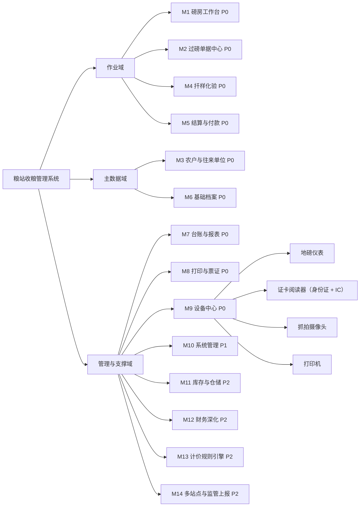
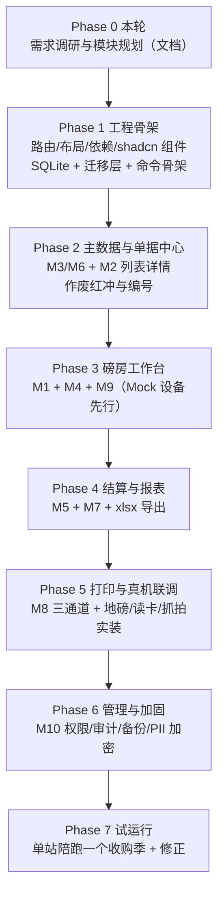

# 02 功能模块规划

依据 [01-业务调研与流程分析](./01-业务调研与流程分析.md) 的六环节流程与合规清单，本文给出模块树、逐项功能规格、分期路线图与非功能需求。

优先级定义：

- **P0** 首版必做，缺一项则粮站无法完成收粮或无法通过监管抽查
- **P1** 首版收尾或小步迭代（1–2 周内可追加），显著影响安全与体验
- **P2** 后续独立期，架构上预留但不实现

每项功能规格统一按 **输入 / 处理规则 / 输出 / 验收口径** 四要素描述，可直接转为开发任务与测试用例。

---

## 1 模块树

依赖关系：M1 是 M2/M4/M5 的作业入口，M9 为 M1 提供设备能力抽象，M6 为全部业务模块提供主数据。M13（计价引擎）以 `PricingEngine` trait 的形式被 M5 调用，首版注入 `ManualPricing` 实现。

---

## 2 M1 磅房工作台（P0）

一屏完成一个车次的全部作业，是系统的使用主界面。设计目标是**单车次作业时间 ≤ 3 分钟**，键盘可完成全流程。

### F1.1 制单与售粮人识别

- **输入**：身份证阅读器取卡数据；或姓名/证号检索关键字；车辆号牌；品种；仓房货位（选填，多数站点不登记）
- **处理规则**：
  - 读卡成功 → 按身份证号查 `party`：**命中即复用档案**（档案停用另判，只挡新单；这张档案若还缺人像，顺手当场补一张，补不上也不挡取号制单，见 F3.1）；**未命中不静默建人**——就地弹「无档案 · 快捷登记」框，姓名 / 证号 / 住址由读卡带入，只补一个电话（可不填），保存后新档案直接选为本单售粮人。证号是一人一档的财务主键，凭空落库得有人确认一次。卡面照片随这次建档一并挂成新档案的人像（`party_photo_set`，见 F3.1）——照片只在这一次读卡时拿得到；存不上也只提示一句，不挡制单
  - 手工录入 → 校验 18 位证号与 GB 11643 校验位，档案标记"未读卡核验"；读卡读不出、或外设总开关关掉时，制单框内的「新档案」按钮打开同一张表单（证号手录 → 未核验），全程不离开制单
  - **核验标记（`party.id_card_verified`）跟着证号来源走**：读卡建档即已核验，手工录入为未核验，口径见 F3.1；快捷登记框里改了证号就说明卡面与录入对不上，自动回落成未核验
  - 取号：调 `seq_counter` 生成磅单号，状态 `registered`
  - 同一证号存在未完成任务时提示"该农户有 N 张在途单"，可一键切换
  - 仓房/货位（去向）留空不挡取号；粮真进了仓由值仓在**磅单详情**补录或改派，署名写 `keeper_id`、变更写 `order.destination` 审计（作废/拒收单不再接受登记）
- **输出**：一张状态为 `registered` 的磅单，进入作业区
- **验收口径**：从放卡到出单号 ≤ 2 次按键；无档案时不出现两次以上的手工输入；断网（本无网络）与设备离线不阻断制单

### F1.2 实时重量采集与称重

- **输入**：地磅仪表读数流（经 M9）；抓拍触发；手录兜底
- **处理规则**：
  - 大屏显示当前毛重读数（整数公斤，字号 ≥ 96 px），并显示"读数稳定/不稳定"状态
  - 判稳（连续 N 帧波动 < 阈值且 > 起称值）后按 `空格` 或点击"捕获" → 按分度值取整 → 写入 `weigh_record`，类型为 `gross` 或 `tare`
  - 一次/二次称重顺序自由：先捕哪个都可，两个都到齐才计算净重
  - 复称：同一类型可再次捕获，须选为"采用值"并填原因，原值保留
  - 皮重异常：与该车辆/该农户历史皮重均值比较，超 ±3% **不阻断**——照常捕获（数据有效），服务端复算后自动在磅单记一条警示并写审计（屏显醒目条、时间轴、票面「皮重警示」栏），供事后核对与红冲；不再要求站长授权
  - 设备故障时切手录：`weigh_record.source = manual` 持久标记，列表与打印均可见"手录"
- **输出**：毛重、皮重、净重、结算重量预览
- **验收口径**：上磅到读数定格 ≤ 1 s；捕获后重量在 UI 与库中一致；手录单可被检索出来供复查；皮重偏差超容差时照常入账并在磅单留下醒目警示与审计

### F1.3 化验指标录入

- **输入**：按品种启用的指标项数值；等级判定；扣重项（扣水公斤数、扣杂公斤数、其他扣重）；拒收标记
- **处理规则**：指标值逐项存 `qc_indicator`（不合并成文本）；扣重之和不得超过净重；拒收时引导走退粮流程
- **输出**：一张质检单，磅单状态推进到 `qc_done`
- **验收口径**：修改任一指标后磅单上的扣重与结算重量即时重算；复检生成新单且与首检并列可查

### F1.4 结算与打印（两个独立环节）

现场常态是**先过磅、先打码单把票给客户，钱当时不算**：农户一天跑两三趟、或把几趟的票攒到周末一起算。
所以这两件事是两个独立环节，不是一个动作的两步——磅房只管出票，钱在结算窗口算。

**打印（工作台 F9 / 顶部按钮 / 第三刷结算弹窗「凭票打印」）**

- **输入**：已完成称重的磅单（净重确定）
- **处理规则**：打印收购码单，票面带**凭票二维码**，码下留一行可读单号兜底；打印与否不改变单据状态
- 码单上可印"预估应付"（化验扣重 + 价目表现价），但必须标明是预估——磅房不定价，价在结算窗口定
- 「打过几张」只以 `print_log` 里成功的记录为准，不用前端临时状态：看了一眼预览又取消不算打过

**结算（扫码结算窗口 `/scan-settle`，一码一单）**

- **输入**：扫票面二维码（或手输单号 / 从待结算池点选）→ 结算单价；各项扣重与费用扣款；支付方式；是否当场付款；**当场实付金额**（默认＝应付全额，允许挂账的站点可改小＝部分付款）
- **处理规则**：
  - 调 `PricingEngine`（首版 `ManualPricing`：单价与扣重全人工）算金额，偏离价目表时提示填写改价事由（选填，写则留痕，不拦结算）
  - 生成结算单 → 付款状态三档：**付清**（实付 ≥ 应付）同步写付款流水；**部分付款**只登记实付那一段，差额留在结算单上（`payment_status = partial`）；**挂账**（一分未付）不产生流水（`unpaid`）。后两档都进 `/payments` 挂账台账等核销；随后打印结算凭证（财务入账联）
  - 实付金额的两条硬边界（前端、mock、Rust 三层同口径短句）：必须 `> 0`（不收钱就改走挂账）、不得 `> 应付`（超付当场拦，与 F5.3 的"付款累计不得超过应付"同一条）；磅单 `paid_at` 只在**付清**时落，部分付款留空直到补录付清
  - **一切结算都必须从扫码进入**（现金客户也一样扫一次）：不扫就没有"哪张单、何时、被谁结算"的对应关系
  - **一码一单，不做多单合并**：粮站的价按品种、等级、水分一单一议，攒成一篮摊一个价等于放弃逐单议价
- **凭票码载荷契约**：`BH1:` + 磅单号（单一来源 `src/lib/ticket-code.ts`）。码里**只装定位符**——金额是后算的，进码等于允许客户自己改价；证号进码等于把 PII 印在流通纸上。升级格式只能新增 `BH2:` 并永久兼容 `BH1:`，否则发出去的旧票集体扫不出来
- **扫码口输入要求**：键盘模拟式扫码枪的按键在**没有任何输入框聚焦**时被直接收走（不是"永远聚焦扫码框"——那样枪一响字符就落进单价框里）；容错全角冒号、小写、首尾空白与枪的回车后缀；认不出种类的码要按前缀分清单据种类（BD 码单 / ZJ 质检单 / JS 结算凭证 / FK 付款凭证）并说人话给出路
- **闸门（每条都要给出路，不许只报"不允许结算"）**：无结算权限、作废/拒收/红冲/归档、已结算过（重复扫码）、净重未定、查无此单
- **票丢了也要能结**：待结算池按售粮人列出所有未结磅单，点一下等同扫一下
- **IC 卡与二维码的分工**：卡是**站内流转**凭据（磅单—化验—司磅之间认领这台车，见 [06 IC 卡流转凭证](./06-IC卡流转凭证.md)），二维码是**客户手里的结算**凭据；两者定位同一张单，服务对象不同，不互相替代

- **输出**：`settled` 磅单、结算单、打印任务、付款流水
- **验收口径**：金额计算与手工复核一致到分；打印失败不改变单据状态但记录失败日志；**同一张码单扫第二次不得二次结算**；扫质检单/结算凭证/付款凭证都要被认出来并给出正确去向；票面码在 58/80 热敏与 A4 两种纸上都能被普通扫码枪一次读中

### F1.5 在途作业看板

- **输入**：无
- **处理规则**：列出所有未到终态的磅单（登记后未称完、称完未结算），按停留时长倒序，超 30 分钟标黄、超 2 小时标红
- **输出**：可点击进入继续作业
- **验收口径**：应用重启后此列表完整恢复，无数据丢失；能在 5 秒内定位到最久未完成的单

---

## 3 M2 过磅单据中心（P0）

### F2.1 磅单列表与查询

- **输入**：筛选条件（日期区间、售粮人/证号、品种、状态、支付方式、是否含手录、是否作废红冲、关键字）+ 排序 + 分页
- **处理规则**：默认查近 7 天且不含作废；游标或页码分页，页大小 50/100/200；列表列可自定义显示与顺序；总数与本页合计（重量、金额）实时给出
- **输出**：分页列表 + 汇总行
- **验收口径**：25 万单量下任意组合查询响应 < 1 s；合计值与导出一一致

### F2.2 单据详情与全链路时间轴

- **输入**：磅单号
- **处理规则**：以时间轴呈现登记 → 化验 → 一次称重 → 二次称重 → 结算 → 付款 → 每次打印，每节点显示操作员、时间、来源（设备/手录）、抓拍缩略图；红冲关系双向可跳
- **输出**：详情页
- **验收口径**：监管倒查任一单时，5 秒内可看到"谁在何时做了什么"，包含作废与授权记录

### F2.3 作废

- **输入**：作废原因（枚举 + 备注）、站长授权密码
- **处理规则**：仅未到 `settled` 的单可直接作废；已结算单禁止作废，只能走红冲；作废后磅单号不回收；已打印联数与"作废"章样式提示
- **输出**：状态 `voided` + 审计记录
- **验收口径**：无授权无法作废；作废单不出现在任何汇总与报表中

### F2.4 红冲（错误更正）

- **输入**：原单号、红冲原因
- **处理规则**：生成一张净重与金额均为负的关联新单；再据实开正确新单；三单互相关联；报表按含红冲口径汇总
- **输出**：负向单 + 关联链
- **验收口径**：原单与红冲单净额合计为零；台账可分别筛出红冲记录

### F2.5 补打

- **输入**：单据号、补打份数、授权
- **处理规则**：补打必须走授权并打印"补打"水印；`print_log` 记录原始打印与补打次数
- **输出**：打印任务 + 留痕
- **验收口径**：未授权无法补打；补打件与原件版式一致且带"补打"标识

---

## 4 M3 农户与往来单位（P0）

### F3.1 档案维护

- **输入**：姓名/单位名称、证件类型与号码、电话、地址、类型（农户/大户/经纪人/合作社/企业）、开户行与账号、备注、照片
- **处理规则**：**建档最低要求＝姓名 + 证号与电话至少填一个**（没带卡的临时户留个电话也建得下来，两样都空才拦；此时证号列存 `NULL`、`id_card_verified` 一律 0）。证号唯一索引、手机号唯一索引（`uk_party_phone`，一人一号；入库前归一为去空白与 `-` 的形状，没填＝`NULL` 不占唯一位）；软删除（`status = disabled`）不物理删；被引用档案禁止删除只可停用；支持读卡自动填充。**核验标记 `id_card_verified` 只认一个口径**：本轮读卡带进来的证号与保存时的证号逐字一致才写 1（界面「已核验」），手工录入或读卡后又改动过证号一律写 0（「未核验」）；读卡命中已有手工档案且证号一致时，保存即升级为已核验；改电话、额度、仓房等无关字段不改变已有标记
- **人像照片（`photo_attachment_id`，选填）**：两种来源——**刷身份证自动带出芯片里那张**（04 §3.2，无需人工上传）与档案表单里本地选一张 JPG/PNG/BMP。规则四条：
  1. **只补缺、不覆盖，且当场补写**：读卡命中已有档案时，档案还没有照片就**这一刷直接补上**，不挂成"待保存"等磅员点保存——读卡命中的档案多半只是顺手核一下、很可能根本不点保存，照片就一直空着（这条正是那样来的）。已有照片一律不动，要换得由人自己在表单里点「换一张」并保存，绝不因一次刷卡悄悄换脸。判据与写入收在一份共用实现里（`src/lib/party-photo.ts`），工作台读卡识别、档案页读卡建档、档案详情读卡核对三个入口共用，不许各写一遍；
  2. 照片是**档案落库之后的独立一步**（`party_photo_set`），文件读不到、超限、格式不对都只提示"照片没存上"，**不回滚已经建好/改好的档案**——与过磅抓拍同一条判断（04 §4）；
  3. 换一张或清除时，旧的 `attachment` 行连同盘上文件一起删（PII 最小化），顺序固定为"先改引用、再删旧"；
  4. 没有照片是正常状态不是异常，界面一律按「无照片」显示，制单、称重、结算全程不挡。
- **输出**：`party` 记录
- **验收口径**：**只填电话（不填证号）能建档成功**，档案里证件号一栏显示「—」且不会被别的无证号档案误认成同一人；证号与电话都空时表单当场拦下、保存按钮不给过；重复建档（证号撞上、或手机号撞上别人的档案）被唯一索引阻断并提示既有档案姓名，档案表单里就地红字提示、不必等保存失败；停用档案在制单时不可选但历史单据仍正常显示；刷证建档保存后，列表与详情立即显示「已核验」，不需要二次操作；刷证建档保存后档案详情直接出现身份证上那张人像（不需要手工传）；**读卡命中一张缺照片的已有档案时，不必点保存**——档案详情立刻出现人像并留一条 `party.photo.update` 审计，而再刷一次已有照片的档案，照片不变

### F3.2 售粮履历与快捷调档

- **输入**：档案 ID 或证号
- **处理规则**：展示累计售粮车次/重量/金额、按年度与品种分布、最近 N 次单据、历史皮重均值（供 F1.2 异常判定）
- **输出**：档案详情页
- **验收口径**：从制单界面一键跳履历；皮重均值与实际历史一致

### F3.3 Excel 批量导入

- **输入**：模板 xlsx（姓名、证号、电话、地址、类型）
- **处理规则**：逐行校验（证号格式/重复/必填），预览错误行，可选择"跳过错误行"或"整体回滚"；已存在证号按更新处理
- **输出**：导入结果报告
- **验收口径**：1000 行导入 ≤ 5 秒；错误行不产生脏数据

### F3.4 代售农户清单（P1）

- **输入**：经纪人磅单下的多个实际种粮人（姓名、证号、代售重量/金额）
- **处理规则**：清单与磅单绑定，合计必须等于磅单结算重量；导出时可按监管要求单独成表
- **输出**：代售明细
- **验收口径**：经纪人挂单时能追溯到真实售粮主体

---

## 5 M4 扦样化验（P0）

### F4.1 化验单录入与指标模板

- **输入**：磅单/样品号；指标值；检测员；检测方式（快检仪/化验室/目测）
- **处理规则**：指标项按品种启用（`grain_variety.enabled_indicators`）；每项含单位、上下限提示色（超限仅提示不阻断，因规则引擎暂缓）；允许保存"未检"状态以便先称重后补检
- **输出**：`qc_report` + `qc_indicator` 集合
- **验收口径**：同一样品两次录入不覆盖，历史可查；补检后磅单自动重算扣重

### F4.2 等级与判定

- **输入**：等级（一等/二等/三等/四等/等外 或自定义）、是否接收、拒收原因
- **处理规则**：等级与判定人工选定，存于化验单；等级变更须重开化验单
- **输出**：质检结论
- **验收口径**：拒收单在 M1 中无法进入称重环节，只能走退粮

### F4.3 留样与复检

- **输入**：留样编号、留样位置、保存期限；复检原因
- **处理规则**：`is_recheck` 标记并指向首检单；复检结论可选择作为结算依据（须留痕）
- **输出**：留样记录、复检单
- **验收口径**：首检与复检结果差异可并列查看；结算单明确记录其依据的化验单 ID

### F4.4 质检单打印

见 M8，本文不重复。

---

## 6 M5 结算与付款（P0）

### F5.1 单磅单结算

- **输入**：单价（分/吨存储，界面一律按元/公斤录入）、扣款项、支付方式、是否当场付款
- **处理规则**：
  - 金额 = 结算重量 × 单价 ÷ 1000，四舍五入到分；扣款逐项计入 `deduction_json`
  - 单价来源可为手工价目表（M6）带出，带出后仍可改（改价需留痕）
  - 状态推进 `to_settle → settled`
- **输出**：结算单 + 结算明细行
- **验收口径**：与 Excel 手工核算到分一致；改价痕迹可查

### F5.2 多车次合并结算

- **输入**：同一售粮人多张待结算磅单（按证号 + 日期区间筛选）
- **处理规则**：合并为一张结算单，明细列全部磅单；合并后各磅单不可再单独结算；解绑需先撤销结算
- **输出**：一张结算单对多张磅单（`settlement_order` 多对多）
- **验收口径**：合计金额 = 各单金额之和；重复结算被阻断

### F5.3 付款登记与挂账

- **输入**：付款金额（可分期）、渠道（现金/银行卡/微信/支付宝/对公转账/赊账）、流水号、收款账户、付款人
- **处理规则**：付款累计不得超过应付；未付清形成挂账清单；结算后超 N 小时未付清触发时效预警（N 为参数，默认 72，对应监管要求）
  - **挂账清单的口径**（`settlement_credits` / `creditRows()` 单源）：`status = normal` 且 `payment_status <> 'paid'` 的**结算单**，含 `unpaid`（整单挂账）与 `partial`（部分付款后的余额）两档，`unpaid_fen = payable_fen − paid_fen`。还没结算的磅单**不算挂账**，它们在 F5.2 待结算池里压着——两条清单一加才是"今天还欠着的事"
  - 部分付款有两个入口：结算当场填小的实付金额（F1.4），或事后在结算单详情里逐次补录；两者都只写 `payment_record`，付清时才把 `paid_at` 落下
- **输出**：`payment_record`、挂账列表
- **验收口径**：挂账清单金额与"应付 − 已付"逐户相符；预警在 M7 首页可见；`/payments` 的空态不得把"没有挂账"说成"今天没待办"

### F5.4 撤销结算

- **输入**：结算单号、原因、授权
- **处理规则**：仅在未付款（或已付款先冲销）时允许；回退关联磅单至 `to_settle`；留审计不发物理删除
- **输出**：状态回退
- **验收口径**：回退后磅单可重新结算，原结算记录仍可见

---

## 7 M6 基础档案（P0）

| 功能 | 优先级 | 输入 | 处理规则 | 输出 | 验收口径 |
| --- | --- | --- | --- | --- | --- |
| 粮食品种维护 | P0 | 编码、名称、类别、基准水分/杂质限量、启用指标项、单位 | 已被单据引用的品种禁止删除，只可停用；编码站内唯一 | `grain_variety` | 停用品种在新单不可选，历史单显示正常 |
| 仓房与货位维护 | P0 | 所属仓房、货位编码、类型（囤/仓/棚）、标称容量 | 首版仅作为磅单的"入仓去向"备选项，不做结存计算；档案为空或不选都不挡制单 | `warehouse` / `storage_slot` | 按去向统计时，未登记去向的单据归入"未指定"，不被当成缺项拦截 |
| 收购价目表 | P0 | 品种、等级、单价（分/吨）、生效起止、定价依据、制单与批准人 | 同品种同等级生效期不得重叠；取价按业务日期命中生效区间 | `price_list` | 制单选品种等级后自动带出当期价 |
| 站点参数 | P0 | 站名、站点码、税号、地址、电话、单据抬头与备注文案、磅单前缀与位数、重量取整规则、皮重容差、支付时效阈值 | 全部键值化存 `app_setting`，修改写审计 | `app_setting` | 改站名后所有模板同步生效 |
| 员工与岗位 | P0 | 姓名、登录名、岗位、在职状态 | 岗位决定 P1 的 RBAC 能力集 | `user_account` | 停用员工不可登录但历史署名保留 |
| 扣款项目字典 | P0 | 名称（如烘干费、过筛费、袋重）、默认标准 | 供结算与称重下拉选择 | `app_setting` 内字典 | 袋重可按品种带默认值 |

---

## 8 M7 台账与报表（P0）

### F7.1 收购明细台账

- **输入**：日期区间、品种、售粮人类型、仓房、状态过滤
- **处理规则**：列顺序固定为监管习惯字段（序号、日期、磅单号、售粮人、证号、品种、等级、毛重、皮重、净重、扣重、结算重量、单价、金额、支付方式、付款状态、车牌、化验员、磅员、备注）；导出 xlsx 与屏显一致
- **输出**：台账表格 + xlsx 文件
- **验收口径**：抽查任一行与单据详情一致；导出文件的行数与屏显合计行相符

### F7.2 日报与月报

- **输入**：日期或月份
- **处理规则**：总车次、总净重、总扣重、总结算重量、总金额、按品种/按仓房/按支付方式分组；含与上月/去年同期对比（有数据即算）
- **输出**：报表页 + 打印/导出
- **验收口径**：日报各分组之和等于总计；跨日报表与台账合计一致

### F7.3 品种与等级质量分析

- **输入**：日期区间、品种
- **处理规则**：水分/杂质均值与分布（分箱）、等级占比、拒收率、扣量率（扣重/净重）；因规则引擎暂缓，此处只做统计不做判定
- **输出**：分析表与简单图表
- **验收口径**：样本数与化验单数一致

### F7.4 农户售粮排行与往来对账

- **输入**：日期区间、类型
- **处理规则**：按售粮人汇总车次/重量/金额/未付余额；可钻取到单据列表
- **输出**：排行与挂账清单
- **验收口径**：与 F5.3 挂账金额逐户一致

### F7.5 作业量与操作员工统计

- **输入**：日期区间、员工
- **处理规则**：各岗位办理单量、手录占比、作废/红冲/补打/异常放行次数（舞弊预警线索）
- **输出**：统计表
- **验收口径**：手录与异常放行占比可单独排序，便于站长核查

### F7.6 首页看板

- **输入**：无（当日）
- **处理规则**：今日车次/吨数/金额、在途作业数、未付挂账数与金额、设备离线告警、支付时效超期提醒
- **输出**：Dashboard
- **验收口径**：数字与明细页一致，刷新延迟 < 3 s

---

## 9 M8 打印与票证（P0）

| 功能 | 优先级 | 规格 |
| --- | --- | --- |
| 磅单/收购码单 | P0 | 一式多份可配（联数、纸型 A4/241-3 针式/58 热敏）；字段含站名、单据号、日期、售粮人与证号、车牌、品种等级、毛皮净重、各项扣重、结算重量、单价、金额（大写）、三个环节操作员、签字栏；份间骑缝编号；**票面右下角凭票码（见下一行；载荷契约见 F1.4，模板里的"必备区块"，编辑器删不掉、取用模板时兜底补回）** |
| 凭票码（二维码 / 一维条码） | P0 | 载荷仍是 `BH1:` + 单据号，**与码制无关**（`src/lib/ticket-code.ts` 单源）。票面出一个还是两个码由模板的「码制」决定：仅二维码 / 仅一维条码（CODE128）/ **两者都打**——现场确实有只认一维码的扫描枪（老的键盘口激光枪扫二维码靠模拟图像勉强），票上只印二维码时客户递上来就是一张扫不出来的纸，而换枪不该是结算窗口的日常。**尺寸档位必须三条出纸路都算数**：预览 SVG、A4/针式的 GDI 直打、热敏的 ESC/POS 都读 `code-size.ts` 那一张表（档位 → 模块点数，203dpi 下 1 点 = 0.125mm；「中」= 4 点正是机器出厂值），纠错等级两边同为 H——从前只有 A4 与预览认这个档位、机器恒打 4 点，站长调到「超大」纸上纹丝不动。一维码的条空宽度由前端 `code128.ts` 一次算出（ESC/POS 功能 A 的七种码制里没有 CODE128，凭票载荷里的 `:` 连 CODE39 字符表都进不去），机器只照它发 `GS v 0` 栅格，于是"预览多宽的码、纸上就多宽"是结构上成立的；纸装不下时等比压小模块宽度，**预览与出纸同时压**，不允许出现"预览刚好、纸上被切一半"。码下可选印一行可读单号，供纸面晒白时手输 |
| 质检单 | P0 | 指标逐项列示 + 检测方式 + 判定结论 + 化验员签字 |
| 结算凭证 | P0 | 合并明细表 + 应付已付未付 + 收款人签字；带 `JS` 单号的凭单码（挂账后拿这张凭证来核销） |
| 内部流转单 | P1 | IC 卡/多岗流转场景，对应 R6。**与凭票二维码不冲突**：卡管站内流转（哪个岗位正在办这台车），码管客户手里的结算凭据 |
| 模板管理 | P0 | 抬头、脚注、Logo/印章图、字号、行距、边距、列宽可视化配置；配置版本化并预览 |
| 打印留痕与补打 | P0 | `print_log` 记单据类型、份数、打印机、成败、是否补打、操作人 |
| 大写金额 | P0 | 人民币大写换算正确（含零、角分、整） |
| 打印预览与静默 | P1 | 通道 A 预览；静默与套打见 [04 硬件对接方案](./04-硬件对接方案.md) |

验收口径：同一张单据在三种纸型下版式不错位、不截断；补打件带"补打"标识；打印失败有明确原因提示（打印机离线 / 缺纸 / 驱动异常）。

---

## 10 M9 设备中心（P0）

| 功能 | 优先级 | 输入 | 处理规则 | 验收口径 |
| --- | --- | --- | --- | --- |
| 地磅配置与测试 | P0 | 接口类型（COM/TCP）、端口、波特率、协议型号、分度值、稳定帧数与阈值 | 显示实时读数 + 帧监视器；「联机测试」探的就是那条串口（正在收数按读数流判定，没开流时临时开端口读三帧），结论当场回写状态灯；Mock / 已停用的磅不碰端口 | 拔掉串口：后端 5 秒饥饿窗口到点（`STARVE_MS`）推一次离线事件，作业面告警与台账状态灯同时转红并计一次错误；防抖只有这一档，界面不再等第二轮（掉线后没有新帧，界面侧再防抖就永远报不出红）。收数恢复后灯立刻回绿、"最后成功"刷新 |
| 证卡阅读器配置 | P0 | 驱动（`routon_sdtapi`/`mock`）、`Sdtapi.dll` 路径、是否同时取照片、IC 出厂密钥 | 一台设备两条介质通道（身份证 / IC），面板按驱动登记的 `media` 渲染；读卡跑在 `spawn_blocking` + 全局 `DEV_LOCK` 串行，无子进程 | 点"读卡"1 秒内返回或明确报错；无卡时报错文案能区分"没读到卡"与"设备不通" |
| 摄像头配置 | P0 | 品牌、地址、账号、通道、抓拍 URL 模板、触发时机 | 支持"测试抓图"并预览；图片按单入库 | 过磅捕获成功后附件表有对应记录 |
| 打印机配置 | P0 | 打印机名、纸型、边距、份数、是否默认 | 可打印测试页 | 选错打印机时失败原因可辨 |
| Mock 模式 | P0 | 全局开关 | 所有设备可切模拟，重量与证件数据由界面注入 | 无硬件可跑完整闭环流程（演示与培训用） |
| 设备自检面板 | P0 | 无 | 展示每个设备在线状态、最后成功时间、错误计数、原始帧日志 | 现场排障能在 1 分钟内定位是哪台设备 |
| 话筒喊话（PTT） | P1 | 话筒/喇叭端点、软增益、单次时长上限 | 按住说话经软件直通到功放；与播报共用一路输出、二选一互斥；失焦/锁屏/30 s 到点均自动释放 | 验收见 [07 话筒喊话与语音播报](./07-话筒喊话与语音播报.md) §8；拔掉功放线不影响称重与结算任何作业 |
| 语音播报 | P1 | 播报开关、各事件文本模板、TTL、是否播结算重量 | 预录片段拼接（构建期合成、运行期零合成）；**只在业务事务提交后触发**；被喊话打断不补播半截 | 毛重捕获后播"毛重…公斤，请下磅"，数字读法逐条对表（07 §5.4） |
| LED 外部显示屏 | 已取消 | — | 2026-09-13 现场确认站点无此需求；`kind='led'` 只剩库 CHECK 里的历史值，设备页不再提供该类 | 不做 |
| 钱箱联动 | 已取消 | — | 同上，站点不用钱箱；`kind='cashbox'` 只在库里留着，设备页不再提供该类 | 不做 |

---

## 11 M10 系统管理（P1）

| 功能 | 优先级 | 规格 | 验收口径 |
| --- | --- | --- | --- |
| 登录与密码 | P1 | 用户名密码（argon2 哈希），连续失败锁定，支持在岗切换而不退出程序；登录后会话长期有效，空闲满站点参数 `idle_lock_minutes`（0＝从不）或点侧栏左下角「锁屏」即锁屏，输本人密码原地解锁、不退出登录 | 未登录不可进入任何业务页；锁屏期间任何业务命令被后端拒绝 |
| 角色权限 RBAC | P1 | 岗位 → 能力集（制单/称重/化验/结算/去向登记/作废授权/补打授权/参数配置/导出/只读）；前端隐藏 + 后端命令双重校验 | 磅员无法进入结算；越权调用命令返回拒绝 |
| 操作审计 | P1 | 登录、制单、称重手录、异常放行、去向改派、作废、红冲、补打、改价、参数变更、导出，含前后值快照 | 任一关键动作可查到 who/when/what/before/after |
| 数据备份与恢复 | P1 | 每日自动 `VACUUM INTO` + 附件打包（zip）到备份目录，保留 30 份；手动备份到 U 盘；恢复向导（校验和 + 覆盖确认） | 用最近备份可完整恢复，含附件 |
| 数据修复与体检 | P1 | 检查断号、孤儿明细、汇总与明细不一致、附件缺失，可生成报告 | 人为构造脏数据可被检出 |
| 日结交班 | P1 | 按班次汇总车次/吨数/金额/现金/未付，打印交接表 | 与台账口径一致 |
| PII 加密 | P1 | 证号与照片字段级加密（AES-GCM），密钥托管 Windows 凭据管理器/DPAPI | 直接打开 db 文件读不到明文证号 |
| 数据库维护 | P1 | `PRAGMA optimize`、`wal_checkpoint`、定期 VACUUM、统计信息展示 | 应用关闭时不损坏库 |

---

## 12 M11–M14 后续期（P2，本次仅预留）

| 模块 | 内容 | 预留方式 |
| --- | --- | --- |
| M11 库存与仓储 | 入仓/出仓/转仓、仓房结存、粮情（温湿度/虫情）、损耗核算、检斤与仓储对账 | `stock_movement` 表已设计不写入；磅单已含仓房货位 |
| M12 财务深化 | 收购成本、销售毛利、往来对账、费用归集、凭证与发票、银行代付回单 | 付款流水与扣款项已结构化落库 |
| M13 计价规则引擎 | 国标梯度增扣量、企业自定义口径（1:1.2、超 7% 拒收等）、自动定等、拒收红线、多方案并存与生效期 | `PricingEngine` trait + `ManualPricing`；`weigh_order.price_plan_id`、`deduction_detail_json` 字段预留 |
| M14 多站点与监管上报 | 站点汇总、数据上报省级平台、云同步与移动端查询 | 所有表带 `station_code`；导出模板可配字段映射 |

---

## 13 非功能需求

| 维度 | 指标 | 验证方式 |
| --- | --- | --- |
| 离线可用 | 100% 功能在无任何网络时可用；外设走本地接口 | 拔网线全程作业 |
| 断电恢复 | 重启后在途磅单数据零丢失，状态可续；已提交事务不因重启损坏（WAL） | 称重中途强制断电 |
| 查询性能 | 25 万磅单量下组合查询 + 分页 < 1 s；单据详情 < 300 ms | 造数据实测 |
| 采集时延 | 仪表帧到 UI 显示 < 100 ms；判稳后捕获 < 50 ms | 打点测量 |
| 交互效率 | 制单到打印主流程 ≤ 3 次点击；全表单 Tab 顺序正确；小键盘可完成数值录入 | 现场走查 |
| 数据留存 | 单据与附件保存 ≥ 3 年；备份保留 30 份 | 配置与容量核算 |
| 容量 | 单库 500 MB 内（不含附件）性能不明显衰减 | 压测 |
| 可靠性 | 打印/抓拍失败不回滚业务事务；设备离线不阻断手工兜底 | 故障注入 |
| 可维护性 | 迁移脚本顺序可重放；关键路径有结构化日志（`tracing`，本地按天滚动） | 日志可定位一次异常作业 |
| 兼容性 | Windows 10/11 x64；WebView2 运行时缺失时安装器提示或有回退说明 | 干净虚拟机验证 |
| 安全 | 密码 argon2；PII 加密；审计不可改；无外部网络上传 | 代码走查 + 库文件检查 |
| 界面适配 | 1366×768 及以上可用；磅房常用 1920×1080 全屏；不依赖鼠标悬停作为唯一提示 | 分辨率切换 |
| 可访问性与可读性 | 重量与金额数字使用等宽数字（tabular-nums）；关键状态不只用颜色表达，同时有文字 | 走查 |

---

## 14 分期路线图

里程碑判定：

- Phase 4 结束：无硬件、纯 Mock 下可完成一个真实车次的完整闭环并导出台账（**可交付演示**）
- Phase 5 结束：真实地磅 + 打印机在站点现场跑通（**可试运行**）
- Phase 6 结束：满足第 5 节合规清单全部条目（**可正式替代手工账**）

---

## 15 首版 Definition of Done

1. 六环节主流程与 E1–E12 异常分支全部可用，无功能空壳
2. 合规清单 8 条逐项可演示
3. 三套打印模板（磅单、质检单、结算凭证）在现场打印机上版式正确
4. 地磅、读卡器、摄像头至少各有一种真实型号联调通过，其余以 Mock 交付并文档说明
5. 待确认清单 Q1–Q14 已获答复或有明确默认假设记录
6. 备份可恢复演练通过一次（含附件）
7. 一个收购季试运行期间无单据丢失、无金额差错
