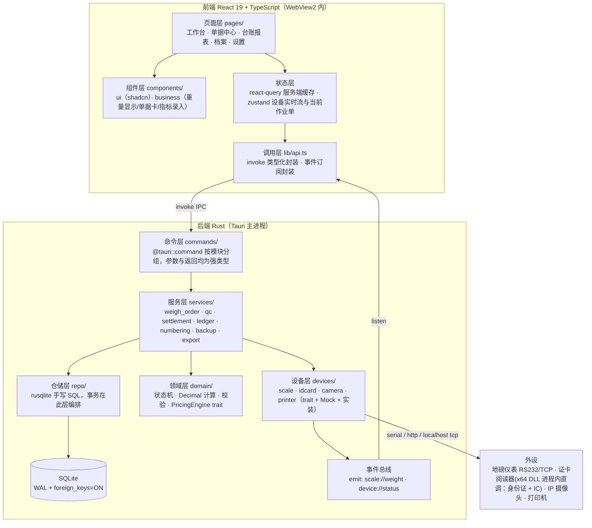
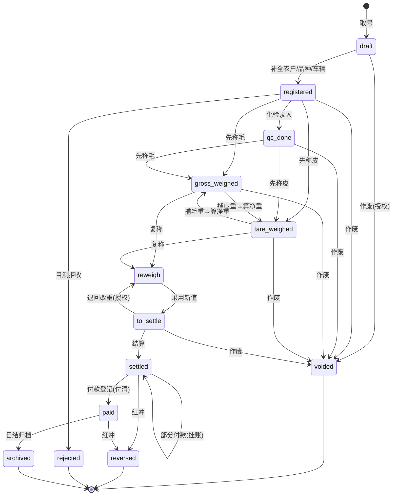
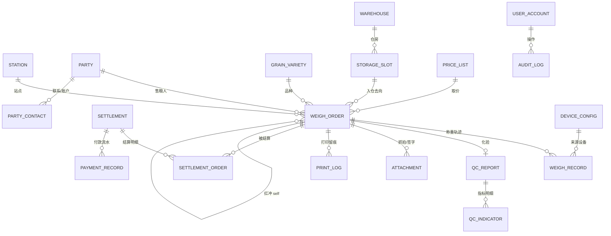

# 03 技术架构与数据模型

本文给出系统分层、目录结构、依赖清单、全局约定（精度/单位/编号/时间/软删除）、磅单状态机、完整表结构与索引、迁移与备份策略。表结构可直接转为第一个 SQLite 迁移脚本。

---

## 1 架构总览

单机桌面应用：一个 Tauri 进程承载 Rust 后端（业务逻辑 + SQLite + 外设驱动）与 WebView2 前端（React）。**无独立服务端、无网络依赖**。



### 1.1 分层职责边界

| 层 | 职责 | 禁止事项 |
| --- | --- | --- |
| 页面层 | 编排组件、路由参数、表单校验展示 | 不直接拼 SQL；不做金额/重量计算 |
| 状态层 | 缓存查询结果、订阅设备事件 | 不持久化业务状态（持久化只在后端） |
| 命令层 | 入参反序列化、权限校验、调用服务、返回 DTO | 不写业务规则 |
| 服务层 | 事务边界、跨聚合编排（如结算涉及多张磅单） | 不直接操作串口/HTTP |
| 仓储层 | SQL 与行映射 | 不含业务分支 |
| 领域层 | 状态机迁移合法性、Decimal 计算、校验、计价抽象 | 不依赖 tauri 与 rusqlite（纯逻辑，可单测） |
| 设备层 | 协议解析、连接管理、重试与降级、Mock | 不直接写业务表（结果交给服务层落库） |

### 1.2 关键架构决策

| 决策 | 选择 | 理由 |
| --- | --- | --- |
| 数据库访问 | `rusqlite`（bundled）+ 手写 SQL，不用 ORM | 台账与报表大量多表聚合，SQL 可控且便于迎检核对；避免 ORM 生成 N+1 |
| 插件式 SQL 插件 | **不采用** `tauri-plugin-sql` | 需要自定义事务编排、`VACUUM INTO` 备份、字段级加密与 pragma 调优，直控连接更省事 |
| 连接管理 | 单 `Connection` 置于 `Mutex`，由 Tauri 托管状态 | 单机单用户，无并发写；串行化天然规避锁冲突 |
| 实时重量传输 | Tauri 事件 `emit`，非轮询 invoke | 5–10 帧/秒下避免 IPC 开销与请求竞态 |
| 称重采集线程 | 独立 OS 线程 + `serialport` 阻塞读，判稳后 emit | 串口阻塞不能污染异步运行时 |
| 前端路由 | `@tanstack/react-router` + **hash history** | 生产走 `tauri://` 自定义协议，hash 路由免依赖服务端 SPA 回退 |
| 金额与重量计算 | 全在 Rust 侧 `rust_decimal`，接口传整数最小单位或字符串 | 见第 3 节精度约定，杜绝浮点误差 |
| 附件存储 | 文件系统分片目录 + `attachment` 表登记 | 图片入 BLOB 会急剧放大库体积并拖慢备份 |
| 计价规则 | `PricingEngine` trait，首版 `ManualPricing` | 本次明确暂缓规则引擎，但保留可替换边界 |
| 打印 | 三通道抽象 `PrintJob`（窗口预览 / 队列直打 / RAW 指令） | 工作台无预览直打：热敏走 RAW，A4/针式走 `queue_print.rs` 的 GDI 队列直打（纸张随打印机配置），见 04 文档 |

---

## 2 目录结构

规划结构（新增文件按此落位，本文档不创建代码文件）：

```text
src/
  main.tsx  App.tsx
  routes/                     # tanstack-router 路由段
      __root.tsx
      index.tsx                # 首页看板
      workstation.tsx           # M1 磅房工作台
      orders/$orderNo.tsx       # M2 单据详情
      orders/index.tsx          # M2 列表
      parties/index.tsx         # M3
      qc/index.tsx              # M4
      settlements/index.tsx     # M5
      masters/                  # M6 品种/仓房/价目/参数
      reports/                  # M7 台账/日报/月报/分析
      devices/index.tsx         # M9
      system/                   # M10 用户/审计/备份
  components/
      ui/                        # shadcn 生成，勿手改
      business/                  # WeightDisplay 重量大字 / OrderStatusBadge
                                 # IndicatorInput 化验指标行 / DocTimeline 时间轴
                                 # PartyPicker / VarietyPicker / MoneyInput
      layout/                    # AppShell（Sidebar + 顶栏工具条 + 状态栏）/ DeviceStatusBar
  lib/
      api.ts                    # invoke 的类型化出口（唯一允许直接调 invoke 的文件）
      events.ts                 # 设备事件订阅 hook：useScaleWeight / useDeviceStatus
      format.ts                 # weight01kg→"12,345.6 kg"、fen→"¥1,234.56"、吨、元/斤
      decimal.ts                # 与后端一致的定点数辅助（仅展示，不参与计算）
      schema/                   # zod 表单与 DTO 校验，字段与后端 DTO 对齐
      constants.ts              # 状态枚举、指标字典、权限点
  store/
      device.ts                 # zustand：实时重量、设备在线态
      workstation.ts            # 当前作业单草稿

src-tauri/src/
  main.rs  lib.rs               # Builder：插件注册、状态托管、命令注册、启动迁移
  error.rs                      # AppError 枚举 + impl Serialize for IPC 错误传递
  db/
      mod.rs                    # 连接建立、pragma、Mutex<AppDb>
      migrate.rs                # schema_version 顺序迁移执行器
      migrations/0001_init.sql  # 首个建表脚本
  domain/
      weight.rs                 # Weight01Kg 新类型 + 取整规则
      money.rs                  # AmountFen / PriceFenPerTon + 换算与大写
      state.rs                  # WeighOrderStatus 与合法迁移表
      pricing.rs                # trait PricingEngine + ManualPricing
      validate.rs               # 身份证号 GB 11643 校验、单据校验
  repo/
      party.rs variety.rs warehouse.rs price.rs
      weigh_order.rs weigh_record.rs qc.rs
      settlement.rs payment.rs attachment.rs
      numbering.rs audit.rs setting.rs device.rs report.rs
  services/
      weigh_service.rs          # 制单/称重/复称/作废/红冲事务编排
      qc_service.rs
      settlement_service.rs     # 合并结算、付款、撤销结算
      ledger_service.rs         # 台账与报表查询
      export_service.rs         # xlsx 生成（rust_xlsxwriter）
      backup_service.rs         # VACUUM INTO + 附件打包 + 保留策略
      print_service.rs          # 模板渲染与三通道派发 + print_log
  devices/
      mod.rs                    # DeviceHub：生命周期、状态、Mock 开关
      scale/{mod.rs,trait.rs,yaohua.rs,toledo.rs,serial.rs,tcp.rs,mock.rs}
      idcard/{mod.rs,trait.rs,bridge.rs,hid.rs,mock.rs}
      camera/{mod.rs,trait.rs,hikvision.rs,dahua.rs,usb.rs,mock.rs}
      printer/{mod.rs,preview.rs,raw_escpos.rs,raw_escp.rs,pdf.rs,mock.rs}
  commands/
      mod.rs party.rs master.rs weigh.rs qc.rs settlement.rs
      report.rs device.rs printer.rs system.rs
  models/                       # 前后端共享 DTO（serde Serialize/Deserialize）
      dto.rs
```

---

## 3 全局约定

### 3.1 数值精度与单位（禁用浮点）

粮食行业的重量颗粒度粗、金额必须到分，而 JavaScript 的 `f64` 在累加时会产生肉眼不可见的误差，一旦进入结算单就会直接变成与农户的现金纠纷。因此全链路禁用浮点：

| 量 | 存储类型 | 单位 | 界面展示 | 换算 |
| --- | --- | --- | --- | --- |
| 重量（毛/皮/净/扣/结算） | `INTEGER` | 0.1 kg（称为"分斤"不合适，统一叫 0.1 公斤位） | `12,345.6 kg` 或 `12.346 t` | `kg = v / 10`；`t = v / 10000` |
| 金额 | `INTEGER` | 分 | `¥1,234.56` | `元 = v / 100` |
| 单价 | `INTEGER` | 分/吨 | 三选二展示：`¥2,280.00/吨`、`1.14 元/斤`、`2.28 元/公斤` | `分/斤 = v / 2000`；`分/公斤 = v / 1000` |
| 化验指标（水分/杂质等） | `INTEGER` | 0.01% | `14.50 %` | `% = v / 100` |
| 容重 | `INTEGER` | g/L | `762 g/L` | 同值 |
| 比率/占比 | 不存 | 由查询即时算 | 保留 2 位 | — |

规则：

1. 所有整数均以 **最小单位存储**，命名带单位后缀：`gross_weight_01kg`、`amount_fen`、`price_fen_per_ton`、`moisture_001pct`
2. 计算只发生在 Rust 侧，使用 `rust_decimal`（`Decimal`），中间量以 `Decimal` 表达，落库前转 `i64`
3. 结算金额公式：`amount_fen = round_half_up( settlement_weight_01kg × price_fen_per_ton ÷ 10000 )`
   （推导：0.1 kg × 分/吨 ÷ 10000 = 分。例：结算重量 123,456（即 12345.6 kg）× 228000（即 2280 元/吨）÷ 10000 = 2,814,796.8 → 2,814,797 分 = 28,147.97 元）
4. **四舍五入统一用 half-up**，且只在最终金额处取整；逐项扣款分别取整后求和，避免"总分不符"
5. 汽车衡分度值 10 kg（= 100 个 0.1kg 单位）时，捕获值按 `weight_rounding_mode` 参数对齐：`floor` / `half_up` / `nearest_div`（默认 `nearest_div`）
6. 前端 `lib/format.ts` 是唯一的展示换算点，禁止在组件里写 `/10`、`*100` 之类散落的换算
7. DTO 中的数值字段类型是 `number`（JS 安全整数范围内）——单票金额与重量远小于 2^53，无溢出风险；但**汇总接口返回字符串**，以防前端累加

### 3.2 时间

- 存储：`TEXT`，ISO 8601 本地时间 + 偏移，形如 `2026-09-10T08:12:33.482+08:00`（由 Rust `chrono::DateTime<Local>` 序列化）
- 选择本地时间而非 UTC：粮站的"日"以自然日为统计边界，UTC 会把晚上收的粮归到次日，产生对不上账的报表
- 结算周期、报表区间一律用 `date` 类型字段（`business_date`），与创建时间分离，避免跨零点争议
- 展示格式固定 `YYYY-MM-DD HH:mm`，秒仅详情与日志显示

### 3.3 主键与标识

- 内部主键：`id INTEGER PRIMARY KEY AUTOINCREMENT`（局部性优于随机 UUID，索引更小）
- 对外业务键：单据号（唯一索引），界面与打印只用单据号
- 跨站/未来同步需要的全局 id：`uid TEXT`（UUID v4）仅在 `weigh_order`、`party`、`settlement`、`attachment` 上保留，其余表不加

### 3.4 软删除与审计字段

所有可变更的业务表统一含：

```text
created_at TEXT NOT NULL, created_by INTEGER NOT NULL REFERENCES user_account(id),
updated_at TEXT, updated_by INTEGER, deleted_at TEXT, deleted_by INTEGER
```

`deleted_at IS NULL` 为在用；查询一律带该条件（仓储层封装，不依赖开发者记忆）。**单据类表禁止任何形式的删除**，只走 `status` 流转。

### 3.5 单据编号规则

```
格式：<前缀><站点码(2)><年(4)><月(2)><流水(6)>
例：  BD01202609000123   —— 磅单，01 站，2026 年 9 月，第 123 号
      ZJ01202609000045   —— 质检单
      JS01202609000012   —— 结算单
      FK01202609000088   —— 付款单
      HC01202609000007   —— 红冲关联单
```

- 流水按 **站点 + 前缀 + 年月** 归零重排，跨月不连续是行业常态，报表以 `business_date` 为准
- 取号实现：`seq_counter` 表 `INSERT ... ON CONFLICT DO UPDATE SET current = current + 1 RETURNING current`，与磅单插入**同一事务**，保证断电不重号
- **断号可查**：提供"编号连续性体检"功能，列出缺失号并说明原因（作废号保留占位，不复用）
- 前缀与位数在 `app_setting` 中可配（`doc_no_prefix_BD`、`doc_no_seq_len`）
- 已作废/红冲单的号码永久占位，不允许回收

### 3.6 枚举

SQLite 无枚举类型，统一用 `TEXT NOT NULL` + `CHECK (col IN (...))` 约束，Rust 侧 `serde` 与 `strum` 双向映射，前端 `constants.ts` 同源维护。这样迎检直接看库文件也能读懂状态值，比整数枚举更适合现场排障。

---

## 4 磅单状态机

### 4.1 状态定义

| 状态 | 含义 | 允许的下一状态 |
| --- | --- | --- |
| `draft` | 已取号未补全信息（异常退出遗留） | `registered` / `voided` |
| `registered` | 已登记（农户、品种、车辆齐备） | `gross_weighed` / `tare_weighed` / `qc_done` / `voided` |
| `qc_done` | 化验完成，尚无重量 | `gross_weighed` / `tare_weighed` / `voided` |
| `gross_weighed` | 已取毛重，缺皮重 | `tare_weighed` / `reweigh` / `voided` |
| `tare_weighed` | 已取皮重，缺毛重 | `gross_weighed` / `reweigh` / `voided` |
| `reweigh` | 净重已定但正在复称调整 | `to_settle` / `voided` |
| `to_settle` | 净重与结算重量确定，待结算 | `settled` / `voided` |
| `settled` | 已结算（生成结算单） | `paid` / `reversed` |
| `paid` | 已付清 | `archived` / `reversed` |
| `archived` | 归档（日结后终态） | — |
| `voided` | 作废（终态，仅未完成单可达） | — |
| `reversed` | 被红冲（终态，原单） | — |
| `rejected` | 拒收退粮（终态） | — |

### 4.2 迁移图



### 4.3 不变式（在服务层强制，不依赖前端）

1. 净重仅在毛重与皮重同时存在时计算，且 `net = |gross − tare|`，`net > 0`
2. `settlement_weight_01kg = net − package_deduct − moisture_deduct − impurity_deduct − other_deduct`，结果必须 `> 0`（红冲单除外）
3. `amount_fen >= 0`（红冲单为负，且必须与 `reversed_order_id` 同时存在或同时为空）
4. 任一 `voided` / `reversed` 单不得参与汇总统计，但红冲单必须参与（其负值抵消原单）
5. 状态迁移必须携带 `operator_id` 与时间，且写入 `audit_log`；非法迁移返回 `AppError::IllegalStateTransition`
6. 一张磅单最多归属一张有效结算单（`settlement_order` 上对 `order_id` 加唯一索引，`excluded_by_void` 除外）
7. 化验单与磅单在一对一基础上允许多版本（复检），但**同一时刻只有一张 `is_effective = 1`**

---

## 5 ER 关系



---

## 6 迁移与版本管理

- `app_meta` 表存 `schema_version`（整数）与 `installed_at`；迁移脚本以 `include_str!` 内嵌于二进制，按文件名顺序（`0001_init.sql`、`0002_xxx.sql`）执行，每个脚本在单个事务内运行，失败即回滚并中止启动、弹出可读的修复提示
- **迁移前自动备份**：执行前先做一次 `VACUUM INTO` 到 `backup/pre_migrate_<版本>_<时间>.db`，保证升级失败可回退
- 首版数据基线：`0001_init.sql` 建表 + `0002_seed.sql` 写入默认品种（玉米/小麦/稻谷/大豆）、默认指标字典、默认角色与初始站长账号（首次登录强制改密）；`0003_seed_superadmin.sql` 补一个预留超管账号。密码哈希**不写进任何种子脚本**：种子一律留 `!set_on_first_run` 占位符，真实 argon2 串由首启设密时运行时写入，已发布脚本的校验和因此永不被改动
- 不提供"降级"脚本；回退靠恢复迁移前备份

---

## 7 备份、恢复与附件

| 项 | 策略 |
| --- | --- |
| 主库备份 | 每日首次启动或跨日时 `VACUUM INTO` 生成快照（自带一致性，不需停写）；文件名 `banghe_<YYYYMMDD-HHmmss>.db`。**已实现**：后台线程每小时判定一次，最新普通副本超过 `backup_auto_interval_days`（缺省 1 天）即补一份 `kind = auto`，留痕主体为"系统自动"（`actor_id` 留空）；另有界面「立即备份」与迁移前 `pre_migrate_` 快照 |
| 附件备份 | 增量打包 `zip`（仅打包新增/修改的图片），或全量随库备份（站点附件量小时） |
| 保留策略 | 默认保留 30 份（超出删最旧）；每月最后一份标记为月度归档不自动清理，满足留存 ≥ 3 年 |
| 备份位置 | `AppDataDir/backup/`；另支持手动"导出到 U 盘"（选目录，生成单 zip 含库 + 附件 + 清单校验和） |
| 完整性 | 每个备份含 `manifest.json`：库文件 SHA-256、附件数量与总字节、schema 版本、应用版本 |
| 恢复 | 恢复向导：选择 db → 校验和比对 → 显示库内业务日期范围与单据数 → 二次确认 → 覆盖前自动备份当前库 → 重启。**已实现**：`db` 限备份目录内的副本，U 盘等外部路径由「从其它位置导入副本」先验校验和再落进备份目录（同名不同内容一律另起 `imported` 名，绝不覆盖）；选择框只给路径，清洗在后端。zip 整包恢复尚未实现 |
| 附件目录 | `AppDataDir/attachments/<业务类型>/<站点码>/<年>/<月>/<单号>/<序号>_<事件>.jpg`，避免单目录文件过多 |
| WAL 收尾 | 应用退出时 `PRAGMA wal_checkpoint(TRUNCATE)` 并 `PRAGMA optimize`，防止 `-wal` 文件无限增长 |
| 存储位置约束 | 库与附件均在 `AppDataDir`，**不得**放在安装目录（升级会覆盖）或 OneDrive 同步目录（会引发文件锁与损坏） |

---

## 8 依赖清单

### 8.1 Rust（`src-tauri/Cargo.toml`）

| crate | 用途 | 备注 |
| --- | --- | --- |
| `tauri` v2 | 框架 | 现有 |
| `tauri-plugin-opener` | 打开导出文件所在目录 | 现有 |
| `rusqlite` (features=`bundled`, `chrono`) | SQLite | 内嵌编译，站点机无需装数据库 |
| `serde` / `serde_json` | DTO | 现有 |
| `thiserror` | `AppError` | 错误消息面向现场人员，需可读中文 |
| `chrono` (+`serde`) | 本地时间 | 用 `Local` |
| `uuid` (v4, `serde`) | 全局 id | |
| `rust_decimal` (feature `serde-f64-str`) | 金额/重量计算 | 序列化走字符串避免 JS 精度问题 |
| `strum` (+derive) | 枚举与数据库字符串映射 | |
| `serialport` | 地磅串口 | Windows 下依赖 setupapi，无需额外驱动 |
| `reqwest` (default-features=false, `rustls-tls`, `json`) | 摄像头 HTTP 抓图 | 不引系统 OpenSSL，便于离线打包 |
| `tokio` | 异步任务与 TCP 仪表 | 与 tauri `async_runtime` 协作 |
| `image` (jpeg) | 抓拍压缩/缩略图/尺寸限制 | |
| `sha2` | 备份与附件校验和 | |
| `zip` | 备份打包 | |
| `rust_xlsxwriter` | 台账与报表 xlsx 导出 | 纯 Rust，写入快 |
| `calamine` | 农户档案 xlsx 导入 | |
| `argon2` | 密码哈希 | 已接入（M10）：argon2id + 随机盐，PHC 串入 `user_account.password_hash`；参数取 crate 默认（OWASP 推荐 m=19 MiB/t=2/p=1），校验放在连接锁外 |
| `aes-gcm` | 证号/照片字段级加密 | |
| `keyring` | 托管数据密钥（Windows 凭据管理器/DPAPI） | |
| `tracing` + `tracing-subscriber` + `tracing-appender` | 结构化日志，按天滚动 | 现场排障关键 |
| `hidefile`/`windows`（按需） | 静默打印 RAW 队列、DPAPI、设备枚举 | 仅 Windows target |

### 8.2 前端（`package.json`）

| 包 | 用途 |
| --- | --- |
| `@tanstack/react-router` | 路由（hash history） |
| `@tanstack/react-query` | 查询缓存与失效（单据列表/详情/报表） |
| `@tanstack/react-table` | 单据与台账大表格：列显隐、排序、分页 |
| `react-hook-form` + `zod` + `@hookform/resolvers` | 表单与校验，schema 与后端 DTO 同源 |
| `zustand` | 设备实时重量流与当前作业草稿 |
| `dayjs` | 日期处理与区间 |

### 8.3 shadcn 组件待补（`npx shadcn@latest add ...`）

已有 `button` `card` `dropdown-menu` `menubar`。需追加：

```text
table table-8 input input-group textarea number-input select native-select
checkbox radio-group switch slider date-picker calendar time-picker
dialog alert-dialog sheet drawer form field tabs sidebar breadcrumb
avatar badge separator scroll-area pagination tooltip popover hover-card
sonner alert empty skeleton progress spinner search-field chip
stepper description-file icon-button
```

（具体名称以 `shadcn@4.21` registry 实际可用项为准，安装前先 `npx shadcn@latest view` 核对；基色 `neutral`、样式 `base-maia` 沿用 `components.json`。）

### 8.4 Tauri 配置需调整（实现阶段执行）

- `capabilities/default.json` 追加：`core:webview:allow-print`、`core:window:allow-set-size`、`core:webview:allow-create-webview-window`（打印窗口用）
- `tauri.conf.json`：主窗口 `title` 改中文站名、`width/height` 提升到 1440×900 且 `minWidth/minHeight` 限制、`resizable: true`、`maximizable`；新增 `additionalDirectories` 指向备份目录以便导出；`bundle.windows.webviewInstallMode` 设为 `embedBootstrapper` 或 `offlineInstaller`（磅房机常无外网）
- `productName` / `mainBinaryName` 建议改为可读中文名（需先验证 NSIS 对中文二进制名兼容性，保守做法保留 `banghe`，仅改窗口与安装包显示名）

---

## 9 表结构明细

约定：`-- 注释` 说明字段业务含义；所有 `*_at` 为 ISO 8601 本地时间文本；`deleted_at` 仅在可删除的档案表出现。金额/重量字段命名带单位后缀。

### 9.1 `app_meta` 元信息

| 字段 | 类型 | 约束 | 说明 |
| --- | --- | --- | --- |
| `key` | TEXT | PK | `schema_version` / `app_version` / `installed_at` / `last_backup_at` / `data_key_fp` |
| `value` | TEXT | NOT NULL | |

### 9.2 `station` 站点（v1 仅一条）

| 字段 | 类型 | 约束 | 说明 |
| --- | --- | --- | --- |
| `id` | INTEGER | PK | |
| `code` | TEXT | NOT NULL UNIQUE | 2 位站点码，参与单据编号 |
| `name` | TEXT | NOT NULL | 抬头用站名 |
| `tax_no` | TEXT | | 税号 |
| `address` / `phone` | TEXT | | |
| `legal_person` | TEXT | | 负责人 |
| `is_active` | INTEGER | NOT NULL DEFAULT 1 | |
| `created_at` | TEXT | NOT NULL | |

### 9.3 `app_setting` 系统参数（键值）

| 字段 | 类型 | 约束 | 说明 |
| --- | --- | --- | --- |
| `key` | TEXT | PK | 见 9.3.1 |
| `value_json` | TEXT | NOT NULL | JSON 值，`serde_json` 解析 |
| `value_type` | TEXT | NOT NULL | `string`/`int`/`bool`/`json` |
| `description` | TEXT | | 界面提示文案 |
| `updated_at` / `updated_by` | TEXT / INTEGER | FK→user_account | 变更写审计 |

9.3.1 首版默认键：

```text
doc_no_prefix_BD="BD"  doc_no_prefix_ZJ="ZJ"  doc_no_prefix_JS="JS"
doc_no_prefix_FK="FK"  doc_no_seq_len=6
weight_rounding_mode="nearest_div"  scale_division_01kg=100
tare_tolerance_pct=300            -- 皮重容差 3.00%，单位 0.01%
payment_due_warn_hours=72         -- 粮款支付时效预警
moisture_deduct_manual=true       -- 扣水为人工录入（规则引擎未启用）
impurity_deduct_manual=true
print_default_copies=3
print_paper="A4"                  -- A4 | dot241 | thermal58 | thermal80；工作台无预览直打，出口随纸型自动分流
capture_on_gross=true  capture_on_tare=true
attachment_max_kb=500  attachment_keep_days=3650
backup_dir=""  backup_keep_count=30
settlement_allow_part_pay=true
pii_encrypt_enabled=true
-- 0006 补录：参数页在用但首版未收录的界面项，值取界面现值
stable_window_ms=1500             -- 判稳窗口，单位毫秒
stable_tolerance_01kg=50          -- 判稳波动容差，单位 0.1kg
open_order_alert_minutes=30       -- 在途单停留提醒阈值（看板与工作台共用）
settle_merge_by_day=true          -- 同人同日多单合并结算
reprint_need_auth=true            -- 补打需站长授权
retention_sample_days=30          -- 质检留样保存天数
pii_mask_id_card=true             -- 界面掩码身份证号（与存储加密是两回事）
-- 0008 补录：自动备份间隔，见 §7
backup_auto_interval_days=1       -- 单位自然日；后台线程每小时比对上次副本时间，够数才补一份
-- 0009 补录：流转卡（06 篇），随建表脚本同批落入种子基线
card_flow_mode="auto"             -- auto＝后台常听 IC、刷卡推进；off＝不启用流转卡，工作台全手点
card_pool_warn_free=5             -- 空闲卡低于此值时看板与卡池页黄色预警
card_release_on_terminal=true     -- 终态同事务自动解绑回池；置 false 则强制人工退卡
card_swipe_debounce_ms=1500       -- 同一张卡重复命中的去抖窗口，窗口内只算一刷
-- 0010 补录：制单强制绑卡（06 §4.0），只加参数不动表结构
card_required_on_create=true      -- 取号制单必须先刷到一张空闲流转卡并在同事务绑卡；置 false 才允许无卡制单
-- 0011 退役：工作台固定为「无预览直打」——热敏走 ESC/POS 直连、A4/针式直接进打印队列，
--      纸型与托盘随打印机自身配置。打印通道不再可配，基线删去 print_channel 与 print_silent
--      两项（0002/0006 的历史种子语句不改，由 0011 末尾 DELETE 从存量库移除）。
-- 0012 补录：磅房语音提示（读卡弹窗提示 + 操作回话），见 05 §6.5；与 07 篇的功放喊话链路是两条独立通路
reader_prompt_voice=true            -- 本机扬声器出声的总闸：读卡类弹窗弹出念「请将卡放到感应区」，工作台上每道闸门拦下与每步落成都回话；false＝彻底静音，读卡、称重、结算、绑卡闸门一律不受影响
```

### 9.4 `user_account` 用户

| 字段 | 类型 | 约束 | 说明 |
| --- | --- | --- | --- |
| `id` | INTEGER | PK | |
| `username` | TEXT | NOT NULL UNIQUE | 登录名 |
| `display_name` | TEXT | NOT NULL | 单据署名用 |
| `password_hash` | TEXT | NOT NULL | argon2；种子写 `!set_on_first_run`，此类账号只认装机初始密码且首登必改，改过即永久关闭该通道 |
| `role` | TEXT | NOT NULL CHECK IN (`station_master`,`registrar`,`weigher`,`inspector`,`keeper`,`cashier`,`viewer`) | 岗位 |
| `phone` | TEXT | | |
| `must_change_pwd` | INTEGER | NOT NULL DEFAULT 0 | 首登强改 |
| `failed_count` | INTEGER | NOT NULL DEFAULT 0 | 连错锁定 |
| `locked_until` | TEXT | | |
| `is_active` | INTEGER | NOT NULL DEFAULT 1 | 停用后历史署名保留 |
| `last_login_at` | TEXT | | |
| `created_at`/`updated_at`/`deleted_at` | TEXT | | |

索引：`idx_user_role(role, is_active)`

### 9.5 `role_permission` 岗位能力表（P1 启用，首版建表）

| 字段 | 类型 | 约束 | 说明 |
| --- | --- | --- | --- |
| `role` | TEXT | PK 之一 | |
| `permission` | TEXT | PK 之一 | 能力点，如 `order.void`、`order.reprint`、`tare.override`、`price.edit`、`setting.write`、`data.export`、`backup.restore` |
| `granted` | INTEGER | NOT NULL | |

索引：主键即覆盖；查询用 `WHERE role = ? AND granted = 1`

### 9.6 `party` 售粮人/往来单位

| 字段 | 类型 | 约束 | 说明 |
| --- | --- | --- | --- |
| `id` | INTEGER | PK | |
| `uid` | TEXT | UNIQUE | |
| `code` | TEXT | UNIQUE | 可选自编户号 |
| `name` | TEXT | NOT NULL | |
| `party_type` | TEXT | NOT NULL CHECK IN (`farmer`,`large_grower`,`broker`,`cooperative`,`company`) | |
| `id_card_no_enc` | BLOB | | AES-GCM 密文（PII）；随机 IV 使密文不可比较，唯一性由 `id_card_no_fp` 承担 |
| `id_card_no_fp` | TEXT | UNIQUE WHERE NOT NULL | 证号 SHA-256，用于唯一性归并与检索（不落明文） |
| `id_card_verified` | INTEGER | NOT NULL DEFAULT 0 | 1=已核验：证号由读卡器带入且保存前未被改动；0=未核验：手工录入，或读卡后又改过证号。由 `party_save` 入参写入，界面一律显示「已核验/未核验」；改电话、额度等无关字段不动该标记，改证号即回落 0 |
| `phone_enc` | BLOB | | 加密 |
| `address` | TEXT | | 地址一般不属高敏，明文书写以便打印 |
| `photo_attachment_id` | INTEGER | FK→attachment | **人像照片，选填**（`NULL`＝这张档案没照片，不是缺数据）。由 `party_photo_set` 写：读卡自动带出的芯片照，或档案表单本地选的 JPG/PNG/BMP（02 §F3.1）。换一张或清除时，旧的 `attachment` 行连同盘上文件一起删 |
| `bank_name` / `bank_account_enc` | TEXT / BLOB | | 账号加密 |
| `tax_no` | TEXT | | 企业/合作社 |
| `credit_limit_fen` | INTEGER | NOT NULL DEFAULT 0 | 挂账额度，0=不允许挂账 |
| `default_warehouse_id` | INTEGER | FK→warehouse | 常用去向，制单时的默认值（选填） |
| `default_vehicle_no` | TEXT | | 常用车牌 |
| `last_tare_01kg` | INTEGER | | 最近皮重，异常判定用 |
| `remark` | TEXT | | |
| `status` | TEXT | NOT NULL DEFAULT `active` CHECK IN (`active`,`disabled`) | |
| `created_at`/`created_by`/`updated_at`/`updated_by`/`deleted_at` | | | |

索引：`idx_party_name(name)`、`idx_party_type(party_type, status)`、`idx_party_fp(id_card_no_fp) UNIQUE`、`idx_party_phone(phone_enc)`（P1 加密后改用检索密文前缀或另建 `phone_fp`）

### 9.7 `party_contact` 联系人/多账户（P1）

| 字段 | 类型 | 约束 | 说明 |
| --- | --- | --- | --- |
| `id` | INTEGER | PK | |
| `party_id` | INTEGER | NOT NULL FK→party ON DELETE CASCADE | |
| `kind` | TEXT | NOT NULL CHECK IN (`contact`,`bank`,`vehicle`) | 多电话/多账户/常用车牌 |
| `value_enc` | BLOB | NOT NULL | |
| `is_default` | INTEGER | NOT NULL DEFAULT 0 | |
| `created_at` | TEXT | NOT NULL | |

索引：`idx_pc_party(party_id, kind)`；部分唯一索引 `UNIQUE(party_id,kind) WHERE is_default=1`

### 9.8 `grain_variety` 品种

| 字段 | 类型 | 约束 | 说明 |
| --- | --- | --- | --- |
| `id` | INTEGER | PK | |
| `code` | TEXT | NOT NULL UNIQUE | `YM` 玉米 / `XM` 小麦 / `DG` 稻谷 / `DD` 大豆 |
| `name` | TEXT | NOT NULL | |
| `category` | TEXT | | 主粮/杂粮/油料 |
| `std_moisture_001pct` | INTEGER | | 基准水分限量（提示用，不参与计算） |
| `std_impurity_001pct` | INTEGER | | |
| `std_unsound_001pct` | INTEGER | | |
| `std_bulk_density` | INTEGER | | 容重 g/L |
| `reject_moisture_001pct` | INTEGER | | 拒收红线（提示） |
| `enabled_indicators_json` | TEXT | NOT NULL DEFAULT `'[]'` | 启用的指标项及单位顺序 |
| `default_package_deduct_01kg` | INTEGER | NOT NULL DEFAULT 0 | 默认袋重（0.1kg/袋 需与袋数相乘） |
| `sort_order` | INTEGER | NOT NULL DEFAULT 0 | |
| `is_active` | INTEGER | NOT NULL DEFAULT 1 | 被引用后不可删只可停 |
| `created_at`/`updated_at`/`deleted_at` | TEXT | | |

### 9.9 `warehouse` 仓房 / `storage_slot` 货位

只为磅单的**可选**「入仓去向」提供候选：多数站点制单时不登记去向，档案为空或不选都不挡取号制单；不做结存与库存核算（留 M11）。

`warehouse`

| 字段 | 类型 | 约束 | 说明 |
| --- | --- | --- | --- |
| `id` | INTEGER | PK | |
| `code` | TEXT | NOT NULL UNIQUE | |
| `name` | TEXT | NOT NULL | |
| `kind` | TEXT | CHECK IN (`house`,`barn`,`shed`,`silo`) | |
| `capacity_ton` | INTEGER | | 标称容量（展示与提示，不做结存） |
| `is_active` | INTEGER | NOT NULL DEFAULT 1 | |
| `created_at`/`updated_at`/`deleted_at` | TEXT | | |

`storage_slot`

| 字段 | 类型 | 约束 | 说明 |
| --- | --- | --- | --- |
| `id` | INTEGER | PK | |
| `warehouse_id` | INTEGER | NOT NULL FK→warehouse | |
| `code` | TEXT | NOT NULL | 与 `warehouse_id` 联合唯一 |
| `label` | TEXT | | |
| `is_active` | INTEGER | NOT NULL DEFAULT 1 | |

索引：`uk_slot(warehouse_id, code) UNIQUE`

### 9.10 `price_list` 收购价目表

| 字段 | 类型 | 约束 | 说明 |
| --- | --- | --- | --- |
| `id` | INTEGER | PK | |
| `variety_id` | INTEGER | NOT NULL FK→grain_variety | |
| `grade` | TEXT | NOT NULL | 一等/二等/三等/四等/等外 |
| `price_fen_per_ton` | INTEGER | NOT NULL | |
| `effective_from` | TEXT | NOT NULL | 日期 |
| `effective_to` | TEXT | NOT NULL DEFAULT `9999-12-31` | |
| `basis` | TEXT | | 定价依据（国标/省价/自定） |
| `made_by` / `approved_by` | INTEGER | FK→user_account | 制单与批准 |
| `remark` | TEXT | | |
| `created_at`/`created_by`/`deleted_at` | | | |

约束与索引：`idx_price_lookup(variety_id, grade, effective_from, effective_to)`；生效区间重叠校验在服务层做（SQLite 排除型约束表达力不足），保存时冲突即拒绝并提示已存在的价格行。

### 9.11 `weigh_order` 磅单（核心表）

| 字段 | 类型 | 约束 | 说明 |
| --- | --- | --- | --- |
| `id` | INTEGER | PK | |
| `uid` | TEXT | UNIQUE | |
| `order_no` | TEXT | NOT NULL UNIQUE | 磅单号 |
| `station_id` | INTEGER | NOT NULL FK→station | |
| `business_date` | TEXT | NOT NULL | 业务日期（统计归属日） |
| `status` | TEXT | NOT NULL CHECK IN (见 4.1) | |
| `party_id` | INTEGER | NOT NULL FK→party | 售粮人 |
| `variety_id` | INTEGER | NOT NULL FK→grain_variety | |
| `grade` | TEXT | | 等级，来自化验或人工 |
| `warehouse_id` | INTEGER | FK→warehouse | 入仓去向，**选填**（可空，制单不校验） |
| `slot_id` | INTEGER | FK→storage_slot | 货位，随仓房一并选填 |
| `vehicle_no` | TEXT | | 车牌 |
| `driver_name` | TEXT | | |
| `queue_no` | TEXT | | 预留：排队叫号（06 §9 非目标，继续空置） |
| `card_no` | TEXT | | **已启用**（06 篇）：当前绑定的流转卡号快照——发卡时写入、终态释放/补发换卡时改写；仅作单据侧展示与码单可印，占用真相以 `card` 表（§9.26）为准 |
| `gross_weight_01kg` | INTEGER | | 毛重（当前采用值） |
| `tare_weight_01kg` | INTEGER | | 皮重（当前采用值） |
| `net_weight_01kg` | INTEGER | | 净重，取毛重与皮重之差的绝对值 |
| `package_deduct_01kg` | INTEGER | NOT NULL DEFAULT 0 | 包装扣重 |
| `package_count` | INTEGER | NOT NULL DEFAULT 0 | 袋数 |
| `moisture_deduct_01kg` | INTEGER | NOT NULL DEFAULT 0 | 扣水（人工） |
| `impurity_deduct_01kg` | INTEGER | NOT NULL DEFAULT 0 | 扣杂（人工） |
| `other_deduct_01kg` | INTEGER | NOT NULL DEFAULT 0 | 其他扣重 |
| `deduct_total_01kg` | INTEGER | NOT NULL DEFAULT 0 | 四项之和，服务层写入 |
| `settlement_weight_01kg` | INTEGER | | 结算重量 |
| `price_fen_per_ton` | INTEGER | | 结算单价 |
| `price_list_id` | INTEGER | FK→price_list | 取价来源，改价后为 NULL 并留 `price_override_reason` |
| `price_override_reason` | TEXT | | |
| `goods_amount_fen` | INTEGER | | 货款 = 结算重量 × 单价 |
| `deduction_fee_fen` | INTEGER | NOT NULL DEFAULT 0 | 扣款（烘干费/过筛费等） |
| `advance_fee_fen` | INTEGER | NOT NULL DEFAULT 0 | 代垫（运费/磅费） |
| `payable_amount_fen` | INTEGER | | 应付 = 货款 − 扣款 + 补贴 |
| `subsidy_fen` | INTEGER | NOT NULL DEFAULT 0 | 预留：补贴 |
| `paid_amount_fen` | INTEGER | NOT NULL DEFAULT 0 | 冗余汇总，由付款流水重算校验 |
| `payment_status` | TEXT | NOT NULL DEFAULT `unpaid` CHECK IN (`unpaid`,`partial`,`paid`,`not_required`) | |
| `payment_method` | TEXT | | 主渠道 |
| `weight_source` | TEXT | NOT NULL DEFAULT `scale` CHECK IN (`scale`,`manual`) | **手录标记，迎检必查** |
| `tare_override_by` | INTEGER | FK→user_account | 遗留列：授权路径移除后恒空，仅为兼容老数据保留 |
| `tare_override_reason` | TEXT | | 皮重偏差超容差的自动警示文案（null=未超差），票面与时间轴据此醒目提醒 |
| `is_manual_pricing` | INTEGER | NOT NULL DEFAULT 1 | 计价方式（首版恒 1） |
| `price_plan_id` | INTEGER | | **预留**：规则引擎方案 |
| `deduction_detail_json` | TEXT | NOT NULL DEFAULT `'[]'` | **预留**：梯度扣量明细 |
| `reversed_order_id` | INTEGER | FK→weigh_order(id) | 红冲指向原单 |
| `reverse_of_id` | INTEGER | FK→weigh_order(id) | 被哪张红冲单反指 |
| `qc_report_id` | INTEGER | FK→qc_report | 当前结算依据的化验单 |
| `registered_by`/`registered_at` | INTEGER/TEXT | NOT NULL | 登记员与时间 |
| `gross_at`/`tare_at` | TEXT | | 两次称重完成时间 |
| `qc_at` | TEXT | | |
| `settled_at` | TEXT | | |
| `paid_at` | TEXT | | |
| `voided_at`/`voided_by`/`void_reason` | | | 作废三要素 |
| `weigher_id` / `inspector_id` / `keeper_id` | INTEGER | FK→user_account | 三环节署名（码单必印）；`keeper_id` 由补录/改派去向那一步写入 |
| `remark` | TEXT | | |
| `created_at`/`created_by`/`updated_at`/`updated_by` | | NOT NULL(前两项) | |

索引：

```sql
CREATE UNIQUE INDEX uk_order_no ON weigh_order(order_no);
CREATE INDEX idx_order_date_status ON weigh_order(business_date, status);
CREATE INDEX idx_order_party_date ON weigh_order(party_id, business_date);
CREATE INDEX idx_order_variety_date ON weigh_order(variety_id, business_date);
CREATE INDEX idx_order_status ON weigh_order(status) WHERE status NOT IN ('archived','voided'); -- 在途作业看板
CREATE INDEX idx_order_settled ON weigh_order(settled_at) WHERE settled_at IS NULL OR payment_status <> 'paid'; -- 挂账清单
CREATE INDEX idx_order_reverse ON weigh_order(reversed_order_id) WHERE reversed_order_id IS NOT NULL;
CREATE INDEX idx_order_manual ON weigh_order(weight_source, business_date) WHERE weight_source='manual';
```

### 9.12 `weigh_record` 称重轨迹

| 字段 | 类型 | 约束 | 说明 |
| --- | --- | --- | --- |
| `id` | INTEGER | PK | |
| `order_id` | INTEGER | NOT NULL FK→weigh_order ON DELETE RESTRICT | |
| `seq` | INTEGER | NOT NULL | 单内递增 |
| `weigh_type` | TEXT | NOT NULL CHECK IN (`gross`,`tare`) | |
| `weight_01kg` | INTEGER | NOT NULL | 本次捕获原始值 |
| `aligned_weight_01kg` | INTEGER | NOT NULL | 按分度值取整后的值 |
| `is_adopted` | INTEGER | NOT NULL DEFAULT 0 | 是否为采用值 |
| `adopt_reason` | TEXT | | 复称替换原因 |
| `source` | TEXT | NOT NULL CHECK IN (`scale`,`manual`) | |
| `device_id` | INTEGER | FK→device_config | 哪台磅 |
| `raw_frame` | TEXT | | 仪表原始帧（脱敏后存），排障关键 |
| `stable` | INTEGER | NOT NULL DEFAULT 1 | 是否判稳通过 |
| `captured_at` | TEXT | NOT NULL | |
| `operator_id` | INTEGER | NOT NULL FK→user_account | |
| `photo_attachment_id` | INTEGER | FK→attachment | 上磅抓拍 |

索引：`uk_record(order_id, seq) UNIQUE`、`idx_adopted(order_id, weigh_type, is_adopted)`

### 9.13 `qc_report` 化验单

| 字段 | 类型 | 约束 | 说明 |
| --- | --- | --- | --- |
| `id` | INTEGER | PK | |
| `report_no` | TEXT | NOT NULL UNIQUE | 质检单号 |
| `order_id` | INTEGER | NOT NULL FK→weigh_order | |
| `sample_no` | TEXT | | 样品编号 |
| `variety_id` | INTEGER | NOT NULL FK→grain_variety | |
| `grade` | TEXT | | 人工判定等级 |
| `decision` | TEXT | NOT NULL CHECK IN (`accept`,`reject`,`conditional`) | |
| `reject_reason` | TEXT | | |
| `moisture_deduct_01kg` | INTEGER | NOT NULL DEFAULT 0 | 化验给出的扣水建议（人工） |
| `impurity_deduct_01kg` | INTEGER | NOT NULL DEFAULT 0 | |
| `test_method` | TEXT | NOT NULL CHECK IN (`nir`,`lab`,`visual`) | 近红外/化验室/目测 |
| `is_recheck` | INTEGER | NOT NULL DEFAULT 0 | |
| `first_report_id` | INTEGER | FK→qc_report | 复检指向首检 |
| `is_effective` | INTEGER | NOT NULL DEFAULT 1 | 同单唯一有效 |
| `inspector_id` | INTEGER | NOT NULL FK→user_account | |
| `inspected_at` | TEXT | NOT NULL | |
| `retention_no` / `retention_until` | TEXT | | 留样编号与保存期限 |
| `photo_attachment_id` | INTEGER | FK→attachment | 样品照片 |
| `remark` | TEXT | | |
| `created_at`/`created_by` | | NOT NULL | |

索引：`idx_qc_order(order_id, is_effective)`、`idx_qc_date(inspected_at)`、`idx_qc_variety(variety_id, inspected_at)`

### 9.14 `qc_indicator` 指标明细

| 字段 | 类型 | 约束 | 说明 |
| --- | --- | --- | --- |
| `id` | INTEGER | PK | |
| `report_id` | INTEGER | NOT NULL FK→qc_report ON DELETE CASCADE | |
| `code` | TEXT | NOT NULL | `moisture`/`impurity`/`unsound`/`bulk_density`/`mold`/`yellow_grain`/`odor`/`head_rice`/`mill_rate`… |
| `name` | TEXT | NOT NULL | 中文名快照（字典变更不影响历史） |
| `value_num` | INTEGER | | 数值（单位由 `unit` 决定），非数值判定为 NULL |
| `value_text` | TEXT | | 气味等文本 |
| `unit` | TEXT | NOT NULL | `0.01pct`/`gL`/`text` |
| `std_value` | INTEGER | | 当时标准值快照，便于日后规则引擎回溯验证 |
| `over_std` | INTEGER | NOT NULL DEFAULT 0 | 是否超标准（仅提示色） |
| `sort_order` | INTEGER | NOT NULL DEFAULT 0 | |

索引：`uk_ind(report_id, code) UNIQUE`、`idx_ind_code_value(code, value_num)`（质量分析统计用）

### 9.15 `attachment` 附件

| 字段 | 类型 | 约束 | 说明 |
| --- | --- | --- | --- |
| `id` | INTEGER | PK | |
| `uid` | TEXT | UNIQUE | |
| `biz_type` | TEXT | NOT NULL CHECK IN (`scale_capture`,`id_card_photo`,`signature`,`sample_photo`,`other`) | |
| `biz_id` | INTEGER | | 关联单据主键（不设 FK，因多态）。`id_card_photo` 这一类下存的是 **`party.id`**——档案行指附件、附件行反指档案，两边一起写才不留孤本 |
| `order_id` | INTEGER | FK→weigh_order | 便于按单清理与统计；档案人像不属于任何单据，留空 |
| `file_path` | TEXT | NOT NULL | 相对 `AppDataDir` 的路径 |
| `file_size` | INTEGER | NOT NULL | |
| `mime` | TEXT | NOT NULL DEFAULT `image/jpeg` | 由**文件头**判定后写入（`image/jpeg`、`image/png`、`image/bmp`），不采信上传方声称的类型；身份证芯片照是 `image/bmp` |
| `width`/`height` | INTEGER | | |
| `sha256` | TEXT | NOT NULL | 完整性与去重。同一张图重复保存靠它判"其实没换"，于是不换附件 id、不多写一份文件 |
| `encrypted` | INTEGER | NOT NULL DEFAULT 0 | **当前一律为 0**：AES-GCM 字段加密基建还没落地，与 `id_card_no_enc` 存明文是同一条过渡态（见 §4）。基建到位后照片与证号一并补，届时这列才置 1 |
| `captured_at` | TEXT | NOT NULL | |
| `source_device_id` | INTEGER | FK→device_config | |
| `created_at`/`created_by` | | NOT NULL | |
| `accessed_at`/`accessed_by` | TEXT/INTEGER | | PII 访问审计（最近一次）。档案人像每次被界面读走都会刷这两列并落一条 `pii.read` 审计（§9.21） |

索引：`idx_att_biz(biz_type, biz_id)`、`idx_att_order(order_id)`、`idx_att_sha(sha256)`

**读写通道**：写只有一条路——`camera::store_image`（先写文件并 `sync_all`、再插本行；插库失败补删文件，绝不留"盘上有图、库里无行"的孤本）。读也只有一条路——`attachment::read_for_display`：按 `id` 取文件、复核相对路径仍落在 `AppDataDir` 内，回 `data:<mime>;base64,…` 给界面。**`file_path` 既不出库也不进日志**，界面从头到尾拿不到本机路径；这里的隐私控制是"每次查看都留痕"，不是岗位拦截（§4：读不设岗）。

### 9.16 `settlement` 结算单

| 字段 | 类型 | 约束 | 说明 |
| --- | --- | --- | --- |
| `id` | INTEGER | PK | |
| `uid` | TEXT | UNIQUE | |
| `settle_no` | TEXT | NOT NULL UNIQUE | |
| `station_id` | INTEGER | NOT NULL FK→station | |
| `party_id` | INTEGER | NOT NULL FK→party | |
| `business_date` | TEXT | NOT NULL | |
| `period_from` / `period_to` | TEXT | NOT NULL | 合并结算覆盖的业务日 |
| `order_count` | INTEGER | NOT NULL | |
| `total_net_01kg` / `total_deduct_01kg` / `total_settle_01kg` | INTEGER | NOT NULL | 汇总 |
| `total_goods_fen` | INTEGER | NOT NULL | 货款合计 |
| `total_deduction_fen` / `total_advance_fen` | INTEGER | NOT NULL DEFAULT 0 | |
| `payable_fen` | INTEGER | NOT NULL | 应付 |
| `paid_fen` | INTEGER | NOT NULL DEFAULT 0 | 已付 |
| `payment_status` | TEXT | NOT NULL CHECK IN (`unpaid`,`partial`,`paid`) | |
| `main_method` | TEXT | | |
| `payee_name` / `payee_account_enc` | TEXT / BLOB | | 收款人可与售粮人不同（代领） |
| `signed_by_party` | INTEGER | NOT NULL DEFAULT 0 | 是否已签字确认 |
| `signature_attachment_id` | INTEGER | FK→attachment | |
| `status` | TEXT | NOT NULL DEFAULT `normal` CHECK IN (`normal`,`revoked`) | 撤销结算标记 `revoked` |
| `settled_at` / `settler_id` | TEXT / INTEGER | NOT NULL | |
| `remark` | TEXT | | |
| `created_at`/`created_by`/`updated_at` | | | |

索引：`idx_settle_party(party_id, business_date)`、`idx_settle_status(payment_status, business_date)`（挂账与时效预警）

### 9.17 `settlement_order` 结算-磅单关联

| 字段 | 类型 | 约束 | 说明 |
| --- | --- | --- | --- |
| `id` | INTEGER | PK | |
| `settlement_id` | INTEGER | NOT NULL FK→settlement ON DELETE CASCADE | |
| `order_id` | INTEGER | NOT NULL FK→weigh_order | |
| `goods_amount_fen` | INTEGER | NOT NULL | 结算时快照（单据后续被红冲仍可核对） |
| `price_fen_per_ton` | INTEGER | NOT NULL | 快照 |
| `settlement_weight_01kg` | INTEGER | NOT NULL | 快照 |
| `seq` | INTEGER | NOT NULL | 明细顺序 |

索引：`uk_so_order(order_id) UNIQUE`（**一张磅单只能被一张有效结算单引用**）、`idx_so_settle(settlement_id)`

### 9.18 `payment_record` 付款流水

| 字段 | 类型 | 约束 | 说明 |
| --- | --- | --- | --- |
| `id` | INTEGER | PK | |
| `pay_no` | TEXT | NOT NULL UNIQUE | 付款单号 |
| `settlement_id` | INTEGER | FK→settlement | 与 `order_id` 至少一项非空 |
| `order_id` | INTEGER | FK→weigh_order | 支持不合并时按单直接付款 |
| `amount_fen` | INTEGER | NOT NULL CHECK (amount_fen > 0) | |
| `method` | TEXT | NOT NULL CHECK IN (`cash`,`bank`,`wechat`,`alipay`,`transfer`,`credit_writeoff`) | |
| `trade_no` | TEXT | | 银行/第三方支付流水号 |
| `payee_name` | TEXT | | |
| `account_enc` | BLOB | | |
| `paid_at` | TEXT | NOT NULL | |
| `operator_id` | INTEGER | NOT NULL FK→user_account | 出纳 |
| `voucher_no` | TEXT | | 凭证号（财务深化期用） |
| `reversed` | INTEGER | NOT NULL DEFAULT 0 | 冲销标记，不删行 |
| `remark` | TEXT | | |
| `created_at`/`created_by` | | NOT NULL | |

索引：`idx_pay_settle(settlement_id)`、`idx_pay_date(paid_at)`、`idx_pay_method(method, paid_at)`（现金/渠道分布统计）

### 9.19 `print_log` 打印留痕

| 字段 | 类型 | 约束 | 说明 |
| --- | --- | --- | --- |
| `id` | INTEGER | PK | |
| `doc_type` | TEXT | NOT NULL CHECK IN (`weigh_order`,`quality_report`,`settlement_voucher`,`internal_flow`,`ledger`,`daily_report`) | |
| `doc_id` | INTEGER | NOT NULL | |
| `doc_no` | TEXT | NOT NULL | 快照，便于单据删除前审计（实际不删） |
| `copies` | INTEGER | NOT NULL DEFAULT 1 | |
| `paper` | TEXT | NOT NULL | `A4`/`dot241`/`thermal58`/`thermal80` |
| `printer_name` | TEXT | NOT NULL | |
| `channel` | TEXT | NOT NULL CHECK IN (`preview`,`pdf_silent`,`raw`) | |
| `is_reprint` | INTEGER | NOT NULL DEFAULT 0 | |
| `authorized_by` | INTEGER | FK→user_account | 补打授权人 |
| `result` | TEXT | NOT NULL CHECK IN (`success`,`failed`) | |
| `error_msg` | TEXT | | |
| `rendered_json` | TEXT | | 本次打印的数据快照（用于复现"当初打了什么"） |
| `printed_at` / `operator_id` | TEXT / INTEGER | NOT NULL | |

索引：`idx_print_doc(doc_type, doc_id)`、`idx_print_date(printed_at)`

### 9.20 `device_config` 设备配置

| 字段 | 类型 | 约束 | 说明 |
| --- | --- | --- | --- |
| `id` | INTEGER | PK | |
| `code` | TEXT | NOT NULL UNIQUE | `scale1`/`idcard1`/`cam1`/`prn_main` |
| `name` | TEXT | NOT NULL | |
| `kind` | TEXT | NOT NULL CHECK IN (`scale`,`idcard`,`camera`,`printer`,`led`,`cashbox`,`signpad`) | |
| `driver` | TEXT | NOT NULL | 具体实现标识：`yaohua_xk3190`/`toledo`/`bridge_exe`/`hidapi`/`hikvision_isapi`/`dahua_cgi`/`preview`/`raw_escp`/`raw_escpos`/`mock` |
| `config_json` | TEXT | NOT NULL DEFAULT `'{}'` | 端口/波特率/地址/账号/URL 模板/纸型边距 |
| `secret_json` | TEXT | | 摄像头密码等，加密存 |
| `is_enabled` | INTEGER | NOT NULL DEFAULT 1 | |
| `is_mock` | INTEGER | NOT NULL DEFAULT 0 | |
| `is_default` | INTEGER | NOT NULL DEFAULT 0 | 同类默认设备 |
| `last_status` | TEXT | NOT NULL DEFAULT `unknown` CHECK IN (`unknown`,`online`,`offline`,`error`) | |
| `last_ok_at` / `last_err_at` | TEXT | | |
| `last_error` | TEXT | | |
| `err_count` | INTEGER | NOT NULL DEFAULT 0 | 连续错误计数 |
| `created_at`/`updated_at` | TEXT | | |

索引：`idx_dev_kind(kind, is_enabled)`；部分唯一 `uk_dev_default(kind) WHERE is_default=1`

### 9.21 `audit_log` 操作审计

| 字段 | 类型 | 约束 | 说明 |
| --- | --- | --- | --- |
| `id` | INTEGER | PK | |
| `at` | TEXT | NOT NULL | |
| `actor_id` | INTEGER | FK→user_account | |
| `actor_name` | TEXT | NOT NULL | 快照，用户改名/停用不影响 |
| `action` | TEXT | NOT NULL | `login`,`logout`,`login.timeout`,`authorize`,`password.change`,`password.reset`,`order.create`,`order.void`,`order.reverse`,`weigh.capture`,`weigh.manual`,`tare.override`,`qc.save`,`settle.create`,`settle.revoke`,`pay.record`,`price.override`,`print`,`reprint`,`setting.update`,`export`,`backup`,`restore`,`pii.read` |
| `entity` | TEXT | NOT NULL | 表名 |
| `entity_id` | INTEGER | | |
| `entity_no` | TEXT | | 单据号 |
| `before_json` / `after_json` | TEXT | | 仅记录被改字段的前后值 |
| `reason` | TEXT | | 需授权操作的强制理由 |
| `authorized_by` | INTEGER | FK→user_account | 授权人 |
| `result` | TEXT | NOT NULL DEFAULT `ok` CHECK IN (`ok`,`denied`,`error`) | 越权尝试同样要记 |
| `error_msg` | TEXT | | |
| `session_id` | TEXT | | 同一次作业串联 |
| `client_info` | TEXT | | 机器名/应用版本 |

索引：`idx_audit_at(at)`、`idx_audit_actor(actor_id, at)`、`idx_audit_entity(entity, entity_id)`、`idx_audit_action(action, at)`

写入规则：审计表**只插入不更新不删除**；应用不暴露任何删改接口；建议每日 `INSERT INTO audit_log_snapshot ...` 或依赖备份保障留存。

### 9.22 `seq_counter` 编号计数器

| 字段 | 类型 | 约束 | 说明 |
| --- | --- | --- | --- |
| `prefix_key` | TEXT | PK | `<doc_type>:<station_code>:<YYYYMM>` |
| `current` | INTEGER | NOT NULL DEFAULT 0 | |
| `step` | INTEGER | NOT NULL DEFAULT 1 | |
| `updated_at` | TEXT | NOT NULL | |

### 9.23 `stock_movement` 出入库流水（预留，首版不写入）

| 字段 | 类型 | 约束 | 说明 |
| --- | --- | --- | --- |
| `id` | INTEGER | PK | |
| `move_no` | TEXT | UNIQUE | |
| `kind` | TEXT | CHECK IN (`in`,`out`,`transfer`,`loss`,`adjust`) | |
| `order_id` | INTEGER | FK→weigh_order | 入库可溯源到磅单 |
| `party_id` | INTEGER | FK→party | |
| `variety_id` / `grade` | | FK→grain_variety | |
| `from_warehouse_id`/`from_slot_id`/`to_warehouse_id`/`to_slot_id` | INTEGER | FK | |
| `weight_01kg` | INTEGER | NOT NULL | |
| `price_fen_per_ton` | INTEGER | | |
| `amount_fen` | INTEGER | | |
| `business_date` | TEXT | NOT NULL | |
| `operated_at`/`operator_id` | TEXT/INTEGER | NOT NULL | |
| `remark` | TEXT | | |

索引：`idx_move_slot(to_slot_id, business_date)`、`idx_move_date(business_date, kind)`

### 9.24 视图

```sql
-- 在途作业（M1 看板 / 首页告警）
-- 时长两侧必须统一到 julianday('now')：落库文本自带 +08:00 偏移（§3.2），
-- julianday() 按偏移归一时点；若左侧用 ('now','localtime') 会把本地挂钟当
-- UTC 取儒略日，结果恒定虚增一个时区（东八区 = 8 小时）。初版此处写的正是
-- ('now','localtime')，为已知 bug，由迁移 0005_fix_view_timezone.sql 修正。
CREATE VIEW v_open_order AS
SELECT o.*, p.name AS party_name, v.name AS variety_name,
       CAST((julianday('now') - julianday(COALESCE(o.tare_at, o.gross_at, o.registered_at))) * 24 * 60 AS INTEGER) AS stuck_minutes
FROM weigh_order o
JOIN party p ON p.id = o.party_id
JOIN grain_variety v ON v.id = o.variety_id
WHERE o.status NOT IN ('archived','voided','reversed','rejected');

-- 挂账清单（F5.3 / F7.4 复用）
CREATE VIEW v_payable AS
SELECT s.id, s.settle_no, s.party_id, p.name, s.payable_fen, s.paid_fen,
       s.payable_fen - s.paid_fen AS unpaid_fen, s.settled_at,
       CAST((julianday('now') - julianday(s.settled_at)) * 24 AS INTEGER) AS unpaid_hours
FROM settlement s JOIN party p ON p.id = s.party_id
WHERE s.status = 'normal' AND s.payment_status <> 'paid';
```

视图列一并入 `0001_init.sql`；报表 SQL 不建视图（需按筛选条件动态拼装），只在仓储层以 `&str` 组装参数化片段。

### 9.25 `user_preference` 个人界面偏好

| 字段 | 类型 | 约束 | 说明 |
| --- | --- | --- | --- |
| `user_id` | INTEGER | NOT NULL PK FK→user_account | 账号级：换机登录同一账号仍是他的排布，删账号随级联消失（偏好不是留痕数据） |
| `key` | TEXT | NOT NULL PK | 偏好键，如 `workstation.layout`；字符集与长度由 `prefs.rs` 校验 |
| `value_json` | TEXT | NOT NULL | JSON 文本，服务端不解析其结构，只校验合法性与 ≤64 KB |
| `updated_at` | TEXT | NOT NULL | 最后写入时间 |

与 §9.3 `app_setting` 的分工只有一条：**归属**。站点参数全站一份、由站长改、改了写审计并立即影响正在进行的过磅；本表是每人一份的显示偏好，
磅员把称重区拉大不改变化验员的界面，因此既不套 `setting.write` 岗闸，也不进审计（一次拖拽一条审计，等于把审计刷成噪音）。
唯一消费者是磅房工作台的自定义布局（05 §4.1）：值为 react-grid-layout 的 `{ version, items, hidden }`，
读不到行时由前端回落代码内的默认三栏布局，故本表允许长期为空、也不进 §9.3.1 的种子基线。

### 9.26 `card` 流转卡池（06 篇新增，迁移 0009）

一单一卡、循环回收的流转卡册。一行一张物理卡，`card_no` 就是寻卡返回的 UID（大写十六进制、去分隔符后归一），出厂不可改；占用真相只在这一行里，不在 `weigh_order.card_no` 上玩部分唯一索引（06 §5.2）。

| 字段 | 类型 | 约束 | 说明 |
| --- | --- | --- | --- |
| `card_no` | TEXT | PK | 归一后的卡 UID（大写十六进制）；登记与识别两侧走同一 `normalizeCardNo`/Rust 归一，避免大小写不一致误判"未登记" |
| `label` | TEXT | UNIQUE WHERE NOT NULL AND <>'' | 印刷编号/贴签，现场人眼认的那串，可空 |
| `status` | TEXT | NOT NULL DEFAULT 'in_pool' | CHECK `in_pool`（空闲在册）/`in_use`（挂一张在途单）/`retired`（注销） |
| `current_order_id` | INTEGER | FK→weigh_order | 仅 `status='in_use'` 时非空；解绑/回收/换卡时置空 |
| `issued_at` / `issued_by` | TEXT / INTEGER | FK→user_account | 本次发卡时间与操作员 |
| `retired_at` / `retire_reason` | TEXT | | 注销时间与原因（需站长权限，06 §4.4 C3） |
| `remark` | TEXT | | |
| `created_at` / `created_by` / `updated_at` / `updated_by` | | | 与全仓审计四件套同构 |

索引：`uk_card_label(label) UNIQUE WHERE label IS NOT NULL AND label <> ''`。另在 `weigh_order` 上建部分索引 `idx_order_card`（按单据侧卡号查，属 §9.11 的索引，不在本表名下点名）。

发卡/退卡/注销/补发的追溯（"这张卡谁领走的、丢了查最后持有人"）由既有 `audit_log` 通道承载（动作名 `card.issue`/`card.release`/`card.register`/`card.retire`/`card.reissue`，主体 `card`，业务键 `card_no`），**不另建 `card_event` 流水表**（06 §5.1）。

> 本站是否启用流转卡、空闲预警阈值、终态是否自动解绑、刷卡去抖窗口、制单是否必须绑卡，由 §9.3.1 的五个键 `card_flow_mode`/`card_pool_warn_free`/`card_release_on_terminal`/`card_swipe_debounce_ms`/`card_required_on_create` 控制：前四个随 0009 建表脚本同批落入种子基线，`card_required_on_create` 由 0010 补录（与 `src/lib/settings-catalog.ts` 逐字一致，否则 `schema_contract::seed_baseline_matches_design_doc` 会红）。

---

## 10 报表查询设计要点

| 报表 | 关键 SQL 形态 | 索引依赖 |
| --- | --- | --- |
| 收购明细台账 | `weigh_order` JOIN `party`/`variety`，`WHERE business_date BETWEEN ? AND ?`，按 `business_date DESC, order_no DESC` 分页（`LIMIT ? OFFSET ?`） | `idx_order_date_status` |
| 日报/月报 | 按 `business_date` 或 `substr(business_date,1,7)` 分组，`SUM(net/settle/amount)`，`COUNT(*)` | 同上；`status NOT IN ('voided')` |
| 品种/等级质量分析 | `qc_indicator` 按 `code` 分组，`value_num` 分箱（`CASE WHEN` 阶梯） | `idx_ind_code_value` |
| 农户排行与对账 | `GROUP BY party_id` + `v_payable` | `idx_order_party_date` |
| 手录/异常统计 | `WHERE weight_source='manual'` 或 `tare_override_reason IS NOT NULL` | 部分索引 `idx_order_manual` |
| 打印量与补打 | `print_log` 按 `doc_type`/`is_reprint` 分组 | `idx_print_date` |

性能守则：

1. 分页必带总数时用 `COUNT(*) OVER ()` 窗口函数一次取得，避免二次全表扫描
2. 汇总值（合计行）与列表同一条 SQL 的窗口函数产出（`SUM(...) OVER ()`），确保"屏显合计 = 明细之和"
3. 大表导出走流式写 xlsx（`rust_xlsxwriter` 的 `workbook` 逐行 `write_row`），不把全部行读进 `Vec`
4. `PRAGMA journal_mode=WAL`、`synchronous=NORMAL`、`cache_size=-65536`（64 MB）、`mmap_size=268435456` 在连接建立时设置
5. 每年初做一次归档：把上一年的 `weigh_record.raw_frame`、超期抓拍移出主库到冷存目录，主库只留单据与附件索引
