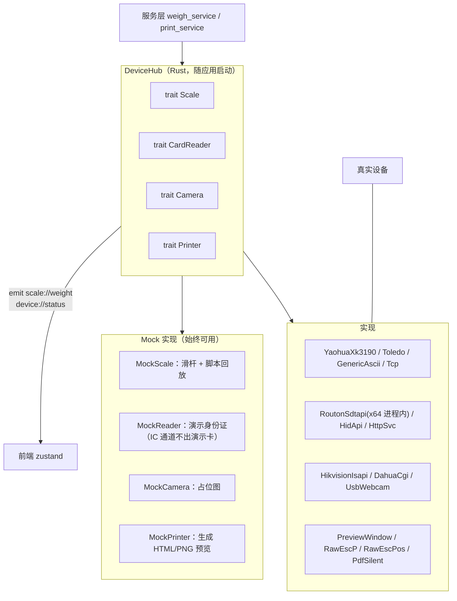
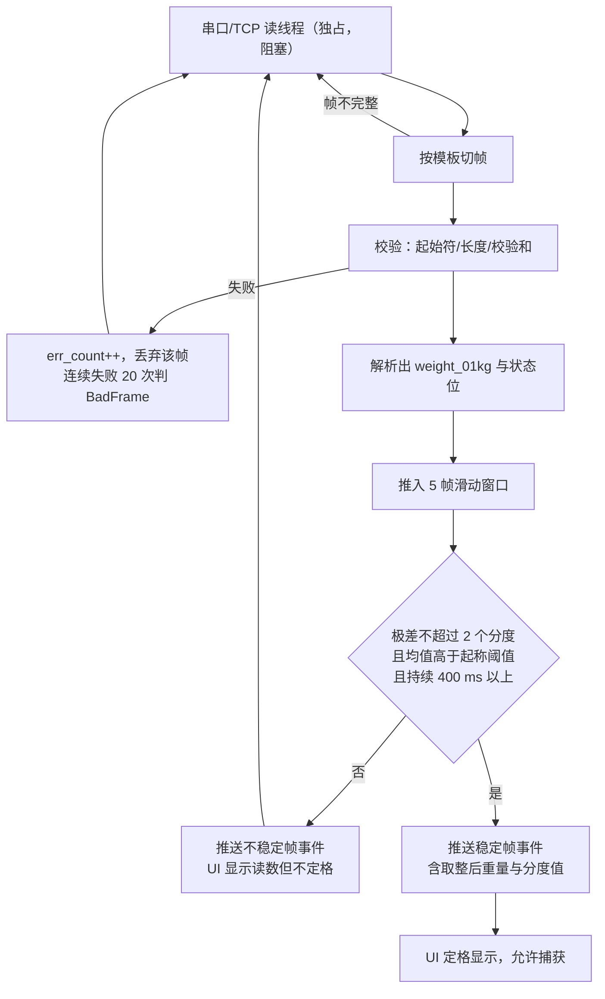
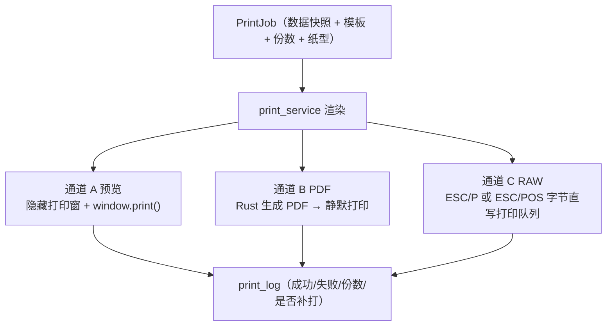

# 04 硬件对接方案

首版需对接四类外设：地磅称重仪表、证卡阅读器（身份证 + IC 双介质）、过磅抓拍摄像头、打印机（含钱箱/LED/语音等辅助外设）。本文给出每类设备的接入协议、Rust 抽象层设计、Mock 策略、降级方案与**现场必须验证的项目**。

核心原则：**没有硬件也能跑通全流程**。所有设备走统一 trait，Mock 实现与实装实现可在"设备中心"随时切换，开发、演示、培训、试运行均不依赖到场设备。

---

## 1 设备层总体设计



### 1.1 trait 定义

```rust
// devices/scale/mod.rs
pub trait Scale: Send + Sync {
    fn start(&self, tx: Sender<ScaleEvent>) -> Result<()>;   // 启动采集线程
    fn read_stable(&self, timeout: Duration) -> Result<Weighing>;  // 阻塞取一次稳定值
    fn zero(&self) -> Result<()>;      // 置零（仪表支持时）
    fn tare(&self) -> Result<()>;      // 去皮
    fn status(&self) -> DeviceStatus;
    fn probe(&self) -> Result<String>; // 自检，返回原始帧样本
    fn close(&self);
}

pub enum ScaleEvent {
    Frame { raw: String, weight: Option<Weight01Kg>, stable: bool },
    Status(DeviceStatus),
    Error(String),
}

// devices/reader/mod.rs —— 一台读卡器、两种介质（详见 §3）
pub trait CardReader: Send + Sync {
    fn probe(&self) -> Result<SamInfo>;                    // 在线凭据：SAM 应答
    fn read_id_card(&self, photo: bool) -> Result<IdCardInfo>;  // 介质一：身份证
    fn read_ic_card(&self, key: [u8; 6], blocks: &[(u8, u8)]) -> Result<IcCardInfo>; // 介质二：Mifare，只读
    fn media(&self) -> &'static [CardMedium];              // 该驱动声明支持的介质
    // fn watch(&self, tx: Sender<ReaderEvent>) -> Result<()>;  // 连续监听（放卡即报）：预留，未实装
}

// devices/camera/mod.rs
pub trait Camera: Send + Sync {
    fn snapshot(&self) -> Result<Vec<u8>>;   // JPEG 字节
    fn probe(&self) -> Result<()>;
}

// devices/printer/mod.rs
pub trait Printer: Send + Sync {
    fn submit(&self, job: &PrintJob) -> Result<PrintOutcome>;  // 同步返回受理结果
    fn lists(&self) -> Result<Vec<String>>;
}
```

> 本节 trait 是**设计草案**。已落地部分与草案有出入：读卡器实际是三条 Tauri 命令（`idcard_status` / `idcard_read` / `ic_read`）+ 进程内 `DEV_LOCK` 串行化，没有 `CardReader` trait 对象与 Mock 实现类，Mock 由前端 store 承担（见 §3.2、§3.3）。称重仪表侧最接近草案（读线程 + 事件推送）。

统一约定：

| 约定 | 内容 |
| --- | --- |
| 错误分类 | `DeviceError::{Offline, Timeout, BadFrame, AuthFailed, Busy, Unsupported}`，服务层按类别决定是否降级到手录 |
| 超时 | 读卡 2 s、抓图 3 s、打印受理 5 s、仪表判稳 8 s，全部可配 |
| 重连 | 指数退避（0.5/1/2/5/10 s 封顶），连续失败 5 次转 `offline` 并 emit 状态，不再刷屏 |
| 状态上报 | 每次成功更新 `device_config.last_ok_at`，失败累加 `err_count` 与 `last_error` |
| 并发 | 每个设备一个独占句柄（`Mutex`），串口不允许两个线程同时读 |
| 生命周期 | 应用退出前 `close()` 全部设备；读卡器为进程内直调，无子进程需要回收，但要确保 `DEV_LOCK` 不跨请求长期持有 |
| 原始帧留存 | 称重成功时把 `raw_frame` 存 `weigh_record.raw_frame`，是现场排障与纠纷复现的第一手依据 |

---

## 2 地磅称重仪表

### 2.1 现实约束

汽车衡（电子汽车磅）的称重仪表型号极多，粮站常见的是耀华 XK3190 系列、梅特勒-托利多、中航、耀华 A12、柯力 D301、耀华数字式等。**同一型号可通过面板参数设置成不同的输出方式**（连续发送 / 询问应答 / 稳定发送），因此不能假定"某型号 = 某一帧格式"。

结论：不做"按型号硬编码"，而做**通用帧模板 + 型号预设**。现场用"帧监视器"抓取实际字节流，套用或微调模板即可接入，无需改代码发版。

### 2.2 帧族分类

| 族 | 典型仪表 | 特征 | 解析方式 |
| --- | --- | --- | --- |
| A 连续 ASCII 发送 | 耀华 XK3190-A7/A9 连续发送、柯力 D2008、多数模拟传感器仪表 | 以固定起始符（常为 `=` 或 `STX`）开始，含符号位、数字、小数点、可选单位与状态字节，以 `CR`/`CRLF`/`ETX` 结束 | 分隔符切帧 + 位置化取值 |
| B 稳定值发送 | 部分仪表设为"稳定才发" | 同 A，但仅稳定时输出 | 同 A，判稳逻辑退化为"有帧即稳"，仍需本地二次确认 |
| C 询问-应答二进制 | 托利多 7E/STX 命令方式、耀华 XK3190-A9 命令方式 | 主机发查询指令，仪表应答定长帧，含校验和 | 请求-响应 + 定长/校验解析 |
| D 网络透传 | 仪表带以太网口或经串口服务器 | TCP 流，内容仍是 A/C 的帧 | 同 A/C，仅传输层换成 TCP 客户端 |

### 2.3 通用帧模板（存于 `device_config.config_json`）

```json
{
  "transport": { "kind": "serial", "port": "COM3", "baud": 9600, "data_bits": 8,
                 "parity": "none", "stop_bits": 1 },
  "framing":   { "mode": "delimited", "start": "=", "terminator": "\r\n",
                 "encoding": "ascii", "max_len": 20 },
  "payload":   { "sign_index": 1, "digits": "0123456", "decimal_places": 1,
                 "skip_chars": " ", "unit": "kg", "status_bytes": [] },
  "stability": { "window_frames": 5, "max_spread_divisions": 2,
                 "min_weight_01kg": 2000, "stable_ms": 400 },
  "align":     { "division_01kg": 100, "mode": "nearest_div" },
  "query":     { "enabled": false, "command_hex": "02 3F 57 45 03", "interval_ms": 200 }
}
```

字段说明：

- `framing.mode`：`delimited`（A/B/D）或 `fixed_len`（C）
- `payload.decimal_places`：仪表输出若含小数点，按小数点位取整到 0.1 kg 单位；无小数点时按 kg 直接换算
- `stability.min_weight_01kg`：起称阈值（默认 200 kg），防止空磅噪声被当作有效读数
- `stability.max_spread_divisions`：滑动窗口内极差不得超过的分度值个数（默认 2）
- `align.division_01kg`：分度值，60 t 汽车衡常为 10 kg（= 100 个 0.1 kg）
- `query`：C 族启用，按间隔主动查询

内置预设（一键填充模板，仍可改）：`yaohua_xk3190_cont`、`kerui_d2008_cont`、`toledo_7e_poll`、`generic_ascii_crlf`、`mock`。

### 2.4 采集与判稳流程



关键实现点：

1. **读线程独立于 Tauri 异步运行时**（`std::thread` + `serialport` 阻塞读），避免串口卡死拖垮 IPC
2. 事件推送节流：不稳定帧最多 10 帧/秒下发，稳定后立刻补发一次，防止 UI 数字乱跳看不清
3. 捕获动作由服务层执行：写 `weigh_record`（存原始值 + 取整值 + `raw_frame` + `stable` + `device_id`），设备层不碰业务表
4. 仪表故障（无帧 5 s / 校验持续失败）→ 状态转 `error` → 工作台顶部出现醒目横幅 + 允许"手工录入"切换（`weight_source='manual'`）
5. 置零/去皮按钮仅在仪表预设支持命令时启用，否则置灰并提示

### 2.5 现场必须验证

| 项 | 验证方法 | 失败时的处理 |
| --- | --- | --- |
| 仪表实际输出的字节 | 设备中心"帧监视器"看原始 hex 与 ASCII | 按实帧调模板，10 分钟内可接完 |
| 波特率等串口参数 | 仪表面板参数菜单查 | 现场改仪表或改配置 |
| 分度值与小数点含义 | 让司机上下磅观察读数变化 | 调 `division_01kg`、`decimal_places` |
| 是否会出现负值/超载 `OL` | 观察空磅与超载状态 | 模板加符号位与溢出串处理 |
| 两台磅/双口 | 逐台配置并设默认 | 单磅设计已支持多设备记录 |
| 线缆与 COM 口 | USB 转串口需查驱动（CH340/PL2303/FTDI） | Windows 需预装驱动，列入部署清单 |

风险：USB 转串口芯片驱动缺失是现场最高频故障，**部署脚本需包含驱动检测与提示**，并在设备中心显示"COM 口枚举列表"便于换口。

---

## 3 证卡阅读器（身份证 + IC 双介质）

### 3.1 结论：一台设备、两个介质通道

现场这台 **精伦 Routon iDR** 系列读卡器同时支持两种介质：非接 **二代居民身份证**（走 SAM 解密）与 **Mifare IC 卡**。因此系统里的概念单位是"**读卡器**"，不是"身份证阅读器 + 一个附带的 IC 小功能"：

- 一台设备（`device_config` 一行，`kind='idcard'`）挂**两条通道**（`idcard` / `ic`），各自有独立的"正在读 / 上次结果 / 错误原因"；
- 设备能读什么由**驱动能力登记表**决定，前端不写死：`src/lib/card-reader.ts` 的 `READER_DRIVERS[driver]` 声明 `media`（介质列表）、`onlineProof`（在线凭据）、`photo`（能否取照片）、`fields`（台账可配参数）；
- 设备中心面板按 `spec.media` 渲染章节，读几条介质就出几节；换一个只支持身份证的驱动，IC 那节自动消失。

> `device_config.kind` 的 CHECK 枚举值仍保留字面量 `'idcard'`（改名需重建表并动 `schema_snapshot.sql` 契约测试），只有展示文案与前端模型抽象成了"证卡阅读器"。

### 3.2 架构：64 位 Sdtapi.dll 进程内直调

BangHe 是 64 位应用，加载 `src-tauri/resources/sdtapi/` 下的 **64 位** `Sdtapi.dll`，在**本进程内**直调，没有桥接子进程、没有本地 HTTP 端口、没有 `termb.lic`：


关键实现点（`src-tauri/src/idcard.rs`，与 `printer.rs` 同一套硬性约定）：

| 点 | 做法 | 原因 |
| --- | --- | --- |
| 线程模型 | 每条命令都跑在 `spawn_blocking`，不占异步运行时 | 寻卡/读卡会阻塞数百毫秒到数秒，否则窗口卡死 |
| 设备互斥 | `static DEV_LOCK: Mutex<()>`，同一时刻只允许一个读卡操作 | Sdtapi 设备是**进程内单实例且非线程安全** |
| DLL 定位 | `locate_dll`：`SDTAPI_DLL` 环境变量 → exe 目录 → 打包资源目录 → dev 工作目录 | 开发态与安装包态路径不同，都要能起来 |
| 依赖 DLL | `Dewlt.dll`（照片解码）/`SavePhoto.dll` 与 `Sdtapi.dll` 同目录，由 `LOAD_WITH_ALTERED_SEARCH_PATH` 一并解析 | 混目录会解码失败 |
| 打开设备 | `open_driverfree(DRIVER_FREE_HID)` 失败则 `open_any([USB_HID, AUTO, 1, 2])` | 免驱机型优先，兼容装驱动的老机型 |
| 取卡 | 免驱版必须先 `authenticate()` 触发射频，故循环 **5 次 × 300 ms** 后放弃 | 放卡到感应需要一点时间 |
| 编码 | GBK 字段、生日/有效期 `CCYYMMDD` 由封装归一为可读串 | 直读会得到乱码与 `19750312` |
| 失败语义 | 命令永不 panic：返回 `ok=false` + 人类可读 `error` | 前端要能说清"为什么没读到" |

命令契约：

```text
idcard_status()                       -> { connected, samId?, fingerprint, error? }
idcard_read(withPhoto?)               -> { ok, name, gender, nation, birth, idNumber,
                                           address, agency, validFrom, validTo,
                                           photoPath?, error? }
ic_read(keyHex?, blocks?)             -> { ok, kindCode, kindLabel, sn,
                                           blocks: [{ sector, block, ok, hex, error? }], error? }
```

`keyHex` 为 12 位十六进制（6 字节）密钥，默认出厂密钥 `FFFFFFFFFFFF`；`blocks` 为 `(扇区, 块)` 列表，默认读扇区 0 的块 0/1/2（块 0 含厂商 UID）。**IC 通道只读，没有任何写块命令**——现场没验证过写权限，先把不可逆的动作排除在能力之外。

### 3.3 状态诚实性与降级

| 情形 | 界面 | 依据 |
| --- | --- | --- |
| 在线 | 只有 **SAM 应答**（`idcard_status` 拿到 `samId`）才点亮绿灯 | 02 §M9：能打开 USB ≠ SAM 会话可用 |
| 未检测 | `status='unknown'`，文案"未检测，读卡时自动探测"，首次读卡前自动 probe 一次 | 未知 ≠ 离线，不许混成一个红灯 |
| 读卡失败但设备通 | 状态灯**不动**，只给原因（"未检测到身份证，请把卡贴紧感应区后重试"） | 一次没读出不代表设备坏了 |
| 命令级失败 | 灯转红 + 保留 `lastProbe.error`（如"未找到 Sdtapi.dll"） | 这是真的不通 |
| Mock 设备 | 只出演示卡，明示"演示卡"徽标；**IC 通道不给演示数据** | 演示数据不能伪装成真机结果 |
| 外设总开关关闭 | 工作台所有外设按钮置灰并写清原因，**保留**"搜档案/手工录入证号"路径 | F1.1 降级路径永远保留 |
| 浏览器预览 | 提示"当前是浏览器预览，没有原生设备通道，请用 `npm run tauri dev`" | 避免把没接上误读成设备坏了 |

明文证号只存在于内存，界面一律 `maskIdCard` 脱敏显示；落库按 03 §4 的字段级加密（`id_card_no_enc` BLOB）处理，档案匹配在 Rust 侧做，不把证号当查询串传出去。

### 3.3.1 读卡建档的连续监听（放卡弹窗）

建档现场的动作是"农户走过来把证件放上去"，不是操作员点一下按钮：人从排队到放稳普遍超过一轮寻卡的 2 秒窗口，点读一次就把重试甩回给了操作员。所以 `/parties` 的「读卡建档」改为弹 `CardScanDialog`，弹窗开着期间由 `store/device` 的 `idcard.watch()` 一轮接一轮地调 `idcard_read`（轮间停 350 ms），读到卡自动收工去带出档案。

- **监听为什么放在前端而不是 Rust 常驻线程**：读卡器是进程内单实例、厂商 DLL 非线程安全，所有寻卡/读卡都在 `DEV_LOCK` 里串行（§3.5 第 5 条）。常驻监听会把这把锁长期占住，工作台与设备中心的其它设备命令一起被饿死；前端循环每轮返回即放锁，弹窗关掉立刻停，代价只是每轮重跑一次 `Sdt::load`。§3.1 预留的 `fn watch(tx)` 仍未实装，等真出现"必须放卡即报"的机型再开。
- **两条停止口径**：60 秒倒计时走完，或用户提前关闭（右上角叉 / 取消监听 / Esc），都算正常结束且不留后台轮询；读到卡同样立刻收工。`stopWatch` 会换掉监听循环的"任期号"，StrictMode 双跑与弹窗重挂不会留下两条并行循环。
- **两类失败分道**：每轮"没检测到卡"只写 `watchNote`，显示在弹窗里当进度提示；命令级失败（设备不通、缺 `Sdtapi.dll`、外设总开关关闭）仍写 `error` 并让监听循环停下。不分开的话，弹窗背后那条页面级告警会随每一轮寻卡反复闪，而真故障会被淹没在"没卡"里。
- **降级路径照旧保留**：弹窗里始终有「手工录入」，读不出来直接开空表单建档（§3.4 方案 E）。

### 3.4 备选方案（按采购情况择一，可并存）

| 方案 | 适用设备 | 优点 | 代价 |
| --- | --- | --- | --- |
| B 免驱 HID 直连（`hidapi`） | 部分"二代证读卡器（HID 免驱）" | 无需 DLL | 需拿到该设备的 HID 报文协议；厂商常不公开。精伦免驱机型已由 `routon-idr` 覆盖 |
| C 厂商本地 HTTP 服务 | 厂商提供的"网页版读卡控件/服务" | 实现最简 | 需现场预装厂商服务，版本不可控 |
| D 网络版读卡终端 | 带网口的读卡机 | 跨机器共享、无 DLL | 设备贵，需确认协议是否开放 |
| E 不接设备 | — | — | 手工录入证号 + 格式校验，档案标记"未读卡核验"（**已作为 F1.1 降级路径实现，永远保留**） |

新增厂商设备时不需要动 UI：在 `card-reader.ts` 的 `READER_DRIVERS` 加一条登记（声明 `media`/`onlineProof`/`fields`），Rust 侧加对应命令即可。

### 3.5 已知坑（必须写进部署文档）

1. **安装包别把测试照片打进去**：`SavePhoto.dll` 会往 DLL 同目录顺手落一份 `photo.bmp`/`photo.jpg`（102×126 的真实身份证照片）。dev 跑一次真机读卡就会污染 `src-tauri/resources/sdtapi/`。`tauri.conf.json` 的资源打包已改为**逐文件枚举**而非 `resources/sdtapi/*` 通配，且 `photo.*` 已进 `.gitignore`——历史提交里的样本照片需自行清理。
2. 64 位进程链接 32 位 DLL 直接失败，报错误导性强（表现为"未找到设备"）。厂商开发包**必须确认是 x64 版**；`Sdt::load` 失败信息里会带 `ERROR_BAD_EXE_FORMAT` 字样，看到它就是拿错包了。
3. 照片解码依赖 `Dewlt.dll`/`SavePhoto.dll` 与 `Sdtapi.dll` **版本配套**，混用不同开发包的 DLL 会解码失败或崩溃；三者必须同批拷贝。
4. 部分设备需先装 USB 驱动（`USBDrv-*.msi`），同一机型不同批次 VID/PID 可能不同 → `open_driverfree` 失败时靠 `open_any` 兜底，仍失败要能在 `error` 里看出来。
5. 厂商 DLL 非线程安全，**任何**读卡/寻卡调用都在 `DEV_LOCK` 里串行；前端两条通道共用一台设备，不要并发点。
6. 连续读卡行为差异大（有的放卡即出、有的需重新放置），代码用 5 次 × 300 ms 重试吸收，实测不达标时先调这个循环而不是加设备端轮询。建档面的放卡弹窗（§3.3.1）另有一层外层轮询，但那是**弹窗开着期间的前端循环、关掉即停**，不等于给设备开了常驻监听线程。
7. `routon.ini` 与 DLL 同目录，`Log`/`LogData` 出厂为 `0`；现场排障临时打开会把证号写进日志，**排查完必须关回去**。

### 3.6 已废弃方案存档：x86 桥接子进程

早期设计（本节前身）判断"主流厂商 SDK 均为 x86（32 位）动态库，64 位 Tauri 进程无法 `LoadLibrary`"，据此规划过一整套 `idcard-bridge.exe`（C# / .NET Framework 4.x / x86）+ 主进程守护 + `127.0.0:随机端口` HTTP + 一次性 token 的桥接架构，并要求 `termb.lic` 放在 `C:\` 根目录。

**实际到货的精伦机型提供 x64 版 `Sdtapi.dll`，且免驱 HID 可直接打开**，桥接层要解决的问题（位数不兼容、授权文件、进程生命周期）全部不存在。继续保留一个子进程只会多出一处崩溃面、一处端口竞争和一份需要单独构建签名的二进制，故整条链路删除，改为 3.2 的进程内直调。代码里已无 `bridge_exe`/`termb`/`华视` 相关实现，仅本文档留此存档。

若后续采购到只有 32 位 SDK 的机型，桥接仍是备选：那份契约（`GET /health`、`GET /read?timeout=&photo=`，408 超时无卡 / 503 设备离线 / 451 授权缺失）设计得足够干净，可以作为 `card-reader.ts` 里一条新登记驱动接回来，前端与工作台代码不用动。

---

## 4 过磅监控抓拍

### 4.1 方案选择：优先 HTTP 抓图

| 方式 | 适用 | 实现成本 | 说明 |
| --- | --- | --- | --- |
| A 摄像头 HTTP 抓图（推荐） | 海康、大华、宇视等 IP 摄像机/录像机 | 低（`reqwest` 一次 GET） | 直接得到 JPEG，无重依赖 |
| B NVR 通道抓图 | 已有录像机 | 低 | 走 NVR 的同一套 CGI |
| C RTSP 抽帧 | 摄像头不开放抓图接口 | 高 | 需 ffmpeg 外挂，分发涉及 LGPL/GPL 合规，进程管理复杂；仅作兜底 |
| D USB 摄像头 | 用笔记本/USB 头的站点 | 中（`nokhwa`） | 画质与视角不适合拍整车，作备用 |

抓图 URL 预设（存 `config_json`，可改）：

```text
海康（ISAPI）  GET http://<ip>/ISAPI/Streaming/channels/<ch>01/picture
               ch=1 → 101（主码流）；需 HTTP Digest 认证
大华（CGI）    GET http://<ip>/cgi-bin/snapshot.cgi?channel=<ch>&subtype=0&format=jpg
               需 Digest；部分固件参数为 sn=1&channel=0
宇视           GET http://<ip>/media/1.jpeg?type=streaming&subtype=0
通用模板       允许完全自定义 URL，支持 {ip} {channel} {subtype} 占位
```

认证：`auth` 支持 `digest` / `basic` / `none`；密码存 `device_config.secret_json`（加密）。

### 4.2 触发与存储

- 触发时机：捕获毛重、捕获皮重各一张（参数 `capture_on_gross` / `capture_on_tare`）；异常复称额外一张
- 处理：`image` crate 解码 → 长边限制 1600 px → JPEG 质量 80 → 若 > `attachment_max_kb` 逐级降质 → 计算 SHA-256 → 写文件 + `attachment` 记录
- 命名：`attachments/scale_capture/<站码>/<年>/<月>/<单号>/<seq>_<gross|tare|reweigh>.jpg`
- 失败降级：抓图失败**绝不阻断称重保存**，只在单据上留"无抓拍"标记并写 `audit_log`；连续失败转设备离线
- 网络：摄像头与磅房机同网段即可，不需外网；跨网段/需 VPN 时优先方案 B 或改用站点本地 NVR

### 4.3 合规提示

抓拍画面含人像与车牌，属个人信息：不外传、不上传云端、访问写审计、按 `attachment_keep_days` 到期清理（默认 10 年，与台账留存一致，可按监管要求调整）。展示时缩略图 + 点击原图并记 `pii.read` 审计。

---

## 5 打印与辅助外设

### 5.1 Tauri v2 的现实限制

Tauri v2 核心**不提供静默打印、打印机选择、纸张/边距控制**的 API（官方 silent-print 插件长期是 open issue）。`core:webview:allow-print` 只放行"打印"这一动作，最终仍由 WebView2 打印预览由用户点确认。因此必须自建通道抽象。

### 5.2 三通道



| 通道 | 实现 | 优点 | 限制 |
| --- | --- | --- | --- |
| A 预览（首版默认） | 打印窗口渲染磅单 HTML，CSS `@page` 定纸型边距，调 `window.print()`（WebView2 原生支持，弹系统/Edge 打印预览）；或 Tauri `print()`（需 `core:webview:allow-print`） | 零额外依赖、所见即所得、用户可选打印机、中文与条码字体交给系统 | 每次需人工点确认，无法无人化；边距依赖预览里"边距：无/最小"设置 |
| B PDF 静默 | Rust 侧用模板生成 PDF（`typst` 排版引擎或 `printpdf`）→ 打印：调 `SumatraPDF.exe -print-to "<printer>" -print-settings "nodoubleprint,nocollate"`（独立进程，不受其 GPL 传染性影响，但需随包分发 exe）；或 `windows` crate 走 GDI 打印（工作量大） | 可全自动、版式跨机一致、天然留档（PDF 落盘即电子存档） | 依赖外挂 exe 或大量 Win32 代码；字体需嵌入 PDF |
| C RAW 指令 | `windows` crate `winspool`：`OpenPrinterW` → `StartDocPrinterW(datatype="RAW")` → `StartPage` → `WritePrinter`（ESC/P 或 ESC/POS 字节流）→ `EndPage/EndDoc` → `ClosePrinter` | 套打精确逐毫米定位、无对话框、速度快、热敏小票可开钱箱 | **要求打印机支持对应指令集**（爱普生 LQ 系列 ESC/P2、映美 FP 系列、芯烨/爱普生 TM 系列 ESC/POS）；驱动模式下需允许直通；中文字形依赖打印机内置字库或点阵图 |

首版策略：**通道 A 全量实现（一定能用）+ 通道 C 针对现场实际打印机型号实现**；通道 B 作为试运行期的可选增强。三者对上层是同一个 `PrintJob`，切换只改 `device_config`。

#### 通道 C 实装记录（2026-09-11，斯普瑞特 SPRT 80 mm 实机）

现场接入的第一台是热敏小票机，通道 C 已在实机跑通，结论如下：

| 项 | 实测结论 |
| --- | --- |
| 设备寻址 | USB `VID_0483&PID_5720`（序列号 `11101800002`）；Windows 里同时存在队列「80mm Series Printer」→ USB002，即系统已挂 `usbprint.sys` 类驱动 |
| 传输实现 | **没有自写 `winspool`**：用 `escpos` 0.20（feature `usbprint`），`CreateFileW` 直接打开 `GUID_DEVINTERFACE_USBPRINT` 设备接口（`FILE_SHARE_READ\|WRITE`，与打印队列共存不互斥），字节直达打印机 |
| 中文 | 库不带汉字指令（无 `FS` 系列）。做法：`Protocol::new(Encoder::new(encoding_rs::GBK))` + 手工发 `FS &`（`1C 26`）进中文模式，实机用**内置点阵字库**清晰打出，无需光栅化文字 |
| 栅格 | ESC/POS Font A 一行 **48 列**（打 48 个 `-` 不折行）；排版按 `Paper::P80 = 48` / `P58 = 32`，汉字与全角标点按 2 列计宽 |
| 状态查询 | `DLE EOT` 有应答（实测状态字节 `0x16`）。两个坑必须处理：打开后**第一次 bulk-IN 常是脏字节**（多为 `0x2B`）要先丢弃；**一次只发一条查询**，打包多条会让响应错位。部分工况下设备不回 ESC/POS 状态，此时退回 `IOCTL_USBPRINT_GET_LPT_STATUS` |
| 切刀 | `GS V B 0` 半切有效 |
| 钱箱 | 指令已封装（`CashDrawer::Pin2`），现场未接钱箱，未实测 |

代码落点（排版只此一份，主程序与工装共用）：

- `crates/ticket-core` —— `device.rs`（枚举/打开/DLE EOT 状态）、`render.rs`（票面排版、GBK、栅格与分节格式）、`model.rs`（`WeighTicket` 快照）
- `src-tauri/src/printer.rs` —— `printer_list` / `printer_status` / `printer_self_test` / `print_weigh_ticket`，全部跑在 `spawn_blocking` 上；打印失败**不回异常**，只回 `ok=false` + 原因，防止打印成为磅队堵点
- `tools/escpos-probe` —— 现场命令行工装（`--list` / `--status` / 自检票 / `--ticket` 样例码单 / `--out` 导出字节）
- `src/lib/native.ts` —— 前端唯一原生出口；无 Tauri 环境时返回 `available:false` + 原因，界面据此置灰并解释，不用假数据伪装"设备在线"

配置写入与门禁（02 §M9 的"保存前必须联机测试通过"已落地）：

- 设备中心 → 小票机卡片 → 右侧「配置…」：改 VID / PID / 纸宽。规则是**改任一字段，上一次联机测试立即作废**；未测试或测试不通过时保存按钮不动，API 层同样会拒绝（不靠 UI 自觉）。
- 基础档案 → 站点参数 → 打印通道 / 纸型：只有会把单据打到热敏机的选项触发验证，改联数不打扰设备。
- 验证只发一次 `DLE EOT` 状态查询，**不出纸**；浏览器预览问不到设备时允许保存，但状态写"未检测"并把原因落到 `last_error`，审计明细追加"（未经真机验证）"——不用 mock 结果骗出绿标。
- 判断逻辑只在 `src/lib/print-guard.ts` 一处（`needsPrintVerify` / `verifyReceiptPrinter` / `PAPER_COLS`），Rust 侧 `Paper::cols()` 与它同口径。

仍未闭环：`print_log` 目前是 mock 留痕，真打印的成败与设备 label 尚未回写；地磅的串口参数与帧模板写入未开放；A4/241 针式仍走通道 A；`IOCTL` 状态字 `0x18` 的缺纸位含义与实机纸位的对应关系需在带钱箱/满纸工况下再核一次。

### 5.3 磅单套打（一式多份/针式连续纸）

现场最易出问题的环节，必须按下面流程调：

1. 确认纸型：`241-3`（三层整张）、`241-2P`（二层有撕裂线）、A4 等；连续纸需设"页长 = 表单行数"
2. 确认联数与"页与页之间跳过行数"——套打纸的横向错位会累积，必须在模板里用**绝对行定位**而非自然流式排版
3. 通道 A 调法：`@page { size: 241mm 140mm; margin: 0 }`，`-webkit-print-color-adjust: exact`，并在预览中选"边距：无"
4. 通道 C 调法：ESC/P 用 `ESC 0 n`（n/60 英寸）设行距、`ESC (k` 选中文字形、`ESC A` 设页长、`FF` 换页；打印一份"格线校准页"（每 5 mm 一条刻度线）给客户贴到机器上对比
5. 打印机走纸起始偏移：用 `ESC Q n`（左边距）与首次换行数校正
6. 骑缝编号/联次标注（"第一联 存根联 / 第二联 财务联 / 第三联 客户联"）需在模板内固定

### 5.4 辅助外设

| 外设 | 方案 | 优先级 |
| --- | --- | --- |
| 钱箱 | ESC/POS `2B 00 00`（脉冲）随小票打印一并发送 | P2 |
| LED 外部显示屏 | RS232/485 私有协议（多为 `0xA5` 帧头 + GB2312 字节），需型号；作为独立 `Led` trait | P2 |
| 语音播报（系统合成） | **方案已由 [07 话筒喊话与语音播报](./07-话筒喊话与语音播报.md) 定稿**：仍是预录片段拼接（"请上磅""毛重""公斤""请下磅"），但运行期**不用 `rodio`**，改由 `cpal` 单输出流 + 自建混音仲裁承担（07 §2.4）。`System.Speech` 只用在构建期一次性合成片段包，运行期不起子进程，那条 300–800 ms 启动延迟因此不存在 | P1 |
| 话筒喊话（人工 PTT） | 本机声卡直连：USB 话筒 → 软件直通 → 线路输出 → 功放/音柱。与播报共用一路输出并二选一互斥；无厂商 SDK、无网络协议，`device_config.kind='pa'`（一条链路含进/出两个端点，沿用读卡器"一台设备两条通道"的建模）。详见 07 全文 | P1 |
| 手写签名板 | 汉王/天汇/ePad 多为 x86 SDK 或自带驱动 + 图像回调 → 若确认只有 32 位 SDK，需**自建**桥接子进程（`signpad-bridge.exe`，返回 PNG）。读卡器已改进程内直调，没有现成桥接可复用，见 §3.6 | P1 |
| 近红外快检仪 | 若型号支持"打印输出"或串口直出文本，可复用 §2 的通用帧模板解析指标值 | P2 |

### 5.5 中文字体

磅单需要中文与**等宽数字**。策略：正文用系统宋体/黑体（`font-family: "SimSun","Microsoft YaHei"`），所有重量与金额字段用 `font-variant-numeric: tabular-nums` + 内嵌等宽数字字体，保证套打对齐与表格不错位。生成 PDF 时必须嵌入字体子集，否则换机乱码。

---

## 6 设备自诊断（M9）

设备中心页必须做到"现场不懂技术的人也能定位是哪台设备坏了"：

| 区块 | 内容 |
| --- | --- |
| 状态卡 | 每个设备一张卡：名称、类型、驱动、纸型/端口、状态灯（在线/离线/异常/未知）、最后成功时间、连续错误数 |
| 一键测试 | 仪表：显示实时读数 + 帧监视器（原始 hex/ASCII 滚动）；读卡器：探测 SAM 回读指纹，再按该驱动登记的介质各测一次（读身份证 / 寻 IC 卡），逐块显示成败；摄像头：显示抓拍缩略图；打印机：打印测试页（含格线校准页） |
| Mock 开关 | 全局 + 单设备两级；启用 Mock 时界面显著提示"当前为模拟模式"，防止误当真实数据 |
| 故障建议 | 每类错误给出下一步动作（如"检查 COM3 是否被占用""确认波特率 9600""未找到 Sdtapi.dll，确认安装包 `sdtapi/` 目录完整""未检测到身份证，把卡贴紧感应区"） |
| 配置导入导出 | 设备配置导出 JSON，换机时可导入，减少现场重复配置 |
| 日志 | 原始帧与错误进 `tracing` 按天滚动文件，可在页面"打开日志目录" |

---

## 7 风险汇总

| 编号 | 风险 | 影响 | 应对 |
| --- | --- | --- | --- |
| H1 | ~~身份证阅读器 SDK 32 位，需额外 x86 桥接进程~~ **已消除**：到货精伦机型带 x64 `Sdtapi.dll`，改进程内直调（§3.2） | — | 残余风险：后续换厂商时仍可能买到只有 32 位 SDK 的机型，采购前必须确认位数（见 §8 第 3 项） |
| H2 | 仪表帧格式与预设不符 | 现场接不上磅 | 通用帧模板 + 帧监视器，配置化解决，不发版 |
| H3 | 针式套打错位 | 单据不可用，农户纠纷 | 通道 A 保底（先能出单据）+ 格线校准页 + 现场调参工时预留 1–2 天 |
| H4 | 无静默打印 API | 每单需人工点一次打印确认 | 试运行期接受；后续通道 B/C 消除 |
| H5 | USB 转串口驱动缺失 | 上磅即失败 | 部署脚本检测 + 设备中心显示 COM 枚举 |
| H6 | 摄像头网络不通或密码变更 | 无抓拍留痕 | 不阻断业务，仅标记"无抓拍" + 审计 |
| H7 | ~~授权文件 `termb.lic` 需放 `C:\` 根~~ **已消除**：x64 进程内直调不需要授权文件 | — | 改为确保 `Sdtapi.dll`/`Dewlt.dll`/`SavePhoto.dll`/`routon.ini` 随包且同目录（`bundle.resources` 已逐文件枚举，防测试照片进包，见 §3.5-1） |
| H8 | 打印机指令集不直通（驱动模式吞掉 RAW） | 通道 C 不可用 | 提前确认打印机品牌型号（Q3），必要时回退通道 A/B |
| H9 | 60 t 汽车衡分度值 10–20 kg 导致"吨级金额"粗颗粒 | 农户对净重取整有异议 | 站点参数固定取整规则并在码单上明示 |

---

## 8 需要现场提供的资料（对应 01 文档 Q3–Q7）

1. 称重仪表铭牌照片 + 面板参数菜单中"通讯/输出方式"设置项截图
2. 串口线接法（DB9 针脚：2/3/5 常用）与是否经串口服务器
3. 证卡阅读器品牌型号 + 厂商开发包压缩包（含示例程序、SDK 手册）。**必须确认含 x64 版 `Sdtapi.dll`（或对应 64 位库）与配套照片解码 DLL**：现有精伦机型已按 64 位进程内直调落地（§3.2），若新机型只有 32 位 SDK，才需回到 §3.6 存档的桥接方案
4. 摄像头品牌型号、IP、账号、是否走 NVR 及通道号
5. 打印机品牌型号、纸型规格（量准毫米）、已装驱动名称
6. 是否需要钱箱、LED 屏、签名板。**语音两路（喊话 + 播报）开工前另需**：话筒型号与接口（USB / 3.5 mm / 有无 PTT 开关及默认键码）、功放是否支持 MIC 优先、音柱与磅房窗的距离与指向、电脑可用的线路输出路数——清单见 07 §10
7. 磅房工位与设备摆放照片（用于设计工作台分屏与显示位）

拿到 1、3、4、5 四项即可在不发版的前提下完成全部适配，缺项一律以 Mock + 手录降级保证可先上线。第 6 项只影响辅助外设（含喊话）能否实装，不影响这句话。
