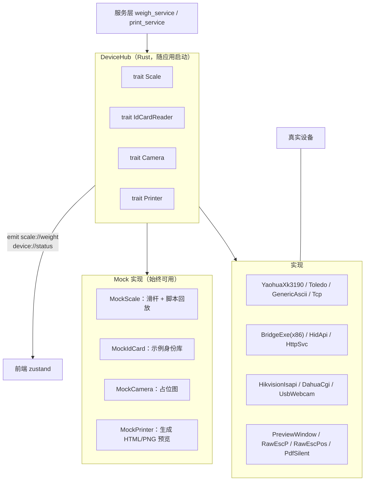
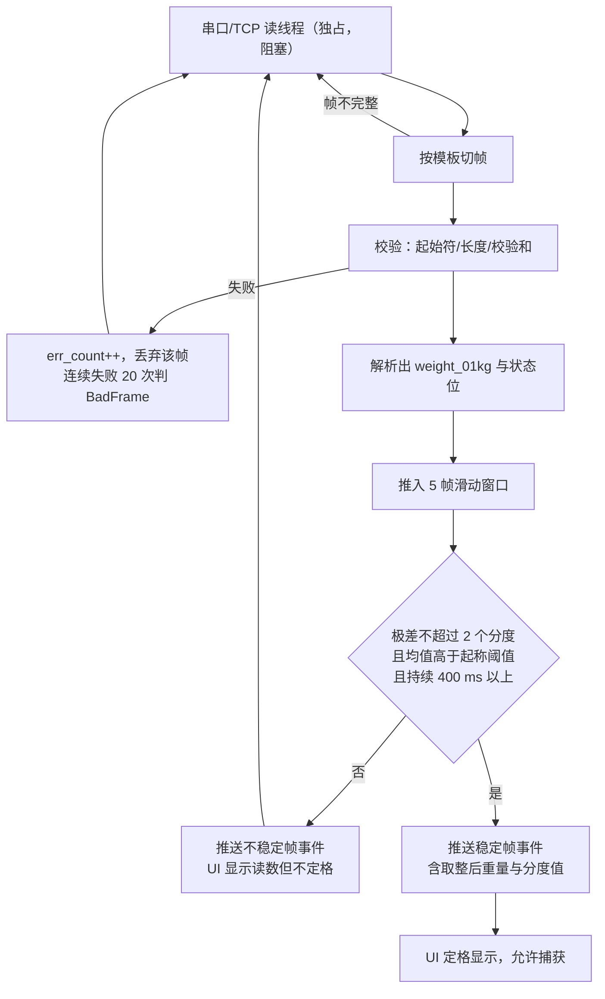
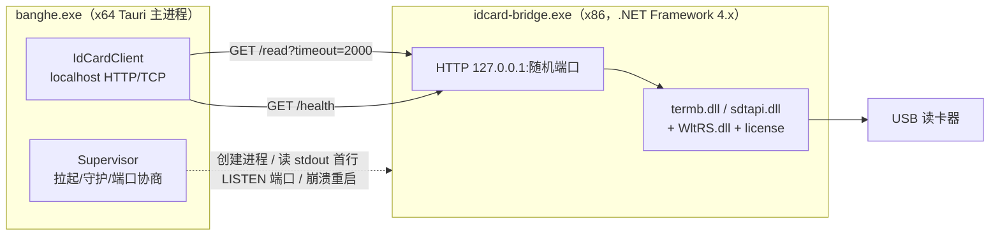
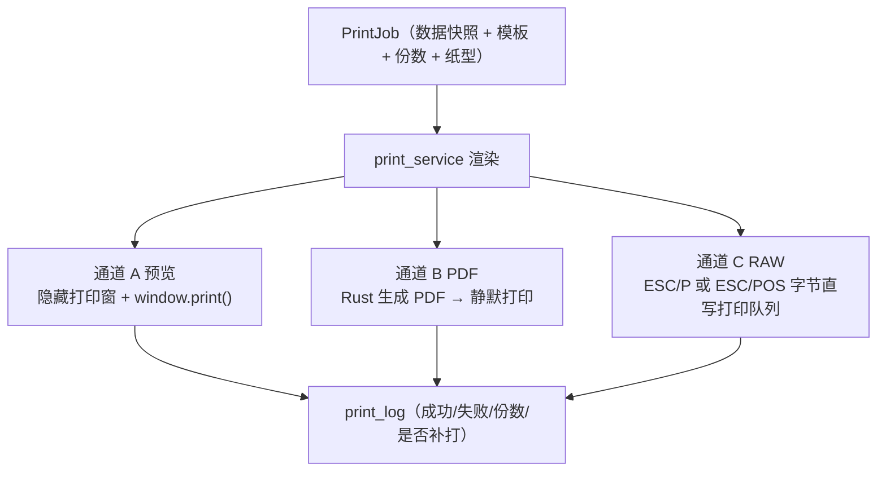

# 04 硬件对接方案

首版需对接四类外设：地磅称重仪表、身份证阅读器、过磅抓拍摄像头、打印机（含钱箱/LED/语音等辅助外设）。本文给出每类设备的接入协议、Rust 抽象层设计、Mock 策略、降级方案与**现场必须验证的项目**。

核心原则：**没有硬件也能跑通全流程**。所有设备走统一 trait，Mock 实现与实装实现可在"设备中心"随时切换，开发、演示、培训、试运行均不依赖到场设备。

---

## 1 设备层总体设计



### 1.1 trait 定义

```rust
// devices/scale/mod.rs
pub trait Scale: Send + Sync {
    fn start(&self, tx: Sender<ScaleEvent>) -> Result<()>;   // 启动采集线程
    fn read_stable(&self, timeout: Duration) -> Result<Weighing>;  // 阻塞取一次稳定值
    fn zero(&self) -> Result<()>;      // 置零（仪表支持时）
    fn tare(&self) -> Result<()>;      // 去皮
    fn status(&self) -> DeviceStatus;
    fn probe(&self) -> Result<String>; // 自检，返回原始帧样本
    fn close(&self);
}

pub enum ScaleEvent {
    Frame { raw: String, weight: Option<Weight01Kg>, stable: bool },
    Status(DeviceStatus),
    Error(String),
}

// devices/idcard/mod.rs
pub trait IdCardReader: Send + Sync {
    fn read(&self, timeout: Duration) -> Result<IdCardInfo>;   // 单次读卡
    fn watch(&self, tx: Sender<IdCardEvent>) -> Result<()>;    // 连续监听（放卡即报）
    fn probe(&self) -> Result<String>;
}

// devices/camera/mod.rs
pub trait Camera: Send + Sync {
    fn snapshot(&self) -> Result<Vec<u8>>;   // JPEG 字节
    fn probe(&self) -> Result<()>;
}

// devices/printer/mod.rs
pub trait Printer: Send + Sync {
    fn submit(&self, job: &PrintJob) -> Result<PrintOutcome>;  // 同步返回受理结果
    fn lists(&self) -> Result<Vec<String>>;
}
```

统一约定：

| 约定 | 内容 |
| --- | --- |
| 错误分类 | `DeviceError::{Offline, Timeout, BadFrame, AuthFailed, Busy, Unsupported}`，服务层按类别决定是否降级到手录 |
| 超时 | 读卡 2 s、抓图 3 s、打印受理 5 s、仪表判稳 8 s，全部可配 |
| 重连 | 指数退避（0.5/1/2/5/10 s 封顶），连续失败 5 次转 `offline` 并 emit 状态，不再刷屏 |
| 状态上报 | 每次成功更新 `device_config.last_ok_at`，失败累加 `err_count` 与 `last_error` |
| 并发 | 每个设备一个独占句柄（`Mutex`），串口不允许两个线程同时读 |
| 生命周期 | 应用退出前 `close()` 全部设备；子进程（读卡桥接）由主进程负责 kill，不留孤儿进程 |
| 原始帧留存 | 称重成功时把 `raw_frame` 存 `weigh_record.raw_frame`，是现场排障与纠纷复现的第一手依据 |

---

## 2 地磅称重仪表

### 2.1 现实约束

汽车衡（电子汽车磅）的称重仪表型号极多，粮站常见的是耀华 XK3190 系列、梅特勒-托利多、中航、耀华 A12、柯力 D301、耀华数字式等。**同一型号可通过面板参数设置成不同的输出方式**（连续发送 / 询问应答 / 稳定发送），因此不能假定"某型号 = 某一帧格式"。

结论：不做"按型号硬编码"，而做**通用帧模板 + 型号预设**。现场用"帧监视器"抓取实际字节流，套用或微调模板即可接入，无需改代码发版。

### 2.2 帧族分类

| 族 | 典型仪表 | 特征 | 解析方式 |
| --- | --- | --- | --- |
| A 连续 ASCII 发送 | 耀华 XK3190-A7/A9 连续发送、柯力 D2008、多数模拟传感器仪表 | 以固定起始符（常为 `=` 或 `STX`）开始，含符号位、数字、小数点、可选单位与状态字节，以 `CR`/`CRLF`/`ETX` 结束 | 分隔符切帧 + 位置化取值 |
| B 稳定值发送 | 部分仪表设为"稳定才发" | 同 A，但仅稳定时输出 | 同 A，判稳逻辑退化为"有帧即稳"，仍需本地二次确认 |
| C 询问-应答二进制 | 托利多 7E/STX 命令方式、耀华 XK3190-A9 命令方式 | 主机发查询指令，仪表应答定长帧，含校验和 | 请求-响应 + 定长/校验解析 |
| D 网络透传 | 仪表带以太网口或经串口服务器 | TCP 流，内容仍是 A/C 的帧 | 同 A/C，仅传输层换成 TCP 客户端 |

### 2.3 通用帧模板（存于 `device_config.config_json`）

```json
{
  "transport": { "kind": "serial", "port": "COM3", "baud": 9600, "data_bits": 8,
                 "parity": "none", "stop_bits": 1 },
  "framing":   { "mode": "delimited", "start": "=", "terminator": "\r\n",
                 "encoding": "ascii", "max_len": 20 },
  "payload":   { "sign_index": 1, "digits": "0123456", "decimal_places": 1,
                 "skip_chars": " ", "unit": "kg", "status_bytes": [] },
  "stability": { "window_frames": 5, "max_spread_divisions": 2,
                 "min_weight_01kg": 2000, "stable_ms": 400 },
  "align":     { "division_01kg": 100, "mode": "nearest_div" },
  "query":     { "enabled": false, "command_hex": "02 3F 57 45 03", "interval_ms": 200 }
}
```

字段说明：

- `framing.mode`：`delimited`（A/B/D）或 `fixed_len`（C）
- `payload.decimal_places`：仪表输出若含小数点，按小数点位取整到 0.1 kg 单位；无小数点时按 kg 直接换算
- `stability.min_weight_01kg`：起称阈值（默认 200 kg），防止空磅噪声被当作有效读数
- `stability.max_spread_divisions`：滑动窗口内极差不得超过的分度值个数（默认 2）
- `align.division_01kg`：分度值，60 t 汽车衡常为 10 kg（= 100 个 0.1 kg）
- `query`：C 族启用，按间隔主动查询

内置预设（一键填充模板，仍可改）：`yaohua_xk3190_cont`、`kerui_d2008_cont`、`toledo_7e_poll`、`generic_ascii_crlf`、`mock`。

### 2.4 采集与判稳流程



关键实现点：

1. **读线程独立于 Tauri 异步运行时**（`std::thread` + `serialport` 阻塞读），避免串口卡死拖垮 IPC
2. 事件推送节流：不稳定帧最多 10 帧/秒下发，稳定后立刻补发一次，防止 UI 数字乱跳看不清
3. 捕获动作由服务层执行：写 `weigh_record`（存原始值 + 取整值 + `raw_frame` + `stable` + `device_id`），设备层不碰业务表
4. 仪表故障（无帧 5 s / 校验持续失败）→ 状态转 `error` → 工作台顶部出现醒目横幅 + 允许"手工录入"切换（`weight_source='manual'`）
5. 置零/去皮按钮仅在仪表预设支持命令时启用，否则置灰并提示

### 2.5 现场必须验证

| 项 | 验证方法 | 失败时的处理 |
| --- | --- | --- |
| 仪表实际输出的字节 | 设备中心"帧监视器"看原始 hex 与 ASCII | 按实帧调模板，10 分钟内可接完 |
| 波特率等串口参数 | 仪表面板参数菜单查 | 现场改仪表或改配置 |
| 分度值与小数点含义 | 让司机上下磅观察读数变化 | 调 `division_01kg`、`decimal_places` |
| 是否会出现负值/超载 `OL` | 观察空磅与超载状态 | 模板加符号位与溢出串处理 |
| 两台磅/双口 | 逐台配置并设默认 | 单磅设计已支持多设备记录 |
| 线缆与 COM 口 | USB 转串口需查驱动（CH340/PL2303/FTDI） | Windows 需预装驱动，列入部署清单 |

风险：USB 转串口芯片驱动缺失是现场最高频故障，**部署脚本需包含驱动检测与提示**，并在设备中心显示"COM 口枚举列表"便于换口。

---

## 3 身份证阅读器

### 3.1 硬性障碍：SDK 是 32 位 DLL

主流厂商（华视 CVR-100 系列、新中新 DR-XR、神盾申、中科、国腾）的 SDK 均为 `termb.dll` / `sdtapi.dll` / `SynIDCardAPI.dll` 等 **x86（32 位）** 动态库，调用约定 `StdCall`，且照片解码要配合 `WltRS.dll` + `DLL_File.dll` 与放在 **`C:\` 根目录的授权文件**（`termb.lic` / `license.dat`）。

本项目是 64 位 Tauri 应用，**Windows 不允许在 64 位进程中加载 32 位 DLL**（`LoadLibrary` 返回 `ERROR_BAD_EXE_FORMAT`），`libloading`/`windows` crate 均无法绕过。这是平台限制，不是实现选择。

### 3.2 方案：x86 桥接子进程（主方案）



设计要点：

- 桥接进程用 **C# + .NET Framework 4.x，目标平台 x86**：Windows 10/11 自带 .NET Framework 4.8，无需额外运行时，厂商 SDK 的 C# 示例可直接复用（大幅降低工作量）
- 主进程负责：拉起、健康检查、崩溃自动重启（限 3 次/分钟）、退出时终止；**不留孤儿进程**
- 端口协商：桥接进程启动后向 stdout 打印 `LISTEN <port>`，主进程解析后使用，避免端口冲突
- 进程放置于 `AppDataDir/bridge/idcard-bridge.exe`，与厂商 DLL 同目录，规避安装目录写权限问题
- 授权文件位置：`termb.lic` 必须在 `C:\` 根目录 → 需要管理员权限首次复制，**部署脚本处理并给出明确提示**
- 接口约定：

```http
GET /health                      -> 200 {"ok":true,"sdk":"huashi","version":"..."}
GET /read?timeout=2000&photo=1   -> 200 {"name":"张三","sex":"男","nation":"汉",
                                          "born":"1975-03-12","address":"...",
                                          "id_no":"41xxxxxxxxxxxxxxxxxx",
                                          "authority":"...","valid_from":"...", "valid_to":"...",
                                          "photo_b64":"<jpeg>"}
                                    408 超时无卡 / 503 设备离线 / 451 授权文件缺失
```

- 安全：只绑定 `127.0.0.1`；进程间加一次性 token（`X-Auth` 头）防本机其他程序窃听
- 照片：解码为 BMP 后由主进程转 JPEG 压缩存 `attachment`（`encrypted=1`），**不落临时明文盘**；桥接进程返回 base64 后即由主进程内存处理

### 3.3 备选方案（按采购情况择一，可并存）

| 方案 | 适用设备 | 优点 | 代价 |
| --- | --- | --- | --- |
| B 免驱 HID 直连（`hidapi`） | 部分"二代证读卡器（HID 免驱）" | 无需子进程，纯 Rust | 需拿到该设备的 HID 报文协议；厂商常不公开 |
| C 厂商本地 HTTP 服务 | 厂商提供的"网页版读卡控件/服务"（不少老系统在用） | 实现最简 | 需现场预装厂商服务，版本不可控；部分要求 IE 内核控件不可用 |
| D 网络版读卡器 | 带网口的读卡终端 | 跨机器共享、无 DLL | 设备贵，需确认协议是否开放 |
| E 不接设备 | — | — | 手工录入证号 + 格式校验，档案标记"未读卡核验"（**已作为 F1.1 降级路径实现，永远保留**） |

首版实现：`BridgeExeAdapter`（主）+ `MockIdCardReader` + 手工录入降级。`HidAdapter` 视 Q6 答复决定。

### 3.4 已知坑（必须写进部署文档）

1. 64 位运行时链接 32 位 DLL 直接失败，报错误导性强（表现为"未找到设备"）
2. 缺 `termb.lic`/`license.dat` 时能读到文字信息但**读不到照片**，易被误认为设备故障
3. `WltRS.dll` 与 `termb.dll` 存在版本配套关系，混用不同开发包的 DLL 会导致解码失败或崩溃
4. 部分设备需先装 USB 驱动（`USBDrv-x86/x64.msi`），且同一机型在不同批次的 VID/PID 可能不同
5. 厂商 DLL 非线程安全，桥接进程内读卡必须**串行化**
6. 连续读卡行为差异大（有的放卡即出、有的需重新放置），需在设备中心提供"连续监听"开关与实测说明

---

## 4 过磅监控抓拍

### 4.1 方案选择：优先 HTTP 抓图

| 方式 | 适用 | 实现成本 | 说明 |
| --- | --- | --- | --- |
| A 摄像头 HTTP 抓图（推荐） | 海康、大华、宇视等 IP 摄像机/录像机 | 低（`reqwest` 一次 GET） | 直接得到 JPEG，无重依赖 |
| B NVR 通道抓图 | 已有录像机 | 低 | 走 NVR 的同一套 CGI |
| C RTSP 抽帧 | 摄像头不开放抓图接口 | 高 | 需 ffmpeg 外挂，分发涉及 LGPL/GPL 合规，进程管理复杂；仅作兜底 |
| D USB 摄像头 | 用笔记本/USB 头的站点 | 中（`nokhwa`） | 画质与视角不适合拍整车，作备用 |

抓图 URL 预设（存 `config_json`，可改）：

```text
海康（ISAPI）  GET http://<ip>/ISAPI/Streaming/channels/<ch>01/picture
               ch=1 → 101（主码流）；需 HTTP Digest 认证
大华（CGI）    GET http://<ip>/cgi-bin/snapshot.cgi?channel=<ch>&subtype=0&format=jpg
               需 Digest；部分固件参数为 sn=1&channel=0
宇视           GET http://<ip>/media/1.jpeg?type=streaming&subtype=0
通用模板       允许完全自定义 URL，支持 {ip} {channel} {subtype} 占位
```

认证：`auth` 支持 `digest` / `basic` / `none`；口令存 `device_config.secret_json`（加密）。

### 4.2 触发与存储

- 触发时机：捕获毛重、捕获皮重各一张（参数 `capture_on_gross` / `capture_on_tare`）；异常复称额外一张
- 处理：`image` crate 解码 → 长边限制 1600 px → JPEG 质量 80 → 若 > `attachment_max_kb` 逐级降质 → 计算 SHA-256 → 写文件 + `attachment` 记录
- 命名：`attachments/scale_capture/<站码>/<年>/<月>/<单号>/<seq>_<gross|tare|reweigh>.jpg`
- 失败降级：抓图失败**绝不阻断称重保存**，只在单据上留"无抓拍"标记并写 `audit_log`；连续失败转设备离线
- 网络：摄像头与磅房机同网段即可，不需外网；跨网段/需 VPN 时优先方案 B 或改用站点本地 NVR

### 4.3 合规提示

抓拍画面含人像与车牌，属个人信息：不外传、不上传云端、访问写审计、按 `attachment_keep_days` 到期清理（默认 10 年，与台账留存一致，可按监管要求调整）。展示时缩略图 + 点击原图并记 `pii.read` 审计。

---

## 5 打印与辅助外设

### 5.1 Tauri v2 的现实限制

Tauri v2 核心**不提供静默打印、打印机选择、纸张/边距控制**的 API（官方 silent-print 插件长期是 open issue）。`core:webview:allow-print` 只放行"打印"这一动作，最终仍由 WebView2 打印预览由用户点确认。因此必须自建通道抽象。

### 5.2 三通道



| 通道 | 实现 | 优点 | 限制 |
| --- | --- | --- | --- |
| A 预览（首版默认） | 打印窗口渲染磅单 HTML，CSS `@page` 定纸型边距，调 `window.print()`（WebView2 原生支持，弹系统/Edge 打印预览）；或 Tauri `print()`（需 `core:webview:allow-print`） | 零额外依赖、所见即所得、用户可选打印机、中文与条码字体交给系统 | 每次需人工点确认，无法无人化；边距依赖预览里"边距：无/最小"设置 |
| B PDF 静默 | Rust 侧用模板生成 PDF（`typst` 排版引擎或 `printpdf`）→ 打印：调 `SumatraPDF.exe -print-to "<printer>" -print-settings "nodoubleprint,nocollate"`（独立进程，不受其 GPL 传染性影响，但需随包分发 exe）；或 `windows` crate 走 GDI 打印（工作量大） | 可全自动、版式跨机一致、天然留档（PDF 落盘即电子存档） | 依赖外挂 exe 或大量 Win32 代码；字体需嵌入 PDF |
| C RAW 指令 | `windows` crate `winspool`：`OpenPrinterW` → `StartDocPrinterW(datatype="RAW")` → `StartPage` → `WritePrinter`（ESC/P 或 ESC/POS 字节流）→ `EndPage/EndDoc` → `ClosePrinter` | 套打精确逐毫米定位、无对话框、速度快、热敏小票可开钱箱 | **要求打印机支持对应指令集**（爱普生 LQ 系列 ESC/P2、映美 FP 系列、芯烨/爱普生 TM 系列 ESC/POS）；驱动模式下需允许直通；中文字形依赖打印机内置字库或点阵图 |

首版策略：**通道 A 全量实现（一定能用）+ 通道 C 针对现场实际打印机型号实现**；通道 B 作为试运行期的可选增强。三者对上层是同一个 `PrintJob`，切换只改 `device_config`。

### 5.3 磅单套打（一式多份/针式连续纸）

现场最易出问题的环节，必须按下面流程调：

1. 确认纸型：`241-3`（三层整张）、`241-2P`（二层有撕裂线）、A4 等；连续纸需设"页长 = 表单行数"
2. 确认联数与"页与页之间跳过行数"——套打纸的横向错位会累积，必须在模板里用**绝对行定位**而非自然流式排版
3. 通道 A 调法：`@page { size: 241mm 140mm; margin: 0 }`，`-webkit-print-color-adjust: exact`，并在预览中选"边距：无"
4. 通道 C 调法：ESC/P 用 `ESC 0 n`（n/60 英寸）设行距、`ESC (k` 选中文字形、`ESC A` 设页长、`FF` 换页；打印一份"格线校准页"（每 5 mm 一条刻度线）给客户贴到机器上对比
5. 打印机走纸起始偏移：用 `ESC Q n`（左边距）与首次换行数校正
6. 骑缝编号/联次标注（"第一联 存根联 / 第二联 财务联 / 第三联 客户联"）需在模板内固定

### 5.4 辅助外设

| 外设 | 方案 | 优先级 |
| --- | --- | --- |
| 钱箱 | ESC/POS `2B 00 00`（脉冲）随小票打印一并发送 | P2 |
| LED 外部显示屏 | RS232/485 私有协议（多为 `0xA5` 帧头 + GB2312 字节），需型号；作为独立 `Led` trait | P2 |
| 语音播报 | 预录 WAV 片段拼接（"请上磅""毛重""公斤""请下磅"）用 `rodio` 播放；或用 `System.Speech` 走 PowerShell（有 300–800 ms 启动延迟）——**推荐前者** | P2 |
| 手写签名板 | 汉王/天汇/ePad 多为 x86 SDK 或自带驱动 + 图像回调 → 复用身份证的桥接进程模式（`signpad-bridge.exe`），返回 PNG | P1 |
| 近红外快检仪 | 若型号支持"打印输出"或串口直出文本，可复用 §2 的通用帧模板解析指标值 | P2 |

### 5.5 中文字体

磅单需要中文与**等宽数字**。策略：正文用系统宋体/黑体（`font-family: "SimSun","Microsoft YaHei"`），所有重量与金额字段用 `font-variant-numeric: tabular-nums` + 内嵌等宽数字字体，保证套打对齐与表格不错位。生成 PDF 时必须嵌入字体子集，否则换机乱码。

---

## 6 设备自诊断（M9）

设备中心页必须做到"现场不懂技术的人也能定位是哪台设备坏了"：

| 区块 | 内容 |
| --- | --- |
| 状态卡 | 每个设备一张卡：名称、类型、驱动、纸型/端口、状态灯（在线/离线/异常/未知）、最后成功时间、连续错误数 |
| 一键测试 | 仪表：显示实时读数 + 帧监视器（原始 hex/ASCII 滚动）；读卡：调用一次读卡并展示结果；摄像头：显示抓拍缩略图；打印机：打印测试页（含格线校准页） |
| Mock 开关 | 全局 + 单设备两级；启用 Mock 时界面显著提示"当前为模拟模式"，防止误当真实数据 |
| 故障建议 | 每类错误给出下一步动作（如"检查 COM3 是否被占用""确认波特率 9600""检查 C:\termb.lic 是否存在"） |
| 配置导入导出 | 设备配置导出 JSON，换机时可导入，减少现场重复配置 |
| 日志 | 原始帧与错误进 `tracing` 按天滚动文件，可在页面"打开日志目录" |

---

## 7 风险汇总

| 编号 | 风险 | 影响 | 应对 |
| --- | --- | --- | --- |
| H1 | 身份证阅读器 SDK 32 位，需额外 x86 桥接进程 | 增加一个需单独构建与部署的小程序 | 提前确认型号（Q6）；可能选到免驱 HID 或网络版即免除此风险 |
| H2 | 仪表帧格式与预设不符 | 现场接不上磅 | 通用帧模板 + 帧监视器，配置化解决，不发版 |
| H3 | 针式套打错位 | 单据不可用，农户纠纷 | 通道 A 保底（先能出单据）+ 格线校准页 + 现场调参工时预留 1–2 天 |
| H4 | 无静默打印 API | 每单需人工点一次打印确认 | 试运行期接受；后续通道 B/C 消除 |
| H5 | USB 转串口驱动缺失 | 上磅即失败 | 部署脚本检测 + 设备中心显示 COM 枚举 |
| H6 | 摄像头网络不通或口令变更 | 无抓拍留痕 | 不阻断业务，仅标记"无抓拍" + 审计 |
| H7 | 授权文件 `termb.lic` 需放 `C:\` 根 | 首次安装失败 | 部署脚本以管理员权限复制并校验 |
| H8 | 打印机指令集不直通（驱动模式吞掉 RAW） | 通道 C 不可用 | 提前确认打印机品牌型号（Q3），必要时回退通道 A/B |
| H9 | 60 t 汽车衡分度值 10–20 kg 导致"吨级金额"粗颗粒 | 农户对净重取整有异议 | 站点参数固定取整规则并在码单上明示 |

---

## 8 需要现场提供的资料（对应 01 文档 Q3–Q7）

1. 称重仪表铭牌照片 + 面板参数菜单中"通讯/输出方式"设置项截图
2. 串口线接法（DB9 针脚：2/3/5 常用）与是否经串口服务器
3. 身份证阅读器品牌型号 + 厂商开发包压缩包（含 DLL、示例程序、SDK 手册）
4. 摄像头品牌型号、IP、账号、是否走 NVR 及通道号
5. 打印机品牌型号、纸型规格（量准毫米）、已装驱动名称
6. 是否需要钱箱、LED 屏、语音、签名板
7. 磅房工位与设备摆放照片（用于设计工作台分屏与显示位）

拿到 1、3、4、5 四项即可在不发版的前提下完成全部适配，缺项一律以 Mock + 手录降级保证可先上线。
