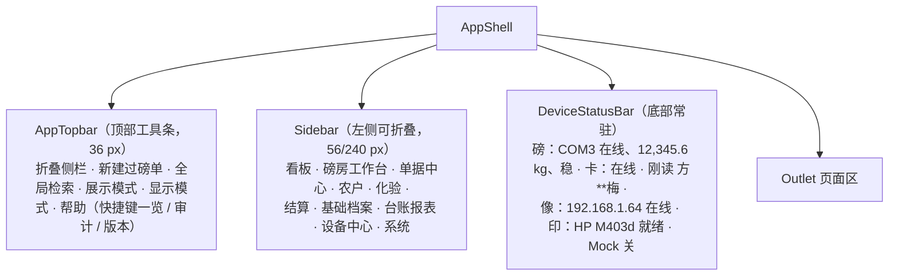

# 05 UI 结构与交互规范

面向实现的前端信息架构与交互约定。视觉体系沿用工程现有 shadcn 配置（`components.json`：style `base-maia`、baseColor `neutral`、cssVariables、`--radius: 0` 直角风格），本文只补充业务侧规范与必须处理的本地化问题。

---

## 1 设计前提（磅房的物理环境）

| 环境事实 | 设计推论 |
| --- | --- |
| 磅房空间狭小，窗口对着磅区，操作者一手扶门一手操作 | 主流程全部可键盘完成；鼠标仅作辅助；按钮点击区 ≥ 36 px |
| 强光、粉尘、可能有雨反光，常远距离给农户展示重量 | 重量显示用超大字号（≥ 96 px）+ 高对比；不用浅色底 |
| 旺季连续作业 10+ 小时，单车次目标 ≤ 3 分钟 | 禁止把关键操作藏进二级弹窗或多步向导；默认值要"猜得准"（上次的品种/仓房/车号） |
| 操作者年龄偏大、电脑熟练度低 | 不使用悬停作为唯一提示；术语用行业话（毛重/皮重/扣杂/码单）而非"实体/记录" |
| 常有纠纷，需要当场给农户看数据 | 每屏可一键"展示模式"（放大重量与金额，隐藏操作按钮） |
| 显示器多为 1080p，个别老机 1366×768 | 断点 ≥ 1280 为主设计宽度，1366×768 不得出现横向滚动 |

---

## 2 应用骨架



- 顶栏不再有桌面风格菜单条：原先六组菜单里的跳转项侧栏与页内 tab 已全覆盖，全局动作收进 `AppTopbar`，Mock 总开关与打印通道分别落在底栏和设备中心 / 站点参数——**没有功能被删掉**
- 底栏状态条常驻且不可隐藏——设备故障是现场最高频问题，必须任何页面都能一眼看到
- 状态文字同时用图形符号（实心圆/空心圆/三角），不依赖颜色区分（色弱与黑白打印机场景）
- 侧栏支持 `Ctrl+B` 折叠；工作台上建议折叠以腾出横向空间
- 打印窗、展示模式窗为独立 Tauri 窗口（`label: print` / `label: display`），不参与主路由

---

## 3 页面清单

| 路由 | 页面 | 主要用户 | 关键构成 | 优先级 |
| --- | --- | --- | --- | --- |
| `/` | 首页看板 | 站长 | 今日车次/吨数/金额卡、在途作业、挂账提醒、支付时效超期、设备离线告警、快捷入口 | P0 |
| `/workstation` | 磅房工作台 | 磅员 | 见第 4 节 | P0 |
| `/orders` | 磅单列表 | 全部 | 筛选区 + `DataTable`（列显隐/排序/分页/合计行）+ 批量打印/导出 | P0 |
| `/orders/:orderNo` | 磅单详情 | 全部 | 基本信息卡、重量轨迹表、化验指标表、结算明细、附件墙、全链路时间轴、操作按钮区（作废/红冲/补打，另有「登记/改派去向」弹窗，仅保管员与站长） | P0 |
| `/parties` | 农户与往来单位 | 登记员 | 列表 + 抽屉式编辑表单 + 售粮履历 Tab + 导入向导 | P0 |
| `/parties/:id` | 档案详情 | 登记员 | 档案、履历、皮重历史、挂账 | P0 |
| `/qc` | 化验工作台 | 化验员 | 待检队列 + 指标录入面板 + 判定 + 打印 | P0 |
| `/qc/:reportNo` | 质检单详情 | 化验员 | 指标、首检/复检对比 | P0 |
| `/scan-settle` | 扫码结算 | 出纳 | 扫码口（键盘模拟枪免聚焦）+ 当前磅单摘要 + 计价与收款表单 + 待结算池（票丢了点选即扫）+ 本窗口已结流水；**一码一单，一切结算的唯一入口**（02 §F1.4） | P0 |
| `/settlements` | 结算台账 | 结算员 | 结算单列表与筛选、应付已付未付合计、逾期与待结算池告警（**本页不生产结算单**，结算在 `/scan-settle`） | P0 |
| `/settlements/:settleNo` | 结算单详情 | 结算员 | 明细磅单、应付已付未付、付款流水、凭证打印、签字状态 | P0 |
| `/payments` | 付款与挂账 | 出纳 | 挂账清单（超期高亮）+ 付款登记 + 渠道分布 | P0 |
| `/masters/varieties` | 品种与指标 | 站长 | 表 + 指标启用编辑器 | P0 |
| `/masters/warehouses` | 仓房货位 | 保管员 | 主从两栏 | P0 |
| `/masters/prices` | 收购价目表 | 站长 | 按品种/等级/生效期的可编辑表 + 生效冲突提示 + 批准流（留档） | P0 |
| `/masters/settings` | 站点参数 | 站长 | 分组表单（单据/称重/结算/打印/留存） | P0 |
| `/reports/ledger` | 收购明细台账 | 站长/审计 | 固定监管列 + 导出 xlsx + 打印 | P0 |
| `/reports/daily` | 日报/月报 | 站长 | 日期选择 + 分组汇总 + 同比环比 + 打印 | P0 |
| `/reports/quality` | 质量分析 | 站长 | 水分杂质分布、等级占比、拒收率、扣量率 | P0 |
| `/reports/parties` | 农户排行与对账 | 站长 | 排行 + 未付钻取 | P0 |
| `/reports/staff` | 作业量与异常统计 | 站长 | 手录占比、作废/补打/异常放行次数 | P0 |
| `/devices` | 设备中心 | 站长 | 设备卡列表 + 测试面板 + 帧监视器 + Mock 开关 + 配置导入导出 | P0 |
| `/system/users` | 登录与权限 | 站长 | P1 |
| `/system/staff` | 员工与岗位 | 站长 | 档案表 + 岗位权限矩阵 + 新增/编辑/重置密码，P1 |
| `/system/audit` | 操作审计 | 站长/审计 | 筛选 + 前后值 diff 视图，P1 |
| `/system/backup` | 备份与恢复 | 站长 | 备份列表、手动备份、导出 U 盘、恢复向导、体检与修复，P1 |
| `/system/shift` | 日结交班 | 站长 | 班次汇总 + 交接表打印，P1 |
| `/system/appearance` | 外观与主题 | 全部 | 显示模式（浅色/深色/跟随系统）+ 基础色板 + 主题色 + 双模式预览 + 复制 CSS + 重置默认主题；只作用本机，不进站点参数与审计，P0 已实现 |
| `/login` | 登录 | 全部 | 一个页面三种态：输入密码 / 设置密码（账号仍是占位哈希或被要求强改）/ 锁定倒计时。全程键盘可完成，失败就地提示不弹模态，已实现 |

身份处理（已按密码登录实现）：登录与校验在桌面端本地完成（`src-tauri/src/auth.rs`），未登录或 `must_change_pwd` 未清时，路由守卫把任何业务页都挡回 `/login`；会话只存内存，重启程序必须重登，空闲满后端下发的时长即失效。侧栏底部只保留署名与「换人 / 锁屏」入口，换人需重新输密码；浏览器预览没有原生通道，降级为"只认在职名单、不校验密码"的演示模式，并常驻横幅标注，不伪装成真实登录。

---

## 4 磅房工作台（核心界面）

### 4.0 作业模型（登记弹窗 + 刷卡推进）

工作台不再让"身份与制单"常驻占视线。改后的主链路（详见 06 篇）：

- **登记＝弹窗**。来新人点顶栏「制单」（或 `F7`）弹出"身份与制单"框：框内读身份证认人 / 搜档案 / 手录证号建档 → 选品种车牌（去向仍选填）→ **点「取号并制单」再弹一个"请将流转卡贴在读卡器感应区"的寻卡框**，读到一张空闲在册卡才取号，卡与单同一笔事务绑死（06 §4.0）→ 关框。弹窗打开期间 **IC 常听挂起、只解身份证**（一台读卡器一次只认一种介质，06 §1.2），绑卡那一步才切回 IC 通道。读不到卡这张单就制不成；站点不刷卡的退路是把 `card_required_on_create` 关掉（06 §6.4）。
  - **读卡读到没建过档的证号＝就地弹「无档案 · 快捷登记」框**，不再只甩一条"请先建档"的 toast 把磅员赶回档案页：姓名 / 证号 / 住址读卡带入，只补一个电话（可不填），保存后新档案直接选为本单售粮人，接着选品种车牌就行（02 §F1.1 验收「无档案时不出现两次以上的手工输入」）。框内同时给「搜档案」退路——卡面是熟客、但档案里证号录错过时，搜出来改原档案比在这里再建一张更稳（一人一档，`party_save` 也按证号指纹阻断重复建档）。
  - **建档口径与档案页同一条**：读卡带入的证号逐字未改才记「已核验」，框内改过证号自动回落「未核验」；快捷框只收自然人三类（农户 / 种粮大户 / 经纪人），合作社与企业拿的是统一社会信用代码、校验规则不同，走档案页完整表单；开户行、挂账额度、参考皮重同理留给档案页补全。
  - **读卡器不可用时点「新档案」**打开同一张表单手工录入（证号手录即未核验）——外设总开关关掉后的提示语与 05 §10-1「无外设也能完成闭环」都靠这个按钮兑现。
- **默认态＝IC 后台常听**。一关框就恢复 `reader.ic.watch`。制单当场已经把卡绑上（06 §4.0），所以监听此刻的主职是**推进**：此后同一张卡**每刷一次把这张单往前推一步**——①刷捕毛重、②刷捕皮重并**静默出码单**（算好净重直接送打，不弹预览）、③刷**等价于扫这张单的码**——打开「扫码结算」窗口并带上这张单，在那里落价、收款、打凭证，成功后回收卡（06 §2.2）。只有把 `card_required_on_create` 关掉的站点，监听才回到"读到一张空闲卡放上机器 → 按 06 §4.1 把卡**发给**最近无卡的在途单"。
- **面板降级为应急手点**。`③ 称重区` 的捕获按钮、`⑤ 凭票与打印` 的打印按钮保留，作为"无外设也能完成闭环"（§10-1）与读卡器故障时的手点兜底，文案标"（应急手点，正常刷 IC 卡）"。化验 `④` 仍是旁路可选步，不在刷卡链里。**结算没有"面板上的手点"这条路**：卡刷到第三下等价于扫这张单的码——打开「扫码结算」窗口并带上这张单，落价与收款仍在那一屏完成（02 §F1.4）。

> 下面这张 ASCII 仍把 `①` 画在左栏，只为展示它**有哪些字段**；这些字段现在都在"制单"弹窗里，界面上不再常驻。

1280 px 下三栏（应急态/未启用流转卡时的排布），重量区优先占位：

```text
┌───────────────────────────────────────────────────────────────────────────────────┐
│ 磅房工作台                        当前：BD01202609000123    [F2 展示模式] [F9 打印] │
├──────────────────┬────────────────────────────────┬───────────────────────────────┤
│ ① 身份与制单      │ ③ 称重区                       │ ⑤ 凭票与打印                   │
│                 │                                │                               │
│ [读卡 F8]        │      实时读数                   │ 价目表现价                     │
│ 姓名 [王建国]     │   1 2 3 4 5 . 6  kg   ← 96px+  │   2,280.00 元/吨 · 三等       │
│ 证号 [41********] │   ● 稳定  分度 10kg  COM3       │ 净重        1 8 7 0 . 0 kg   │
│ 类型 [农户  ]     │                                │ 结算重量     1 7 2 0 . 0 kg    │
│ 品种 [玉米  ]     │  [空格] 捕获毛重   [P] 捕获皮重  │ 预估应付     ¥  4,287.60      │
│ 车牌 [豫A____]    │                                │   ↑ 实付以结算窗口录入为准      │
│ 去向 [未定] ▾选填 ├────────────────────────────────┤ [F9 打印码单交客户]            │
│ 备注 [        ]   │ ④ 化验区                       │ 未打印 → 已打 2 张（补打）      │
│                 │  水分 [14.8]↑ 杂质[1.2]↑        │                               │
│ [F7 新建下一单]   │  不完善[5.2] 容重[762]          │ 本单不在此结算：客户凭票面右下   │
│                 │  等级[三等▾] 判定[接收▾]         │ 角的二维码到「扫码结算」窗口     │
│ ② 历史皮重 18.4t │  [F5 保存化验]                  │ 一码一单算价收款（02 §F1.4）    │
│                 │                                │ [去扫码结算窗口] 抓拍：毛/皮图   │
├──────────────────┴────────────────────────────────┴───────────────────────────────┤
│ ⑥ 在途作业：BD…121 待结算 · BD…122 待皮重（停留 42 分钟 ⚠）· BD…124 待化验          │
└───────────────────────────────────────────────────────────────────────────────────┘
```

> 结算面板（单价、扣项、支付、签字）已从这一栏搬走：先打票、后凭码集中结算是常态，
> 磅房里留一个能改价能收钱的口子，事后就会出现"这个价到底是谁定的"说不清的一刻。

区域规则：

| 区 | 规则 |
| --- | --- |
| ① 身份与制单 | **不再是常驻面板，而是「制单」弹窗内的字段**（弹窗打开时 IC 常听挂起、只读身份证；点「取号并制单」才切回 IC 通道弹刷卡框，读到空闲在册卡才连同 `card_no` 一起取号，06 §4.0）。读卡后自动填充并把焦点跳到品种；品种/去向默认取该农户上一次值；下拉支持首字母/拼音检索；**入仓去向为选填**，默认折成一行摘要（未定时显示"未定·选填"），点开才出仓房/货位两个下拉，留空不挡取号制单（但挡不住的是"没刷到卡"——那一关按 06 §4.0 强制，除非站点关掉 `card_required_on_create`） |
| ② 历史皮重 | 显示均值与最近 5 次；捕获皮重与均值偏差超容差时该块转为警示态，**捕获照常完成**（只给一句警告、不弹授权框、不拦下），警示随单留痕并醒目提醒 |
| ③ 称重区 | 主触发＝刷绑定卡：第一刷捕毛重、第二刷捕皮重（各取此刻稳定读数，未稳则这一刷作废并提示）；面板"捕获"按钮降为**应急手点**。读数不稳定时数字为细体 + "不稳定"文字；稳定后加粗；捕获成功播放轻提示音并短暂高亮 |
| ④ 化验区 | 每项超基准时在字段右侧显示 `↑`/`↓` 与差值，**不做自动扣量计算**（计价引擎暂缓），仅辅助提示；扣水/扣杂公斤数在本区人工填写 |
| ⑤ 凭票与打印 | 只出票：净重/结算重量/预估应付（明写"预估"）+ 打印码单按钮 + 已打几张（读 `print_log`，不看前端临时状态）+ 去扫码结算窗口的入口。**这一栏没有单价、扣项、支付、签字任何一个输入框**——结算在 `/scan-settle` 一码一单做，磅房里留个能改价能收钱的口子，事后就说不清这个价是谁定的 |
| ⑥ 在途 | 点击卡片直接载入该单继续作业；停留超时按阈值变色 + 文字标注 |

展示模式（`F2`）：全屏仅显示重量与金额两行超大字 + 站名，供农户核对，按 `Esc` 退出。

### 4.1 自定义布局（千人千面）

上面的三栏是**默认排布**，不是死排布。磅员可把界面改成自己的：顶栏「自定义布局」进入编辑态，拖面板顶部的把手换位、拖右下角改大小、点 `×` 收起，顶栏「面板」再放回来，「恢复默认」一键退回三栏。

| 项 | 规则 |
| --- | --- |
| 归属 | **排布跟人走，不跟机器走**。存 §9.25 `user_preference`（按 `user_id` + 键 `workstation.layout`），磅房机轮班共用也互不覆盖；换台机器登录还是他那套 |
| 编辑态 | 日常界面里格子是死的——一手油一手票据，不能有"手一抖布局就变了"的入口。只有编辑态给把手、给缩放角、给 `×` |
| 网格 | 12 列 × 24 行固定预算，行高由工作区实际高度反算，所以同一份布局在 1080p 与 2K 上是同一张脸，只是每块各自长高一点；1280 px 以下不采信格子几何，按 `y`→`x` 的阅读顺序退回单列堆叠——此时**不给把手**（拖不动的东西不摆出可拖的样子），收起走顶栏「面板」 |
| 每块下限 | 称重区 3×8（要容得下读数）、结算区 2×10（要容得下算价表）等，见 `layout.ts` 注册表；缩到下限即停 |
| 收起 | 是"收起"不是"删除"：那一格连同位置一起留着，再放回来还在老地方；最后一块不许收起 |
| 脏值 | 读回来的 JSON 一律先规整：键不认识就丢、越界夹回来、本次新增的面板补回默认位，可见项互相压字则整份退回默认——**宁可退回默认，也不能让工作台开不起来** |
| 保存 | 停手 400 ms 后落库（拖动中每帧都报新格子，不能每帧写一次），退出编辑态与离开页面时补写；失败上屏提示，不假装"已经保存好了" |
| 专注模式 | `F11` 沿用同一份布局，但强制退出编辑态 |

代价说清楚：原来是三栏各自滚动、整页不出页面级滚动条；自由格子做不到对这个恒成立，改为每块内部滚动、整屏超出时工作区出一条滚动条。

---

## 5 快捷键规范

| 键 | 动作 | 生效范围 |
| --- | --- | --- |
| `空格` | 捕获当前稳定读数（毛/皮按当前待捕项自动判定）——**应急手点**，正常由刷卡推进（06 §2.2） | 工作台 |
| `F7` | 打开「制单」弹窗（读身份证认人 / 搜档案 / 手录 → 点「取号并制单」时弹框刷 IC 卡绑卡） | 工作台 |
| `F8` | 弹窗内读身份证（此时 IC 监听挂起） | 登记弹窗 |
| `F5` | 保存化验 | 工作台/化验 |
| `F6` | 从价目表带出单价 | 扫码结算 |
| `F9` | 打印当前单据（工作台＝打码单交客户；补打/重打走预览） | 工作台/详情 |
| `F10` | 提交结算（计价与收款一起落账） | 扫码结算 |
| 扫码枪 | 直接扫，无需先点进输入框（光标不在别的输入框里时按键即一次扫码） | 扫码结算 |
| `F4` | **按住说话**（话筒喊话，松开即停；面板上另有等价的按住按钮，话筒自带 PTT 键可在设备中心录入实际键码） | 工作台 |
| `F2` | 展示模式切换 | 全局 |
| `Alt+1..9` | 跳转侧栏第 N 项（**编号按侧栏展开顺序算**，加/挪入口就会改键，改表要同时改 `app-nav.ts`） | 全局 |
| `Ctrl+K` | 全局检索（单号 / 姓名 / 证号后 4 位 / 车牌） | 全局 |
| `Ctrl+B` | 折叠/展开侧栏 | 全局 |
| `Ctrl+E` | 导出当前列表为 xlsx | 列表页 |
| `Ctrl+Alt+D` | 打开设备中心 | 全局 |
| `F1` | 快捷键一览 | 全局 |
| `Esc` | 关闭弹层 / 退出展示模式 / 取消当前录入 | 全局 |
| 数字小键盘 | 所有数值字段支持小键盘直录，`Enter` 提交并跳下一字段 | 全局 |

要求：快捷键在后端命令层同时有权限校验；任何 `disabled` 状态必须给出文字原因（tooltip 不算唯一提示）。

**按住式快捷键（目前只有 `F4`）另有一条硬规矩**：`keyup`、窗口失焦、`Alt+Tab`、锁屏、会话失效、路由离开、组件卸载 —— 七个入口都必须发"释放"，Rust 侧另有独立计时兜底（哪怕前端整个卡死也会在 30 秒内自己关掉）。这类键的失败模式不是"没反应"，而是"一直开着把喇叭放大"，只能靠多层兜底而不是靠操作者记得松手，详见 [07 话筒喊话与语音播报](./07-话筒喊话与语音播报.md) §4.2。

---

## 6 交互与展示规范

### 6.1 数值展示

| 类型 | 格式 | 示例 |
| --- | --- | --- |
| 重量（明细） | 千分位 + 1 位小数 + 单位 | `12,345.6 kg` |
| 重量（吨，汇总） | 3 位小数 | `12.346 t` |
| 金额 | 千分位 + 2 位小数 + 前缀 | `¥4,287.60` |
| 金额（大写） | 码单必印 | `人民币肆仟贰佰捌拾柒元陆角整` |
| 单价 | 元/吨为主，次行显示元/斤 | `¥2,280.00/吨` `1.14 元/斤` |
| 化验指标 | 2 位小数 + % 或单位 | `14.80 %`、`762 g/L` |
| 时间 | `MM-DD HH:mm`（列表）/`YYYY-MM-DD HH:mm:ss`（详情） | |

所有数值一律 `font-variant-numeric: tabular-nums`，右对齐；单位与数字之间不空格（行业习惯）；负值（红冲）用 `-` 前缀 + 文字"红冲"，**不用颜色单独表达**。

### 6.2 状态色板与文字

| 语义 | 色 | 同时显示的文字 |
| --- | --- | --- |
| 正常/已付清 | 绿 `oklch(0.62 0.16 150)` | 已付清 |
| 进行中/待处理 | 蓝 `oklch(0.58 0.14 250)` | 待结算、待皮重 |
| 警告（停留超时、皮重接近容差、手录） | 琥珀 `oklch(0.72 0.15 75)` | 超 42 分钟、手录 |
| 危险（拒收、超差、作废、离线、未付超期） | 红 `--destructive` | 已作废、离线 |
| 中性（归档、停用） | `--muted-foreground` | 已归档 |

单据状态除色彩徽章外**必须有中文状态文字**（打印黑白、色弱、远程截图沟通都需要）。

### 6.3 表格规范

- 统一 `DataTable`：列显隐与顺序偏好持久化到 `app_setting`（按用户 + 页面 key）
- 默认页大小 50，可选 50/100/200；翻页保留筛选条件（URL 查询参数化，便于贴给同事与审计引用）
- 合计行固定在表尾，来自与列表同一条 SQL 的窗口函数
- 行点击进详情，`Ctrl+点击` 新窗口打开（对账时并排看两张单是真实需求）
- 空状态必须给下一步动作按钮（如"今天还没有磅单 → 去工作台开单"），不留纯文案空页

### 6.4 表单与校验

- `react-hook-form` + `zod`，`lib/schema/` 与后端 DTO 字段一一对应；服务端仍必须二次校验
- 错误显示在字段下方，不用 toast 承载字段级错误；toast 仅用于"保存成功/失败 + 可重试"
- 数值字段用文本框 + 掩码，不用 `type=number`（其滚轮误改与小数点/locale 行为在磅房是严重隐患）
- 占位符用独立令牌 `--input-placeholder`（由 `--foreground` 按 32% 透明度混合派生，浅深色共用），**不复用 `--muted-foreground`**——后者同时是字段标签、说明文字、表格次要列的颜色，和正文只差 0.41 明度，磅房字号（`text-xs/sm`）下"空框"和"已填"看不出区别。`src/App.css` 里刻意写成未分层的 `input::placeholder` / `textarea::placeholder` 全局规则（压过分层后的任何工具类），新复制的组件或裸 `<input>` 都拉不回去；日期选择器这类用按钮当输入框的，未选时同样挂 `text-input-placeholder`。另一半根因：preflight 给 `input/textarea/select` 写了 `color: inherit`，而字段容器常是 `<Label class="text-muted-foreground">` 把控件整个包住，录入内容会跟着标签变灰（深色下实测正文 `#a1a1a1` vs 占位符 `#606060`），占位符调多浅都没用；所以 `App.css` 同处还把 `input` / `textarea` / `native-select` 的 `color` 钉成 `--foreground`，祖先写什么文字色都影响不到录入内容
- 保存失败后**表单内容不得丢失**；离开有未保存内容的页面需确认
- 破坏性操作（作废/红冲/撤销结算/恢复备份）统一 `AlertDialog`，要求填原因，需授权的还要输入站长密码，并在确认框中列出后果（"该单已打印 3 联，作废后需重打"）

### 6.5 反馈与异常

| 场景 | 呈现 |
| --- | --- |
| 设备离线 | 底栏常显 + 相关按钮禁用并说明；不弹模态阻断作业 |
| 称重手录 | 捕获按钮旁显式"改为手录"入口，录完单据标记手录并在列表可筛 |
| 打印失败 | 显示打印机名与失败原因 + "重试"和"改预览打印"两个出口 |
| 抓拍失败 | 单据上"无抓拍"角标，不弹窗 |
| 保存慢（>500 ms） | 按钮内联 loading + 禁用重复提交（幂等：重复提交返回既有单号） |
| 严重错误（DB/迁移失败） | 全屏错误页含"打开日志目录""导出诊断包""从备份恢复"三个动作 |

### 6.6 权限与只读

`viewer`（查询/审计）角色：隐藏所有写操作按钮，导出与打印保留；命令层同样拒绝，返回 `denied` 并写审计（越权尝试必须留痕）。

---

## 7 视觉与本地化规范

### 7.1 中文字体（工程当前存在的具体问题）

`src/App.css` 中 `--font-sans: 'Inter Variable', sans-serif`，而 Inter 不含 CJK 字形。若不处理，中文会掉到浏览器默认字体，与数字混排时行高与基线不齐。需在 `@theme inline` 中显式补 CJK 回退：

```css
@theme inline {
  --font-sans: 'Inter Variable', 'Microsoft YaHei', 'PingFang SC',
               'Noto Sans SC', sans-serif;
}
```

数字使用 `Inter Variable`（自带 tabular figures，需开启 `font-feature-settings: "tnum"`），中文使用系统雅黑，兼顾观感与离线可用（磅房机不能依赖联网下载字体）。磅单打印模板另需内嵌宋体系以保证套打一致性。

### 7.2 图表与语义色

现有 `--chart-1..5` 为灰阶，用于报表会无法区分配色（品种占比、等级分布）。需在 `:root` 追加业务语义色与彩色图表序列（不改 shadcn 生成的类名），并把 `--radius: 0` 保留（`base-maia` 直角体系，与"票据/表格"气质一致，不额外改圆角）。

要求：图表同时给出数据标签或提供可切换的表格视图（打印后为黑白）。

### 7.3 尺寸与密度

| 项 | 规范 |
| --- | --- |
| 基准字号 | 14 px（`text-sm`），表格 13 px，辅助 12 px，重量展示 96–160 px |
| 控件高度 | 36 px（`h-9`）；工作台主操作按钮 44 px |
| 间距阶 | 4/8/12/16/24/32，禁止散落的奇数值 |
| 页面留白 | 内容区左右 24 px，标题区高 56 px |
| 弹窗宽 | 表单 480 px / 明细 720 px / 导入向导 960 px |
| 侧栏 | 展开 240 px，折叠 56 px |

### 7.4 深色模式与主题配置（已实现）

出厂默认**浅色**：磅房白天强光下深色对比更差。可选深色（夜班、遮阳棚内）与跟随系统；入口有两处——顶栏工具条的显示模式按钮（按钮上就是当前档位名）和 `/system/appearance`。

- 模式由 `next-themes` 管理 `<html>` 上的 `.dark` 类（`src/components/ui/sonner.tsx` 读同一上下文），色板由 `src/lib/theme.ts` 注入 `:root` + `.dark` 两段 CSS 变量覆盖；两者各存一个 localStorage 键（`banghe.theme.mode` / `banghe.theme.palette`），挂载前由 `bootstrapTheme()` 先打上，避免首帧闪白。
- 色板结构照 shadcn 官方主题编辑器：**基础色板**（Neutral / Stone / Zinc / Mauve / Olive / Mist / Taupe）给全套灰阶令牌，**主题色**只覆盖 `primary`、`secondary`、`chart-1..5`、`sidebar-primary` 等少数令牌。数值不手抄，由 `tools/gen-theme-presets.mjs` 从 `shadcn-ui/ui` 的 `apps/v4/registry/themes.ts` 生成 `src/lib/theme-presets.ts`。
- 三处刻意的边界：① 不提供圆角调节，`--radius` 固定 0（base-maia 直角，§7.2）；② 主题色不改图表配色，`--chart-color-1..5` 是品种/等级的业务语义色（§7.2）；③ 主题是**本机显示偏好**，即时生效、只存本机，不写 `app_setting`、不留审计、不需要站长权限——会影响单据内容的选项一律留在「基础档案 → 站点参数」。
- **重置默认主题** = 移除注入的 `<style id="banghe-theme">` 并把模式改回浅色，外观重新完全由 `src/App.css` 决定。生成脚本会逐令牌校验"官方 Neutral == `App.css` 的 `:root`/`.dark`"，一旦漂移就构建失败——否则重置会变成悄悄换一副样子。
- **打印一律浅色**：单据模板（`components/print/sheets.tsx`）本身就是固定黑白，但列表页与审计页直接 `Ctrl+P` 出纸会带上屏幕配色。因此 `beforeprint` 临时摘掉 `.dark`、`afterprint` 还原（`src/lib/theme.ts` 的 `guardPrintTheme`），等价于用当前色板的 light 值出纸；刻意不在 CSS 里再抄一份浅色令牌，免得形成第二套真相。

---

## 8 组件与代码规范

- UI 原子组件一律取自 `@/components/ui`（shadcn 生成，不手改；改动需通过重新 `add` 覆盖或包一层业务组件）
- 业务组件放 `@/components/business`，命名表达领域而非样式：`WeightDisplay`、`OrderStatusBadge`、`IndicatorInput`、`DocTimeline`、`PartyPicker`、`MoneyInput`、`TareToleranceAlert`
- **禁止在页面里出现 `/10`、`*100`、`toFixed(2)`**：换算与格式化只允许来自 `lib/format.ts`
- 所有后端调用只经 `lib/api.ts`（唯一 `invoke` 出口），按模块分组导出，返回类型与 `models/dto.rs` 对齐；组件不出现字符串命令名
- 查询 key 约定：`["orders", filters]`、`["order", orderNo]`、`["parties", query]`、`["report","daily", date]`；写操作成功后显式 `invalidateQueries`，禁止整页 reload
- 设备实时数据只进 `store/device.ts`（zustand），不进 react-query 缓存（高频、非服务端状态）
- 页面文件只负责组合与路由参数，逻辑超 150 行即抽 hook（`useWorkstation`、`useOrderQueries`、`useScaleWeight`）
- 图标统一 `lucide-react`；重量/金额等关键区域不使用 emoji
- 文案规范：单据上称"码单/磅单"，界面上称"过磅单"；避免"提交/确认"混用，统一"保存""确认结算""作废"
- 无障碍：表单控件必须有可见 `<label>`（不用 placeholder 代替）、自定义弹层焦点收敛、`Esc` 可关、表格用 `<table>` 语义而非 div 堆叠

---

## 9 打印模板规范

| 模板 | 纸型 | 关键要素 |
| --- | --- | --- |
| 磅单/收购码单 | A4（默认）、241-3 针式、58 热敏 | 站名抬头 + 单据号（骑缝）+ 业务日期；售粮人与证号（证号中间 6 位掩码，如 `4101**********1234`，迎检需要完整证号时由站长单独导出）；品种/等级/水分/杂质；毛重·皮重·净重；袋重·扣水·扣杂·结算重量；单价（元/吨与元/斤并列）；货款·扣款·应付；大写金额；**磅员/化验员/结算员三署名栏**；售粮人签字栏；联次标注（第一联 存根/第二联 财务/第三联 客户）；补打时右上角"补打"字样 |
| 质检单 | A4 | 样品号、指标逐项（值/单位/基准/比较）、判定结论、留样号、化验员签字 |
| 结算凭证 | A4 | 结算单号、覆盖期间、明细磅单表、合计行、应付已付未付、收款人、签字 |
| 内部流转单 | 241 | 对应 R6 多岗流转与 IC 卡模式，P1 |
| 台账导出 | xlsx | 列与 `F7.1` 屏显一致，含筛选条件与导出时间页眉、合计行、冻结表头 |

技术要求：`@page` 精确控制纸型与边距；`-webkit-print-color-adjust: exact` 保证印章/表格线不丢；模板数据由后端渲染成快照存 `print_log.rendered_json`，以便回答"当初那张纸打的是什么内容"。

---

## 10 首版 UI 验收清单

1. 断网、无外设（Mock 关闭）情况下，手工录入可完成一个车次闭环并打出码单
2. 全程键盘完成主流程，不用鼠标也能开单到打印
3. 1366×768 与 1920×1080 均无横向滚动、无文字截断
4. 任一金额/重量在界面、打印件、xlsx 三处逐分逐 kg 一致
5. 所有状态既有颜色也有文字；黑白打印后仍可判读
6. 设备离线时不出现模态弹窗阻塞，底栏可定位到具体设备与原因
7. 作废、红冲、补打三处授权均生效并留痕；皮重偏差超容差不走授权，改为照常入账 + 磅单醒目警示并写审计
8. 台账导出文件用 WPS 与 Excel 打开均无列错位、无数字变科学计数法
