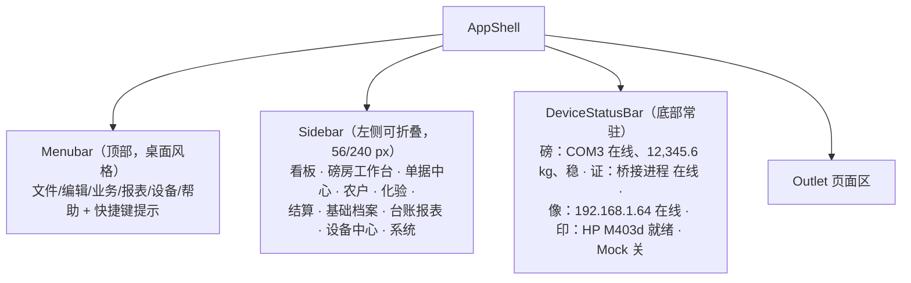

# 05 UI 结构与交互规范

面向实现的前端信息架构与交互约定。视觉体系沿用工程现有 shadcn 配置（`components.json`：style `base-maia`、baseColor `neutral`、cssVariables、`--radius: 0` 直角风格），本文只补充业务侧规范与必须处理的本地化问题。

---

## 1 设计前提（磅房的物理环境）

| 环境事实 | 设计推论 |
| --- | --- |
| 磅房空间狭小，窗口对着磅区，操作者一手扶门一手操作 | 主流程全部可键盘完成；鼠标仅作辅助；按钮点击区 ≥ 36 px |
| 强光、粉尘、可能有雨反光，常远距离给农户展示重量 | 重量显示用超大字号（≥ 96 px）+ 高对比；不用浅色底 |
| 旺季连续作业 10+ 小时，单车次目标 ≤ 3 分钟 | 禁止把关键操作藏进二级弹窗或多步向导；默认值要"猜得准"（上次的品种/仓房/车号） |
| 操作者年龄偏大、电脑熟练度低 | 不使用悬停作为唯一提示；术语用行业话（毛重/皮重/扣杂/码单）而非"实体/记录" |
| 常有纠纷，需要当场给农户看数据 | 每屏可一键"展示模式"（放大重量与金额，隐藏操作按钮） |
| 显示器多为 1080p，个别老机 1366×768 | 断点 ≥ 1280 为主设计宽度，1366×768 不得出现横向滚动 |

---

## 2 应用骨架



- 底栏状态条常驻且不可隐藏——设备故障是现场最高频问题，必须任何页面都能一眼看到
- 状态文字同时用图形符号（实心圆/空心圆/三角），不依赖颜色区分（色弱与黑白打印机场景）
- 侧栏支持 `Ctrl+B` 折叠；工作台上建议折叠以腾出横向空间
- 打印窗、展示模式窗为独立 Tauri 窗口（`label: print` / `label: display`），不参与主路由

---

## 3 页面清单

| 路由 | 页面 | 主要用户 | 关键构成 | 优先级 |
| --- | --- | --- | --- | --- |
| `/` | 首页看板 | 站长 | 今日车次/吨数/金额卡、在途作业、挂账提醒、支付时效超期、设备离线告警、快捷入口 | P0 |
| `/workstation` | 磅房工作台 | 磅员 | 见第 4 节 | P0 |
| `/orders` | 磅单列表 | 全部 | 筛选区 + `DataTable`（列显隐/排序/分页/合计行）+ 批量打印/导出 | P0 |
| `/orders/:orderNo` | 磅单详情 | 全部 | 基本信息卡、重量轨迹表、化验指标表、结算明细、附件墙、全链路时间轴、操作按钮区（作废/红冲/补打） | P0 |
| `/parties` | 农户与往来单位 | 登记员 | 列表 + 抽屉式编辑表单 + 售粮履历 Tab + 导入向导 | P0 |
| `/parties/:id` | 档案详情 | 登记员 | 档案、履历、皮重历史、挂账 | P0 |
| `/qc` | 化验工作台 | 化验员 | 待检队列 + 指标录入面板 + 判定 + 打印 | P0 |
| `/qc/:reportNo` | 质检单详情 | 化验员 | 指标、首检/复检对比 | P0 |
| `/settlements` | 结算中心 | 结算员 | 待结算池（按农户分组）+ 合并结算面板 + 结算单列表 | P0 |
| `/settlements/:settleNo` | 结算单详情 | 结算员 | 明细磅单、应付已付未付、付款流水、凭证打印、签字状态 | P0 |
| `/payments` | 付款与挂账 | 出纳 | 挂账清单（超期高亮）+ 付款登记 + 渠道分布 | P0 |
| `/masters/varieties` | 品种与指标 | 站长 | 表 + 指标启用编辑器 | P0 |
| `/masters/warehouses` | 仓房货位 | 保管员 | 主从两栏 | P0 |
| `/masters/prices` | 收购价目表 | 站长 | 按品种/等级/生效期的可编辑表 + 生效冲突提示 + 批准流（留档） | P0 |
| `/masters/settings` | 站点参数 | 站长 | 分组表单（单据/称重/结算/打印/留存） | P0 |
| `/masters/staff` | 员工与岗位 | 站长 | 表 + 口令重置 | P0 |
| `/reports/ledger` | 收购明细台账 | 站长/审计 | 固定监管列 + 导出 xlsx + 打印 | P0 |
| `/reports/daily` | 日报/月报 | 站长 | 日期选择 + 分组汇总 + 同比环比 + 打印 | P0 |
| `/reports/quality` | 质量分析 | 站长 | 水分杂质分布、等级占比、拒收率、扣量率 | P0 |
| `/reports/parties` | 农户排行与对账 | 站长 | 排行 + 未付钻取 | P0 |
| `/reports/staff` | 作业量与异常统计 | 站长 | 手录占比、作废/补打/异常放行次数 | P0 |
| `/devices` | 设备中心 | 站长 | 设备卡列表 + 测试面板 + 帧监视器 + Mock 开关 + 配置导入导出 | P0 |
| `/system/users` | 登录与权限 | 站长 | P1 |
| `/system/audit` | 操作审计 | 站长/审计 | 筛选 + 前后值 diff 视图，P1 |
| `/system/backup` | 备份与恢复 | 站长 | 备份列表、手动备份、导出 U 盘、恢复向导、体检与修复，P1 |
| `/system/shift` | 日结交班 | 站长 | 班次汇总 + 交接表打印，P1 |
| `/login` | 登录 | 全部 | P1（P0 阶段先以"选择操作员"轻量身份切换实现） |

身份处理的首版务实做法：P0 未上登录前，用"当前操作员"选择器（`/masters/staff` 中在职员工）确定署名，所有写操作携带该 id；P1 换成口令登录后同一套 `actor_id` 机制无需改动。

---

## 4 磅房工作台（核心界面）

1280 px 下三栏，重量区优先占位：

```text
┌───────────────────────────────────────────────────────────────────────────────────┐
│ 磅房工作台                        当前：BD01202609000123    [F2 展示模式] [F9 打印] │
├──────────────────┬────────────────────────────────┬───────────────────────────────┤
│ ① 身份与制单      │ ③ 称重区                       │ ⑤ 结算与打印                   │
│                 │                                │                               │
│ [读卡 F8]        │      实时读数                   │ 单价  [2,280.00] 元/吨         │
│ 姓名 [王建国]     │   1 2 3 4 5 . 6  kg   ← 96px+  │   (1.14 元/斤) [从价目带出 F6]  │
│ 证号 [41********] │   ● 稳定  分度 10kg  COM3       │ 扣项  袋重[0] 扣水[120] 扣杂[30]│
│ 类型 [农户  ]     │                                │ 结算重量      1 8 7 0 . 0 kg   │
│ 品种 [玉米  ]     │  [空格] 捕获毛重   [P] 捕获皮重  │ 货款          ¥  4,287.60     │
│ 车牌 [豫A____]    │                                │ 扣款          ¥      0.00     │
│ 去向 [1号仓/3位]  ├────────────────────────────────┤ 应付          ¥  4,287.60     │
│ 备注 [        ]   │ ④ 化验区                       │ [F10 结算并打印码单]           │
│                 │  水分 [14.8]↑ 杂质[1.2]↑        │ 支付 [现金 ▾] [当场已付 ✓]     │
│ [F7 新建下一单]   │  不完善[5.2] 容重[762]          │ 签字 □ 已签字（纸质拍照）       │
│                 │  等级[三等▾] 判定[接收▾]         │                               │
│ ② 历史皮重 18.4t │  [F5 保存化验]                  │  抓拍：毛重图 皮重图           │
├──────────────────┴────────────────────────────────┴───────────────────────────────┤
│ ⑥ 在途作业：BD…121 待结算 · BD…122 待皮重（停留 42 分钟 ⚠）· BD…124 待化验          │
└───────────────────────────────────────────────────────────────────────────────────┘
```

区域规则：

| 区 | 规则 |
| --- | --- |
| ① 身份与制单 | 读卡后自动填充并把焦点跳到品种；品种/去向默认取该农户上一次值；下拉支持首字母/拼音检索 |
| ② 历史皮重 | 显示均值与最近 5 次；捕获皮重与均值偏差超容差时该块转为警示态并弹授权框 |
| ③ 称重区 | 读数不稳定时数字为细体 + "不稳定"文字；稳定后加粗 + 出现"捕获"提示；捕获成功播放轻提示音并短暂高亮；禁用读数动画抖动 |
| ④ 化验区 | 每项超基准时在字段右侧显示 `↑`/`↓` 与差值，**不做自动扣量计算**（计价引擎暂缓），仅辅助提示；扣水/扣杂公斤数在本区人工填写 |
| ⑤ 结算区 | 所有金额变化即时重算；未捕获两项重量时"结算"按钮禁用并说明原因（禁用必须带原因提示） |
| ⑥ 在途 | 点击卡片直接载入该单继续作业；停留超时按阈值变色 + 文字标注 |

展示模式（`F2`）：全屏仅显示重量与金额两行超大字 + 站名，供农户核对，按 `Esc` 退出。

---

## 5 快捷键规范

| 键 | 动作 | 生效范围 |
| --- | --- | --- |
| `空格` | 捕获当前稳定读数（毛/皮按当前待捕项自动判定） | 工作台 |
| `F7` | 新建下一单（清空并保留站点常用默认值） | 工作台 |
| `F8` | 读卡 | 工作台 |
| `F5` | 保存化验 | 工作台/化验 |
| `F6` | 从价目表带出单价 | 工作台 |
| `F9` | 打印当前单据 | 工作台/详情 |
| `F10` | 结算并打印码单 | 工作台 |
| `F2` | 展示模式切换 | 全局 |
| `Alt+1..9` | 跳转侧栏第 N 项 | 全局 |
| `Ctrl+K` | 全局检索（单号 / 姓名 / 证号后 4 位 / 车牌） | 全局 |
| `Ctrl+B` | 折叠/展开侧栏 | 全局 |
| `Ctrl+E` | 导出当前列表为 xlsx | 列表页 |
| `Ctrl+Alt+D` | 打开设备中心 | 全局 |
| `Esc` | 关闭弹层 / 退出展示模式 / 取消当前录入 | 全局 |
| 数字小键盘 | 所有数值字段支持小键盘直录，`Enter` 提交并跳下一字段 | 全局 |

要求：快捷键在后端命令层同时有权限校验；任何 `disabled` 状态必须给出文字原因（tooltip 不算唯一提示）。

---

## 6 交互与展示规范

### 6.1 数值展示

| 类型 | 格式 | 示例 |
| --- | --- | --- |
| 重量（明细） | 千分位 + 1 位小数 + 单位 | `12,345.6 kg` |
| 重量（吨，汇总） | 3 位小数 | `12.346 t` |
| 金额 | 千分位 + 2 位小数 + 前缀 | `¥4,287.60` |
| 金额（大写） | 码单必印 | `人民币肆仟贰佰捌拾柒元陆角整` |
| 单价 | 元/吨为主，次行显示元/斤 | `¥2,280.00/吨` `1.14 元/斤` |
| 化验指标 | 2 位小数 + % 或单位 | `14.80 %`、`762 g/L` |
| 时间 | `MM-DD HH:mm`（列表）/`YYYY-MM-DD HH:mm:ss`（详情） | |

所有数值一律 `font-variant-numeric: tabular-nums`，右对齐；单位与数字之间不空格（行业习惯）；负值（红冲）用 `-` 前缀 + 文字"红冲"，**不用颜色单独表达**。

### 6.2 状态色板与文字

| 语义 | 色 | 同时显示的文字 |
| --- | --- | --- |
| 正常/已付清 | 绿 `oklch(0.62 0.16 150)` | 已付清 |
| 进行中/待处理 | 蓝 `oklch(0.58 0.14 250)` | 待结算、待皮重 |
| 警告（停留超时、皮重接近容差、手录） | 琥珀 `oklch(0.72 0.15 75)` | 超 42 分钟、手录 |
| 危险（拒收、超差、作废、离线、未付超期） | 红 `--destructive` | 已作废、离线 |
| 中性（归档、停用） | `--muted-foreground` | 已归档 |

单据状态除色彩徽章外**必须有中文状态文字**（打印黑白、色弱、远程截图沟通都需要）。

### 6.3 表格规范

- 统一 `DataTable`：列显隐与顺序偏好持久化到 `app_setting`（按用户 + 页面 key）
- 默认页大小 50，可选 50/100/200；翻页保留筛选条件（URL 查询参数化，便于贴给同事与审计引用）
- 合计行固定在表尾，来自与列表同一条 SQL 的窗口函数
- 行点击进详情，`Ctrl+点击` 新窗口打开（对账时并排看两张单是真实需求）
- 空状态必须给下一步动作按钮（如"今天还没有磅单 → 去工作台开单"），不留纯文案空页

### 6.4 表单与校验

- `react-hook-form` + `zod`，`lib/schema/` 与后端 DTO 字段一一对应；服务端仍必须二次校验
- 错误显示在字段下方，不用 toast 承载字段级错误；toast 仅用于"保存成功/失败 + 可重试"
- 数值字段用文本框 + 掩码，不用 `type=number`（其滚轮误改与小数点/locale 行为在磅房是严重隐患）
- 保存失败后**表单内容不得丢失**；离开有未保存内容的页面需确认
- 破坏性操作（作废/红冲/撤销结算/恢复备份）统一 `AlertDialog`，要求填原因，需授权的还要输入站长口令，并在确认框中列出后果（"该单已打印 3 联，作废后需重打"）

### 6.5 反馈与异常

| 场景 | 呈现 |
| --- | --- |
| 设备离线 | 底栏常显 + 相关按钮禁用并说明；不弹模态阻断作业 |
| 称重手录 | 捕获按钮旁显式"改为手录"入口，录完单据标记手录并在列表可筛 |
| 打印失败 | 显示打印机名与失败原因 + "重试"和"改预览打印"两个出口 |
| 抓拍失败 | 单据上"无抓拍"角标，不弹窗 |
| 保存慢（>500 ms） | 按钮内联 loading + 禁用重复提交（幂等：重复提交返回既有单号） |
| 严重错误（DB/迁移失败） | 全屏错误页含"打开日志目录""导出诊断包""从备份恢复"三个动作 |

### 6.6 权限与只读

`viewer`（查询/审计）角色：隐藏所有写操作按钮，导出与打印保留；命令层同样拒绝，返回 `denied` 并写审计（越权尝试必须留痕）。

---

## 7 视觉与本地化规范

### 7.1 中文字体（工程当前存在的具体问题）

`src/App.css` 中 `--font-sans: 'Inter Variable', sans-serif`，而 Inter 不含 CJK 字形。若不处理，中文会掉到浏览器默认字体，与数字混排时行高与基线不齐。需在 `@theme inline` 中显式补 CJK 回退：

```css
@theme inline {
  --font-sans: 'Inter Variable', 'Microsoft YaHei', 'PingFang SC',
               'Noto Sans SC', sans-serif;
}
```

数字使用 `Inter Variable`（自带 tabular figures，需开启 `font-feature-settings: "tnum"`），中文使用系统雅黑，兼顾观感与离线可用（磅房机不能依赖联网下载字体）。磅单打印模板另需内嵌宋体系以保证套打一致性。

### 7.2 图表与语义色

现有 `--chart-1..5` 为灰阶，用于报表会无法区分配色（品种占比、等级分布）。需在 `:root` 追加业务语义色与彩色图表序列（不改 shadcn 生成的类名），并把 `--radius: 0` 保留（`base-maia` 直角体系，与"票据/表格"气质一致，不额外改圆角）。

要求：图表同时给出数据标签或提供可切换的表格视图（打印后为黑白）。

### 7.3 尺寸与密度

| 项 | 规范 |
| --- | --- |
| 基准字号 | 14 px（`text-sm`），表格 13 px，辅助 12 px，重量展示 96–160 px |
| 控件高度 | 36 px（`h-9`）；工作台主操作按钮 44 px |
| 间距阶 | 4/8/12/16/24/32，禁止散落的奇数值 |
| 页面留白 | 内容区左右 24 px，标题区高 56 px |
| 弹窗宽 | 表单 480 px / 明细 720 px / 导入向导 960 px |
| 侧栏 | 展开 240 px，折叠 56 px |

### 7.4 深色模式

工程已具备 `.dark` 变量。首版策略：跟随系统 + 站点参数可强制浅色（磅房强光下深色对比更差），默认强制浅色。

---

## 8 组件与代码规范

- UI 原子组件一律取自 `@/components/ui`（shadcn 生成，不手改；改动需通过重新 `add` 覆盖或包一层业务组件）
- 业务组件放 `@/components/business`，命名表达领域而非样式：`WeightDisplay`、`OrderStatusBadge`、`IndicatorInput`、`DocTimeline`、`PartyPicker`、`MoneyInput`、`TareToleranceAlert`
- **禁止在页面里出现 `/10`、`*100`、`toFixed(2)`**：换算与格式化只允许来自 `lib/format.ts`
- 所有后端调用只经 `lib/api.ts`（唯一 `invoke` 出口），按模块分组导出，返回类型与 `models/dto.rs` 对齐；组件不出现字符串命令名
- 查询 key 约定：`["orders", filters]`、`["order", orderNo]`、`["parties", query]`、`["report","daily", date]`；写操作成功后显式 `invalidateQueries`，禁止整页 reload
- 设备实时数据只进 `store/device.ts`（zustand），不进 react-query 缓存（高频、非服务端状态）
- 页面文件只负责组合与路由参数，逻辑超 150 行即抽 hook（`useWorkstation`、`useOrderQueries`、`useScaleWeight`）
- 图标统一 `lucide-react`；重量/金额等关键区域不使用 emoji
- 文案规范：单据上称"码单/磅单"，界面上称"过磅单"；避免"提交/确认"混用，统一"保存""确认结算""作废"
- 无障碍：表单控件必须有可见 `<label>`（不用 placeholder 代替）、自定义弹层焦点收敛、`Esc` 可关、表格用 `<table>` 语义而非 div 堆叠

---

## 9 打印模板规范

| 模板 | 纸型 | 关键要素 |
| --- | --- | --- |
| 磅单/收购码单 | A4（默认）、241-3 针式、58 热敏 | 站名抬头 + 单据号（骑缝）+ 业务日期；售粮人与证号（证号中间 6 位掩码，如 `4101**********1234`，迎检需要完整证号时由站长单独导出）；品种/等级/水分/杂质；毛重·皮重·净重；袋重·扣水·扣杂·结算重量；单价（元/吨与元/斤并列）；货款·扣款·应付；大写金额；**磅员/化验员/结算员三署名栏**；售粮人签字栏；联次标注（第一联 存根/第二联 财务/第三联 客户）；补打时右上角"补打"字样 |
| 质检单 | A4 | 样品号、指标逐项（值/单位/基准/比较）、判定结论、留样号、化验员签字 |
| 结算凭证 | A4 | 结算单号、覆盖期间、明细磅单表、合计行、应付已付未付、收款人、签字 |
| 内部流转单 | 241 | 对应 R6 多岗流转与 IC 卡模式，P1 |
| 台账导出 | xlsx | 列与 `F7.1` 屏显一致，含筛选条件与导出时间页眉、合计行、冻结表头 |

技术要求：`@page` 精确控制纸型与边距；`-webkit-print-color-adjust: exact` 保证印章/表格线不丢；模板数据由后端渲染成快照存 `print_log.rendered_json`，以便回答"当初那张纸打的是什么内容"。

---

## 10 首版 UI 验收清单

1. 断网、无外设（Mock 关闭）情况下，手工录入可完成一个车次闭环并打出码单
2. 全程键盘完成主流程，不用鼠标也能开单到打印
3. 1366×768 与 1920×1080 均无横向滚动、无文字截断
4. 任一金额/重量在界面、打印件、xlsx 三处逐分逐 kg 一致
5. 所有状态既有颜色也有文字；黑白打印后仍可判读
6. 设备离线时不出现模态弹窗阻塞，底栏可定位到具体设备与原因
7. 作废、红冲、补打、皮重越权放行四处授权均生效并留痕
8. 台账导出文件用 WPS 与 Excel 打开均无列错位、无数字变科学计数法
