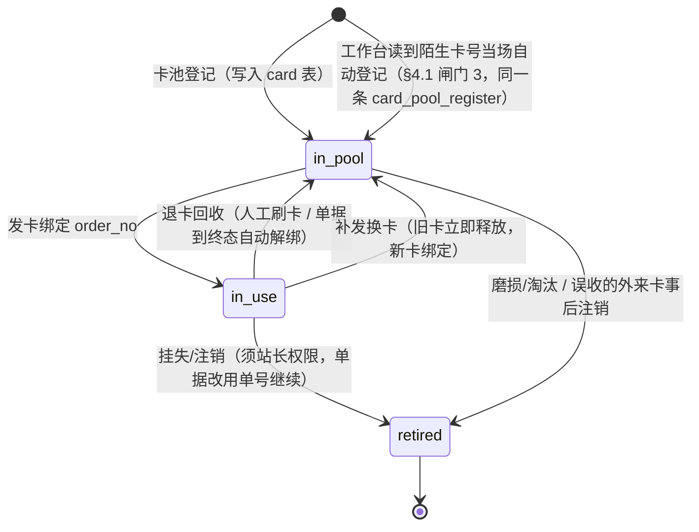
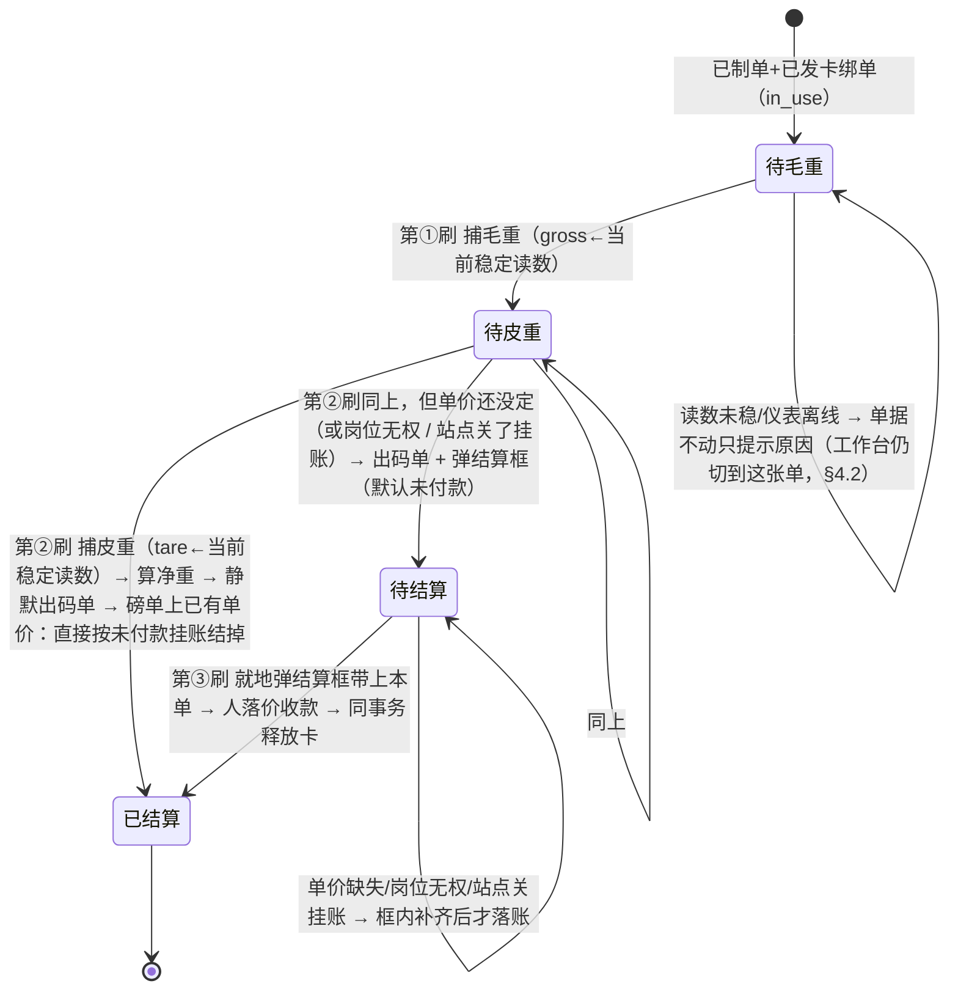
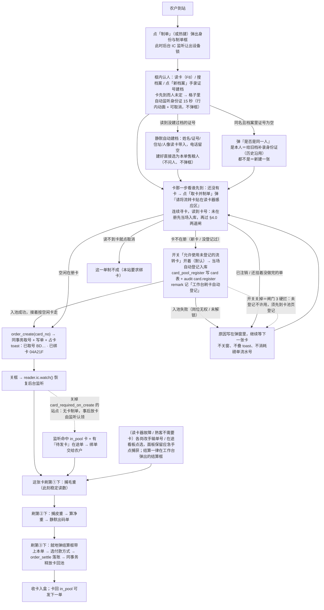

# 06 IC 卡流转凭证（一单一卡 · 刷卡推进 · 循环回收）

磅房里农户**忘带身份证**时发一张 IC 卡。这张卡不只是"认出是哪一单"的免手输便利件，它还是**过磅作业的推进扳机**：一单从制单到结算，靠同一张卡刷三次走完——第一次刷捕毛重、第二次刷捕皮重并即时算净重自动出码单、第三次刷卡**等价于扫这张单的码**：在工作台就地弹出结算框并带上这张单，在框里落价、收款、打凭证。结算完成把卡收回、下一单接着用。本篇给出这条链路的业务规则、**刷卡计数状态机**、卡生命周期、数据模型、接口契约与实现清单。

> **卡与票面二维码的分工**（02 §F1.4）：卡管**站内流转**——哪个岗位正在办这台车、免手输单号定位这一单；二维码管**客户手里那张凭据**——人不在磅房、隔一天拿票回来算钱时靠它。两者定位的是同一张 `weigh_order`，但服务对象与时点不同，**不互相替代**：没发卡也要能扫，客户没来也要能凭卡把这单推到结算（扫与刷落的是同一个结算框）。
>
> 阅读前提：01 §3.1 六环节主流程、03 §4 磅单状态机、04 §3 证卡阅读器。本篇**只把"过磅触发"从"磅员点按钮"换成"刷卡"**，不改动六环节的任何作业顺序与计价口径；重量归属仍在 `order_create` 那一刻锁死在 `weigh_order.party_id`，`capture`/`settle` 的入参与闸门一字不动（§6.3）——第三刷改的是"在哪儿完成结算"，不是"结算怎么做"。
>
> **口径变更（覆盖上一版"刷卡只定位、上磅不读卡"的写法）**：工作台**除"身份与制单"弹窗打开、需要读身份证的那一段之外，IC 通道全程监听**（§3、§1.2）。一台读卡器同一时刻只能解一种介质，所以弹窗读身份证时 IC 监听挂起，收工回后台立刻恢复监听——这是硬件属性，不是软件选择（§1.2）。
>
> **口径变更（2026-09-12，本轮）**：**发卡时机从"制单之后"提前到"制单当场"**。点「取卡并制单」先弹框刷 IC 小白卡，读到一张可用的空闲卡才取号，卡与单在同一笔事务里绑死；**读不到卡这张单就制不成**，卡上还挂着没做完单子的同样拦下（§4.0）。上一版"发卡是关框后靠后台监听认领、任何一道读不出卡流程都照旧跑完"的写法只在关掉 `card_required_on_create` 之后成立（§3 要点 2、§4.4 C1）。

---

## 1 定位：卡只认单，不认人

这是全篇最重要的一句话，后面所有规则都从它推出来。

| 卡承担 | 卡不承担 |
| --- | --- |
| 制单之后，让扦样、化验、二次称重、结算各岗**免手输单号、免在途看板里找**就能定位到这一张磅单；并作为**过磅/结算的推进扳机**——同一张卡每刷一次，把这张单按状态机往前推一步（毛重→皮重→结算，§2.2） | 身份识别与档案归并（仍由身份证 `party.id_card_no_fp` 决定） |
| 一车一卡的物理交接凭据，农户手里"有个东西"代表这单还在办 | 结算对象、付款渠道、挂账额度的判定依据 |
| 领卡/退卡的岗位留痕（谁发的、谁收的、挂在哪张单上） | 长期会员身份、跨日跨次复用同一张卡认同一个人 |

**爆炸半径**：卡被换掉、丢失、被别的站的卡混进来，最坏结果是"这一单要退回手输单号才能继续"，**不会算错钱、不会把 A 的皮重记到 B 头上**——因为重量归属在 `order_create` 那一刻就锁死在 `weigh_order.party_id` 上了（`src-tauri/src/orders.rs` 的 `capture` 只认 `order_no`）。所以卡分两段看：**过磅推进那三刷仍是便利件**——读不出卡一律退回面板手点，闸门与金额一分不动；**制单这一步自本轮起是必需件**（§4.0）——默认读不到可用的卡就不许取号，要放开得由站长把参数关掉，不是"闸门自动降级"。

卡现在会**触发写**（捕重、结算），比"只定位"多了一层责任：一次刷卡只能经 `card_locate` 命中**唯一一张在途单**后才推进那一张，绝不由"刷到卡"去猜是哪辆车。它并没有放大上面那句结论——把毛重记到谁头上，取决于"这张卡绑的是哪张单"（发卡时锁死）与"磅上此刻的稳定读数"（全局唯一），跟旧版"磅员先在面板选中单再点捕获"是同一个信任点，不新增错账路径。真正的防串靠 §4.1 发卡闸门（在册、一卡一单）与 §2.2 只认当前稳定读数两条。

### 1.1 为什么不解决"没带证也没档"

`save_party` 新建分支强制身份证必填并做 SHA-256 指纹唯一归并（`orders.rs:1172`），而卡只认单不认人，因此**发一张卡不能替代建档**。没带证的熟客走"搜档案"（姓名/手机号）一样能制单，本来就不需要卡；首次来售粮又没带证的人，走 01 §3.3 异常分支 E11「手工录入证号 + 标记未读卡核验」。真正"无证也能建档"的临时档案是另一轮设计（涉及 `id_card_no_fp` 可为空的归并策略与付款渠道限制），**不在本篇范围**，见 §9。

### 1.2 硬件互斥：一台读卡器一次只解一种介质

精伦 iDR 一台机内同一副射频前端既解身份证（SAM）也寻 IC（Mifare），**同一时刻只能跑一种**；两条通道并行轮询只会抢同一把设备锁（`store/device.ts` 里 `idcard.watch` 与 `ic` 读共用一个进程内单实例）。所以工作台不能"一边后台监听 IC 刷卡、一边随时能读身份证"。落地口径：

- **默认态＝IC 监听在跑**。工作台一进页面就起 `reader.ic.watch`，负责毛重/皮重/结算三刷推进（§2.2）。
- **登记弹窗打开＝IC 监听挂起、切身份证**。点"制单"（或热键）弹出"身份与制单"框，先 `reader.ic.stopWatch()` 让出设备锁，框内改用 `reader.idcard.read/watch` 解身份证认人（或搜档案、手录证号）。
- **收工回后台＝恢复 IC 监听**。弹窗关闭（制单成功或放弃）后重新 `reader.ic.watch()`，交给下一单去刷。

这条切换必须**唯一收口**在一个编排器里（§8 的 `useIcWorkflow`），不允许两个组件各自 `watch`——否则 StrictMode 双挂、或弹窗与他处同时起循环，真机上就是两条循环抢锁、`stopWatch` 只停得掉其中一条。任期号机制照 `idcard` 通道现成的 `cardWatchEpoch` 同款，IC 通道补齐（§8）。

### 1.1 为什么不解决"没带证也没档"

`save_party` 新建分支强制身份证必填并做 SHA-256 指纹唯一归并（`orders.rs:1172`），而卡只认单不认人，因此**发一张卡不能替代建档**。没带证的熟客走"搜档案"（姓名/手机号）一样能制单，本来就不需要卡；首次来售粮又没带证的人，走 01 §3.3 异常分支 E11「手工录入证号 + 标记未读卡核验」。真正"无证也能建档"的临时档案是另一轮设计（涉及 `id_card_no_fp` 可为空的归并策略与付款渠道限制），**不在本篇范围**，见 §9。

---

## 2 卡生命周期与状态机

卡是**有限的循环资产**，所以必须**在册**才能用；一次流转内被一张磅单独占，终态即释放回池。"在册"有两条来路：卡池页批量登记（贴好签再入池），以及工作台读到陌生卡号时**当场自动登记入库**（§4.1 闸门 3）——后者消掉的是"卡贴在感应区上、却要磅员去另一屏点一次登记再回来重刷"那一步。第二条来路由站点参数 `card_auto_register`「允许使用未登记的流转卡」把着，默认开；关掉它就只剩卡池页那一条（外来卡/公交卡不会被收进池子）。

### 2.1 卡的资产生命周期（在册循环）



| 状态 | 含义 | 进入条件 | 在界面怎么说 |
| --- | --- | --- | --- |
| `in_pool` | 空闲在册，可发 | 卡池页登记入库；工作台刷到未登记卡当场自动入库；或退卡回收 | "空闲卡 N 张" |
| `in_use` | 已绑一张未到终态的磅单 | 发卡闸门全过 | "卡 04A21F 挂在 BD01202609000037" |
| `retired` | 注销，不再发放 | 挂失/报废 | 注销需填原因，`audit` 留痕 |

**一卡一单天然成立**：`card` 表一行一卡（`card_no` 唯一），占用信息就是这一行的 `status + current_order_id`，不需要在 `weigh_order` 上玩部分唯一索引（见 §5.2 为什么）。

**解绑以单据终态为准，不依赖人记得刷卡**：磅单进入 `settled`/`paid`/`archived`/`voided`/`reversed`/`rejected` 时，服务层在同一事务内释放该单绑的卡（`in_use → in_pool`）。人工"退卡"动作只是提前收卡，收不到也不会把这张卡永久卡死。日终再做一次扫尾对账（§6.4）。

### 2.2 一单三步：刷卡计数状态机

**这一步是"哪一刷"不靠前端数次数，靠单据落库的状态反推**。编排器读到一张卡 → `card_locate` 命中它绑的那张单 → 看这张单**当前缺什么**决定这一刷干什么。为什么不存"第几刷"这个计数器：断电、换班、复称、旁人在另一台机改过这张单，都会让"次数"和"单据真实状态"对不上；以 `gross_weight_01kg / tare_weight_01kg / settled` 三列为准，永远算的是"这张单还差哪一步"，重复刷、漏刷、乱序刷都只是"这一步已完成→落到下一个待办"，天然幂等。



逐刷口径：

| 刷次（=单据当前状态） | 动作 | 写库 | 卡状态 |
| --- | --- | --- | --- |
| 缺毛重 | **先过价闸**：磅单上还没有单价 → 这一刷作废，提示去称重区把价填好；有价才取**此刻地磅稳定读数**捕为毛重 | `order_capture(gross)`；状态→`gross_weighed` | 不变 `in_use` |
| 有毛重缺皮重 | 取此刻稳定读数捕为皮重，**同一刻**算净重、**静默送打码单**；紧接着把结算这一步一并走掉——磅单上**已有单价**就直接按未付款挂账结掉，没有单价才弹结算框（默认未付款）等人落价 | `order_capture(tare)`；状态→`tare_weighed`/`to_settle`；够条件时同一步 `order_settle`；打印走 §8 打印编排 | 没自动结 → 不变 `in_use`；自动结掉 → 终态 `in_pool`（§6.4 自动释放） |
| 两项都有、未结算 | 在工作台就地弹出结算框并带上这张单（02 §F1.4）：框内以**本单已落的单价**（制单挂牌价，或磅员在现场改过的价）铺初值、化验扣量兜底，出纳选付款方式与实付金额（当场付清 / 只付一部分 / 整单挂账）并确认签字；改了价就得写清事由，确认后落账 | `order_settle`；状态→`settled`，付款状态按实付落 `paid`/`partial`/`unpaid` | 终态→`in_pool`（§6.4 自动释放） |

三条硬规矩：

1. **只认"当前稳定读数"，不缓存、不凑数**。刷卡瞬间若 `scale.stable === false`，这一刷**作废**并提示"读数未稳，请等车停稳再刷"，绝不把抖动的中间值写进磅单（沿用称重区既有判稳闸门，不因换成刷卡触发就绕过）。
2. **第②刷即出码单是"静默送打"**，不弹预览（用户口径），磅员核对在码单实物上；补打/重打走打印中心或 F9，仍可预览。自动打印失败必须 toast 报因（缺纸/离线），但不回滚已捕获的皮重。
3. **自动落账只有一种情形，且只落未付款**。第②刷在净重算出后确实会**直接落一张结算单**，但前提狭窄：`weigh_order.price_fen_per_ton` **已经有值**（价在更早的环节就定了），且只按 `pay_now = false` 落成 `unpaid`（挂账）。它不挑付款方式、不碰现金、也不替人定价——**单价缺失 / 岗位无权 / 站点关掉挂账，一律退回结算框由人确认**。这三条都写在 `src/lib/settle-defaults.ts::postWeighAction` 里，是那个函数唯一的一份判定，手点捕获与刷卡捕获共用同一个出口（若两处各写一份，同一次过磅会因"是刷的还是点的"得出两种结果）。
4. **第③刷不是"直接结算落账"，是"弹结算框→人确认"**。收钱牵涉付款方式与实付金额的选择，任何情况下都不允许把"当场付清/只付一部分/挂账"替操作员拍板；框内仍走 `order_settle` 全部闸门（岗位权限、重复结算；**结算价偏离价目表即属改价，事由必填、不少于 4 个字，是服务端硬闸**——这一单的票早就把制单挂的价印给客户了，价与账对不上时得拿得出「凭什么」）。第②刷那条自动路径之所以能落，正是因为它把付款方式这一维**钉死在"未付款"**上——没有可选项，也就没有可拍错的东西。
5. **吨位与钱分开管岗**：挂账结算多了 `settle.credit` 这一条（磅员、出纳、站长），`pay.record`（当场付款）仍只给站长与出纳。命令层按 `pay_now` 选角色集、**不取并集**（`orders.rs::order_settle`）——两把钥匙分开，磅员那把开不了现金那扇门。
6. **毛重那一刷之前，磅单上必须有单价**（02 §F1.4）。价是成交的前提——农户到站先问价、谈成才卸货，没价就等于这车还没谈成，不该收粮；收了就是一笔事后只能靠嘴对账的糊涂账。所以缺价时这一刷**什么都不写**：屏上一句、喇叭同一句，有定价权的岗位顺手把「定价 / 改价」框开在他面前（判定与文案只有 `src/lib/weigh-gate.ts` 一份，手点 / 手录 / 刷卡三条入口共用；服务端 `orders.rs::capture` 与 mock 另有同一句话的硬闸兜底，前端这道只是让人当场知道该干什么）。**皮重那一刷不设这道闸**——空车多重与这车粮值多少钱无关；而一次/二次称重顺序自由（§F1.2），先捕皮重的车在毛重那一刷照样撞得到。
   - 制单那一刻就按品种带一次挂牌价（`orders.rs::create_order` 的 `lookup_price`，不用人操作），所以正常站点根本走不到缺价这一步；**撞上这道闸只有两种情形**：这个品种在价目表里没有现行价目，或现场议的价还没落到单上。
   - 缺价**不拦制单**：价是后头补得上的，号取不出来才是真把现场卡住（会让没配好价目表的站点整站开不了张）。

超容差（皮重偏差）在**第②刷**不拦车——捕皮重这一步照常完成、读数即采信，服务端复算后自动在磅单记一条醒目警示并写审计（与称重区现有逻辑同源，toast 只给一句警告、不弹授权框），事后由站长在磅单/审计里核对，如需更正走红冲重录。

---

## 3 主流程



六条时序要点：

1. **登记是弹窗 + 常驻格子两条入口，走同一条路**。点了「制单」弹框（`F7` / 后台刷到没单可发的空闲卡时带卡号弹它），或在常驻的 `① 身份与制单` 格子里直接办；框开着这段时间 **IC 常听挂起**（§1.2 硬件互斥），框内先解身份证；一关框就恢复 IC 监听。
2. **绑卡与认人谁后到、谁触发取号**（§4.0，本轮变更）。两条入口都同一条规则：**卡已就位而售粮人未定 → 格子里自动起一轮 15 秒身份证监听**，读到证卡即认人（含 §3 的静默建档 / 「是否是同一人」那一问）并**自动**把 `card_no` 随 `order_create` 提交；反过来**人已定而卡未到 → 点「取卡并制单」才切回 IC 通道弹绑卡框**，读到一张空闲在册卡即连同 `party_id` 一起取号。取号、写单、占卡、写快照一笔事务完成，toast 直接报"已取号 BD… · 已绑卡 …"。读不到卡、或那张卡还挂着没做完的单，这一单就制不成——农户手里那一刻已经有卡，不必再等磅员另放一张上去。**被服务端拦下的那张卡就地作废**（`cardNo` 清空、回到等下一张），不让人原地重试同一张。
3. **后台监听发卡退居备选**。只有把 `card_required_on_create` 关掉（或 `card_flow_mode=off`）的站点才走旧路径：制单只产出"无卡在途单"，磅员把空闲卡往机器上一放，监听读到 `in_pool` 卡且有待发卡单，就绑到**最近制单且尚无卡**的那一张（toast 写清绑到哪张，放错可 `card_release` 后重放）。跳过发卡照常能走完，见 §4.4 C1。
4. **一张绑好的卡刷一次推进一步**，靠单据落库状态反推"下一步是毛重还是皮重还是结算"（§2.2），前端不数次数。农户中途走开又回来刷自己那张卡，接着上一步往下走，不需要重发。
5. **上磅/下磅就是"把车开稳再刷一下"**。`order_capture` 仍只认 `order_no`+重量，卡只负责①定到哪张单、②取此刻稳定读数。化验（F5）不在刷卡链里，是旁路的可选步；结算框打开才碰钱。
6. **该出声的地方一律出声**（05 §6.5）。两类：① 读卡建档框、制单读卡框、制单绑卡框（上面 §4.0 那一框）、卡池「读卡登记」框弹出的那一刻，以及**卡就位后格子里自动起的那轮 15 秒身份证监听**（它不弹框，人可能正看着窗外，只靠一行动画请人放证不够），本机扬声器念一句"请将身份证平放在读卡器感应区 / 请将流转卡贴在读卡器感应区"；② 刷卡推进链路上**每一个要人改动作的节点**都回话——读数没稳或仪表离线（这一刷没记上）、外来卡用不了（自动登记没成 / 已注销 / 还挂着没做完的单）、这张单已结算或已不在途（把卡收回）、毛重皮重落库、发卡成败、制单绑卡框里被闸门拦下的每一张卡。判据是"这一刻要不要人改动作"：要改动作必须出声，不需要人反应的不出声；**只播动作与结论，不念单号、卡号、姓名与重量**（那些归屏幕和码单）。操作员与农户都在窗外，屏幕上那行红字绿字没人回头看的概率高过看的概率。开关是站点参数 `reader_prompt_voice`（默认开），**它只闸声音**：关掉之后刷卡绑卡、两道闸、发卡推进一寸都不变。未登记卡**自动登记成功不出声**——紧接着的"卡已发出 / 已把这张卡贴到身份与制单"那一句就是结论，连着念两句反而听不清重点；只有登记失败才必须出声。

> 一条制单链上连着解**两种介质**：认人那一段读身份证（`idcard.watch`），绑卡那一段读 IC（`ic.watch`），一台读卡器一次只解一种（§1.2）。本轮之后**两段的先后不再固定**（农户先递卡还是先递证都不该逼磅员改动作），触发点统一收在"谁后到谁触发取号"；但**互斥这条铁律一寸不让**——行内那轮监听与那两个弹窗一样占住设备锁（`setPanelHolding`），读到、超时或按「取消」即 `stopWatch` 交还，IC 后台常听自己回来，绝不能两条循环同时在跑。

> 旧版 §3.3「上磅/下磅不需要读卡、读卡只是把 order_no 填进面板」的写法作废：本版把"读卡"提为过磅的**主触发**，面板点捕获降为应急手点（§8、05 §4）。

---

## 4 业务规则与闸门

### 4.0 制单绑卡（本轮口径变更，先读这节）

**制单必须先刷到一张可用的流转卡。** 点「取卡并制单」（制单框里那一步）先弹「请将流转卡贴在读卡器感应区」的连续监听框（`src/components/workstation/CardBindDialog.tsx`）：读到卡号就地过闸——**卡不在册的当场自动登记入库**（见 §4.1 闸门 3），再判两道闸：未注销、这张卡没挂着没做完的单——全过才把 `card_no` 随 `order_create` 提交。服务端在**同一事务**里取号、写单、占卡、写单据侧快照，任何一道不过整笔回滚：

- **读不到卡，这张单就制不成**，也不会留下"已取号却没绑卡"的半张单；判定放在 `next_no` 之前，连磅单流水号都不消耗。
- **但现场等不起：主按钮左边还有一颗「无卡制单」**（单笔退路，入参 `CreateOrderInput.allow_no_card`）。读卡器坏了、卡池见底、农户手里那张是反复读不出的外来卡——这时候让整条队伍停着、等站长先去改全站参数是不成立的。点它即不弹绑卡框直接取号，**只放开"必须刷到卡"这一道闸**：品种必填照旧、售粮人必须先定下来（这一路手上没有卡，那条挂在"卡已就位"上的 15 秒自动认人不生效，机器不替人猜是谁），而卡真带过来了时在册 / 未注销 / 没挂着未完成单三道闸一寸不省，照样拦在取号之前。号取成后单上 `card_no` 留空，`order.create` 那行审计末尾写明「无卡制单，待补绑流转卡」——光看 `card_no IS NULL` 分不出"当时就没绑"和"绑过又退了卡"，这一行是给事后翻账留的。这颗按钮**只在本站强制绑卡而此刻手上没卡时出现**（`requireCard && !cardNo`），卡已就位或本站不强制时不摆，不给磅员的日常多一颗。守卫见 `orders_contract.rs::create_order_binds_a_free_card_or_refuses_the_number` 末段：无卡退路出得了号、放过不了外来卡、也不多吃一个流水号。
- **补得上：磅单详情那颗「补绑流转卡」**（`OrderDetailPage` 基本信息卡片右上角，只在"在途且没卡"时出现，绑上自己就消失）。点开的是同一个 `CardBindDialog`（`purpose="rebind"`：闸门、手动挑卡、60 秒收工一条不差，只是屏幕上与喇叭里的"下一步"从"正在取号制单"换成"正在绑定这张单"，也不再给"不绑卡照样走"那条退路），读到卡走 §4.1 那条 `card_issue`（显式带 `order_no`），**不另开一条写入口**。另一条更省手的路是什么都不点：把空闲卡放上感应区，后台监听按 §4.1 闸门 1 认的就是"`card_no IS NULL` 的在途单"，这张无卡单当场被认领。基本信息那一格「流转卡」未绑时写成「未绑定 · 请点右上角「补绑流转卡」」，不留一个教人误会的「—」。这颗按钮与那颗「无卡制单」都还只吃 `order.create` 那道岗位闸，**独立的权限闸门排在后面**（本轮刻意不做，见 §9 非目标）。
- 闸门收在 `cards::check_card_for_create`（只判不写，取号前问一次）与 `cards::bind_on_create`（同事务占用），与 §4.1 的后台监听发卡**共用同一份判定**，不让两个入口漂出两种口径。
- **"这张卡还有没做完的单子就不许绑"** 是 §2.1 一卡一单在制单时机上的落点：`card` 那一行的 `current_order_id` 指向的单未到终态即拦下，文案直接点出是哪张单（`卡 04A21F 还挂着没做完的单 BD…（张三），一张卡不能同时开两张单`）。挂着单但那单已到终态的卡（只有关掉 `card_release_on_terminal` 才会剩）视同空闲，就地收回再绑新单，不必先人去卡池页点一次退卡。
- **放开强制**的两种口径：站点参数 `card_required_on_create=false`，或本站压根不用流转卡（`card_flow_mode=off`）。任一成立即回到 §3 的旧路径——无卡制单，磅员事后把空闲卡放上机器由后台监听认领发卡。
- **"见卡就发"已经放开**（本轮口径变更，取代此前"卡池登记是硬前提"的立场）：读到不在册的卡，`useIcWorkflow` 与 `CardBindDialog` 都先调一次 `card_pool_register` 就地入池留痕，再按一张普通空闲卡继续走——磅员不必为了发一张新卡切到「流转卡」页点一次登记、回来再刷第二遍。**代价要认**：任何一张 13.56MHz Mifare 卡（公交卡、别的站的卡、员工自己的卡）都会被收进本站卡池并可能被绑上一张真磅单；留痕落在 `card.remark`「工作台刷卡自动登记（发卡 / 制单绑卡）」+ `audit card.register`，事后可在卡池页「来源 / 备注」列认出来并注销（C3）。已注销（`retired`）的卡一律**不**复活。
- **这条放开是可以关回去的**：站点参数 `card_auto_register`「允许使用未登记的流转卡」默认开；置 `false` 即完整退回上面那条硬闸门——读到未登记的卡当场拦下、写明"请到「流转卡」页登记"，一张也不替站点收进池子。要不要接住农户手里那张陌生卡，归站长按现场纪律定，不由代码替他决定，也不写死成两种之一。
- **读卡器这一路走不通时有一条「手动绑卡」退路**：框底「取消制单」左边那颗 text 按钮，点一下在左侧浮出本站**空闲在册**卡的下拉（`card_pool_list status=in_pool`，未登记/已注销/挂在途单的都不在里面），那颗按钮同时换成常规「绑定」，点绑定即完成绑卡。它**不另开一条写入口**——与刷到卡同一条 `onPicked` 出口，卡号照旧随 `order_create` 同事务绑上，`check_card_for_create` 那道闸一寸不省（下拉读到的是快照，卡在这期间被别的单占走时制单当场报错，不会悄悄绑上一张已挂单的卡）。展开手动后**停掉 60 秒自动关窗表**（人正在挑卡，不该被定时器抹掉这一步），但连续寻卡那圈照旧跑着——这期间农户真把卡贴上了感应区，仍按"读到了"收工。

### 4.1 发卡（`in_pool → in_use`）

入口有三：**制单绑卡**（§4.0，强制站点的主路径）、**后台监听读到一张 `in_pool` 卡**（关掉 §4.0 的强制后才是主路径，见 §3 要点 2；它同样接得住 §4.0 那颗「无卡制单」留下的单子——闸门 1 找的就是 `card_no IS NULL` 的在途单）、以及**磅单详情「补绑流转卡」**（给指定那张单补，显式带 `order_no` 来过同一套闸）：磅员把空闲卡往机器上一放、或在框里挑一张，编排器/详情页就带着这个 `card_no` 来过闸。按顺序过闸，**第一道不过就停，错误文案要说清是哪一道**：

| # | 闸门 | 不过时的文案 |
| --- | --- | --- |
| 1 | 有待发卡单：至少一张未到终态且 `card_no IS NULL` 的在途单，取 `registered_at` 最近的一张 | 一张都没有：编排器（`useIcWorkflow.openRegister`）不把磅员赶回点弹窗，而是**把这张卡交给常驻的「身份与制单」面板就地制单**（经 `presetCardNo` 就位、选好售粮人点「取卡并制单」即随单绑上，不再弹制单框）；服务端那句"没有等待发卡的在途单"只作兜底报错 |
| 2 | 读到卡号：`ic_read` 返回 `ok = true` 且 `sn` 非空 | 转 §4.4 降级，不报设备故障 |
| 3 | 卡在册：`card` 表有该 `card_no` 且 `status = 'in_pool'` | 在册但占用 → 转 §4.2 当作"刷卡推进"处理，不重发；不在册 → **开关 `card_auto_register`（默认开）则编排器当场 `card_pool_register` 自动登记入库（`remark` 写来源 + `audit card.register` 留痕），随即按空闲卡继续这一刷**（§4.0 末条）；开关关掉 → 硬拦"卡未登记，请到「流转卡」页登记后再发"。自动登记本身失败（岗位无权 / 未解锁 / 库锁）同样拦下这一刷 |
| 4 | 该单未绑卡：`weigh_order.card_no IS NULL` | 已绑 → 走"补发换卡"而不是报错 |
| 5 | 该单未到终态 | 终态 → "本单已结算，请直接去退卡" |

发卡成功后：`card.status='in_use'`、`card.current_order_id`、`weigh_order.card_no = sn`、`issued_at/issued_by`，四条写在**同一事务**内，并 `audit` 一条 `card.issue`（含操作员与单号）。

**卡号要印在码单上**（05 §9 打印模板要素补一项）：农户签字那一下同时完成"我领走这张卡"的确认，退卡时凭单号或凭卡都能对上，不需要额外搞领卡登记。跳过发卡时该字段打印为"—"，不影响码单其余要素与法律效力。

### 4.2 用卡定位与推进

读到 `card_no` → 先判占用态：`in_pool` 走 §4.1 发卡；`in_use` 则 `card_locate` 命中它绑的那张在途单，按 §2.2 把该单**往前推一步**（缺毛重→捕毛重，缺皮重→捕皮重+出码单，随后磅单上已有单价就直接挂账结掉、没有才弹结算框；两项都有未结算→就地弹结算框并带上本单）。查不到对应单 → 提示"这张卡没有对应在途单"，**不阻断**手输单号与在途看板点选。

**先定位、再推进，两件事分开**：命中一张在途卡，第一件事是把工作台的"当前单"切成这张卡绑的单（`useIcWorkflow.onFocusOrder` → 路由 `orderNo`），常驻的「身份与制单」与称重/化验/抓拍各面板随即说的都是这张单。这一步排在**仪表闸门与去抖窗口之前**：仪表离线、读数未稳、连击落在 `card_swipe_debounce_ms` 之内，拦下的都只是"这一刷写不写库"，没有理由连"屏幕上该显示谁"也一起拦掉——反过来说，操作员刷的是乙的单、面板还停在甲的单上，人对着别人的姓名车牌核对这一次的读数，比让他多刷一次危险得多。只在单号真的变了时才导航，同一张卡反复刷不往 history 里塞重复 URL；挂着**终态单**的卡（下一段）不定位，只报"把卡收回"。

**它绑的单若已"结束"，别再要读数**：`card_locate` 命中的一张单若落在**作废 / 拒收退粮 / 红冲**这些终态（不只是 settled/paid/archived），推进侧一律判成"已结束"，提示"这张单已经不能继续了，把卡收回、去「流转卡」页退卡"——**绝不**再把它当"缺毛重"去要一次地磅读数（那会弹出一句误导人的"仪表离线"，让人以为是自己没连上磅，其实单子早结了）。这与 §4.1 发卡/建卡侧对"挂着终态单的空闲卡就地收回"是同一口径，两侧不漂。

**一刷的判据是边沿，不是时间**：真机上卡往感应区一放就不动，监听循环会一轮轮读到**同一个 sn**。所以 `reader.ic.watch` 只在两种情况下把命中交回编排器——①读到的 `card_no` 与上一次交回的不是同一张；②同一张卡，但中间**天线空读过一次**（卡被拿走再放回来）。这才算"一刷"。只靠 `card_swipe_debounce_ms` 时间窗口挡不住真正的事故：窗口一过（默认 1.5 s），压在感应区没挪窝的那张卡会以**同一个读数**把皮重也捕了，净重直接算成 0；边沿触发从根上杜绝"一次压卡推两步"。时间窗口保留作第二道保险（键 `card_no + 当前单据状态`，同一张单同一步在窗口内不重复推进），防的是操作员手快连贴两下。

**闸门不过时不叠框**：自动登记失败、已注销、读数未稳、发卡失败这类拦截，同一张卡 / 同一张单重复出现时**更新原来那条提示**（toast 按 `id` 去重），不在磅房屏幕上叠出一摞红框——磅员要看见的是"这一刷被哪道闸门拦了"，不是十遍同样的话。自动登记成功的"卡 … 不在卡池，已自动登记入库"同样按卡号 `id` 去重：一张没救回来的卡反复贴，也只占一行。寻卡成功但 `sn` 为空按 §4.1 闸门 2 降级处理，**不报**"未登记"、更**不**替它登记一张空号卡。皮重超容差不属拦截（照常入账），其警告 toast 也按单号 `id` 去重，别一刷一条堆叠。

**读卡器故障后自动缓过来**：`watch` 因设备级故障空手返回时，编排器不退出，按 2 s 起、翻倍、封顶 15 s 退避重起监听；读卡器重新插好、驱动重启后不必刷新页面。故障期间面板手点照常可用（§4.4 C1）。

### 4.3 退卡回收

三种入口，动作一致（解绑 + `card.status='in_pool'` + `audit card.release`）：结算/作废同事务自动释放；工作台"退卡"按钮；卡池页按卡号手工释放（用于"卡带回家了次日送回"）。**回收不校验卡是不是当前面板那张单**——农户随时可能拿别人的卡来退，退对卡就对了。

### 4.4 异常与例外分支（接 01 §3.3 的编号风格）

| 编号 | 情形 | 处理 |
| --- | --- | --- |
| C1 | 读卡器离线/没插 | **过磅推进那三刷**：IC 监听起不来或每轮报设备故障，编排器把状态转灰并写明原因，工作台退回**面板手点**，捕获与结算都落在称重区（05 §10-1"无外设也要能完成闭环"）：仪表同时离线时「毛重 / 皮重」那一格本身就是录入框（05 §4 ③），没捕过的格子直接敲数、空格 / P / 回车同权提交——**两台设备都坏也走得完一车**；净重齐了之后由「**去结算（本单）**」把这一单交给同一个结算框（等价于第③刷，闸门与话术复用 `settle-gate.ts`）。**制单绑卡那一步**：这台机读不到卡就是取不了号（§4.0 是硬闸门，不做自动降级）。**当场把队伍放行靠的是那颗「无卡制单」**（§4.0：先出号、卡事后在磅单详情补绑或由监听认领），不必等站长改参数；要长期不绑卡制单，才由站长把 `card_flow_mode` 置 `off`（本站不用卡）或把 `card_required_on_create` 置 `false`（不用卡制单、事后靠监听发卡） |
| C2 | 读到的是外来卡（公交卡、别的站的卡） | **默认开：不再拦下**。闸门 3 走"不在册当场自动登记入库"（§4.1 闸门 3、§4.0 末条），所以外来卡也会进池并可能被绑上一张真磅单。这是"见卡就发"换来的代价：卡池从"人工登记的名额"退成"见过的卡的账本"。留痕在 `card.remark`「工作台刷卡自动登记…」与 `audit card.register`，站长在卡池页「来源 / 备注」列认出来后按 C3 注销即可（注销只影响卡池，不动金额与台账）。**不接受这个代价就关开关**：`card_auto_register=false` 完整退回原来的硬拦，一张外来卡都进不了池。两种口径下 `retired` 都不复活——注销过的卡绝不能因为又被刷到就回到池里 |
| C3 | 卡丢失 | 卡池页注销（需站长权限）→ 该单改用单号继续 → 农户补领一张新卡。注销只影响卡池，不影响任何金额与台账 |
| C4 | 农户拿回一张已被回收后重新发出的卡，想找回自己那单 | 提示"此卡空闲，若要发卡请先制单"。已释放的卡**不承诺**还能找回旧单，旧单永远按单号可查（§9 非目标） |
| C5 | 一车多单（一人多次售粮） | 一单一卡，第二张单再发一张；卡池紧张时看板预警 |
| C6 | 复称（`reweigh`）/改皮重 | 不换卡、不重新发卡，卡与单绑定关系不变；复称后未结算的卡在**下一刷**继续按 §2.2 判定推进 |
| C7 | 中途换卡（原卡读不出了） | "补发换卡"：同事务释放旧卡 + 绑新卡 + `audit card.reissue` 记新旧卡号与原单。因卡不承载身份，此动作零财务风险 |
| C8 | 空闲卡低于阈值 | 看板与卡池页黄色提示"空闲卡仅 N 张，当日在途 M 单"，阈值 `card_pool_warn_free` 可调 |
| C9 | 读数未稳就刷卡 | 这一刷**作废**，toast"读数未稳，请等车停稳再刷"，不写库、不推进、不去抖窗口外的下一刷照常（§2.2 硬规矩 1）；但工作台照旧**定位到这张卡绑的单**（§4.2 先定位再推进），操作员就在这张单上等稳了手点或再刷 |
| C10 | 卡已随结算回池又被拿来刷 | 命中 `in_pool`：无待发卡单则提示"此卡空闲"（同 C4）；有则按 §4.1 当发卡处理。**绝不**因"刚结算过的卡"回退到那张已到终态的单，终态单只能走 §4.3 退卡/日终扫尾，不由刷卡改写 |

---

## 5 数据模型

### 5.1 新增 `card`（流转卡池）

迁移脚本 `src-tauri/src/db/migrations/0009_ic_flow_card.sql`（新脚本必须在 `src-tauri/src/db/migrate.rs` 的 `MIGRATIONS` 里登记，`tests/schema_contract.rs::every_migration_file_is_registered` 会拦"写了脚本忘了注册"）。

```sql
CREATE TABLE IF NOT EXISTS card (
  card_no           TEXT    NOT NULL PRIMARY KEY,   -- 寻卡返回的 sn（十六进制大写），不可变
  label             TEXT,                           -- 印刷编号/贴签，现场人眼认的那串
  status            TEXT    NOT NULL DEFAULT 'in_pool'
                      CHECK (status IN ('in_pool','in_use','retired')),
  current_order_id  INTEGER REFERENCES weigh_order(id),  -- 仅 status='in_use' 时非空
  issued_at         TEXT,
  issued_by         INTEGER REFERENCES user_account(id),
  retired_at        TEXT,
  retire_reason     TEXT,
  remark            TEXT,
  created_at        TEXT NOT NULL,
  created_by        INTEGER NOT NULL REFERENCES user_account(id),
  updated_at        TEXT,
  updated_by        INTEGER REFERENCES user_account(id)
);
CREATE UNIQUE INDEX IF NOT EXISTS uk_card_label ON card(label) WHERE label IS NOT NULL AND label <> '';
CREATE INDEX IF NOT EXISTS idx_order_card ON weigh_order(card_no) WHERE card_no IS NOT NULL;
```

不建 `card_event` 流水表——发卡/退卡/注销/补发四个动作的追溯需求（"这张卡是谁领走的、丢了要查到最后持有人"）由既有 `audit` 通道承载，多一张表只是把同一件事记两遍。

### 5.2 为什么不能只靠 `weigh_order.card_no` 一列

`weigh_order.card_no`、`queue_no` 是 0001 建表时就留的死列（`0001_init.sql:204-205`，全仓零读写）。本篇**启用 `card_no`** 作为单据侧的卡号快照（列表、详情、码单可印），但它不能替代卡池表，理由两条：

- 卡是循环资产，必须有一处记录"在册 / 空闲 / 注销"，否则外来卡混入（C2）无从拦；
- 若在 `weigh_order.card_no` 上建部分唯一索引来保证"一卡一单"，**补发换卡（C7）留下的旧卡号痕迹会和仍在途的那张单撞索引**。占用真相放在 `card` 表一行内，反而不需要任何花哨索引。

`queue_no` 继续保持空置（排队叫号是另一码事，见 §9）。

---

## 6 接口契约

### 6.1 读卡：复用现成命令，只取卡号

`ic_read(keyHex?, blocks?)`（`src-tauri/src/idcard.rs:242`）已经返回 `sn`，且 `sn` 来自寻卡结果，**不需要扇区密钥**——所以密钥被厂家改过的卡照样能用。发卡与刷卡定位一律传 `blocks: []`：跳过三个块的读取，既省一次密钥认证的耗时，也让"密钥不对读不出块"这种噪音彻底不出现。这是本篇**不新增任何读卡原语**的原因。

```text
ic_read(keyHex?, blocks: [])  ->  { ok, kindCode, kindLabel, sn, blocks: [], error? }
```

`sn` 归一为**大写十六进制、去分隔符**后作为 `card_no` 存库；登记与识别两侧走同一个归一函数，否则大小写不一致会造成"明明在册却说未登记"。

### 6.2 新增命令（`src-tauri/src/cards.rs`，与其余写命令同一套 `write_tx` 会话岗位闸门）

```text
card_pool_list(statusFilter?, keyword?)  -> [{ cardNo, label, status, orderNo?, issuedAt?, issuedByName?, remark }]
card_pool_register(cardNo, label?, remark?)      -> Card      # 只读不写卡：cardNo 由现场读卡得到，或手输贴签号后补读校验。调用方有二：卡池页「读卡登记」批量入池，以及工作台刷到未登记卡时由 `autoRegisterCard` 当场补登（`remark` 写来源，§4.1 闸门 3）
card_pool_retire(cardNo, reason)                 -> Card      # 需站长权限；in_use 的卡须先释放或同时释放
card_issue(orderNo, cardNo?)  -> { card, orderNo }  # 省略 cardNo = 服务端不猜，必须由前端读卡结果传入
card_release(cardNo | orderNo)                     -> Card
card_locate(cardNo) -> { found, status, orderNo?, partyName? }   # 只读定位，无副作用
card_reissue(orderNo, newCardNo)                   -> Card  # C7：释放旧 + 绑新，同事务
```

硬性约定沿用本仓库既有几条，不另立规矩：

- 所有写命令走 `write_tx`（`unchecked_transaction` + 岗位闸门），入参里的操作员 id 一律忽略，取会话身份；
- 每个写动作补一条 `audit`（复用 `orders::audit`，本就是 `pub(crate)`），动作名 `card.issue` / `card.release` / `card.register` / `card.retire` / `card.reissue`，主体类型 `card`，业务键用 `card_no`；
- 错误信息是能给磅员看的中文短句，前端面板 `onError` 原样透传，不做二次包装；
- DTO 字段驼峰混写处用 `serde(rename)` 与 `src/mock/types.ts` 逐字对齐。

### 6.3 `order_create` 多一个 `card_no`；称重/化验/结算命令**不改**，推进编排在前端

```text
order_create(input{ party_id, variety_id, vehicle_no?, warehouse_id?, slot_id?, remark?, card_no?, weight_source })
  -> WeighOrder        # card_no：§4.0 制单框刷到的卡号（前端读卡结果传入，服务端不猜）
```

- `card_required_on_create` 开着而 `card_no` 为空 → 直接拒绝，**且拒绝发生在 `next_no` 之前**，不消耗磅单流水号；
- `cards::check_card_for_create`（只判不写，取号前跑）与 `cards::bind_on_create`（同事务占卡 + 写 `weigh_order.card_no` 快照 + `audit card.issue`）共用同一份判定，与 `card_issue` 那条链不会有两种口径；
- 磅单快照照旧是"展示用"，占用真相只在 `card` 表那一行（§5.2）。

`order_capture`、`qc_save`、`order_settle` 的入参与状态推进一律不动。"读到卡→看这张单缺什么→决定这一刷捕毛重/捕皮重/弹结算"这套判断，整段写在前端编排器 `useIcWorkflow` 里（§8），它只是把现成命令按单据状态依次调起来，**不新增任何写命令、不新增称重闸门**。后端其余改动只在 `order_settle` 与 `order_void` 内部：终态落库的同事务里顺手释放该单绑的卡。

### 6.4 参数与日终

`src/lib/settings-catalog.ts` 里这张表的键按补录批次累积（0009 四项 + 0010 `card_required_on_create` + 0016 `card_auto_register`；与 03 §9.3.1 同批登记，否则 `schema_contract::seed_baseline_matches_design_doc` 会红）：

| key | 默认 | 作用 |
| --- | --- | --- |
| `card_pool_warn_free` | `5` | 空闲卡低于此值时看板与卡池页黄色预警（C8） |
| `card_release_on_terminal` | `1` | 终态自动解绑；置 0 则强制人工退卡才回池（用于要逐张点收卡的站点） |
| `card_swipe_debounce_ms` | `1500` | 同一张卡重复命中的去抖窗口（§4.2 防连击），窗口内只算一刷 |
| `card_flow_mode` | `auto` | 本站是否启用流转卡：`auto`＝工作台后台常听 IC、刷卡推进毛重/皮重/结算（默认）；`off`＝完全不启用流转卡，不起 IC 监听、不弹发卡/推进，工作台一律走面板手点（读卡器故障或不用卡的站点） |
| `card_required_on_create` | `true` | 制单是否必须绑卡（§4.0，随 0010 补录）：`true`＝取号前先弹框刷到一张空闲卡，读不到卡制不成单；`false`＝允许无卡制单，卡由事后监听认领。`card_flow_mode=off` 时本参数不参与判定。**它是全站口径**：读卡器临时坏掉那种救急走单笔退路「无卡制单」（§4.0），不拿这个参数当救急开关 |
| `card_auto_register` | `true` | 是否**允许使用未登记的流转卡**（§4.1 闸门 3，随 0016 补录）：`true`＝刷到不在册的卡当场自动登记入库并接着用它发卡/制单，来源记进 `card.remark`（卡池页「来源 / 备注」列可见，误收的公交卡事后注销）；`false`＝闸门 3 退回硬拦，未登记的卡一律不用，必须先到「流转卡」页登记。两种口径下 `retired` 都不复活；库里缺这个键时按 `true` 走（与 `card_required_on_create` 的缺省式一致） |

日终对账（挂在现有日结/封账动作里）：扫 `card.status='in_use'` 而其 `current_order_id` 对应磅单已到终态或已删除的行，自动释放并计入当日"未归还卡 N 张"清单——只提示，不静默改单据。

---

## 7 与其它文档的接缝（本轮刻意未改那五篇）

`docs/design/01–05` 与 `README.md` 当前工作区均有未提交改动，为避免与在途编辑冲突，本篇独立成文，接缝留给下一次统一合并：

| 位置 | 需要补进去的内容 |
| --- | --- |
| 01 §3.2 环节 1 | 增加"没带身份证"分支：熟客搜档案 → 制单 → 发流转卡；明确卡不替代建档 |
| 01 §3.3 | 新增异常行 E12「流转卡缺失/外来卡/丢失」→ 指回本篇 §4.4 C1–C8 |
| 01 §6 首版边界 | 把"IC 卡｜首版收敛｜仅预留 `queue_no`、`card_no`"改为"`card_no` 已启用为流转卡（一单一卡、循环回收）；`queue_no` 仍预留" |
| 02 §M1 F1.1 | 售粮人识别从三通道升为四通道（读卡 / 搜档案 / 手工建档 / 流转卡定位）；新增功能点 F1.6 流转卡发放与回收 |
| 02 §M9 | 证卡阅读器 IC 通道说明由"只读，不接业务"改为"只读取卡号，接流转卡业务；仍不写任何块" |
| 03 §9 表结构 | 登记 `card` 为新表（编号顺延，全仓"23 张表 + 1 张预留"的计数随之改），`weigh_order.card_no` 注释从"预留"改为"当前绑定卡号快照" |
| 04 §3 | 新增 §3.7 流转卡：`blocks: []` 只取 `sn`、卡号归一、外来卡闸门；`card-reader.ts` 的 `MEDIUM.ic.note` 从「IC 卡参与收粮流程（如内部流转卡）时再接业务侧」改为已接入 |
| 05 §4 | 工作台 ①「身份与制单」由常驻面板改为**登记弹窗**（新人来时弹、制单即关）；称重/结算主触发改为**刷 IC 卡**，面板降级为应急手点；皮重捕获后静默出码单；`card-reader.ts`/设备中心加「流转卡」卡池页（登记/注销/手工释放） |
| README | 阅读顺序表加第 6 行；术语表把"内部流转单"从"P1"改为本篇口径 |

---

## 8 实现清单

| 层 | 文件 | 动作 |
| --- | --- | --- |
| 迁移 | `src-tauri/src/db/migrations/0009_ic_flow_card.sql` | 建 `card` 表 + 两个索引；`idx_order_card` 部分索引 |
| 迁移 | `src-tauri/src/db/migrate.rs` | `MIGRATIONS` 追加 0009 一条 |
| 后端 | `src-tauri/src/cards.rs`（新） | §6.2 七个命令 + `write_tx`/`audit` 接入；`lib.rs` 注册 |
| 后端 | `src-tauri/src/orders.rs` | `order_settle`/`order_void` 终态同事务释放卡；`Card` 相关 DTO。`order_settle` 的角色集按 `pay_now` 选：当场付款走 `SETTLE_ROLES`（出纳/站长），挂账走 `SETTLE_CREDIT_ROLES`（多一个磅员），**不取并集** |
| 前端 | `src/components/workstation/RegistrationDialog.tsx`（新） | 取代常驻 ① 面板的**弹窗**：打开时 `ic.stopWatch()` → 框内 `idcard.read/watch` 认人（或搜档案/手录证号建档）→ 选品种车牌 → `createOrder` 取号 → 关框。把原 `IdentityPanel` 的表单、读卡回填、去向折叠行整体搬进 Dialog，`onDraft` 局部化到框内 |
| 前端 | `src/components/workstation/useIcWorkflow.ts`（唯一监听收口） | 后台常听 IC：读到 `in_pool` 卡→按 §4.1 发卡绑到最近无卡单；读到 `in_use` 卡→按 §2.2 看单据缺什么→调 `capture`；**净重刚定的那一捕**（毛重补齐或皮重补齐都算）回调 `onNetDetermined`，由页面收尾；含 §4.2 去抖、`card_flow_mode=off`/`mockOff` 不起监听、与身份证读互斥（同一 epoch 单循环） |
| 前端 | `src/components/workstation/WeighPanel.tsx` | 由主操作降级为**应急手点**，手录的入口就是「毛重 / 皮重」那一格本身（2026-10-09 改形：撤掉「手工录入读数」开关与它下面那两个框——没捕过的格子直接是录入框，已捕到读数的退回只读、点数值右边「修改」才进编辑态；主按钮与空格 / P 跟着这一格走，格子里有数就提交那个数、格子空着且仪表离线也走手录，落库成功即退回只读、换单即清空整组），"净重刚定"用**捕获前自取的快照**判（不读页面 prop，理由见 05 §4 ③）。它**不做**"净重定了之后干什么"的判断，只把 `onNetDetermined` 与 `onRequestSettle` 交给页面——前者归 `src/lib/settle-defaults.ts::postWeighAction`、后者归 `src/lib/settle-gate.ts`，与刷卡 / 扫票那条路共用同一份 |
| 前端 | `src/lib/api.ts` + `src/lib/cards-native.ts`（新）+ `src/mock/api.ts` | 沿用 `*-native.ts` 通道范式按 `runningInTauri` 分流 invoke/mock，**无原生通道也要能跑通发卡—定位—回收全链**（03 硬约束 3） |
| 前端 | `src/lib/card-reader.ts` | IC 通道 `note`/`qualifier` 文案更新为"接流转卡·刷卡推进"；导出 `normalizeCardNo`（与 Rust 侧同一归一口径） |
| 前端 | `src/store/device.ts` | IC 通道补 `watch/stopWatch`（`reader.ic` 现只有 `read`），照身份证通道的前端循环 + 任期号 + "每轮没卡"与"命令级失败"分道；`idcard.watch`/`ic.watch` 共用一把设备锁互斥 |
| 前端 | `src/pages/WorkstationPage.tsx` | 移除 `identity` 常驻面板（`layout.ts` PANELS 删该项并给 `defaultHidden` 兼容），页头加「制单」按钮 + F7 开弹窗；挂 `useIcWorkflow` |
| 前端 | `src/pages/CardsPage.tsx`（新）+ 侧栏 | 卡池登记/注销/手工释放/空闲预警；每功能自带顶级分组（沿用仓库菜单惯例） |
| 打印 | `src/components/print/sheets.tsx` + 打印编排 | 码单要素补"流转卡号"（跳过发卡印 `—`）；第②刷捕皮重后**静默送打**（不弹预览，失败 toast 报因不回滚） |
| 参数 | `src/lib/settings-catalog.ts` | §6.4 四项（与 03 §9.3.1 同批） |
| 文档 | 05 §4 | 记交互变更：身份与制单＝弹窗、称重/结算主触发＝刷卡、面板降级为应急、皮重即静默出码单 |
| 测试 | `src-tauri/tests/cards_contract.rs` | 闸门逐条断言；契约测试种子无业务行，插 `weigh_order` 前须自建 `party`（FK 会拦），测试函数名用 ASCII snake_case |

**本轮增量（§4.0 制单绑卡）**：

| 层 | 文件 | 动作 |
| --- | --- | --- |
| 迁移 | `src-tauri/src/db/migrations/0010_card_required_on_create.sql` | 只补一个参数键，不动表结构；`MIGRATIONS` 同批登记 |
| 后端 | `src-tauri/src/cards.rs` | `check_card_for_create`（只判不写）+ `bind_on_create`（同事务占卡/写快照/审计），与 `issue` 共用占用判定 |
| 后端 | `src-tauri/src/orders.rs` | `CreateOrderInput.card_no`；闸门判在 `next_no` 之前；`WeighOrder` DTO 与 `ORDER_SELECT` 末列补 `card_no` 快照 |
| 前端 | `src/components/workstation/CardBindDialog.tsx`（新） | 制单刷卡框：`ic.watch` 连续寻卡 → `card_locate` 过闸 → 不过就在框里说清原因继续等；60 秒到点收工 |
| 前端 | `src/components/workstation/IdentityPanel.tsx` | 「取卡并制单」改走 `submit()`：强制站点未刷卡先弹 `CardBindDialog`，卡号随 `createOrder` 提交；toast 回显"已绑卡 …" |
| 前端 | `src/mock/api.ts` + `src/lib/settings-catalog.ts` | 浏览器侧同一套闸门与占卡写入；参数目录补一项（演示值取 `false`：预览没有 IC 通道） |
| 文档 | 03 §9.3.1 / §9.26 | 登记新键（`seed_baseline_matches_design_doc` 要求逐字相等） |
| 测试 | `src-tauri/tests/orders_contract.rs` | `create_order_binds_a_free_card_or_refuses_the_number`：无卡/未登记/已注销/挂着未完成单逐条拦下，且**不消耗流水号、不留半张单**；挂着终态单的卡视同空闲 |

**本轮增量（未登记卡自动登记入库，§4.1 闸门 3）**：

| 层 | 文件 | 动作 |
| --- | --- | --- |
| 迁移 | `src-tauri/src/db/migrations/0016_card_auto_register.sql`（新） | 只落一个参数键 `card_auto_register`（默认 `true`），不动表结构；`MIGRATIONS` 同批登记（`every_migration_file_is_registered` 逐字比对目录） |
| 参数 | `src/lib/settings-catalog.ts` + 03 §9.3.1 | 「过磅计量」组补一项**允许使用未登记的流转卡**，描述与 §9.3.1 那行同批写（`seed_baseline_matches_design_doc` / `every_key_the_frontend_catalog_renders_exists_in_the_library` 两条断言都盯着） |
| 前端 | `src/lib/card-auto-register.ts`（新，**唯一实现处**） | `autoRegisterCard(qc, cardNo, scene)`：只走 `card_pool_register` 这一条写入口（卡号归一 / `in_pool` 入库 / `audit card.register` 都由它做），`remark` 写"工作台刷卡自动登记（发卡 / 制单绑卡）"，成功后 invalidate `["cards"]` 并按卡号去重报一条 toast；失败只回中文短句、不抛——判断"这一刷接下来干什么"仍留在调用方。开关取值也收在这儿：`autoRegisterOn(raw)`＝`raw !== "false"`（缺键按开，与 `card_required_on_create` 同一式） |
| 前端 | `src/components/workstation/useIcWorkflow.ts` | `card_locate` 回 `found=false` 时不再拦下：先 `autoRegisterCard` 入池，再按一张普通空闲卡走 `issueFree`（成功不另念一句，紧接着的发卡/制单那一路自己说话；失败才出声）。`card_auto_register` 关掉即退回原来那句"未在卡池登记，请先到「流转卡」页登记"；开关进 `handle` 依赖，站长改完下一刷就生效 |
| 前端 | `src/components/workstation/CardBindDialog.tsx` | 同一分支：读到陌生卡号当场入库留痕后**照常交回 `onPicked`** 取号绑本单；只有"自动登记本身失败"才回写到框里继续等下一张卡。开关走 **ref 不进监听 effect 依赖**——参数是异步查回来的，进依赖会让本框刚开就 `stopWatch` 重起一轮，把正压在感应区那次 `read` 判废 |
| 前端 | `src/pages/CardsPage.tsx` | 列表补「来源 / 备注」列显示 `card.remark`，站长据此认出没登记就进了池的外来卡并按 C3 注销；页头与空态文案改口径（本页退成批量登记 + 事后纠错） |
| 后端 | 不动 | `card_pool_register` / `issue` / `check_card_for_create` 三处逻辑一寸未改：自动登记复用同一命令与同一岗位闸门（`CARD_WRITE_ROLES`）、同一份审计，服务端"卡未登记"两句文案只作兜底保留 |
| mock | 不动 | `cardPoolRegister` 与 Rust 侧逐字同口径（含 `remark ?? 原值`、已在册只补写不重置占用态），浏览器预览因此也能跑通"刷新卡 → 入池 → 发卡"全链（03 硬约束 3） |

**本轮增量（迁移 0017 · 两刷零按键制单）**：

| 层 | 文件 | 动作 |
| --- | --- | --- |
| 迁移 | `src-tauri/src/db/migrations/0017_order_variety_nullable.sql` | `weigh_order.variety_id` 改**真可空**：先 `DROP` 引用它的 `v_open_order` 视图与 `idx_order_variety_date` 索引（不先删就报 `no such column`），存量品种暂存 TEMP 表 → `DROP COLUMN` → `ADD COLUMN … REFERENCES grain_variety(id)`（SQLite ≥3.35 才走得通，重建表那条路会把 9 条外键拖进文本改写）→ 回填 → 原样重建索引与视图，视图的 `JOIN grain_variety` 改 `LEFT JOIN`（否则没品种的在途单从看板上凭空消失） |
| 后端 | `src-tauri/src/orders.rs` | `WeighOrder.variety_{id,code,name}` 与 `CreateOrderInput.variety_id` 改 `Option`；`ORDER_SELECT` 改 `LEFT JOIN`（一处改，`order_get`/`order_list`/`open_orders`/检索/结算全线跟）；制单品种闸门只校验"给了的品种的在册且启用"，`None` 直接放行；新增 `order_set_variety`（照 `set_grade` 骨架：存在性/启用/终态闸门、值未变不写库不留痕、`audit order.variety`）；`save_qc` 与 `order_settle` 各加一道"没定品种"硬拦 |
| 后端 | `src-tauri/src/{ledger,reports,dashboard}.rs` | 读路径 `LEFT JOIN` + `COALESCE(…,'未定品种')`：台账与日报是钱据，NULL 组若被 `JOIN` 静默丢掉会出现"分品种行加起来对不上总额"这种最要命的错 |
| 前端 | `src/lib/party-auto-register.ts`（新） | 照 `card-auto-register.ts` 的形状：`enrollFromIdCard`（未命中静默建档，电话留空、人像随卡带入、证号即已核验）与 `bindIdCardToParty`（给同名无证号的旧档补证号，`name/party_type/phone` 原样送回防抹空、`address` 刻意不送＝只补缺不覆盖）；不抛异常，失败回 `reason` 由界面回落手工框 |
| 前端 | `src/components/workstation/IdCardWatchHint.tsx`（新） | 格子里那一行 15 秒监听：自起 `reader.idcard.watch`、自 `stopWatch`，脉冲小环 + 剩余秒数 + 「取消」；**只负责收工，不认领卡片**——回读仍由 `IdentityPanel` 那个 `lastCard` 副作用唯一认领 |
| 前端 | `src/components/workstation/SamePartyDialog.tsx`（新） | 「是否是同一人」：候选一行一条（姓名·编码·住址·建档时间），「是本人·补录身份证」/「都不是·新建档案」/「先不处理」，两条落地后同样自动制单 |
| 前端 | `src/components/workstation/IdentityPanel.tsx` | 卡在位而人未定 → 自动起监听；认到人 → 自动 `createOrder({card_no, party_id})`。`autoFired`（`card:party` 认一次）防同一次压卡重复取号，`cardNoRef` 镜像防 `create` 读到旧的 `draft.party`；`setPanelHolding` 把这条行内监听一起算进设备互斥；制单闸门只剩岗位权限（品种与售粮人不再挡按钮）；建档/制单被服务端拦下即清卡号回到等下一张卡 |
| 前端 | `src/components/settlement/SettleForm.tsx` / `src/components/workstation/QcPanel.tsx` | 品种的两个补口：结算框顶部「收购品种（本单按此品种计价）」行，改完按新品种重带单价与袋重并出声；化验区指标网格上方一行下拉，没定品种时先选品种才让录化验 |
| 前端 | `src/lib/format.ts` | `varietyLabel()` 成为品种名唯一展示出口（`string \| null` → 「未定品种」），列表/详情/搜索/在途条/码单与结算明细十几处统一走它，界面不许打出 `null` 或空白格 |
| mock | `src/mock/{types,api,orders,analytics}.ts` | 三个品种字段可空、`setOrderVariety` 与制单/化验/结算闸门逐字同口径；日报分品种多出一条「未定品种」行并恒排末位（它不是一种粮） |
| 文档 | 02 §F1.1 / 03 §9.6 §9.24 / 05 §4.0 §4 区域规则 / 06 §3 §4.0 §8 | 两刷一条流、15 秒行内监听、静默建档与「是否是同一人」那一问、品种后置到结算与化验 |
| 测试 | `src-tauri/tests/orders_contract.rs` 等 | 无品种制单成功且 `order_get`/`open_orders`/`v_open_order`/台账都还看得见这张单；无品种结算与无品种化验各自被拒；`order_set_variety` 的合法/停用品种/已结算/值未变不留痕四条；迁移 0017 对存量数据保号 |

**后续变更（2026-09-14）：品种改回制单必填。** 上表那一版把品种放到结算 / 化验前才定，是因为"磅房里品种常常还没定（混装、临时收购）"；真跑下来这条路的代价比收益大——品种是结算单价对回价目表的唯一锚、也是化验指标集与扣量基准的来源，留空取号等于把这两件事一起拖到卸完货，而"未定品种"这一类还会在台账与日报里多出一条恒排末位的假品种行。故：

- 后端 `orders.rs::create_order`：闸门从"填了就查在册且启用"改成**必填**，与售粮人同级排在取号之前；`weigh_order.variety_id` 这一列仍可空（存量单、以及事后被 `order_set_variety` 清空的那类照旧读得出），读路径的 `LEFT JOIN` 与「未定品种」兜底一条没撤；
- 前端 `IdentityPanel`：下拉去掉「未定（结算前再选）」空选项、标注必填，缺品种时标红 + toast + 出声 + 光标送到那一格；`卡 + 人` 那条自动出号链多一道"品种在不在"的检查——品种空着就只提示不取号（默认值沿用上一张单，所以多数场合仍是零按键）；
- 结算 / 化验那两道硬闸**一条不撤**：它们对存量单仍是最后一道防线；
- 测试：新增 `a_new_order_must_carry_its_variety`（空品种被拒、不留单、不吃流水号、不留审计，补上品种后仍是当天第 1 号）；原"无品种单读得回来"那条改由 `create + order_set_variety(清空)` 造数，并新增 `create + order_set_variety` 的审计断言。

验收口径（逐条现场可测）：

1. 关掉外设总开关：称重—结算照旧手点无障碍；**制单要绑卡的那一步会拦下**（绑卡框写明"这台机器读不到卡"），当场救急点「无卡制单」先出号、卡回头补（C1 / §4.0）；要长期不绑卡制单才把 `card_required_on_create`（或 `card_flow_mode`）关掉；
2. 拿一张没登记的卡去发：**不被拦**——toast 报"已自动登记入库"，随即按空闲卡走 §4.1 发出去（没有在途单时交给「身份与制单」面板就地制单）；卡池页多出一行、`来源 / 备注` 写着"工作台刷卡自动登记（发卡）"，`audit` 里有对应的 `card.register`（C2 的新口径）；
3. 同一张卡连制两单，第二单在制单那一步就被拦并指出挂在哪张单上（§4.0 / §4.1 闸门 3）；
4. 结算成功后不碰退卡，卡自动回池，卡池页计数 +1（§6.4 `card_release_on_terminal=1`）；
5. 把 `card_release_on_terminal` 置 0 后，未退卡的卡在池内保持 `in_use`，人工释放才回池；
6. 注销一张挂在途单上的卡，需站长权限且该单改用单号仍能走完到结算；
7. 补发换卡后，旧卡立刻可被下一单发走，两张单的磅单号与金额互不影响（C7）；
8. 断电重启后，所有在途单的卡绑定关系与重启前一致（卡内无状态的好处）。
9. **感应区空着**点「取卡并制单」：框里 60 秒到点自动收工，库里既没有磅单、磅单流水号也没往前走一格（§4.0）；
10. 刷一张没登记的小白卡制单：框不关、不喊人去卡池页——当场入库留痕（`remark` 记"制单绑卡"）并直接取号绑上本单，toast 回显"已取号 BD… · 已绑卡 …"（C2 在制单时机的新表现）；
11. 先注销一张卡再拿来刷：仍然拦下，写明"已注销"，**不会**因为又被人刷到就自动复活回池（自动登记只补不在册的号，不碰 `retired`）；
12. 用一个没有发卡权限的岗位登录（如化验员）刷一张新卡：自动登记失败，屏上写清是岗位无权、喇叭念"这张卡登记不上，换一张卡"，库里**不留**半张单也不消耗流水号；换站长/磅员/登记员/值仓岗立刻能登记并发卡；
13. 把「设置 · 过磅计量」里的**允许使用未登记的流转卡**关掉，再刷同一张新卡：两条入口（后台常听、制单绑卡框）都退回拦下——屏上写"卡 … 未在卡池登记，请先到「流转卡」页登记"，喇叭念"这张卡没有登记过，换一张卡"，卡池不新增行、`audit` 不新增 `card.register`、磅单流水号也不往前走一格；把它开回来立刻恢复"当场入库 + 接着用"（§4.0 末条）；
14. 强制开着时桌面端制单必带卡（toast 回显"已取号 BD… · 已绑卡 …"）；把参数关掉后同一台机立刻回到"无卡制单 + 事后放卡由监听发"，两条路径都能走完到结算。
15. **贴一张 IC 卡 → 格子里自动出现那一行监听并出声**（"请将身份证平放在读卡器感应区"）；放下身份证 → **一次键都不按**出单号，toast 回显"已取号 BD… · 已绑卡 …"，卡片绑到这张单上（§3 要点 2）；
16. 监听那一行按「取消」：这一行当场收工、设备锁交还，IC 后台常听立刻回来（再贴一张卡仍能触发）；**同一次压卡反复刷不重复取号**——磅单流水号只往前走一格，感应区上那张卡不会开出第二张单；
17. 用一张**没建过档**的身份证走 15：库里静默多出一张档案（`party` 页可见：电话为空、住址与人像已带、`id_card_verified=1`），磅单直接绑到它身上，全程不弹任何录入框；预先手工留一张**同名且证号为空**的档案再走一次，弹「是否是同一人」——点「是本人」时旧档证号补上且它的历史磅单与挂账余额一张不少，点「都不是」时新建一张、旧档一寸未动；
18. **品种必填**（2026-09-14 起）：草稿里品种空着点「取卡并制单」→ 那一格标红 + toast「请先选收购品种」+ 喇叭念一句，库里不留单、流水号不走；补上品种后照常取号。存量单（那一版允许留空时制的）在磅单、检索、在途看板、码单打印里一律显示「未定品种」而不是空白；化验区不选品种不让存（服务端 `save_qc` 同口径拦），结算框里选定品种后单价按新品种重带、结成功。

19. **读卡器空着也能出号**：本站参数开着"制单必须绑卡"、感应区上没卡、售粮人与品种都已定 → 点「无卡制单」当场取号，toast 回显"已取号 BD… · 本单未绑流转卡，记得补绑"、喇叭念一句，`weigh_order.card_no` 为空且 `order.create` 审计末尾写着「无卡制单，待补绑流转卡」；同一张草稿缺品种时仍只把那一格标红（退路不退品种闸门）；这颗按钮在卡已就位、或本站关掉强制绑卡时**不出现**（§4.0）；
20. **无卡单的补绑两条路都走得通**：①打开这张单的磅单详情，「流转卡」那一格写着"未绑定 · 请点右上角「补绑流转卡」"，点开那颗按钮→贴一张空闲卡即绑上，按钮与那一格同时恢复正常卡号，走的审计是 `card.issue`；②什么都不点，直接把一张空闲卡放上感应区，工作台后台监听按 §4.1 闸门 1 把它认给这张单（toast 写明发给了哪个单号）。给一张已绑卡的正挂着的单再补，服务端按闸门 4 拦下并指出这张卡挂在哪张单上；
21. **退路不退闸门**：点「无卡制单」时顺手贴一张外来卡（未登记、且本站关掉了「允许使用未登记的流转卡」）仍然被拦下，写明"未在卡池登记"，且**不消耗流水号、库里不留半张单**（`orders_contract.rs` 末段钉住）。

---

## 9 非目标（明确不做）

- **不给「无卡制单」与「补绑流转卡」设独立权限闸门**（本轮非目标，排在后面）。这两颗按钮目前只吃 `order.create` 那道岗位闸（补绑那侧另有 `card_issue` 的 `CARD_WRITE_ROLES`），磅员/登记员/站长当场可点——现场救急要的就是"不必先去找站长"。代价是"强制绑卡"从一个硬闸门变成了一个人可以绕开的默认，绕没绕开只留一行审计。要不要收紧到"单笔无卡制单需站长授权"，等现场先用一段时间再定；真要上，落点是入参侧的岗位判定 + `audit` 记授权人（与 `tare.override` 同一形状），不改这两个入口本身。
- **不写卡**。`routon-idr` 封装未暴露写块接口，`04 §3.2` 的"现场没验证过写权限，先把不可逆的动作排除在能力之外"这条立场本篇不动。卡内不存任何业务数据，只有一枚出厂不可改的 UID；所有映射在库里。因此**农户拿任何一张 13.56MHz Mifare 卡来都能被读到 `sn`**。卡内容不防伪这一点从来没变；变的是本轮起"卡池在册"这道人工闸门会被**自动登记**补开（§4.1 闸门 3），所以剩下的边界只有三条：卡内不存任何业务数据、卡不承载身份（认单不认人）、误收的号事后在卡池页注销（C2/C3）。站长按 `card_auto_register=false` 关掉它，"在册"就又退回纯人工登记的那道闸。
- **不做长期身份卡**（一次绑定、农户反复用、配 `party.card_no`）。它要连带挂失补办、一户多卡、卡与人的关系变更审计，且和"卡循环使用"直接冲突。若现场后续确实需要，另开一篇。
- **不做临时档案/无证建档**（§1.1）。若"首次来售粮且没带证"在现场是常态而非例外，那要先解决建档放宽与付款渠道限制，卡解决不了。
- **不做排队叫号**（`queue_no` 继续空置）、**不做农户自助刷卡**、**不做多站点卡池互认**（一个站一套部署一个库，卡池天然不互通）。
