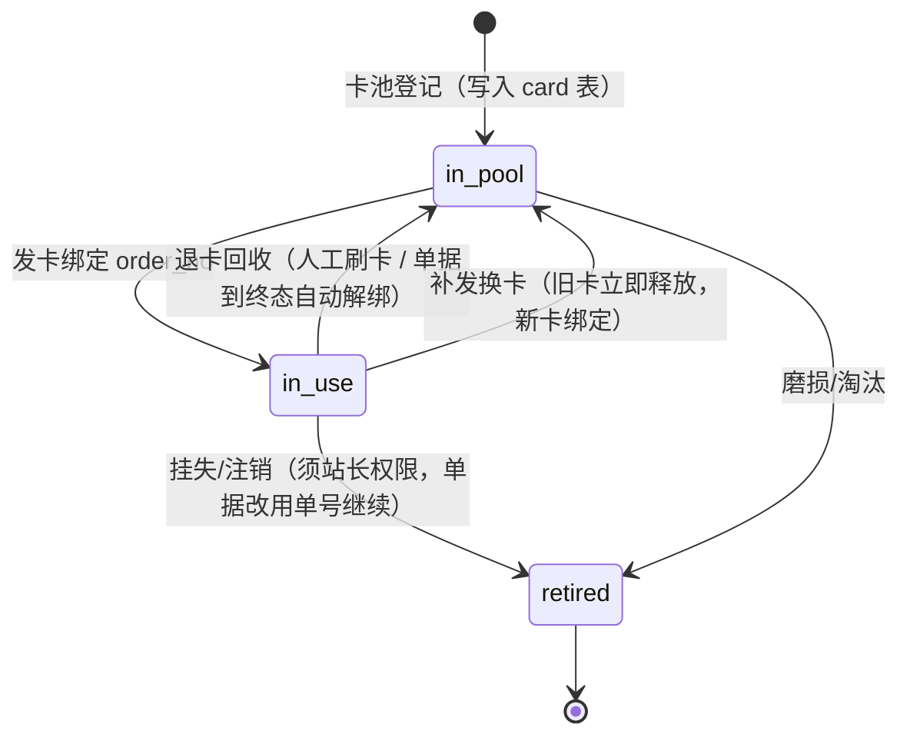
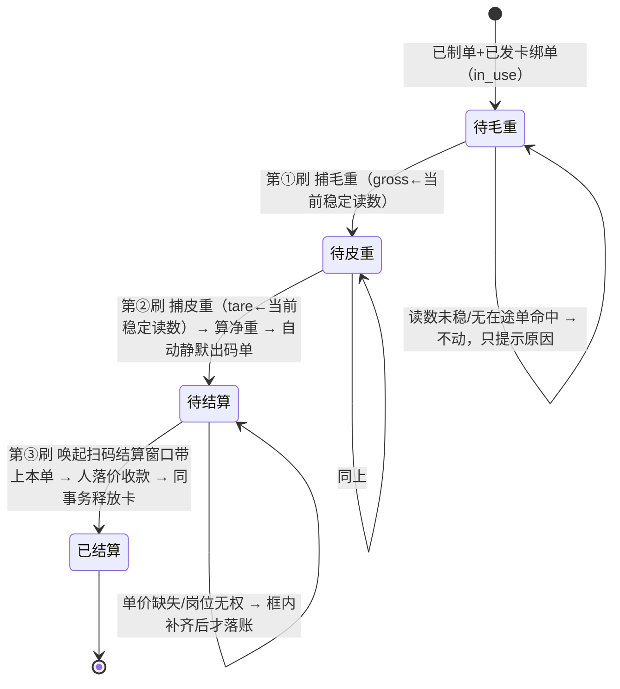
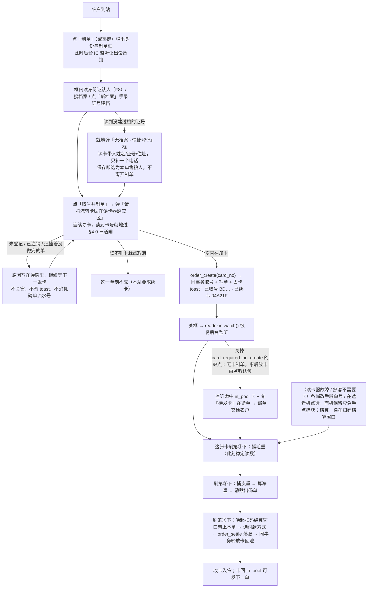

# 06 IC 卡流转凭证（一单一卡 · 刷卡推进 · 循环回收）

磅房里农户**忘带身份证**时发一张 IC 卡。这张卡不只是"认出是哪一单"的免手输便利件，它还是**过磅作业的推进扳机**：一单从制单到结算，靠同一张卡刷三次走完——第一次刷捕毛重、第二次刷捕皮重并即时算净重自动出码单、第三次刷卡**等价于扫这张单的码**：把「扫码结算」窗口调起来并带上这张单，在那里落价、收款、打凭证。结算完成把卡收回、下一单接着用。本篇给出这条链路的业务规则、**刷卡计数状态机**、卡生命周期、数据模型、接口契约与实现清单。

> **卡与票面二维码的分工**（02 §F1.4）：卡管**站内流转**——哪个岗位正在办这台车、免手输单号定位这一单；二维码管**客户手里那张凭据**——人不在磅房、隔一天拿票回来算钱时靠它。两者定位的是同一张 `weigh_order`，但服务对象与时点不同，**不互相替代**：没发卡也要能扫，客户没来也要能凭卡把这单推到结算。
>
> 阅读前提：01 §3.1 六环节主流程、03 §4 磅单状态机、04 §3 证卡阅读器。本篇**只把"过磅触发"从"磅员点按钮"换成"刷卡"**，不改动六环节的任何作业顺序与计价口径；重量归属仍在 `order_create` 那一刻锁死在 `weigh_order.party_id`，`capture`/`settle` 的入参与闸门一字不动（§6.3）——第三刷改的是"在哪儿完成结算"，不是"结算怎么做"。
>
> **口径变更（覆盖上一版"刷卡只定位、上磅不读卡"的写法）**：工作台**除"身份与制单"弹窗打开、需要读身份证的那一段之外，IC 通道全程监听**（§3、§1.2）。一台读卡器同一时刻只能解一种介质，所以弹窗读身份证时 IC 监听挂起，收工回后台立刻恢复监听——这是硬件属性，不是软件选择（§1.2）。
>
> **口径变更（2026-09-12，本轮）**：**发卡时机从"制单之后"提前到"制单当场"**。点「取号并制单」先弹框刷 IC 小白卡，读到一张可用的空闲卡才取号，卡与单在同一笔事务里绑死；**读不到卡这张单就制不成**，卡上还挂着没做完单子的同样拦下（§4.0）。上一版"发卡是关框后靠后台监听认领、任何一道读不出卡流程都照旧跑完"的写法只在关掉 `card_required_on_create` 之后成立（§3 要点 2、§4.4 C1）。

---

## 1 定位：卡只认单，不认人

这是全篇最重要的一句话，后面所有规则都从它推出来。

| 卡承担 | 卡不承担 |
| --- | --- |
| 制单之后，让扦样、化验、二次称重、结算各岗**免手输单号、免在途看板里找**就能定位到这一张磅单；并作为**过磅/结算的推进扳机**——同一张卡每刷一次，把这张单按状态机往前推一步（毛重→皮重→结算，§2.2） | 身份识别与档案归并（仍由身份证 `party.id_card_no_fp` 决定） |
| 一车一卡的物理交接凭据，农户手里"有个东西"代表这单还在办 | 结算对象、付款渠道、挂账额度的判定依据 |
| 领卡/退卡的岗位留痕（谁发的、谁收的、挂在哪张单上） | 长期会员身份、跨日跨次复用同一张卡认同一个人 |

**爆炸半径**：卡被换掉、丢失、被别的站的卡混进来，最坏结果是"这一单要退回手输单号才能继续"，**不会算错钱、不会把 A 的皮重记到 B 头上**——因为重量归属在 `order_create` 那一刻就锁死在 `weigh_order.party_id` 上了（`src-tauri/src/orders.rs` 的 `capture` 只认 `order_no`）。所以卡分两段看：**过磅推进那三刷仍是便利件**——读不出卡一律退回面板手点，闸门与金额一分不动；**制单这一步自本轮起是必需件**（§4.0）——默认读不到可用的卡就不许取号，要放开得由站长把参数关掉，不是"闸门自动降级"。

卡现在会**触发写**（捕重、结算），比"只定位"多了一层责任：一次刷卡只能经 `card_locate` 命中**唯一一张在途单**后才推进那一张，绝不由"刷到卡"去猜是哪辆车。它并没有放大上面那句结论——把毛重记到谁头上，取决于"这张卡绑的是哪张单"（发卡时锁死）与"磅上此刻的稳定读数"（全局唯一），跟旧版"磅员先在面板选中单再点捕获"是同一个信任点，不新增错账路径。真正的防串靠 §4.1 发卡闸门（在册、一卡一单）与 §2.2 只认当前稳定读数两条。

### 1.1 为什么不解决"没带证也没档"

`save_party` 新建分支强制身份证必填并做 SHA-256 指纹唯一归并（`orders.rs:1172`），而卡只认单不认人，因此**发一张卡不能替代建档**。没带证的熟客走"搜档案"（姓名/手机号）一样能制单，本来就不需要卡；首次来售粮又没带证的人，走 01 §3.3 异常分支 E11「手工录入证号 + 标记未读卡核验」。真正"无证也能建档"的临时档案是另一轮设计（涉及 `id_card_no_fp` 可为空的归并策略与付款渠道限制），**不在本篇范围**，见 §9。

### 1.2 硬件互斥：一台读卡器一次只解一种介质

精伦 iDR 一台机内同一副射频前端既解身份证（SAM）也寻 IC（Mifare），**同一时刻只能跑一种**；两条通道并行轮询只会抢同一把设备锁（`store/device.ts` 里 `idcard.watch` 与 `ic` 读共用一个进程内单实例）。所以工作台不能"一边后台监听 IC 刷卡、一边随时能读身份证"。落地口径：

- **默认态＝IC 监听在跑**。工作台一进页面就起 `reader.ic.watch`，负责毛重/皮重/结算三刷推进（§2.2）。
- **登记弹窗打开＝IC 监听挂起、切身份证**。点"制单"（或热键）弹出"身份与制单"框，先 `reader.ic.stopWatch()` 让出设备锁，框内改用 `reader.idcard.read/watch` 解身份证认人（或搜档案、手录证号）。
- **收工回后台＝恢复 IC 监听**。弹窗关闭（制单成功或放弃）后重新 `reader.ic.watch()`，交给下一单去刷。

这条切换必须**唯一收口**在一个编排器里（§8 的 `useIcWorkflow`），不允许两个组件各自 `watch`——否则 StrictMode 双挂、或弹窗与他处同时起循环，真机上就是两条循环抢锁、`stopWatch` 只停得掉其中一条。任期号机制照 `idcard` 通道现成的 `cardWatchEpoch` 同款，IC 通道补齐（§8）。

### 1.1 为什么不解决"没带证也没档"

`save_party` 新建分支强制身份证必填并做 SHA-256 指纹唯一归并（`orders.rs:1172`），而卡只认单不认人，因此**发一张卡不能替代建档**。没带证的熟客走"搜档案"（姓名/手机号）一样能制单，本来就不需要卡；首次来售粮又没带证的人，走 01 §3.3 异常分支 E11「手工录入证号 + 标记未读卡核验」。真正"无证也能建档"的临时档案是另一轮设计（涉及 `id_card_no_fp` 可为空的归并策略与付款渠道限制），**不在本篇范围**，见 §9。

---

## 2 卡生命周期与状态机

卡是**有限的循环资产**，所以必须先在册才能用；一次流转内被一张磅单独占，终态即释放回池。

### 2.1 卡的资产生命周期（在册循环）



| 状态 | 含义 | 进入条件 | 在界面怎么说 |
| --- | --- | --- | --- |
| `in_pool` | 空闲在册，可发 | 登记入库；或退卡回收 | "空闲卡 N 张" |
| `in_use` | 已绑一张未到终态的磅单 | 发卡闸门全过 | "卡 04A21F 挂在 BD01202609000037" |
| `retired` | 注销，不再发放 | 挂失/报废 | 注销需填原因，`audit` 留痕 |

**一卡一单天然成立**：`card` 表一行一卡（`card_no` 唯一），占用信息就是这一行的 `status + current_order_id`，不需要在 `weigh_order` 上玩部分唯一索引（见 §5.2 为什么）。

**解绑以单据终态为准，不依赖人记得刷卡**：磅单进入 `settled`/`paid`/`archived`/`voided`/`reversed`/`rejected` 时，服务层在同一事务内释放该单绑的卡（`in_use → in_pool`）。人工"退卡"动作只是提前收卡，收不到也不会把这张卡永久卡死。日终再做一次扫尾对账（§6.4）。

### 2.2 一单三步：刷卡计数状态机

**这一步是"哪一刷"不靠前端数次数，靠单据落库的状态反推**。编排器读到一张卡 → `card_locate` 命中它绑的那张单 → 看这张单**当前缺什么**决定这一刷干什么。为什么不存"第几刷"这个计数器：断电、换班、复称、旁人在另一台机改过这张单，都会让"次数"和"单据真实状态"对不上；以 `gross_weight_01kg / tare_weight_01kg / settled` 三列为准，永远算的是"这张单还差哪一步"，重复刷、漏刷、乱序刷都只是"这一步已完成→落到下一个待办"，天然幂等。



逐刷口径：

| 刷次（=单据当前状态） | 动作 | 写库 | 卡状态 |
| --- | --- | --- | --- |
| 缺毛重 | 取**此刻地磅稳定读数**捕为毛重 | `order_capture(gross)`；状态→`gross_weighed` | 不变 `in_use` |
| 有毛重缺皮重 | 取此刻稳定读数捕为皮重，**同一刻**算净重并**静默送打码单** | `order_capture(tare)`；状态→`tare_weighed`/`to_settle`；打印走 §8 打印编排 | 不变 `in_use` |
| 两项都有、未结算 | 唤起「扫码结算」窗口并带上这张单（02 §F1.4）：窗口内默认带出价目表价/化验扣量，出纳选付款方式（当场付/挂账）与签字，确认后落账 | `order_settle`；状态→`settled`/`paid` | 终态→`in_pool`（§6.4 自动释放） |

三条硬规矩：

1. **只认"当前稳定读数"，不缓存、不凑数**。刷卡瞬间若 `scale.stable === false`，这一刷**作废**并提示"读数未稳，请等车停稳再刷"，绝不把抖动的中间值写进磅单（沿用称重区既有判稳闸门，不因换成刷卡触发就绕过）。
2. **第②刷即出码单是"静默送打"**，不弹预览（用户口径），磅员核对在码单实物上；补打/重打走打印中心或 F9，仍可预览。自动打印失败必须 toast 报因（缺纸/离线），但不回滚已捕获的皮重。
3. **第③刷不是"直接结算落账"，是"唤起窗口→人确认"**。结算牵涉钱与付款方式选择，任何情况下都不允许"一刷落账"把价目/扣量/挂账判断替操作员拍板；扫码结算窗口内仍走 `order_settle` 全部闸门（改价事由、岗位权限）。

超容差（皮重偏差）在**第②刷**不拦车——捕皮重这一步照常完成、读数即采信，服务端复算后自动在磅单记一条醒目警示并写审计（与称重区现有逻辑同源，toast 只给一句警告、不弹授权框），事后由站长在磅单/审计里核对，如需更正走红冲重录。

---

## 3 主流程



五条时序要点：

1. **登记是弹窗，不是常驻面板**。工作台默认不留"身份与制单"那一栏占视线；来新人点了「制单」弹框，读身份证认人→制单→关框。框开着这段时间 **IC 常听挂起**（§1.2 硬件互斥），框内先解身份证；一关框就恢复 IC 监听。
2. **绑卡就在制单框里当场做完**（§4.0，本轮变更）。点「取号并制单」弹的是**读 IC 卡**的框：读到一张空闲在册卡 → 卡号随 `order_create` 提交 → 取号、写单、占卡、写快照一笔事务完成，toast 直接报"已取号 BD… · 已绑卡 …"。读不到卡、或那张卡还挂着没做完的单，这一单就制不成——农户手里那一刻已经有卡，不必再等磅员另放一张上去。
3. **后台监听发卡退居备选**。只有把 `card_required_on_create` 关掉（或 `card_flow_mode=off`）的站点才走旧路径：制单只产出"无卡在途单"，磅员把空闲卡往机器上一放，监听读到 `in_pool` 卡且有待发卡单，就绑到**最近制单且尚无卡**的那一张（toast 写清绑到哪张，放错可 `card_release` 后重放）。跳过发卡照常能走完，见 §4.4 C1。
4. **一张绑好的卡刷一次推进一步**，靠单据落库状态反推"下一步是毛重还是皮重还是结算"（§2.2），前端不数次数。农户中途走开又回来刷自己那张卡，接着上一步往下走，不需要重发。
5. **上磅/下磅就是"把车开稳再刷一下"**。`order_capture` 仍只认 `order_no`+重量，卡只负责①定到哪张单、②取此刻稳定读数。化验（F5）不在刷卡链里，是旁路的可选步；扫码结算窗口内才碰钱。

> 同一个制单框里连着解**两种介质**：认人那一段读身份证（`idcard.watch`），绑卡那一段读 IC（`ic.watch`），一台读卡器一次只解一种（§1.2），所以两段严格先后——前一个监听必须在弹下一个框之前 `stopWatch` 交还设备锁，绝不能两条循环同时在跑。

> 旧版 §3.3「上磅/下磅不需要读卡、读卡只是把 order_no 填进面板」的写法作废：本版把"读卡"提为过磅的**主触发**，面板点捕获降为应急手点（§8、05 §4）。

---

## 4 业务规则与闸门

### 4.0 制单绑卡（本轮口径变更，先读这节）

**制单必须先刷到一张可用的流转卡。** 点「取号并制单」（制单框里那一步）先弹「请将流转卡贴在读卡器感应区」的连续监听框（`src/components/workstation/CardBindDialog.tsx`）：读到卡号就地过三道闸——拿到卡号、卡在册且未注销、这张卡没挂着没做完的单——全过才把 `card_no` 随 `order_create` 提交。服务端在**同一事务**里取号、写单、占卡、写单据侧快照，任何一道不过整笔回滚：

- **读不到卡，这张单就制不成**，也不会留下"已取号却没绑卡"的半张单；判定放在 `next_no` 之前，连磅单流水号都不消耗。
- 闸门收在 `cards::check_card_for_create`（只判不写，取号前问一次）与 `cards::bind_on_create`（同事务占用），与 §4.1 的后台监听发卡**共用同一份判定**，不让两个入口漂出两种口径。
- **"这张卡还有没做完的单子就不许绑"** 是 §2.1 一卡一单在制单时机上的落点：`card` 那一行的 `current_order_id` 指向的单未到终态即拦下，文案直接点出是哪张单（`卡 04A21F 还挂着没做完的单 BD…（张三），一张卡不能同时开两张单`）。挂着单但那单已到终态的卡（只有关掉 `card_release_on_terminal` 才会剩）视同空闲，就地收回再绑新单，不必先人去卡池页点一次退卡。
- **放开强制**的两种口径：站点参数 `card_required_on_create=false`，或本站压根不用流转卡（`card_flow_mode=off`）。任一成立即回到 §3 的旧路径——无卡制单，磅员事后把空闲卡放上机器由后台监听认领发卡。
- **未登记的外来卡照旧拦下**（C2 的立场不动：卡池登记是硬前提，不做"见卡就发"）。因此一批新小白卡要先在「流转卡」页逐张登记，才能在制单时用。

### 4.1 发卡（`in_pool → in_use`）

入口有二：**制单绑卡**（§4.0，强制站点的主路径）与**后台监听读到一张 `in_pool` 卡**（关掉 §4.0 的强制后才是主路径，见 §3 要点 2）：磅员把空闲卡往机器上一放，编排器就带着这个 `card_no` 来过闸。按顺序过闸，**第一道不过就停，错误文案要说清是哪一道**：

| # | 闸门 | 不过时的文案 |
| --- | --- | --- |
| 1 | 有待发卡单：至少一张未到终态且 `card_no IS NULL` 的在途单，取 `registered_at` 最近的一张 | "没有等待发卡的在途单：请先点「制单」建单" |
| 2 | 读到卡号：`ic_read` 返回 `ok = true` 且 `sn` 非空 | 转 §4.4 降级，不报设备故障 |
| 3 | 卡在册：`card` 表有该 `card_no` 且 `status = 'in_pool'` | 在册但占用 → 转 §4.2 当作"刷卡推进"处理，不重发；不在册 → "卡未登记，请到「流转卡」页登记后再发" |
| 4 | 该单未绑卡：`weigh_order.card_no IS NULL` | 已绑 → 走"补发换卡"而不是报错 |
| 5 | 该单未到终态 | 终态 → "本单已结算，请直接去退卡" |

发卡成功后：`card.status='in_use'`、`card.current_order_id`、`weigh_order.card_no = sn`、`issued_at/issued_by`，四条写在**同一事务**内，并 `audit` 一条 `card.issue`（含操作员与单号）。

**卡号要印在码单上**（05 §9 打印模板要素补一项）：农户签字那一下同时完成"我领走这张卡"的确认，退卡时凭单号或凭卡都能对上，不需要额外搞领卡登记。跳过发卡时该字段打印为"—"，不影响码单其余要素与法律效力。

### 4.2 用卡定位与推进

读到 `card_no` → 先判占用态：`in_pool` 走 §4.1 发卡；`in_use` 则 `card_locate` 命中它绑的那张在途单，按 §2.2 把该单**往前推一步**（缺毛重→捕毛重，缺皮重→捕皮重+出码单，两项都有未结算→唤起扫码结算窗口并带上本单）。查不到对应单 → 提示"这张卡没有对应在途单"，**不阻断**手输单号与在途看板点选。

**一刷的判据是边沿，不是时间**：真机上卡往感应区一放就不动，监听循环会一轮轮读到**同一个 sn**。所以 `reader.ic.watch` 只在两种情况下把命中交回编排器——①读到的 `card_no` 与上一次交回的不是同一张；②同一张卡，但中间**天线空读过一次**（卡被拿走再放回来）。这才算"一刷"。只靠 `card_swipe_debounce_ms` 时间窗口挡不住真正的事故：窗口一过（默认 1.5 s），压在感应区没挪窝的那张卡会以**同一个读数**把皮重也捕了，净重直接算成 0；边沿触发从根上杜绝"一次压卡推两步"。时间窗口保留作第二道保险（键 `card_no + 当前单据状态`，同一张单同一步在窗口内不重复推进），防的是操作员手快连贴两下。

**闸门不过时不叠框**：未登记、已注销、读数未稳、发卡失败这类拦截，同一张卡 / 同一张单重复出现时**更新原来那条提示**（toast 按 `id` 去重），不在磅房屏幕上叠出一摞红框——磅员要看见的是"这一刷被哪道闸门拦了"，不是十遍同样的话。寻卡成功但 `sn` 为空按 §4.1 闸门 2 降级处理，**不报**"未登记"。皮重超容差不属拦截（照常入账），其警告 toast 也按单号 `id` 去重，别一刷一条堆叠。

**读卡器故障后自动缓过来**：`watch` 因设备级故障空手返回时，编排器不退出，按 2 s 起、翻倍、封顶 15 s 退避重起监听；读卡器重新插好、驱动重启后不必刷新页面。故障期间面板手点照常可用（§4.4 C1）。

### 4.3 退卡回收

三种入口，动作一致（解绑 + `card.status='in_pool'` + `audit card.release`）：结算/作废同事务自动释放；工作台"退卡"按钮；卡池页按卡号手工释放（用于"卡带回家了次日送回"）。**回收不校验卡是不是当前面板那张单**——农户随时可能拿别人的卡来退，退对卡就对了。

### 4.4 异常与例外分支（接 01 §3.3 的编号风格）

| 编号 | 情形 | 处理 |
| --- | --- | --- |
| C1 | 读卡器离线/没插 | **过磅推进那三刷**：IC 监听起不来或每轮报设备故障，编排器把状态转灰并写明原因，工作台退回**面板手点**捕获/结算（05 §10-1"无外设也要能完成闭环"）。**制单绑卡那一步**：这台机读不到卡就是取不了号（§4.0 是硬闸门，不做自动降级），站点要么接回读卡器，要么由站长把 `card_flow_mode` 置 `off`（本站不用卡）或把 `card_required_on_create` 置 `false`（不用卡制单、事后靠监听发卡） |
| C2 | 读到的是外来卡（公交卡、别的站的卡） | 闸门 3 拦住"未登记"。这是**只读 UID 方案唯一的真实风险点**，所以卡池登记是硬前提，不做"见到卡就发" |
| C3 | 卡丢失 | 卡池页注销（需站长权限）→ 该单改用单号继续 → 农户补领一张新卡。注销只影响卡池，不影响任何金额与台账 |
| C4 | 农户拿回一张已被回收后重新发出的卡，想找回自己那单 | 提示"此卡空闲，若要发卡请先制单"。已释放的卡**不承诺**还能找回旧单，旧单永远按单号可查（§9 非目标） |
| C5 | 一车多单（一人多次售粮） | 一单一卡，第二张单再发一张；卡池紧张时看板预警 |
| C6 | 复称（`reweigh`）/改皮重 | 不换卡、不重新发卡，卡与单绑定关系不变；复称后未结算的卡在**下一刷**继续按 §2.2 判定推进 |
| C7 | 中途换卡（原卡读不出了） | "补发换卡"：同事务释放旧卡 + 绑新卡 + `audit card.reissue` 记新旧卡号与原单。因卡不承载身份，此动作零财务风险 |
| C8 | 空闲卡低于阈值 | 看板与卡池页黄色提示"空闲卡仅 N 张，当日在途 M 单"，阈值 `card_pool_warn_free` 可调 |
| C9 | 读数未稳就刷卡 | 这一刷**作废**，toast"读数未稳，请等车停稳再刷"，不写库、不推进、不去抖窗口外的下一刷照常（§2.2 硬规矩 1） |
| C10 | 卡已随结算回池又被拿来刷 | 命中 `in_pool`：无待发卡单则提示"此卡空闲"（同 C4）；有则按 §4.1 当发卡处理。**绝不**因"刚结算过的卡"回退到那张已到终态的单，终态单只能走 §4.3 退卡/日终扫尾，不由刷卡改写 |

---

## 5 数据模型

### 5.1 新增 `card`（流转卡池）

迁移脚本 `src-tauri/src/db/migrations/0009_ic_flow_card.sql`（新脚本必须在 `src-tauri/src/db/migrate.rs` 的 `MIGRATIONS` 里登记，`tests/schema_contract.rs::every_migration_file_is_registered` 会拦"写了脚本忘了注册"）。

```sql
CREATE TABLE IF NOT EXISTS card (
  card_no           TEXT    NOT NULL PRIMARY KEY,   -- 寻卡返回的 sn（十六进制大写），不可变
  label             TEXT,                           -- 印刷编号/贴签，现场人眼认的那串
  status            TEXT    NOT NULL DEFAULT 'in_pool'
                      CHECK (status IN ('in_pool','in_use','retired')),
  current_order_id  INTEGER REFERENCES weigh_order(id),  -- 仅 status='in_use' 时非空
  issued_at         TEXT,
  issued_by         INTEGER REFERENCES user_account(id),
  retired_at        TEXT,
  retire_reason     TEXT,
  remark            TEXT,
  created_at        TEXT NOT NULL,
  created_by        INTEGER NOT NULL REFERENCES user_account(id),
  updated_at        TEXT,
  updated_by        INTEGER REFERENCES user_account(id)
);
CREATE UNIQUE INDEX IF NOT EXISTS uk_card_label ON card(label) WHERE label IS NOT NULL AND label <> '';
CREATE INDEX IF NOT EXISTS idx_order_card ON weigh_order(card_no) WHERE card_no IS NOT NULL;
```

不建 `card_event` 流水表——发卡/退卡/注销/补发四个动作的追溯需求（"这张卡是谁领走的、丢了要查到最后持有人"）由既有 `audit` 通道承载，多一张表只是把同一件事记两遍。

### 5.2 为什么不能只靠 `weigh_order.card_no` 一列

`weigh_order.card_no`、`queue_no` 是 0001 建表时就留的死列（`0001_init.sql:204-205`，全仓零读写）。本篇**启用 `card_no`** 作为单据侧的卡号快照（列表、详情、码单可印），但它不能替代卡池表，理由两条：

- 卡是循环资产，必须有一处记录"在册 / 空闲 / 注销"，否则外来卡混入（C2）无从拦；
- 若在 `weigh_order.card_no` 上建部分唯一索引来保证"一卡一单"，**补发换卡（C7）留下的旧卡号痕迹会和仍在途的那张单撞索引**。占用真相放在 `card` 表一行内，反而不需要任何花哨索引。

`queue_no` 继续保持空置（排队叫号是另一码事，见 §9）。

---

## 6 接口契约

### 6.1 读卡：复用现成命令，只取卡号

`ic_read(keyHex?, blocks?)`（`src-tauri/src/idcard.rs:242`）已经返回 `sn`，且 `sn` 来自寻卡结果，**不需要扇区密钥**——所以密钥被厂家改过的卡照样能用。发卡与刷卡定位一律传 `blocks: []`：跳过三个块的读取，既省一次密钥认证的耗时，也让"密钥不对读不出块"这种噪音彻底不出现。这是本篇**不新增任何读卡原语**的原因。

```text
ic_read(keyHex?, blocks: [])  ->  { ok, kindCode, kindLabel, sn, blocks: [], error? }
```

`sn` 归一为**大写十六进制、去分隔符**后作为 `card_no` 存库；登记与识别两侧走同一个归一函数，否则大小写不一致会造成"明明在册却说未登记"。

### 6.2 新增命令（`src-tauri/src/cards.rs`，与其余写命令同一套 `write_tx` 会话岗位闸门）

```text
card_pool_list(statusFilter?, keyword?)  -> [{ cardNo, label, status, orderNo?, issuedAt?, issuedByName?, remark }]
card_pool_register(cardNo, label?, remark?)      -> Card      # 只读不写卡：cardNo 由现场读卡得到，或手输贴签号后补读校验
card_pool_retire(cardNo, reason)                 -> Card      # 需站长权限；in_use 的卡须先释放或同时释放
card_issue(orderNo, cardNo?)  -> { card, orderNo }  # 省略 cardNo = 服务端不猜，必须由前端读卡结果传入
card_release(cardNo | orderNo)                     -> Card
card_locate(cardNo) -> { found, status, orderNo?, partyName? }   # 只读定位，无副作用
card_reissue(orderNo, newCardNo)                   -> Card  # C7：释放旧 + 绑新，同事务
```

硬性约定沿用本仓库既有几条，不另立规矩：

- 所有写命令走 `write_tx`（`unchecked_transaction` + 岗位闸门），入参里的操作员 id 一律忽略，取会话身份；
- 每个写动作补一条 `audit`（复用 `orders::audit`，本就是 `pub(crate)`），动作名 `card.issue` / `card.release` / `card.register` / `card.retire` / `card.reissue`，主体类型 `card`，业务键用 `card_no`；
- 错误信息是能给磅员看的中文短句，前端面板 `onError` 原样透传，不做二次包装；
- DTO 字段驼峰混写处用 `serde(rename)` 与 `src/mock/types.ts` 逐字对齐。

### 6.3 `order_create` 多一个 `card_no`；称重/化验/结算命令**不改**，推进编排在前端

```text
order_create(input{ party_id, variety_id, vehicle_no?, warehouse_id?, slot_id?, remark?, card_no?, weight_source })
  -> WeighOrder        # card_no：§4.0 制单框刷到的卡号（前端读卡结果传入，服务端不猜）
```

- `card_required_on_create` 开着而 `card_no` 为空 → 直接拒绝，**且拒绝发生在 `next_no` 之前**，不消耗磅单流水号；
- `cards::check_card_for_create`（只判不写，取号前跑）与 `cards::bind_on_create`（同事务占卡 + 写 `weigh_order.card_no` 快照 + `audit card.issue`）共用同一份判定，与 `card_issue` 那条链不会有两种口径；
- 磅单快照照旧是"展示用"，占用真相只在 `card` 表那一行（§5.2）。

`order_capture`、`qc_save`、`order_settle` 的入参与状态推进一律不动。"读到卡→看这张单缺什么→决定这一刷捕毛重/捕皮重/弹结算"这套判断，整段写在前端编排器 `useIcWorkflow` 里（§8），它只是把现成命令按单据状态依次调起来，**不新增任何写命令、不新增称重闸门**。后端其余改动只在 `order_settle` 与 `order_void` 内部：终态落库的同事务里顺手释放该单绑的卡。

### 6.4 参数与日终

`src/lib/settings-catalog.ts` 增加四项（同步 0006 那种 `setting` 落库口径，须与 03 §9.3.1 同批登记，否则 `schema_contract::seed_baseline_matches_design_doc` 会红）：

| key | 默认 | 作用 |
| --- | --- | --- |
| `card_pool_warn_free` | `5` | 空闲卡低于此值时看板与卡池页黄色预警（C8） |
| `card_release_on_terminal` | `1` | 终态自动解绑；置 0 则强制人工退卡才回池（用于要逐张点收卡的站点） |
| `card_swipe_debounce_ms` | `1500` | 同一张卡重复命中的去抖窗口（§4.2 防连击），窗口内只算一刷 |
| `card_flow_mode` | `auto` | 本站是否启用流转卡：`auto`＝工作台后台常听 IC、刷卡推进毛重/皮重/结算（默认）；`off`＝完全不启用流转卡，不起 IC 监听、不弹发卡/推进，工作台一律走面板手点（读卡器故障或不用卡的站点） |
| `card_required_on_create` | `true` | 制单是否必须绑卡（§4.0，随 0010 补录）：`true`＝取号前先弹框刷到一张空闲卡，读不到卡制不成单；`false`＝允许无卡制单，卡由事后监听认领。`card_flow_mode=off` 时本参数不参与判定 |

日终对账（挂在现有日结/封账动作里）：扫 `card.status='in_use'` 而其 `current_order_id` 对应磅单已到终态或已删除的行，自动释放并计入当日"未归还卡 N 张"清单——只提示，不静默改单据。

---

## 7 与其它文档的接缝（本轮刻意未改那五篇）

`docs/design/01–05` 与 `README.md` 当前工作区均有未提交改动，为避免与在途编辑冲突，本篇独立成文，接缝留给下一次统一合并：

| 位置 | 需要补进去的内容 |
| --- | --- |
| 01 §3.2 环节 1 | 增加"没带身份证"分支：熟客搜档案 → 制单 → 发流转卡；明确卡不替代建档 |
| 01 §3.3 | 新增异常行 E12「流转卡缺失/外来卡/丢失」→ 指回本篇 §4.4 C1–C8 |
| 01 §6 首版边界 | 把"IC 卡｜首版收敛｜仅预留 `queue_no`、`card_no`"改为"`card_no` 已启用为流转卡（一单一卡、循环回收）；`queue_no` 仍预留" |
| 02 §M1 F1.1 | 售粮人识别从三通道升为四通道（读卡 / 搜档案 / 手工建档 / 流转卡定位）；新增功能点 F1.6 流转卡发放与回收 |
| 02 §M9 | 证卡阅读器 IC 通道说明由"只读，不接业务"改为"只读取卡号，接流转卡业务；仍不写任何块" |
| 03 §9 表结构 | 登记 `card` 为新表（编号顺延，全仓"23 张表 + 1 张预留"的计数随之改），`weigh_order.card_no` 注释从"预留"改为"当前绑定卡号快照" |
| 04 §3 | 新增 §3.7 流转卡：`blocks: []` 只取 `sn`、卡号归一、外来卡闸门；`card-reader.ts` 的 `MEDIUM.ic.note` 从「IC 卡参与收粮流程（如内部流转卡）时再接业务侧」改为已接入 |
| 05 §4 | 工作台 ①「身份与制单」由常驻面板改为**登记弹窗**（新人来时弹、制单即关）；称重/结算主触发改为**刷 IC 卡**，面板降级为应急手点；皮重捕获后静默出码单；`card-reader.ts`/设备中心加「流转卡」卡池页（登记/注销/手工释放） |
| README | 阅读顺序表加第 6 行；术语表把"内部流转单"从"P1"改为本篇口径 |

---

## 8 实现清单

| 层 | 文件 | 动作 |
| --- | --- | --- |
| 迁移 | `src-tauri/src/db/migrations/0009_ic_flow_card.sql` | 建 `card` 表 + 两个索引；`idx_order_card` 部分索引 |
| 迁移 | `src-tauri/src/db/migrate.rs` | `MIGRATIONS` 追加 0009 一条 |
| 后端 | `src-tauri/src/cards.rs`（新） | §6.2 七个命令 + `write_tx`/`audit` 接入；`lib.rs` 注册 |
| 后端 | `src-tauri/src/orders.rs` | `order_settle`/`order_void` 终态同事务释放卡；`Card` 相关 DTO |
| 前端 | `src/components/workstation/RegistrationDialog.tsx`（新） | 取代常驻 ① 面板的**弹窗**：打开时 `ic.stopWatch()` → 框内 `idcard.read/watch` 认人（或搜档案/手录证号建档）→ 选品种车牌 → `createOrder` 取号 → 关框。把原 `IdentityPanel` 的表单、读卡回填、去向折叠行整体搬进 Dialog，`onDraft` 局部化到框内 |
| 前端 | `src/components/workstation/useIcWorkflow.ts`（新，**唯一监听收口**） | 后台常听 IC：读到 `in_pool` 卡→按 §4.1 发卡绑到最近无卡单；读到 `in_use` 卡→按 §2.2 看单据缺什么→调 `capture`/弹结算；含 §4.2 去抖、`card_flow_mode=off`/`mockOff` 不起监听、与身份证读互斥（同一 epoch 单循环） |
| 前端 | `src/components/workstation/WeighPanel.tsx` / `SettlePanel.tsx` | 由主操作降级为**应急手点**：捕获/结算按钮保留（05 §10-1 无外设闭环），文案改"（应急手点，正常刷 IC 卡）"；`SettlePanel` 的可控状态由 `useIcWorkflow` 在第三刷以 Dialog 形式复用唤起 |
| 前端 | `src/lib/api.ts` + `src/lib/cards-native.ts`（新）+ `src/mock/api.ts` | 沿用 `*-native.ts` 通道范式按 `runningInTauri` 分流 invoke/mock，**无原生通道也要能跑通发卡—定位—回收全链**（03 硬约束 3） |
| 前端 | `src/lib/card-reader.ts` | IC 通道 `note`/`qualifier` 文案更新为"接流转卡·刷卡推进"；导出 `normalizeCardNo`（与 Rust 侧同一归一口径） |
| 前端 | `src/store/device.ts` | IC 通道补 `watch/stopWatch`（`reader.ic` 现只有 `read`），照身份证通道的前端循环 + 任期号 + "每轮没卡"与"命令级失败"分道；`idcard.watch`/`ic.watch` 共用一把设备锁互斥 |
| 前端 | `src/pages/WorkstationPage.tsx` | 移除 `identity` 常驻面板（`layout.ts` PANELS 删该项并给 `defaultHidden` 兼容），页头加「制单」按钮 + F7 开弹窗；挂 `useIcWorkflow` |
| 前端 | `src/pages/CardsPage.tsx`（新）+ 侧栏 | 卡池登记/注销/手工释放/空闲预警；每功能自带顶级分组（沿用仓库菜单惯例） |
| 打印 | `src/components/print/sheets.tsx` + 打印编排 | 码单要素补"流转卡号"（跳过发卡印 `—`）；第②刷捕皮重后**静默送打**（不弹预览，失败 toast 报因不回滚） |
| 参数 | `src/lib/settings-catalog.ts` | §6.4 四项（与 03 §9.3.1 同批） |
| 文档 | 05 §4 | 记交互变更：身份与制单＝弹窗、称重/结算主触发＝刷卡、面板降级为应急、皮重即静默出码单 |
| 测试 | `src-tauri/tests/cards_contract.rs` | 闸门逐条断言；契约测试种子无业务行，插 `weigh_order` 前须自建 `party`（FK 会拦），测试函数名用 ASCII snake_case |

**本轮增量（§4.0 制单绑卡）**：

| 层 | 文件 | 动作 |
| --- | --- | --- |
| 迁移 | `src-tauri/src/db/migrations/0010_card_required_on_create.sql` | 只补一个参数键，不动表结构；`MIGRATIONS` 同批登记 |
| 后端 | `src-tauri/src/cards.rs` | `check_card_for_create`（只判不写）+ `bind_on_create`（同事务占卡/写快照/审计），与 `issue` 共用占用判定 |
| 后端 | `src-tauri/src/orders.rs` | `CreateOrderInput.card_no`；闸门判在 `next_no` 之前；`WeighOrder` DTO 与 `ORDER_SELECT` 末列补 `card_no` 快照 |
| 前端 | `src/components/workstation/CardBindDialog.tsx`（新） | 制单刷卡框：`ic.watch` 连续寻卡 → `card_locate` 过闸 → 不过就在框里说清原因继续等；60 秒到点收工 |
| 前端 | `src/components/workstation/IdentityPanel.tsx` | 「取号并制单」改走 `submit()`：强制站点未刷卡先弹 `CardBindDialog`，卡号随 `createOrder` 提交；toast 回显"已绑卡 …" |
| 前端 | `src/mock/api.ts` + `src/lib/settings-catalog.ts` | 浏览器侧同一套闸门与占卡写入；参数目录补一项（演示值取 `false`：预览没有 IC 通道） |
| 文档 | 03 §9.3.1 / §9.26 | 登记新键（`seed_baseline_matches_design_doc` 要求逐字相等） |
| 测试 | `src-tauri/tests/orders_contract.rs` | `create_order_binds_a_free_card_or_refuses_the_number`：无卡/未登记/已注销/挂着未完成单逐条拦下，且**不消耗流水号、不留半张单**；挂着终态单的卡视同空闲 |

验收口径（逐条现场可测）：

1. 关掉外设总开关：称重—结算照旧手点无障碍；**制单要绑卡的那一步会拦下**，需先把 `card_required_on_create`（或 `card_flow_mode`）关掉才无卡制单（C1）；
2. 拿一张没登记的卡去发，被拦且文案指明"卡未登记"（C2）；
3. 同一张卡连制两单，第二单在制单那一步就被拦并指出挂在哪张单上（§4.0 / §4.1 闸门 3）；
4. 结算成功后不碰退卡，卡自动回池，卡池页计数 +1（§6.4 `card_release_on_terminal=1`）；
5. 把 `card_release_on_terminal` 置 0 后，未退卡的卡在池内保持 `in_use`，人工释放才回池；
6. 注销一张挂在途单上的卡，需站长权限且该单改用单号仍能走完到结算；
7. 补发换卡后，旧卡立刻可被下一单发走，两张单的磅单号与金额互不影响（C7）；
8. 断电重启后，所有在途单的卡绑定关系与重启前一致（卡内无状态的好处）。
9. **感应区空着**点「取号并制单」：框里 60 秒到点自动收工，库里既没有磅单、磅单流水号也没往前走一格（§4.0）；
10. 刷一张没登记的小白卡制单：框不关，写明"卡 … 未在卡池登记，请到「流转卡」页登记后再制单"，换一张已登记的空闲卡立刻制成人（C2 在制单时机的表现）；
11. 强制开着时桌面端制单必带卡（toast 回显"已取号 BD… · 已绑卡 …"）；把参数关掉后同一台机立刻回到"无卡制单 + 事后放卡由监听发"，两条路径都能走完到结算。

---

## 9 非目标（明确不做）

- **不写卡**。`routon-idr` 封装未暴露写块接口，`04 §3.2` 的"现场没验证过写权限，先把不可逆的动作排除在能力之外"这条立场本篇不动。卡内不存任何业务数据，只有一枚出厂不可改的 UID；所有映射在库里。因此**农户拿任何一张 13.56MHz Mifare 卡来都能被读到 `sn`**，安全边界完全靠卡池在册闸门，不靠卡内容防伪。
- **不做长期身份卡**（一次绑定、农户反复用、配 `party.card_no`）。它要连带挂失补办、一户多卡、卡与人的关系变更审计，且和"卡循环使用"直接冲突。若现场后续确实需要，另开一篇。
- **不做临时档案/无证建档**（§1.1）。若"首次来售粮且没带证"在现场是常态而非例外，那要先解决建档放宽与付款渠道限制，卡解决不了。
- **不做排队叫号**（`queue_no` 继续空置）、**不做农户自助刷卡**、**不做多站点卡池互认**（一个站一套部署一个库，卡池天然不互通）。
