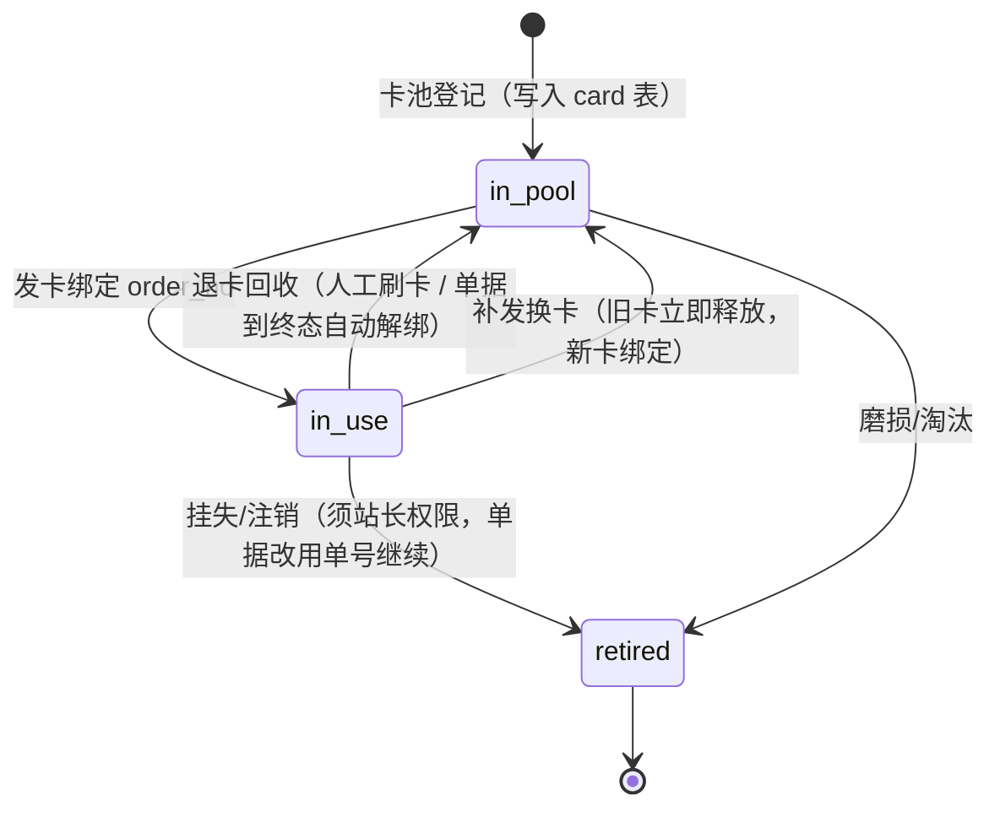
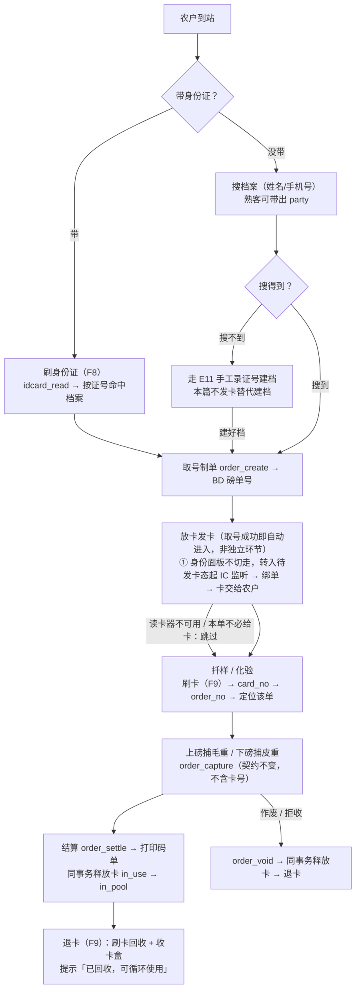

# 06 IC 卡流转凭证（一单一卡 · 循环回收）

磅房里农户**忘带身份证**时发一张 IC 卡，各岗位靠这张卡认出"是哪一单"，结算完成把卡收回、下一单接着用。本篇给出这条链路的业务规则、卡生命周期状态机、数据模型、接口契约与实现清单。

> 阅读前提：01 §3.1 六环节主流程、03 §4 磅单状态机、04 §3 证卡阅读器。本篇**只加一条凭证链**，不改动六环节的任何作业顺序与计价口径。

---

## 1 定位：卡只认单，不认人

这是全篇最重要的一句话，后面所有规则都从它推出来。

| 卡承担 | 卡不承担 |
| --- | --- |
| 制单之后，让扦样、化验、二次称重、结算各岗**免手输单号、免在途看板里找**就能定位到这一张磅单 | 身份识别与档案归并（仍由身份证 `party.id_card_no_fp` 决定） |
| 一车一卡的物理交接凭据，农户手里"有个东西"代表这单还在办 | 结算对象、付款渠道、挂账额度的判定依据 |
| 领卡/退卡的岗位留痕（谁发的、谁收的、挂在哪张单上） | 长期会员身份、跨日跨次复用同一张卡认同一个人 |

**爆炸半径**：卡被换掉、丢失、被别的站的卡混进来，最坏结果是"这一单要退回手输单号才能继续"，**不会算错钱、不会把 A 的皮重记到 B 头上**——因为重量归属在 `order_create` 那一刻就锁死在 `weigh_order.party_id` 上了（`src-tauri/src/orders.rs` 的 `capture` 只认 `order_no`）。所以本篇的卡是**便利件**，不是**必需件**：任何一道闸门读不出卡，流程都必须能照旧跑完。

### 1.1 为什么不解决"没带证也没档"

`save_party` 新建分支强制身份证必填并做 SHA-256 指纹唯一归并（`orders.rs:1172`），而卡只认单不认人，因此**发一张卡不能替代建档**。没带证的熟客走"搜档案"（姓名/手机号）一样能制单，本来就不需要卡；首次来售粮又没带证的人，走 01 §3.3 异常分支 E11「手工录入证号 + 标记未读卡核验」。真正"无证也能建档"的临时档案是另一轮设计（涉及 `id_card_no_fp` 可为空的归并策略与付款渠道限制），**不在本篇范围**，见 §9。

---

## 2 卡生命周期与状态机

卡是**有限的循环资产**，所以必须先在册才能用；一次流转内被一张磅单独占，终态即释放回池。



| 状态 | 含义 | 进入条件 | 在界面怎么说 |
| --- | --- | --- | --- |
| `in_pool` | 空闲在册，可发 | 登记入库；或退卡回收 | "空闲卡 N 张" |
| `in_use` | 已绑一张未到终态的磅单 | 发卡闸门全过 | "卡 04A21F 挂在 BD01202609000037" |
| `retired` | 注销，不再发放 | 挂失/报废 | 注销需填原因，`audit` 留痕 |

**一卡一单天然成立**：`card` 表一行一卡（`card_no` 唯一），占用信息就是这一行的 `status + current_order_id`，不需要在 `weigh_order` 上玩部分唯一索引（见 §5.2 为什么）。

**解绑以单据终态为准，不依赖人记得刷卡**：磅单进入 `settled`/`paid`/`archived`/`voided`/`reversed`/`rejected` 时，服务层在同一事务内释放该单绑的卡（`in_use → in_pool`）。人工"退卡"动作只是提前收卡，收不到也不会把这张卡永久卡死。日终再做一次扫尾对账（§6.4）。

---

## 3 主流程



三条时序要点：

1. **发卡是制单的收尾动作，不是需要磅员另行想起的环节**。取号成功后 ① 面板不切走，直接进"待发卡"态并自动起 IC 监听（照 04 §3.3.1 建档弹窗那套前端循环，绑上卡或磅员点跳过即停），磅员的动作只是"把卡往机器上一放、再递给农户"。为什么放在取号之后：号是"取号即定、不可回收"（03 §3.5），卡挂在号上，反过来先发卡再制单会留下"有卡无单"的悬空状态。为什么可以跳过而不做成硬闸门：卡是便利件（§1），拦住了反而会让读卡器故障时整条收粮线停摆。
2. **刷卡定位是"读"而不是"写"**，所以它不区分卡的占用态：读一张 `in_use` 的卡 → 跳到它挂的那张单；读一张 `in_pool` 的卡 → 提示"此卡空闲，若要发卡请先制单"。**农户中途走开又回来**，刷自己那张卡就能把单找回来，不需要重发。
3. **上磅/下磅不需要读卡**。真机上磅是车与仪表的事，`order_capture` 只认 `order_no`。刷卡只是把 `order_no` 填进面板，不新增称重闸门。

---

## 4 业务规则与闸门

### 4.1 发卡（`in_pool → in_use`）

按顺序过闸，**第一道不过就停，错误文案要说清是哪一道**：

| # | 闸门 | 不过时的文案 |
| --- | --- | --- |
| 1 | 已制单：面板上有确定的 `order_no` | "请先取号制单再发卡" |
| 2 | 读到卡号：`ic_read` 返回 `ok = true` 且 `sn` 非空 | 转 §4.4 降级，不报设备故障 |
| 3 | 卡在册：`card` 表有该 `card_no` 且 `status = 'in_pool'` | 在册但占用 → "此卡已挂在 BD…，请先退卡或直接打开那张单"；不在册 → "卡未登记，请到「流转卡」页登记后再发" |
| 4 | 该单未绑卡：`weigh_order.card_no IS NULL` | 已绑 → 走"补发换卡"而不是报错 |
| 5 | 该单未到终态 | 终态 → "本单已结算，请直接去退卡" |

发卡成功后：`card.status='in_use'`、`card.current_order_id`、`weigh_order.card_no = sn`、`issued_at/issued_by`，四条写在**同一事务**内，并 `audit` 一条 `card.issue`（含操作员与单号）。

**卡号要印在码单上**（05 §9 打印模板要素补一项）：农户签字那一下同时完成"我领走这张卡"的确认，退卡时凭单号或凭卡都能对上，不需要额外搞领卡登记。跳过发卡时该字段打印为"—"，不影响码单其余要素与法律效力。

### 4.2 用卡定位

读 `card_no` → 查 `card.current_order_id`（或 `weigh_order.card_no`）→ 命中在途单则切换面板上下文；查不到 → 提示"这张卡没有对应在途单"，**不阻断**手输单号与在途看板点选。

### 4.3 退卡回收

三种入口，动作一致（解绑 + `card.status='in_pool'` + `audit card.release`）：结算/作废同事务自动释放；工作台"退卡"按钮；卡池页按卡号手工释放（用于"卡带回家了次日送回"）。**回收不校验卡是不是当前面板那张单**——农户随时可能拿别人的卡来退，退对卡就对了。

### 4.4 异常与例外分支（接 01 §3.3 的编号风格）

| 编号 | 情形 | 处理 |
| --- | --- | --- |
| C1 | 读卡器离线/没插 | "待发卡"态转灰并写明原因，给一个「跳过发卡」出口；之后的各岗一律靠单号与在途看板。流程照常走完，**发卡不是必经环节**（05 §10-1"无外设也要能完成闭环"） |
| C2 | 读到的是外来卡（公交卡、别的站的卡） | 闸门 3 拦住"未登记"。这是**只读 UID 方案唯一的真实风险点**，所以卡池登记是硬前提，不做"见到卡就发" |
| C3 | 卡丢失 | 卡池页注销（需站长权限）→ 该单改用单号继续 → 农户补领一张新卡。注销只影响卡池，不影响任何金额与台账 |
| C4 | 农户拿回一张已被回收后重新发出的卡，想找回自己那单 | 提示"此卡空闲，若要发卡请先制单"。已释放的卡**不承诺**还能找回旧单，旧单永远按单号可查（§9 非目标） |
| C5 | 一车多单（一人多次售粮） | 一单一卡，第二张单再发一张；卡池紧张时看板预警 |
| C6 | 复称（`reweigh`）/改皮重 | 不换卡、不重新发卡，卡与单绑定关系不变 |
| C7 | 中途换卡（原卡读不出了） | "补发换卡"：同事务释放旧卡 + 绑新卡 + `audit card.reissue` 记新旧卡号与原单。因卡不承载身份，此动作零财务风险 |
| C8 | 空闲卡低于阈值 | 看板与卡池页黄色提示"空闲卡仅 N 张，当日在途 M 单"，阈值 `card_pool_warn_free` 可调 |

---

## 5 数据模型

### 5.1 新增 `card`（流转卡池）

迁移脚本 `src-tauri/src/db/migrations/0009_ic_flow_card.sql`（新脚本必须在 `src-tauri/src/db/migrate.rs` 的 `MIGRATIONS` 里登记，`tests/schema_contract.rs::every_migration_file_is_registered` 会拦"写了脚本忘了注册"）。

```sql
CREATE TABLE IF NOT EXISTS card (
  card_no           TEXT    NOT NULL PRIMARY KEY,   -- 寻卡返回的 sn（十六进制大写），不可变
  label             TEXT,                           -- 印刷编号/贴签，现场人眼认的那串
  status            TEXT    NOT NULL DEFAULT 'in_pool'
                      CHECK (status IN ('in_pool','in_use','retired')),
  current_order_id  INTEGER REFERENCES weigh_order(id),  -- 仅 status='in_use' 时非空
  issued_at         TEXT,
  issued_by         INTEGER REFERENCES user_account(id),
  retired_at        TEXT,
  retire_reason     TEXT,
  remark            TEXT,
  created_at        TEXT NOT NULL,
  created_by        INTEGER NOT NULL REFERENCES user_account(id),
  updated_at        TEXT,
  updated_by        INTEGER REFERENCES user_account(id)
);
CREATE UNIQUE INDEX IF NOT EXISTS uk_card_label ON card(label) WHERE label IS NOT NULL AND label <> '';
CREATE INDEX IF NOT EXISTS idx_order_card ON weigh_order(card_no) WHERE card_no IS NOT NULL;
```

不建 `card_event` 流水表——发卡/退卡/注销/补发四个动作的追溯需求（"这张卡是谁领走的、丢了要查到最后持有人"）由既有 `audit` 通道承载，多一张表只是把同一件事记两遍。

### 5.2 为什么不能只靠 `weigh_order.card_no` 一列

`weigh_order.card_no`、`queue_no` 是 0001 建表时就留的死列（`0001_init.sql:204-205`，全仓零读写）。本篇**启用 `card_no`** 作为单据侧的卡号快照（列表、详情、码单可印），但它不能替代卡池表，理由两条：

- 卡是循环资产，必须有一处记录"在册 / 空闲 / 注销"，否则外来卡混入（C2）无从拦；
- 若在 `weigh_order.card_no` 上建部分唯一索引来保证"一卡一单"，**补发换卡（C7）留下的旧卡号痕迹会和仍在途的那张单撞索引**。占用真相放在 `card` 表一行内，反而不需要任何花哨索引。

`queue_no` 继续保持空置（排队叫号是另一码事，见 §9）。

---

## 6 接口契约

### 6.1 读卡：复用现成命令，只取卡号

`ic_read(keyHex?, blocks?)`（`src-tauri/src/idcard.rs:242`）已经返回 `sn`，且 `sn` 来自寻卡结果，**不需要扇区密钥**——所以密钥被厂家改过的卡照样能用。发卡与刷卡定位一律传 `blocks: []`：跳过三个块的读取，既省一次密钥认证的耗时，也让"密钥不对读不出块"这种噪音彻底不出现。这是本篇**不新增任何读卡原语**的原因。

```text
ic_read(keyHex?, blocks: [])  ->  { ok, kindCode, kindLabel, sn, blocks: [], error? }
```

`sn` 归一为**大写十六进制、去分隔符**后作为 `card_no` 存库；登记与识别两侧走同一个归一函数，否则大小写不一致会造成"明明在册却说未登记"。

### 6.2 新增命令（`src-tauri/src/cards.rs`，与其余写命令同一套 `write_tx` 会话岗位闸门）

```text
card_pool_list(statusFilter?, keyword?)  -> [{ cardNo, label, status, orderNo?, issuedAt?, issuedByName?, remark }]
card_pool_register(cardNo, label?, remark?)      -> Card      # 只读不写卡：cardNo 由现场读卡得到，或手输贴签号后补读校验
card_pool_retire(cardNo, reason)                 -> Card      # 需站长权限；in_use 的卡须先释放或同时释放
card_issue(orderNo, cardNo?)  -> { card, orderNo }  # 省略 cardNo = 服务端不猜，必须由前端读卡结果传入
card_release(cardNo | orderNo)                     -> Card
card_locate(cardNo) -> { found, status, orderNo?, partyName? }   # 只读定位，无副作用
card_reissue(orderNo, newCardNo)                   -> Card  # C7：释放旧 + 绑新，同事务
```

硬性约定沿用本仓库既有几条，不另立规矩：

- 所有写命令走 `write_tx`（`unchecked_transaction` + 岗位闸门），入参里的操作员 id 一律忽略，取会话身份；
- 每个写动作补一条 `audit`（复用 `orders::audit`，本就是 `pub(crate)`），动作名 `card.issue` / `card.release` / `card.register` / `card.retire` / `card.reissue`，主体类型 `card`，业务键用 `card_no`；
- 错误信息是能给磅员看的中文短句，前端面板 `onError` 原样透传，不做二次包装；
- DTO 字段驼峰混写处用 `serde(rename)` 与 `src/mock/types.ts` 逐字对齐。

### 6.3 称重/化验/结算命令**不改**

`order_capture`、`qc_save`、`order_settle` 的入参与状态推进一律不动。卡只在面板层把 `order_no` 准备好。唯一新增逻辑在 `order_settle` 与 `order_void` 内部：终态落库的同事务里顺手释放该单绑的卡。

### 6.4 参数与日终

`src/lib/settings-catalog.ts` 增加两项（同步 0006 那种 `setting` 落库口径）：

| key | 默认 | 作用 |
| --- | --- | --- |
| `card_pool_warn_free` | `5` | 空闲卡低于此值时看板与卡池页黄色预警（C8） |
| `card_release_on_terminal` | `1` | 终态自动解绑；置 0 则强制人工退卡才回池（用于要逐张点收卡的站点） |
| `card_flow_mode` | `auto` | `auto`＝取号成功即进"待发卡"态并自动起 IC 监听（默认，磅员不需要记这一步）；`manual`＝仍要手点 F9；`off`＝该站不启用流转卡，工作台不出现待发卡态 |

日终对账（挂在现有日结/封账动作里）：扫 `card.status='in_use'` 而其 `current_order_id` 对应磅单已到终态或已删除的行，自动释放并计入当日"未归还卡 N 张"清单——只提示，不静默改单据。

---

## 7 与其它文档的接缝（本轮刻意未改那五篇）

`docs/design/01–05` 与 `README.md` 当前工作区均有未提交改动，为避免与在途编辑冲突，本篇独立成文，接缝留给下一次统一合并：

| 位置 | 需要补进去的内容 |
| --- | --- |
| 01 §3.2 环节 1 | 增加"没带身份证"分支：熟客搜档案 → 制单 → 发流转卡；明确卡不替代建档 |
| 01 §3.3 | 新增异常行 E12「流转卡缺失/外来卡/丢失」→ 指回本篇 §4.4 C1–C8 |
| 01 §6 首版边界 | 把"IC 卡｜首版收敛｜仅预留 `queue_no`、`card_no`"改为"`card_no` 已启用为流转卡（一单一卡、循环回收）；`queue_no` 仍预留" |
| 02 §M1 F1.1 | 售粮人识别从三通道升为四通道（读卡 / 搜档案 / 手工建档 / 流转卡定位）；新增功能点 F1.6 流转卡发放与回收 |
| 02 §M9 | 证卡阅读器 IC 通道说明由"只读，不接业务"改为"只读取卡号，接流转卡业务；仍不写任何块" |
| 03 §9 表结构 | 登记 `card` 为新表（编号顺延，全仓"23 张表 + 1 张预留"的计数随之改），`weigh_order.card_no` 注释从"预留"改为"当前绑定卡号快照" |
| 04 §3 | 新增 §3.7 流转卡：`blocks: []` 只取 `sn`、卡号归一、外来卡闸门；`card-reader.ts` 的 `MEDIUM.ic.note` 从「IC 卡参与收粮流程（如内部流转卡）时再接业务侧」改为已接入 |
| 05 §4 | 工作台 ① 面板加第四个识人入口与 F9 快捷键；`card-reader.ts`/设备中心加「流转卡」卡池页（登记/注销/手工释放） |
| README | 阅读顺序表加第 6 行；术语表把"内部流转单"从"P1"改为本篇口径 |

---

## 8 实现清单

| 层 | 文件 | 动作 |
| --- | --- | --- |
| 迁移 | `src-tauri/src/db/migrations/0009_ic_flow_card.sql` | 建 `card` 表 + 两个索引；`idx_order_card` 部分索引 |
| 迁移 | `src-tauri/src/db/migrate.rs` | `MIGRATIONS` 追加 0009 一条 |
| 后端 | `src-tauri/src/cards.rs`（新） | §6.2 七个命令 + `write_tx`/`audit` 接入；`lib.rs` 注册 |
| 后端 | `src-tauri/src/orders.rs` | `order_settle`/`order_void` 终态同事务释放卡；`Card` 相关 DTO |
| 前端 | `src/lib/api.ts` + `src/lib/cards-native.ts`（新）+ `src/mock/api.ts` | 沿用 `*-native.ts` 通道范式按 `runningInTauri` 分流 invoke/mock，**无原生通道也要能跑通发卡—定位—回收全链**（03 硬约束 3） |
| 前端 | `src/lib/card-reader.ts` | IC 通道 `note`/`qualifier` 文案更新；导出 `normalizeCardNo`（与 Rust 侧同一归一口径） |
| 前端 | `src/components/workstation/IdentityPanel.tsx` | 制单成功即进"待发卡"态：面板不切走、自动起 IC 监听，绑上卡或点「跳过」收工；F9 保留为手点入口；`in_use` 卡刷卡切单 |
| 前端 | `src/store/device.ts` | IC 通道补 `watch/stopWatch`（`reader.ic` 现只有 `read`），照身份证通道的前端循环 + 任期号 + "每轮没卡"与"命令级失败"分道 |
| 前端 | `src/pages/CardsPage.tsx`（新）+ 侧栏 | 卡池登记/注销/手工释放/空闲预警；每功能自带顶级分组（沿用仓库菜单惯例） |
| 打印 | `src/components/print/sheets.tsx` | 码单要素补"流转卡号"（跳过发卡时印 `—`） |
| 参数 | `src/lib/settings-catalog.ts` | §6.4 三项 |
| 测试 | `src-tauri/tests/cards_contract.rs` | 闸门逐条断言；契约测试种子无业务行，插 `weigh_order` 前须自建 `party`（FK 会拦），测试函数名用 ASCII snake_case |

验收口径（逐条现场可测）：

1. 关掉外设总开关，发不了卡但制单—称重—结算全程无障碍（C1）；
2. 拿一张没登记的卡去发，被拦且文案指明"卡未登记"（C2）；
3. 同一张卡连发两单，第二单被拦并指出挂在哪张单上（§4.1 闸门 3）；
4. 结算成功后不碰退卡，卡自动回池，卡池页计数 +1（§6.4 `card_release_on_terminal=1`）；
5. 把 `card_release_on_terminal` 置 0 后，未退卡的卡在池内保持 `in_use`，人工释放才回池；
6. 注销一张挂在途单上的卡，需站长权限且该单改用单号仍能走完到结算；
7. 补发换卡后，旧卡立刻可被下一单发走，两张单的磅单号与金额互不影响（C7）；
8. 断电重启后，所有在途单的卡绑定关系与重启前一致（卡内无状态的好处）。

---

## 9 非目标（明确不做）

- **不写卡**。`routon-idr` 封装未暴露写块接口，`04 §3.2` 的"现场没验证过写权限，先把不可逆的动作排除在能力之外"这条立场本篇不动。卡内不存任何业务数据，只有一枚出厂不可改的 UID；所有映射在库里。因此**农户拿任何一张 13.56MHz Mifare 卡来都能被读到 `sn`**，安全边界完全靠卡池在册闸门，不靠卡内容防伪。
- **不做长期身份卡**（一次绑定、农户反复用、配 `party.card_no`）。它要连带挂失补办、一户多卡、卡与人的关系变更审计，且和"卡循环使用"直接冲突。若现场后续确实需要，另开一篇。
- **不做临时档案/无证建档**（§1.1）。若"首次来售粮且没带证"在现场是常态而非例外，那要先解决建档放宽与付款渠道限制，卡解决不了。
- **不做排队叫号**（`queue_no` 继续空置）、**不做农户自助刷卡**、**不做多站点卡池互认**（一个站一套部署一个库，卡池天然不互通）。
