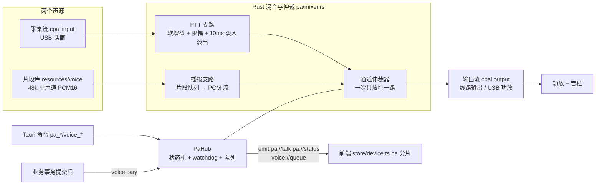
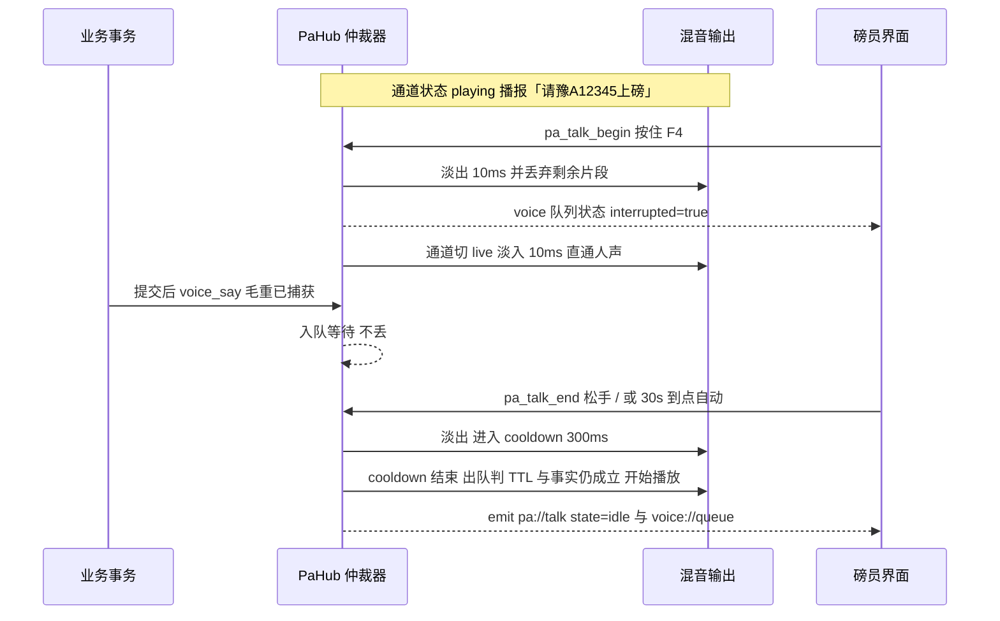
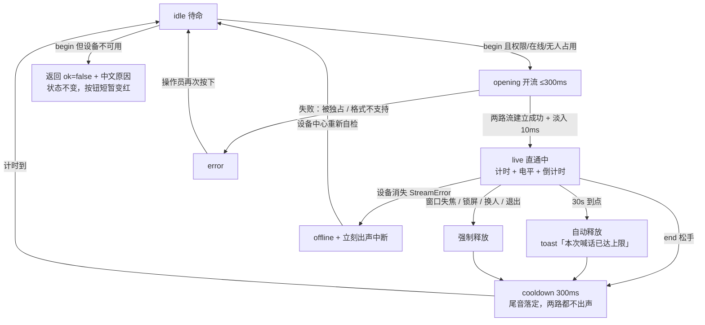

# 07 话筒喊话与语音播报

磅房里操作者与司机之间隔着玻璃窗、地磅和一台发动着的车，靠喊是喊不应的。本文把「人工话筒喊话（PTT）」和「系统语音播报（叫号/重量/告警）」合成**一条声音链路**来设计：两者共用同一只功放和同一组音柱，同一时刻只允许一路出声，由 Rust 侧统一仲裁。

它取代 04 文档 §5.4 里那条 P2 占位结论（"语音播报 = 预录 WAV 用 `rodio` 播放"）——那个方案没有回答"人正在讲话时机器插嘴怎么办"，也没有回答"没有 SDK 的本机声卡怎么进设备台账"。本文把这两件事定下来。

状态：**设计定稿，未实装**。硬件口径已确认为**本机声卡直连（USB 话筒 + 功放/音柱）**，网络音柱、SIP、4G 云喇叭本版不做（§1.3）。

---

## 1 业务场景与边界

### 1.1 现场到底要喊什么

| # | 场景 | 谁发起 | 典型内容 | 为什么必须出声 |
| --- | --- | --- | --- | --- |
| S1 | 排队叫号 | 人工点「叫号」（内容模板化，见 §5.1） | "豫 A 一 二 三四五，请上磅" | 旺季车排在磅外，司机看不到屏幕，也不知道轮到自己 |
| S2 | 上磅姿态纠正 | 磅员 | "请熄火""请往前开，后轮过杆""请全部下车" | 姿态不对直接导致重量不真，重测一次成本远高于喊一句 |
| S3 | 重量告知与下磅 | 磅员为主，系统可播 | "毛重一万二千三百四十五点六公斤，请下磅" | 与对外大屏（`F2`）配对，农户当场确认 |
| S4 | 化验结论告知 | 系统模板 + 人工补充 | "水分超标，扣一百二十公斤" / "拒收，请卸到左边那堆" | 拒收/降级要司机当场配合改变去向，说不清就变成纠纷 |
| S5 | 皮重异常复核 | 磅员 | "麻烦下车看看车上有没有留人/有没有杂物" | 偏差超容差不拦车、照常入账并醒目警示（05 §4 区 ②），当场核实比事后红冲便宜 |
| S6 | 结算与签字引导 | 系统 | "结算完成，请到窗口签字" | 人多时排队秩序靠喊 |
| S7 | 应急与调度 | 磅员 | "挪一下车""盖篷布""失火疏散" | 不可预期，必须一键直达、零延迟 |

结论：**S1/S3/S4/S6 是模板化播报**（内容来自单据字段，机器能生成），**S2/S5/S7 是人工实时喊话**（内容取决于现场看到什么，机器生成不了）。两套能力共用一个输出通道，所以必须一起设计，不能先做一个再"兼容"另一个。

### 1.2 与既有设计的关系

| 已有 | 本文怎么接 |
| --- | --- |
| 04 §5.4「语音播报 P2 / 预录 WAV + rodio」 | **被本文取代**：运行期不用 rodio（§2.4）。播报仍走"预录片段拼接"这条被推荐的路，但拼接与播放由喊话链路统一承担 |
| 04 §5.4「LED 外部显示屏 P2」 | **已取消**（2026-09-13 现场确认站点无户外显示屏与钱箱，04 §5.4 两行同批作废）。同一批业务事件不再喂 LED，语音是唯一那路输出；`kind='led'` 只剩库 CHECK 里的历史值，设备页不再提供该类 |
| 02 §M9「设备自检面板」 | 喊话链路进同一套设备卡：状态灯、最后成功时间、连续错误数、一键测试 |
| 05 §4.1「自定义布局」 | 新增一个工作台面板 `pa`，**默认收起**，不改默认三栏几何（§6.6） |
| 05 §5「快捷键规范」 | 新增 `F4` 按住说话（05 文档已同步登记） |
| 06 IC 流转卡 | 本文不管。读卡弹窗与工作台上的每道闸门、每步落成都已经会出声（05 §6.5 的 `reader_prompt_voice`：读卡弹窗提示 + 操作回话），但那走 WebView2 平台语音合成、只在本机扬声器响，**不经本链路、不进功放、不参与 §3 仲裁**。这些回话与本文 §5.1 的播报事件（毛重/皮重/结算/拒收）语义重合是**有意的**：现场已经验证"要人改动作就得出声"这条判据，将来功放链路落地时把同一批句子喂进 §5.2 的模板即可，届时同一句话由本机还是车间出声归本文的仲裁器定，那一层不预先接线 |
| `weigh_order.queue_no`（0001 预留未启用列） | **本版不激活**。叫号播报用"当前待上磅那单的车牌 + 品种"就够，不为此拉起一套排队号体系（§1.3-6） |

### 1.3 非目标（明确不做，写清代价）

1. **不做网络音柱 / SIP 话机 / 4G 云喇叭**。这类设备要厂商 SDK 或私有协议、要掉线重连与取流，现场型号未定就建模等于凭空抽象。代价：喇叭必须与电脑在同一间磅房的物理距离内（定压功放走音频线，实测 50 m 内无障碍）。
2. **不保存喊话音频**。只落元数据（谁、几点、多长、关联单号、是否被抢占）进 `audit_log`，不建录音表。代价：迎检问"当时到底喊了什么"只能回答"几点喊了 8 秒、针对哪张单"，回答不了逐字内容。真要录音需另开一版（涉及个人信息存储与留存期，不是加个开关）。
3. **不做通用 TTS 引擎、不做语音合成在线服务**。运行期只有片段拼接（§5.3）。代价：新增一个汉字词（如生僻地名、新单位简称）需要补片段并重新打包，不能随口说任意文本。例外只有一处、且不在本链路上：05 §6.5 的读卡弹窗提示语音用的是 WebView2 平台语音合成，出声范围就是弹窗所在这台磅房机的扬声器，为的是让窗外的农户知道"现在放卡"，不承诺车间听清，因此也不需要片段包与延迟预算。
4. **不做回声消除（AEC）、主动降噪、移频抗啸叫**。磅房话筒与音柱有物理隔墙，啸叫主要是接线与摆位问题，用布局 + 增益上限 + 时长上限 + 削波提示吸收（§4.5、§7）。代价：把话筒拿到音柱底下仍然会啸叫——这属于操作违规，界面给出提示但不保证压制。
5. **不做多方对讲、不做磅房间互播、不做音量时段策略（夜间静音）**。一台机一条链路一个人喊。
6. **不做排队叫号体系**（队列生成、过号重排、屏显联动）。本版只播"当前该上磅的那辆车"。
7. **不做英文/方言播报**，不做多说话人。
8. **不做播报文本的自由编辑**（不提供富文本、不提供条件分支语法），只允许有限令牌（§5.2）。

---

## 2 音频链路设计

### 2.1 话筒接在哪：两种物理接法，选 A

| | 接法 A（本文采用） | 接法 B（硬件兜底） |
| --- | --- | --- |
| 通路 | USB 话筒 → 电脑 → 软件直通 → 电脑线路输出 → 功放 → 音柱 | 话筒直接插功放 MIC 口，电脑只喂线路输入给功放 |
| 软件参与度 | 全程参与：增益、限幅、互斥仲裁、时长上限、留痕、电平自检 | 完全不参与，人声绕开电脑 |
| 自动播报能否被话筒盖住 | 能，软件层二选一仲裁（§3） | 要靠功放的 **MIC 优先（voice priority / ducking）** 硬件功能，功放没有就会两路声音叠着放 |
| 现场能否知道"现在有人在喊" | 能（底栏与面板有状态，防止两个磅员各喊各的） | 不能 |
| 换机/换话筒 | 装完即用，配置在设备台账里 | 依赖功放面板旋钮，交接靠人记 |
| 代价 | 引入 `cpal` 依赖，要处理采样率与端点漂移 | 软件侧所有守卫失效 |

**选型结论**：A 为主路径——只有 A 谈得上 §3 的仲裁和 §4 的状态机，"二选一互斥"这个需求本身就要求人声经过软件。B 不写进任何代码分支，只作为部署时的退路记在 §9 第 1 条与 §10。一旦某台机器被迫用 B，现场必须确认功放支持 MIC 优先，否则把 `voice_enabled` 关掉、该机退回纯人工喊话：本系统是"一个站点一套部署一个本地库"（README 术语表），这个开关就是这台磅房机的开关，不存在"关掉会不会影响另一台机"的问题；真到一库多磅点需要逐磅分开的那天，属于本版非目标（§1.3-5），届时再定键的粒度。

### 2.2 软件拓扑



要点：

- **只有一个输出流**。两路声音在软件里抢同一个 sink，而不是各开各的流——这是"二选一互斥"能真正成立的前提（两个流各自播放时，操作系统只会混音，软件无从拒绝）。
- **`PA_LOCK` 全局 Mutex 串行化所有链路操作**（打开/关闭/切换/自检），与读卡器 `DEV_LOCK`、`serialport` 独占句柄同一套惯例：音频设备是单实例资源。
- **两个流都在 `spawn_blocking`/独立线程建立，音频回调内零分配、零锁、零 IPC**（照 04 §2.4 第 1 条"读线程独立于 Tauri 异步运行时"的理由：一次阻塞就会让整窗卡死）。业务侧只跟 `PaHub` 的 channel 说话。
- **Mock 由前端承担**（照读卡器现状，不建 `MockPa` trait 对象）：关掉外设总开关或 `is_mock=1` 时，命令不出声，界面显示"（模拟）已播报：…"并带 Mock 徽标，不伪装真机成功。

### 2.3 依赖与打包

| 项 | 决策 |
| --- | --- |
| 采集与播放 | `cpal`（WASAPI **共享模式**）。独占模式会踢掉系统其它声音且需要精确缓冲区参数，磅房机上风险大于收益 |
| 播放库 | **不引入 `rodio`**，见 §2.4 |
| WAV 解码 | 片段一律 PCM16 单声道，自写 RIFF 头解析约 80 行（`pa/wav.rs`）；若开工时觉得不值当，退化成"构建期把片段拼成一条 `.raw` + 偏移表"，运行期只 `fs::read` 一次再切片（二进制，不能用 `read_to_string`），零解码 |
| 端点枚举 | 复用已依赖的 `windows` crate（0.61，仅 Windows target）：`MMDeviceEnumerator` 枚举 eCapture/eRender + `IMMEndpoint::GetId` 拿稳定端点 ID，与 `camera_list_local` 用 MF 枚举设备是同一写法 |
| 片段资源 | `src-tauri/resources/voice/`，`tauri.conf.json` 的 `bundle.resources` **逐文件枚举**（照 04 §3.5-1 的教训：不要通配，防止工装中间产物与临时录音进包） |
| 新增依赖面 | 3 个 crate 以内（`cpal` + 可选 `hound`），`cargo tree` 复核不与现有依赖冲突后再合。**开工前必须先验 §9 的三件事，验不通就整条重做设计** |

### 2.4 为什么不用 rodio（覆盖 04 §5.4 旧结论）

`rodio` 自带 `OutputStream`（内部再开一个 cpal 输出流）和它自己的混音器/音量控制，看起来更省事，但三件事做不到：

1. **拒绝第二路声音**。rodio 的 `Sink` 之间是叠加混音，播放在途时按下 PTT 只会两声重叠，正是 §3.1 R2 明令禁止的形态；要做抢占就得让 rodio 的输出流和我们的直通输出流互相让位，两个引擎抢同一个设备。
2. **采集侧它不管**。PTT 的人声终究要自己用 cpal 打通，于是同一进程里出现两套流管理与两套设备选择。
3. **播报的原子单位是"一条消息"而非"一个文件"**。片段拼接天然要求我们自己控制"下一个片段何时接上、消息边界在哪、被抢占时丢掉剩余片段"，rodio 的 `Source` 链式拼接并不比一个 200 行的自写队列简单。

所以：**cpal 一个流管理库打到底，rodio 不进依赖表**。播报队列与混音在 `pa/mixer.rs` 一处实现，PTT 与播报走同一条代码路径出喇叭。

### 2.5 关键参数与目标值

| 参数 | 目标/取值 | 说明 |
| --- | --- | --- |
| 端到端延迟（说话→出声） | ≤ 150 ms（设计预算，实测为准） | 超过 ~200 ms 人会明显听到自己的回声而说不下去；缓冲取设备默认回调周期的 2 倍，不自行加大 |
| 输出采样率/声道 | 设备默认（典型 48 kHz），单声道输入复制为双声道输出 | 协商失败 → 命令级错误，不自作主张改系统默认格式 |
| 片段格式 | 48 kHz / 单声道 / PCM16 小端 | 与协商出的输出格式不一致才做线性重采样（人声可懂度足够，不上高质量重采样器） |
| PTT 软增益 | `gainDb` 配置项（字段名以 §6.3 为准），硬上限 **+6 dB** | 超过即拒绝保存并在设备中心说明原因；现场优先调话筒摆位与 Windows 麦克风加强，不靠软件堆增益 |
| 限幅 | 峰值软限幅到 −1 dBFS | 防削波爆音，功放喇叭最怕持续削波 |
| 淡入淡出 | 10 ms | 消除按下/松开那一下的"咔" |
| 单次喊话上限 | `pa_max_seconds` 默认 30 s（可配 10–60） | 到点自动释放，见 §4.2 G2 的 watchdog |
| 喊话后冷却 | 300 ms | 尾音/房间回声落定，也让功放不长期满偏 |
| 播报电平 | 与 PTT 同一增益链，不做"自动响度均衡" | 两路音量差由现场功放面板一次调定 |

### 2.6 端点标识与热插拔

`config_json` 里存的是**端点 ID + 友好名快照**两份，匹配顺序：

```text
1. 按端点 ID 精确命中            → 用之，status=online
2. ID 找不到、友好名命中唯一      → 用之，并在设备中心提示"端点 ID 已变化，按名称匹配"
3. 都找不到                     → 回退系统默认角色设备（eConsole/eMultimedia），
                                  captureFallback/renderFallback=true，灯转黄
4. 连默认设备都没有              → status=offline，命令返回错误原因，不 panic
```

兜底成功**必须写成设备卡上的可见文字**（"话筒已按默认设备兜底：Microphone (USB Audio Device)"），不能只挂在 tooltip 上——05 §1 明令不以悬停作为唯一提示，而"到底用的是哪一台"恰是现场最需要看见的信息。

设备插拔导致 ID 变化是 Windows 常态（换 USB 口、换驱动、系统更新），因此**友好名兜底 + 默认角色兜底是必需路径而不是异常路径**。真正要防的是"匹配到了另一台同名设备"（同一型号两只麦克风），故设备中心始终显示当前实际使用的端点全名，自检音也从这一台走（§4.5）。

播放中途设备消失：cpal 的 `StreamError::DeviceLost/Disconnected` → 立即把 PTT 置 `idle`、播报队列清空、状态转 `offline` 并 emit，**绝不允许"人还在喊但已经没声"这种状态存在**——这是本链路最危险的一类失败：操作者会以为司机已经收到指令，从而做出错误的下一步判断。

---

## 3 通道仲裁：二选一互斥

### 3.1 优先级规则

| 规则 | 内容 | 理由 |
| --- | --- | --- |
| R1 | **人工 PTT 优先级高于系统播报**，且可抢占正在播的播报 | 人已经在对着具体某辆车讲话，机器插嘴只会让司机听不清指令；播报内容由系统稍后重发得出来 |
| R2 | **播报永不打断 PTT，也不与 PTT 混音**（同 R1 的镜像） | 半句人声 + 半句合成音 = 两条指令都作废 |
| R3 | PTT 占用期间的播报**入队等待**，不丢弃；出队时按 TTL 判定（§3.3） | 播报是"通知"，晚 2 秒无妨；丢掉才是问题 |
| R4 | 一条播报消息是**原子单位**：可被打断，不可部分续播 | 只播出一半的"请上……"比不播更危险 |
| R5 | 被打断/过期的播报**不自动重试**，等下一次同类事件 | 重试会在 3 秒后向司机丢出半句旧指令，语义已经变了 |
| R6 | 同一时刻只允许**一个 PTT 会话**；第二个请求返回 `busy`，界面显示"XX 正在喊话" | 两个话筒同时出声是现场最难查的故障，也是纠纷时"我喊过了"的扯皮来源 |
| R7 | 仲裁只发生在 Rust 侧 `PaHub` 一处 | 前端两处各自判断必然分叉（本仓库既有惯例：判断逻辑只在一处，如 `print-guard.ts`） |

### 3.2 判定矩阵

| 当前通道 | 新请求 | 结果 | 留痕 |
| --- | --- | --- | --- |
| `idle` | PTT begin | 10 ms 淡入后直通，状态 `live` | — |
| `idle` | 播报一条 | 立即播放，占通道直到播完 | `voice.say` |
| `live` | 播报一条 | 入队，PTT 释放 + 冷却结束后按 TTL 出队 | `voice.say` + `queued=true` |
| `playing` | PTT begin | 淡出 10 ms 停当前条，剩余片段丢弃，PTT 接管 | `voice.say` + `interrupted=true` |
| `queued` 非空 | PTT begin | 队列原地不动，PTT 直接接管 | — |
| `live` | 第二个 PTT begin | 拒绝 `busy`，不影响第一条 | `pa.talk` + `result=error` |
| `cooldown` | PTT begin | 拒绝 `busy`（冷却 300 ms），播报也不在这 300 ms 里出声 | — |
| 任一 | `F4` 松开 / 失焦 / 锁屏 / 换人 / 退出应用 | 无条件释放直通并回 `idle`，队列继续 | 见 §4.2 |
| `offline`/外设总开关关/Mock | PTT begin | 命令级失败，返回中文原因；**不阻断称重、打印、结算任何作业** | `pa.talk` + `result=denied/error` |

### 3.3 播报队列、去重与 TTL

- 队列上限 **3 条**，满了丢最旧的一条（叫号类语义上最旧=已过时）
- **去重键** = `event + order_no`：同一单同一类事件只保留最新一条（连点两次捕获不会喊两遍）
- 每条带 `expires_at = now + voice_ttl_seconds`（默认 20 s，可配 5–120）；出队时已过期 → 丢弃并记 `dropped=expired`
- 与单据强绑定的事件（"请上磅"、"请下磅"）**额外校验事实仍成立**：出队时该单已不是对应状态（已被别人捕获、已作废、已结算）→ 丢弃，记 `dropped=stale`。避免司机在下车后听到"请上磅"
- 播报串行，条间静默 250 ms（让人耳分条），**不做跨条混音**

### 3.4 抢占时序



---

## 4 PTT 状态机

### 4.1 状态图



### 4.2 守卫清单（每条都必须在 Rust 命令层实现，不靠界面自觉）

| # | 守卫 | 做法 | 不做的后果 |
| --- | --- | --- | --- |
| G1 | **失焦即释放** | 除 `keyup`（归 G3 管）外的**六个入口**：主窗失去焦点、`Alt+Tab`、锁屏、会话失效、路由离开工作台、组件卸载 —— 都调 `pa_talk_end`。与 G3 合计即 05 §5 登记的七个释放入口 | 直通通道卡在开着，功放持续放大房间噪声，全场刺耳 |
| G2 | **Rust 侧独立 watchdog** | `opening/live` 超过 `pa_max_seconds + 2 s` 未收到 end → 自行关闭并 emit | 前端崩溃/卡死时，喇叭被永久占用；只有 Rust 计时才靠得住 |
| G3 | 快捷键只认"第一次 keydown" | 忽略 `repeat`；keyup 必发 end；同时存在屏幕按住按钮，两条入口同一命令 | 长按时系统连发导致状态抖动 |
| G4 | 误触判定 | 按下 < 120 ms 就松开 → 记 `ignored_short=true` 且**不写 `pa.talk` 审计**，但照常淡入淡出（不吞掉真话的开头） | 每次误触都留一条"喊话 0.1 秒"，审计被噪声淹没 |
| G5 | 冷却 | 两次 begin 间隔 < 300 ms 拒绝 | 反复开关产生点击噪声，伤功放 |
| G6 | 时长上限 | 30 s 到点自动释放并显式提示 | 忘记松手 = 全场持续放大 + 别人无法喊话 |
| G7 | 权限 | `FLOOR_ROLES`（站长/登记员/磅员，`orders.rs` 已有常量）可 begin/end；`viewer`/未登录拒绝并留 `denied` 审计 | 越权尝试不留痕（03 §9.21 硬性要求） |
| G8 | 设备单实例 | `PA_LOCK` Mutex 串行化，一次一个会话（R6） | 双流抢设备，表现为随机无声 |
| G9 | 不阻断业务 | 任何音频失败只回错误，**永不 `panic`、永不冒泡成业务异常**（照 `printer.rs`：失败不回异常，只回 `ok=false` + 原因） | 喇叭坏了导致开不了单，是本末倒置 |

### 4.3 三种触发入口

| 入口 | 行为 | 备注 |
| --- | --- | --- |
| 工作台面板大按钮 | 按住说话（`onPointerDown` begin / `onPointerUp` + `onLostPointerCapture` end） | 44 px 高（05 §7.3 主操作按钮规格），按下期间按钮文案变「喊话中 12 s」 |
| `F4` 按住 | 生效范围**仅工作台**（与 `F2` 对外大屏、`F11` 专注模式并存：对外大屏开着时仍可喊，因为喊话正是给场外的司机听）。不做全局，因为路由离开即触发 G1 释放，"在结算中心能喊话"是假能力 | 05 §5 已登记；命令层同样做权限校验，快捷键不是权限依据 |
| 话筒自带 PTT 开关 | 多数喊话话筒的 PTT 键是 USB HID 键盘，出厂键位不统一 | 设备中心提供「录键」：按下话筒键 → 记录实际键码 → 存 `config_json.pttKey`。录不到也不影响前两种入口。**被登记为 `pttKey` 的键位由应用接管，其 `keydown` 一律 `preventDefault`（含 `repeat`）** —— 不少话筒把它做成普通字母键，不吞键就会在品种/车牌输入框里悄悄多出字符；现场优先把该键配成 `F13`–`F24` 这类无副作用键码，配不了就靠吞键兜住 |

### 4.4 界面反馈

`live` 期间必须同时给出四样东西，缺一不可（05 §1「不使用悬停作为唯一提示」与"任何 disabled 都要有文字原因"的延伸）：

1. 面板按钮变主色实心 + 中文「喊话中」+ 已喊秒数
2. 电平条（RMS 与峰值），**峰值贴顶时变红并提示"音量过大，正在削波"**——这是"话筒到底收到声音没有"的唯一诚实证据
3. 底栏设备状态条新增一段，沿用 05 §2 的写法：`喊：待命` / `喊：● 进行中 12 s` / `喊：离线`（图形符号 + 文字，不只用颜色）。**播报队列不占底栏**——底栏讲的是"设备通不通"，播报是业务事件，放工作台面板的"最近播报"里；底栏已经常驻五段，再加一段在 1366 px 上会挤
4. 剩余时长倒计时（到 `pa_max_seconds - 10` 开始提示）

面板本身（即 §6.6 注册的 `pa` 面板，默认收起）从上到下就五样东西，不做多余装饰：

| 块 | 内容 |
| --- | --- |
| 按住说话 | 主操作大按钮（44 px），`live` 时变主色实心并显示已喊秒数 |
| 电平 | 一条 RMS + 峰值刻度条，贴顶转红 |
| 叫号 | 一个按钮，播 §5.1 的 `call_on_scale`（模板取当前单的 `{plate}`）；无当前单时置灰并说明"先制单或选中在途单" |
| 候选语 | §5.2 那 7 条按钮组，点一条播一条，不提供文本框 |
| 最近播报 | 最近 5 条，含 `queued` / `interrupted` / `dropped=expired` / `dropped=stale` 四种结局的中文标注——现场要能看懂"为什么没响" |

### 4.5 现场校准（设备中心「喊话」卡片的三步向导）

| 步 | 动作 | 判据 |
| --- | --- | --- |
| 1 出声通路 | `pa_test_tone`：播 1 kHz 半秒 × 2 + 一条自检播报「语音链路测试，一、二、三」 | 现场听到 = 输出端点与功放接线对 |
| 2 采集通路与增益 | `pa_calibrate_*`：按住说话 3 秒 → 显示峰值电平与是否削波 | 目标峰值 −12 ~ −6 dBFS；到顶则降 `gain_db` 或把话筒移离窗口回音面 |
| 3 整链路无啸叫 | 用第 2 步的增益真喊一次，让同事在磅区确认听得清、现场无啸叫 | 啸叫 → 是摆位问题（话筒正对音柱/玻璃反射），先移位置，其次降增益；**不做移频压制** |

---

## 5 语音播报：内容、令牌与片段包

### 5.1 事件清单（本版全部播报点）

| `event` | 触发时机（自动项**一律在事务提交之后**，见下方硬规矩） | 默认模板 | 需人工触发 | TTL | 默认开关 |
| --- | --- | --- | --- | --- | --- |
| `call_on_scale` | **人工触发**：磅员点工作台面板的「叫号」按钮 | `{plate} ，请上磅` | 是（本身就是人点的） | 20 s | 开 |
| `gross_captured` | 毛重捕获事务提交后 | `毛重{gross_kg}公斤，请下磅` | 否 | 30 s | 开 |
| `tare_captured` | 皮重捕获事务提交后 | `皮重{tare_kg}公斤，称重完成` | 否 | 30 s | 开 |
| `qc_reject` | 质检判定为拒收，报告保存提交后 | `化验结果拒收，请卸货离场` | 否 | 60 s | 开 |
| `qc_deduct` | 质检保存且存在扣量 | `水分超标，扣重{deduct_kg}公斤` | 否 | 60 s | 开 |
| `settled` | 结算并打印码单事务提交后 | `结算完成，请到窗口签字` | 否 | 60 s | 开 |
| `manual_note` | 磅员在面板上从候选里挑一条（不下自由文本） | 候选表见 §5.2 末 | 否 | 10 s | 开 |

**为什么"请上磅"要人点一下**：本版不做排队体系（§1.3-6），制单完成只说明这单建好了，不代表磅台上前一辆已经下去。自动在制单瞬间喊"请上磅"，会把还没轮到的人喊上来撞磅——这是能把重量测错的错。代价说清楚：叫号仍需人做一次动作，但省掉的正是"走到窗口喊/探出头喊"，且这个动作在面板上就是一个按钮。若哪天上了排队体系（06 的 IC 卡 + `queue_no`），这一条改成系统自动触发，其余设计不变。

三条硬规矩：

- **绝不在事务内触发播报**。进程在提交后、投递前崩溃只少播一条，反过来（事务回滚了话却喊出去了）会造成无法撤回的错误指令。首版就用"提交返回后同步投递"，**不引入 Outbox/待播表**（该基建仍未拍板，不在本版范围内顺手建）
- **不播身份证号、不播单价、默认不播金额**（§1.3 之外的合规线：喇叭是广播，全场都听得见）。`voice_announce_amount` 默认 `false`，只说"结算完成"；开启后只播结算重量，仍不播货款金额（04 §4.3 个人信息处理口径的延伸）
- **新增事件必须同时在这张表登记 `TTL` 与"事实仍成立"的校验条件**（§3.3），否则过期指令会被迟到播出

### 5.2 模板令牌（封闭集，不做模板语言）

只允许下列令牌，未识别令牌保存时即拒绝并指出位置；不提供 ``、不提供算术、不提供嵌套。

| 令牌 | 来源 | 播出读法 |
| --- | --- | --- |
| `{plate}` | `weigh_order.vehicle_no` | 逐字符：省份汉字 + 字母英文名 + 数字（§5.4） |
| `{name}` | `party.name` | 姓名汉字，缺片段则跳过该字（§5.4 末） |
| `{variety}` | 品种名 | 走 `clipKey` 别名表（玉米/小麦/稻谷/大豆…），表外品种不播、只播"请上磅" |
| `{gross_kg}` `{tare_kg}` `{net_kg}` `{settle_kg}` `{deduct_kg}` | 0.1 kg 定点整数 | 中文位值读法 + "点" + 逐位小数 + "公斤" |
| `{settle_t}` | 同上换算吨 | 三位小数 + "吨" |
| `{money_yuan}` | 分定点整数 | 元 / 角，**舍弃分**并在界面注明"播报金额精确到角"；受 `voice_announce_amount` 控制 |
| `{seq}` | `—` | **不提供**。本版没有排队号：激活 `weigh_order.queue_no` 要连带一套队列生成与过号规则（§1.3-6 非目标），不要为了一个令牌顺手把它拉起来 |

`manual_note` 候选（不给自由输入框，避免任何文本都要预录片段的悖论）：`请往前开` / `请全部下车` / `请熄火拉手刹` / `请稍等` / `请到窗口签字` / `请把车挪开` / `请注意安全`。选一条即播对应片段序列，界面上是按钮组而不是文本框。

### 5.3 片段包与生成工装

```text
resources/voice/
  manifest.json      片段键 → 文件名 + 时长ms + 文本
  clips/num_0.wav … num_9.wav
  clips/lat_A.wav … lat_Z.wav
  clips/prov_豫.wav …（31 个省份汉字）
  clips/unit_gongjin.wav  unit_dun.wav  unit_yuan.wav  unit_jiao.wav
  clips/conn_dian.wav  conn_bai.wav  conn_qian.wav  conn_wan.wav  conn_ling.wav  conn_shi.wav
  clips/word_shangbang.wav  word_xiabang.wav  word_jieshu.wav …
```

- 约 **105–115 个片段**（10 数字 + 6 位值连接 + 26 字母 + 31 省份 + 约 40 词 + 单位/称呼），合计 < 2 MB，构建期一次生成
- **构建期用 TTS，运行期零合成**：`tools/voice-pack/`（独立小工装）读 `clips.toml`（片段键 = 文本），调 Windows 离线语音（`System.Speech`，zh-CN）输出 48 kHz 单声道 PCM16 WAV，写出 `manifest.json` 与 `clips_missing` 报告。运行期**只读文件**，因此不受 §5.4 里那条"PowerShell 启动 300–800 ms"的延迟影响——04 §5.4 担心的是运行期起子进程，这里没有子进程
- 现场要换音色（比如改用男声或本地话录音）：同名 WAV 覆盖 + 重跑时长表即可，代码零改动
- 缺片段不是故障：拼接器跳过缺失片段并记 `clips_missing=[...]`，播报继续（宁可少一个词也不要不出声），设备中心"语音自检"项里列出缺口

### 5.4 拼接算法（数字、金额、车牌）

| 输入（定点整数） | 输出片段序列 | 规则 |
| --- | --- | --- |
| 重量 `123456`（= 12,345.6 kg） | 一二… → `一万二千三百四十五` + `点` + `五` + `公斤` | 整数部分中文位值读法：连续零只读一个 `零`，末尾零不读；10–19 读"十…"不读"一十…"（与口语一致）；小数部分逐位读，一位 |
| 吨 `123456` → 12.346 t | `十二` `点` `三四六` `吨` | 三位小数逐位 |
| 金额 `428760` 分 = 4,287.60 元 | `四千…元` `六角` | 元部分位值读法；角一位；**分舍弃**（不念"整"）；0 元 0 角读"零元" |
| 车牌 `豫A12345` | `prov_豫` `lat_A` `num_1`…`num_5` | 逐字符；非 {汉字, 字母, 数字} 字符跳过 |
| 姓名 `王建国` | 逐字查 `han_*`，查不到的字跳过 | 人名用片段表覆盖不了全部汉字 → **默认模板不含 `{name}`**，避免"王#建#"式漏字；仅站点自行补齐 `han_*` 片段后才允许启用 |

位值读法用 40 行内的定点算法（不引入中文数字第三方 crate），输入永远是 `i64` 定点，**全链路禁浮点**（README 三条硬约束之一）：分/0.1 kg 换算只在 `lib/format.ts` 与 Rust 侧既有函数里做，播报层只接受已定点的整数。

### 5.5 参数归属（一个参数只允许有一个家）

| 归属 | 判定 | 具体项 |
| --- | --- | --- |
| `app_setting`（站点参数，影响现场听到的内容与时长，进审计、`setting.update`） | 会改变业务输出 | `voice_enabled`、`voice_ttl_seconds`、`voice_announce_amount`、`voice_templates`（json）、`pa_max_seconds` |
| `device_config.config_json`（本机硬件通路，不逐键进审计） | 换台机器就该不一样 | `capture.id` / `capture.name`、`render.id` / `render.name`、`gainDb`、`pttKey`、`clipPackVersion`（逐字见 §6.3） |
| `user_preference`（跟人走） | 个人界面偏好 | 本版**不放任何东西到这里**：喊话没有布局之外的个人项，面板收起状态本来就走 05 §4.1 的 `user_preference` 布局机制 |

---

## 6 契约改动清单（必须与迁移 0009 同一批提交）

### 6.1 `device_config.kind` 增加 `pa`

一条喊话链路 = 一个话筒端点 + 一个喇叭端点，不是两台设备。**沿用「一台设备、两条通道」的读卡器先例**（04 §3.1），`device_config` 只占一行，`config_json` 里两个端点各一组字段。

枚举字面量选 `pa`（Public Address，行业对"广播/喊话"链路的通称）：叫 `mic` 只说了进，叫 `speaker` 只说了出，都不对。

SQLite 的 `CHECK` 不能 `ALTER`，必须重建表（12 步法），且**这是本仓库第一次重建带外键引用的表**：

```sql
-- 0009_pa_channel.sql
PRAGMA foreign_keys=OFF;              -- 重建期间放过 weigh_record.device_id /
                                      -- attachment.source_device_id 的引用
BEGIN;
CREATE TABLE device_config_new ( …kind IN
  ('scale','idcard','camera','printer','led','cashbox','signpad','pa')… );  -- 列定义逐字照 0001，只加 'pa'
INSERT INTO device_config_new SELECT * FROM device_config;
DROP TABLE device_config;
ALTER TABLE device_config_new RENAME TO device_config;
CREATE INDEX idx_dev_kind ON device_config(kind, is_enabled);
CREATE UNIQUE INDEX uk_dev_default ON device_config(kind) WHERE is_default = 1;
COMMIT;
PRAGMA foreign_keys=ON;
```

三个必须核对的点：① `INSERT … SELECT` 保留 `id`，外键引用不断；② 两个索引（含那个部分唯一索引）要照 0001 原样重建，否则 `schema_matches_blessed_snapshot` 直接红；③ `PRAGMA foreign_keys` 每连接才生效，别假设它是开着的。

**枚举三处单源（`enums_are_single_sourced_across_three_places` 会逐字比对，漏一处就红）**：

| 落点 | 改动 |
| --- | --- |
| `src-tauri/src/domain/enums.rs` | `DeviceKind` 加 `Pa => "pa"`（`ENUM_SPECS` 自动带上） |
| `src/lib/constants.ts` | `DeviceKind` 联合类型 + `DEVICE_KIND` 中文标签「喊话话筒」 |
| `docs/design/03 §9.20` | `kind` 行值域补 `pa`，并同步 `§9.3.1` 的 5 个新键与 `§9.21` 的 action 列表 |

改完必须 `BANGHE_BLESS_SCHEMA=1 cargo test --test schema_contract` 重 bless 并**逐行 review diff**（快照是账本不是橡皮章，见 `schema_contract.rs` 头注）。

### 6.2 新增 `app_setting` 键（逐字，含说明）

`seed_baseline_matches_design_doc` 要求 03 §9.3.1 键集与库内键集**逐字相等**，所以下面这段与 03 文档、与 `0009` 的 `INSERT OR IGNORE` 必须同批落地，缺一即红。

```text
voice_enabled=true              -- 系统语音播报总开关（人工喊话不受它管）
voice_ttl_seconds=20            -- 播报出队时超过此时长即丢弃，单位秒
voice_announce_amount=false     -- 是否播结算重量；默认不播，喇叭是广播
voice_templates=json            -- 事件→模板串，缺键回落代码内默认（照 dashboard.rs 读法）
pa_max_seconds=30               -- 单次人工喊话自动释放上限，单位秒
```

`0009` 里一律 `INSERT OR IGNORE`，绝不 `UPDATE`（0006 头注的理由：现场改过的配置不能被升级覆盖）。

### 6.3 `config_json` 结构

```json
{
  "capture": { "id": "{0.0.1.00000000}.{guid}", "name": "USB 麦克风 (Jabra Speak2 40)" },
  "render":  { "id": "{0.0.0.00000000}.{guid}", "name": "Line Out (Realtek High Definition Audio)" },
  "gainDb": -3,
  "pttKey": "F4",
  "clipPackVersion": "2026-09-12"
}
```

口令类字段没有（本机声卡不需要凭据），故 `secret_json` 保持 `NULL`。

`pttKey` 是把话筒自带按键**额外**映射成 begin 的键位，可空；它与快捷键 `F4` **并存而非替换**——两把键都能按住，共用同一组释放入口（§4.2 G1/G3），所以不存在"录了话筒键就没了 F4"这种状态。

### 6.4 命令与事件契约

```text
pa_status()                 -> { ok, connected, capture?, render?, captureFallback,
                                 renderFallback, sampleRate, channels, mock, error? }
pa_list_endpoints()         -> { ok, inputs:[{ id, name, isDefault, maxChannels }],
                                 outputs:[{ id, name, isDefault, maxChannels }], error? }
pa_talk_begin(orderNo?)     -> { ok, talkId, startedAt, error? }         -- 需要权限
pa_talk_end(talkId)         -> { ok, seconds, peakLevel, clipped, ignoredShort, error? }
pa_test_tone()              -> { ok, seconds, path: "capture->render", error? }
pa_calibrate_begin() / pa_calibrate_stop()
                            -> { ok, peakDb, clipped, ms, error? }
voice_say(event, payload)   -> { ok, msgId, queued, estMs, dropped?, error? }
voice_selftest()            -> { ok, clipsTotal, clipsMissing:[clipKey], error? }
voice_preview(clipKey)      -> { ok, error? }
```

命令形参一律 snake_case，前端 `args` 写 camelCase（Tauri v2 的 `orderNo` ↔ `order_no`，多参用 `ARGS_MAP`）；所有 `pa_*` / `voice_*` 走 `spawn_blocking` + `PA_LOCK`；**命令层永不抛异常**，失败回 `ok=false` + 中文短句（面板 `onError` 直接透传，沿用现有惯例）。

`emit` 三个事件：`pa://status`（设备在线态）、`pa://talk`（`idle`/`live`/`cooldown` + 秒数）、`voice://queue`（当前条、等待数、`dropped`/`interrupted`）。高频实时（电平）不进 react-query，只进 `store/device.ts`（05 §8）。

### 6.5 权限与审计

| action | target | detail_json | 说明 |
| --- | --- | --- | --- |
| `pa.talk` | 当时的 `order_no` 或空 | `{seconds, peak, clipped, interruptedByWatchdog, ignoredShort}` | `< 120 ms` 的误触**不写**（G4）；被 watchdog 强制释放必写 |
| `voice.say` | 关联单号 | `{event, msg, queued, interrupted, dropped: expired / stale / none, clipsMissing}` | 事务提交后写 |
| `setting.update` | 键名 | 前后值 | §5.5 那 5 个键自动走既有审计 |

新增 action 只有 `pa.talk` 与 `voice.say` 两个。端点/增益改动、一键测试与校准**复用 `devices.rs` 已有的 `device.update` 与 `device.probe`**（`device.create`/`device.delete` 同现况），不另起一套动作名——否则审计页会出现"同一件事两种记法"。

权限：`pa_talk_begin/end` 走 `FLOOR_ROLES` 闸门（与制单、称重同一条岗位线）；`voice_*` 由系统调用不设岗位闸门，但 `voice_preview`/`pa_test_tone`/`pa_calibrate_*` 属设备操作，与打印机自检同档（站长/磅员）。`viewer` 一律 `denied` 并留痕（05 §6.6）。

### 6.6 前端落点（对齐既有文件，不自创写法）

| 文件 | 改动 |
| --- | --- |
| `src/lib/pa-native.ts` | 新，唯一原生出口：`runningInTauri ? invoke : mock`，`call<T>` 封装，区分"无通道"与"命令失败" |
| `src/store/device.ts` | 新增 `pa` 分片：状态机镜像、计时、电平、播报队列 |
| `src/components/workstation/layout.ts` | 注册 `pa` 面板（`title:"喊话与播报"`、`min:{w:2,h:5}`），并给 `PanelSpec` **新增 `defaultHidden` 标记**。这一步不是可选的漂亮话：`sanitize` 会把"档案里没有的新面板"按默认位补回，但**不会**把它写进 `hidden`；而老用户存过的那份格子已经把 12×24 占满，补进来的可见格子必然与别人压字，于是 `normalize` 的压字闸门会把**整份布局退回 `defaultDoc()`** —— 表现是"升级之后我排的桌子被无声重排了"。带 `defaultHidden` 的新面板直接进 `hidden`，收起态本来就不参与判重叠（该文件 §normalize 注释里的既有口径），老布局一字不动，用户从顶栏「面板」主动放出时才由网格当场挤开 |
| `src/pages/DevicesPage.tsx` | `KIND_ORDER` 末位加 `pa`、`KIND_ICON` 用 `MicIcon`、`DEVICE_SPEC.pa = { prefix:"pa", drivers:["core_audio","mock"], fields:[] }`。`fields` 为空是刻意的：话筒/喇叭端点靠联机扫描回填（`pa_list_endpoints`），不在登记表单手填地址，与 `camera` 的 `local_uvc` 驱动同一条惯例；右侧新增「喊话」联机面板承载两个端点下拉 + 增益 + 三步校准 |
| `src/lib/api.ts` | 只加 `pa` / `voice` 两组，按模块分组导出，组件里不出现命令名字符串（05 §8） |
| 顶栏工具条 | **不加常驻按钮**。喊话是工作台动作，顶栏再加一个入口对年龄偏大的操作者是噪声（05 §1） |

---

## 7 边界与降级矩阵

判据统一是三列：**会不会出声错、会不会阻断作业、界面是否说得清原因**。任何一行都不允许"静默失败"。

| # | 场景 | 系统行为 | 界面 | 阻断作业？ |
| --- | --- | --- | --- | --- |
| 1 | 没插话筒（无采集端点） | `pa_talk_begin` → `ok=false "未找到话筒，检查 USB 麦克风"` | 面板按钮置灰带原因，底栏「喊：离线」 | 否 |
| 2 | 话筒被其它程序以独占模式占用 | 开流失败 → 同上，原因写"话筒被其它程序占用" | 同上 + 建议关闭会议软件 | 否 |
| 3 | 功放/喇叭端点消失 | 输出流 `DeviceLost` → PTT 立即 `idle`、队列清空、`offline` | 面板弹一句"输出设备已断开，刚才的话没有播出去" | 否 |
| 4 | 采样率/声道协商不支持 | 回退默认角色设备一次，仍失败则报错 | 设备中心显示"按默认设备兜底成功/失败" | 否 |
| 5 | 换 USB 口导致端点 ID 漂移 | 走 §2.6 四级匹配，落到友好名或默认设备 | 卡片黄灯 + "端点 ID 已变化，按名称匹配" | 否 |
| 6 | 同型号两只话筒、名称相同 | 匹配到另一台也算"成功" | 自检音与电平是唯一取证手段 → 校准向导第 1 步必做 | 否 |
| 7 | 啸叫 | 电平贴顶时红条 + "正在削波"，30 s 上限兜底 | 提示"话筒离音柱太近" | 否 |
| 8 | 按 30 s 未松手 | watchdog 释放，`interruptedByWatchdog=true` | toast「本次喊话已达 30 秒上限，需要请再按」 | 否 |
| 9 | 前端崩了 / 进程被强杀 | G2 watchdog 与进程退出前 `close()` 一并兜住 | 重开后 `pa_status` 归位 | 否 |
| 10 | 别人正在喊 | 第二个请求 `busy` | 按钮显示「张某某 正在喊话」（来自 `pa://talk` 的 actor） | 否 |
| 11 | `viewer` 或未登录按 `F4` | 命令 `denied` + 审计 | 提示无权限，不弹模态 | 否 |
| 12 | 外设总开关关闭 / `is_mock=1` | 不出声，返回模拟成功 | 全链路带「模拟」徽标，绝不用假绿标（照 04 §3.3） | 否 |
| 13 | 浏览器预览（无原生通道） | 按钮置灰 | "当前是浏览器预览，没有原生音频通道，请用 `npm run tauri dev`" | 否 |
| 14 | 播报模板里写了未知令牌 | 保存时拒绝并指出令牌名 | 站点参数表单字段下报错 | — |
| 15 | 片段文件缺失/包版本不符 | 跳过缺失片段，其余照播 | `voice_selftest` 列缺口；设备中心黄标 | 否 |
| 16 | 播报排在 PTT 后超过 TTL | 丢弃并记 `dropped_expired` | 面板"最近播报"里显示"已过期丢弃：请上磅" | 否 |
| 17 | 单据已被作废/已被他人捕获，播报才出队 | 校验事实仍成立 → 丢弃 `dropped_stale` | 同上 | 否 |
| 18 | 两路重量捕获在 1 s 内连续发生 | 按去重键合并为最新一条 | 只播一条 | 否 |
| 19 | 锁屏 / `Alt+Tab` / 切路由 / 换人 | G1 无条件释放 | 状态回待命 | 否 |
| 20 | 系统睡眠唤醒后端点全变 | 首次请求失败 → 自动重开一次 → 仍失败置 `offline` | 底栏红点 + 一键自检 | 否 |
| 21 | 音频设备损坏 | 播报/喊话静默失败，业务链路（称重、打印、结算）完全不受影响 | 底栏常显，不弹模态 | **绝不** |

---

## 8 验收口径

| 项 | 验收动作 | 通过标准 |
| --- | --- | --- |
| 喊话通路 | 真机按住 `F4` 说一句话，同事在磅区听 | 听得清、无明显延迟（人耳不觉得"慢半拍"）、松手即停 |
| 互斥 | 播报中途按住 `F4` | 播报立刻止住、人声不被叠字；松手后队列里未过期的播报继续 |
| 抢占不补播 | 让一条叫号播报被喊话打断 | 不重播半截，审计里 `interrupted=true` |
| 上限 | 按住 35 s | 30 s 自动释放，倒计时提前 10 s 可见 |
| 失焦释放 | 按住 `F4` 后用 `Alt+Tab` 切走 | 立刻无声；再回来不是"喊话中" |
| 排障 | 拔掉功放音频线 | 底栏转红、面板按钮禁用带原因、一次捕获重量仍可正常保存 |
| 降级 | 外设总开关关闭 | 无话筒也能完成整个车次闭环（02 §M9、README 硬约束） |
| 数字读法 | 用定点输入构造四组：`123456`（= 12,345.6 kg）、`102000`（= 10,200.0 kg）、`428760` 分、`100000 kg` 换算吨（= 100 t） | 依次读"一万二千三百四十五点六公斤""一万零二百公斤""四千二百八十七元六角""一百吨"。规则照 §5.4：整数部分位值读、连续零只读一个、末尾零不读，小数部分逐位读（`12.346 t` 读"十二点三四六吨"） |
| 结构契约 | `cargo test --test schema_contract` | 三处枚举单源 + §9.3.1 键集 + 快照全绿 |
| 无浮点 | 代码走查 | 播报层输入是 `i64` 定点，无 `/10`、`*100`、`toFixed` |

---

## 9 开工前必须先验的三件事（不通过就回来改本文）

1. **同进程内"一个 cpal 输入流 + 一个 cpal 输出流 + 软件环回"在 WASAPI 共享模式下的实际延迟与稳定性**（拿磅房机或同款 Windows 机，半天工时）。这是全篇的地基：延迟 > 200 ms 或长时间开着会崩，则 §2.1 的接法 A 不成立，整条链路改回接法 B（硬件 MIC 优先），本文随之收缩为"只做自动播报 + 软件侧不做人工直通"。
2. **`cpal::Device` 的端点标识能否与 `windows` crate `IMMEndpoint::GetId` 拿到的 ID 对齐**（决定 §2.6 匹配与 `pa_list_endpoints` 的实现路径）。对不上就改为"只用 cpal 自己枚举的 `Device::name()` 做匹配 + 默认设备兜底"，放弃稳定 ID。
3. **构建期 TTS 工装产出的 48 kHz 单声道 WAV 在目标机上的可懂度**（现场实测，尤其磅区背景噪声下）。不达标 → 改人工录音替换同名片段，架构不变。

## 10 现场资料与部署清单

到货必确认（对应 04 §8 的第 6 项）：

1. 话筒型号与接口（USB / 3.5 mm / 带不带 PTT 开关及其默认键码）
2. 功放是否支持 **MIC 优先**（决定接法 B 是否可用），有几个输入通道
3. 音柱位置与磅房窗的距离、指向（决定啸叫风险与是否需要延长音频线）
4. 磅房机声卡是否有线路输出同时接音柱（还是只有 USB 音频）
5. 磅区背景噪声水平（决定播报必须多响、以及是否值得播重量）

部署侧新增：`resources/voice/` 完整性自检（`voice_selftest`）、首次启动跑一次 §4.5 三步校准并留结果在设备中心，不做静默默认。

## 11 风险

| 编号 | 风险 | 影响 | 应对 |
| --- | --- | --- | --- |
| H10 | 软件直通的端到端延迟/稳定性不达标（§9-1） | 操作者说不下去，喊话形同虚设 | 开工先验，不通过即退接法 B；本文不承诺"任何机器都能用" |
| H11 | 功放常开，链路噪声/咔哒声扰民 | 现场怨声、拒绝使用该功能 | 10 ms 淡入淡出 + 300 ms 冷却 + 默认 `gainDb` 为负 + 校准向导；必要时改用带开关的功放 |
| H12 | 播报内容被认为涉及个人信息（车牌、姓名、金额） | 合规质疑 | 默认不播金额与姓名（§5.1、§5.4）；开启项由站长在站点参数里显式操作并留 `setting.update` 审计 |
| H13 | 片段包覆盖不到新词（新单位名、生僻地名） | 播报漏词 | `clips_missing` 可见 + 工装增量补录，不改代码；模板保持"少词也能成句" |
| H14 | 两个工位共用一台机、同时想喊 | 互相听不见对方说什么 | R6 单会话 + `busy` 提示显示当前喊话人姓名 |

## 12 实施拆分

| 阶段 | 内容 | 交付判据 |
| --- | --- | --- |
| P-0 通路验证 | §9 的三件事，一次性 `tools/pa-probe` 工装（枚举端点 + 按住说话直通 + 测延迟） | 拿到实测延迟与稳定性结论，回来定稿 §2 |
| P-1 喊话 | `kind='pa'` + 迁移 0009 + 三处枚举单源 + `PaHub` + 仲裁器 + `pa_*` 命令 + 工作台面板（含 `layout.ts` 的 `defaultHidden` 改造，§6.6）+ 底栏 + `F4` + 设备中心卡片与三步校准；端点标识按 §9 第 2 条的结论定实现路径 | §8 的前 7 行过 |
| P-2 播报 | `voice-pack` 工装 + 片段包 + 拼接器 + 数字读法 + `voice_say` + §5.1 的**五个自动事件**挂到事务提交后（叫号与 `manual_note` 是人工触发项，共七个播报点）+ 站点参数表单 | §8 的 8–10 行过 |
| P-3 收口 | 03 §9 与 §9.21 文档回填、审计查询可见、培训手册补一页（含"别把话筒对着音柱"） | 全量测试绿、`npm run build` 无新错 |

先交付 P-1 是因为它的收益不依赖现场型号与话术：只有人工喊话，系统也已经比今天靠嗓子好一截；只有自动播报，碰上司机不下车、不熄火、不挪车时依然只能探头出去喊。两阶段之间可以隔着一次现场部署。
